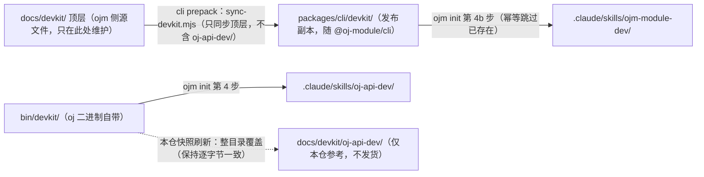

# oj-module DevKit——模块开发手册 + agent skill

面向用 `ojm` 开发前后端一体工程的开发者与 AI agent。本目录是**源文件**，
发布时由 cli 的 `prepack`（`packages/cli/scripts/sync-devkit.mjs`）把其中
**ojm 侧的 6 个文件**同步进 `packages/cli/devkit/`，随 `@oj-module/cli`
发布，再由 `ojm init` 分发到工程内。

整棵树覆盖前后端两侧，但仍是**两套独立分发的 skill**（同名不同物，别混）：

| 侧 | 本仓位置 | 用户工程里的落点 | 分发链 |
|---|---|---|---|
| ojm 模块开发（前端模块、契约、前后端对接） | 本目录顶层 6 个文件 | `.claude/skills/ojm-module-dev/` | `@oj-module/cli` 包 → `ojm init` 第 4b 步 |
| oj API 开发（后端 handler、全局对象、配置、测试） | `oj-api-dev/` 子目录（快照） | `.claude/skills/oj-api-dev/` | **oj 二进制自带**（`bin/devkit/`）→ `ojm init` 第 4 步 |

> **`oj-api-dev/` 子目录是快照，不是本仓维护的文档**：它与本机 oj 的
> `~/.local/share/oj/devkit/`（oj release 下载）逐字节一致，改它没有意义——
> 下次刷新即被覆盖。权威源在 oj 侧；它进本仓只为给框架贡献者一个
> 可 grep 的后端手册副本（后端细节以 oj 发布版为准）。
> 该子目录**不随 cli 包发货**（用户工程从 oj 二进制拿），`sync-devkit.mjs`
> 只同步顶层文件。

## ojm 侧文件（随 cli 包发货）

| 文件 | 用途 |
|---|---|
| `SKILL.md` | Claude Code 等 agent 的 skill 入口：工作流、红线、新模块 checklist、陷阱速查，按章节号引用手册 |
| `manual.md` | 模块开发手册（13 章）：工程结构（module-root 单树 + 两处产物根；含 §1.7 handler 四红线——oj 运行时实测钉出，后端必读；§1.8 `#` 别名与 TS 投影）、写模块、契约与代码生成（含 §3.10 旧 contract.ts 工程迁移指南）、provider 接管（覆盖框架内置功能）、布局、i18n、构建发布、排查、CLI 子命令参考（ojm 原生命令 vs oj 透传命令）、方案包打包与分发（含 §11.1.1 引用式方案）、签名与信任；含 §13.1.1 web.route_prefix 自定义根路径 |
| `framework-dev.md` | 框架贡献者路线（**仅框架仓库**）：改 `packages/runtime`、`packages/cli` 时的入口与红线 |
| `module-dev-and-cdn-playground.md` | 教学文档：开发态 ≠ 分发态、「怎么安装自己的模块 / 会不会重复」、本地 CDN 市场链路五步跑通（setup → publish → build-index → verify → 安装） |
| `sql-builder-missing-capabilities-pr.md` | 构造器能力缺口 PR 参考（**仅框架仓库**）：7 项诉求的闭环记录 |

后端 handler 本身的写法（`json` 信封、`db` 查询、`manifest.yaml`、`oj test`）、
站点挂载（`mounts`）、密钥信封（`secrets`）、vars、cors、schema 校验、broker/tasks/oidc/ws 等
属于 **`oj-api-dev` skill** 的范围——`ojm init` 已把它装到工程的
`.claude/skills/oj-api-dev/`（权威源随 oj 二进制分发，随 oj 版本更新，
本仓副本见上表）。

> **oj v0.1.58 起站点挂载迁移**：`server.api_prefix` / `app_path` / `app_prefix` /
> `static_sites` / `app_spa_fallback` 这五个站点键已被删除，改由顶层 **`mounts:`** 扁平表
> 承载（一行=一个 URL 前缀+一个目录，`api`/`web` 恰好其一）。旧键出现即被 `oj serve` fail-fast 拒绝。
> `ojm init` 模板已是 `mounts:`；oj 侧挂载、密钥信封、vars、cors、schema 校验等完整用法见
> `oj-api-dev` skill 手册。

## oj-api-dev 侧文件（快照，仅本仓参考）

| 文件 | 用途 |
|---|---|
| `SKILL.md` | oj 侧 agent skill 入口（工作流、红线、checklist、陷阱速查） |
| `api-manual.md` | 后端开发手册（13 章）：模块约定、全局对象 API、鉴权租户、测试、配置、构建发布 |
| `scenarios.md` | 场景速查（照抄就能跑） |
| `sql-builder-guide.md` | SQL 构造器专题指引（v0.1.82） |
| `oj-test-guide.md` | `oj test` L1 测试专题指引 |
| `global.d.ts` / `oj-modules.d.ts` | handler 全局对象 TS 类型 + `#` 导入别名 ambient 兜底 |
| `oidc-implementation.md` / `oidc-integration.md` | OIDC 演示走读与集成说明 |
| `README.md` | oj 侧发布索引 + **v0.1.66→v0.1.82 逐版落地记录**（查「某个能力哪版有的」看这里） |

> 注意 `oj-api-dev/README.md` 里「由仓库 `docs/devkit/` 经 `cargo xtask build`
> 归置到 `bin/devkit/`」说的是**上游 oj 仓**的结构，不是本仓——本仓的
> `docs/devkit/` 是 ojm 侧 devkit（你正在读的这个目录）。

## 安装（业务工程）

**方式一（推荐）：`ojm init` 自动分发。** `ojm init` 把两侧 skill 都装进工程的
`.claude/skills/`（ojm 侧来自 cli 包；oj 侧来自 oj 二进制的 `bin/devkit/`，
已存在则幂等跳过）。无需手动拷贝。

**方式二：手动拷贝**（旧工程或不走 init 时）：

```sh
# 本 devkit（ojm 模块开发）：拷入工程的 Claude Code skill 目录
mkdir -p .claude/skills/ojm-module-dev
cp SKILL.md manual.md README.md .claude/skills/ojm-module-dev/

# 后端 API 开发另装 oj 自带的 devkit（独立 skill）：
# 权威源随 oj 二进制分发——本机安装在 ~/.local/share/oj/devkit/，
# 工程内在 bin/devkit/（ojm vendor / init 安装 oj 时一并落盘）
mkdir -p .claude/skills/oj-api-dev
cp ~/.local/share/oj/devkit/SKILL.md ~/.local/share/oj/devkit/api-manual.md .claude/skills/oj-api-dev/
```

安装后 Claude Code 里 `/ojm-module-dev` 或 `/oj-api-dev` 触发，
或直接说「用 ojm-module-dev 加个 xxx 模块」。

## 与 `ojm init` 的关系

两条分发链都接在 `packages/cli/src/init.ts`：

- **第 4 步**：从用户 `bin/devkit/`（oj release 下载）拷 `SKILL.md` /
  `api-manual.md` + 有则拷的 `sql-builder-guide.md` / `oj-test-guide.md` +
  `global.d.ts` → `.claude/skills/oj-api-dev/`；
- **第 4b 步**：从 cli 包内置 `devkit/`（prepack 由本目录顶层同步）拷
  `SKILL.md` / `manual.md` / `README.md` → `.claude/skills/ojm-module-dev/`。



## 更新

- **ojm 侧**：手册与 skill 随 `@oj-module/cli` 版本一起发布；升级 cli 后重跑
  `ojm init` 即可刷新（幂等跳过已存在的文件——若想强制覆盖旧拷贝，先删
  `.claude/skills/ojm-module-dev/` 再 init）。源文件只在仓库 `docs/devkit/` 顶层一处维护。
- **oj 侧**：手册与 skill 随 oj 版本发布；升级 oj 后用新 `bin/devkit/` 覆盖旧拷贝。
  框架贡献者要把本仓快照同步到新版：从 `~/.local/share/oj/devkit/` 整目录覆盖
  `docs/devkit/oj-api-dev/`（10 个文件，保持逐字节一致以便对账）。

> 本目录顶层 6 个文件是**自包含**的：业务工程拿到即可读懂，不需要工程仓库里的
> 其它文档。`oj-api-dev/` 子目录是 oj 侧快照，同样自包含（其自身 README 即索引），
> 但不随 cli 包发货、仅本仓参考。维护者视角的内容来源整理在 `framework-dev.md`（仅本仓）。
