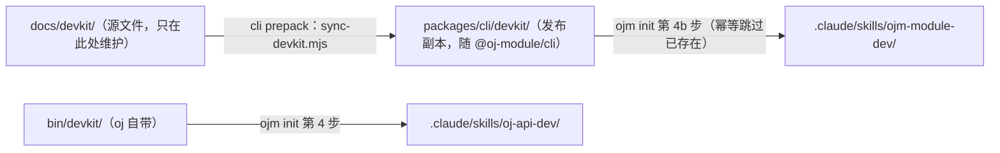

# oj-module DevKit——模块开发手册 + agent skill

面向用 `ojm` 开发前后端一体工程的开发者与 AI agent。本目录是**源文件**，
发布时由 cli 的 `prepack`（`packages/cli/scripts/sync-devkit.mjs`）整目录同步进
`packages/cli/devkit/`，随 `@oj-module/cli` 发布，再由 `ojm init` 分发到工程内。

> 两个 `devkit` 别混：**本目录**（ojm 模块开发）进 cli 包；`bin/devkit/` 是 **oj 自带**
> devkit（`oj-api-dev` skill）在工程里的落点，由 `ojm vendor` / `ojm init` 装 oj 时一并落盘。

它补的是 `oj-api-dev`（oj 后端 API 开发）之外的另一半：**前端模块、契约、
前后端对接**。

> **oj v0.1.58 起站点挂载迁移**：`server.api_prefix` / `app_path` / `app_prefix` /
> `static_sites` / `app_spa_fallback` 这五个站点键已被删除，改由顶层 **`mounts:`** 扁平表
> 承载（一行=一个 URL 前缀+一个目录，`api`/`web` 恰好其一）。旧键出现即被 `oj serve` fail-fast 拒绝。
> `ojm init` 模板已是 `mounts:`；oj 侧挂载、密钥信封、vars、cors、schema 校验等完整用法见
> `oj-api-dev` skill 手册（`ojm init` 装机在 `.claude/skills/oj-api-dev/`）。

| 文件 | 用途 |
|---|---|
| `SKILL.md` | Claude Code 等 agent 的 skill 入口：工作流、红线、新模块 checklist、陷阱速查，按章节号引用手册 |
| `manual.md` | 模块开发手册（12 章）：工程结构（含 §1.7 handler 四红线——oj 运行时实测钉出，后端必读）、写模块、契约与代码生成（含 §3.10 旧 contract.ts 工程迁移指南）、provider 接管（覆盖框架内置功能）、布局、i18n、构建发布、排查、CLI 子命令参考（ojm 原生命令 vs oj 透传命令）、方案包打包与分发、签名与信任 |
| `framework-dev.md` | 框架贡献者路线（**仅框架仓库**）：改 `packages/runtime`、`packages/cli` 时的入口与红线 |

## 安装（业务工程）

**方式一（推荐）：`ojm init` 自动分发。** `ojm init` 会把本 devkit 自动拷进工程的
`.claude/skills/ojm-module-dev/`（与 oj 后端 devkit `oj-api-dev` 一并安装，
已存在则幂等跳过）。无需手动拷贝。

**方式二：手动拷贝**（旧工程或不走 init 时）：

```sh
# 本 devkit（ojm 模块开发）：拷入工程的 Claude Code skill 目录
mkdir -p .claude/skills/ojm-module-dev
cp SKILL.md manual.md README.md .claude/skills/ojm-module-dev/

# 后端 API 开发另装 oj 自带的 devkit（独立 skill，不在此目录内）：
# 权威源随 oj 二进制分发——本机安装在 ~/.local/share/oj/devkit/，
# 工程内在 bin/devkit/（ojm vendor / init 安装 oj 时一并落盘）
mkdir -p .claude/skills/oj-api-dev
cp ~/.local/share/oj/devkit/SKILL.md ~/.local/share/oj/devkit/api-manual.md .claude/skills/oj-api-dev/
```

安装后 Claude Code 里 `/ojm-module-dev` 触发，或直接说「用 ojm-module-dev 加个 xxx 模块」。

## 与 `ojm init` 的关系

`ojm init` 已接入本 devkit 分发（`packages/cli/src/init.ts` 第 4b 步）：从 cli 包内置的
`devkit/`（prepack 由 `docs/devkit/` 同步而来）拷 `SKILL.md` / `manual.md` / `README.md`
到 `.claude/skills/ojm-module-dev/`。发布链路细节见 `framework-dev.md` §7。



## 更新

手册与 skill 随 `@oj-module/cli` 版本一起发布；升级 cli 后重跑 `ojm init` 即可刷新
（幂等跳过已存在的文件——若想强制覆盖旧拷贝，先删 `.claude/skills/ojm-module-dev/` 再 init）。
源文件只在仓库根 `docs/devkit/` 一处维护。

> 本目录（devkit）是**自包含**的：所有内容都在这 4 个文件里，不需要工程仓库里的
> 其它文档即可读懂。维护者视角的内容来源整理在 `framework-dev.md`（仅本仓）。
