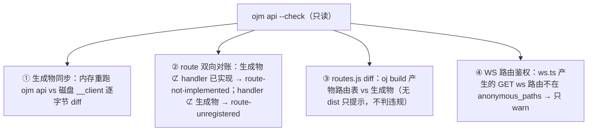
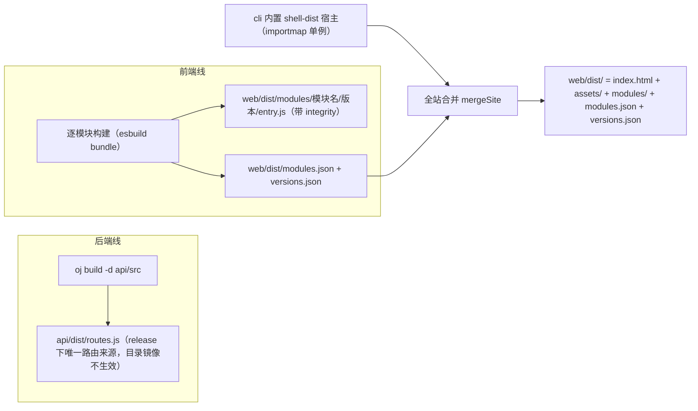
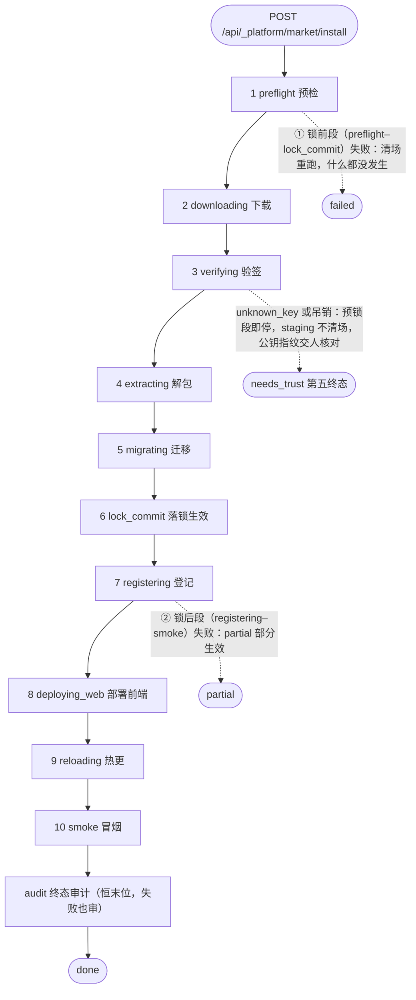
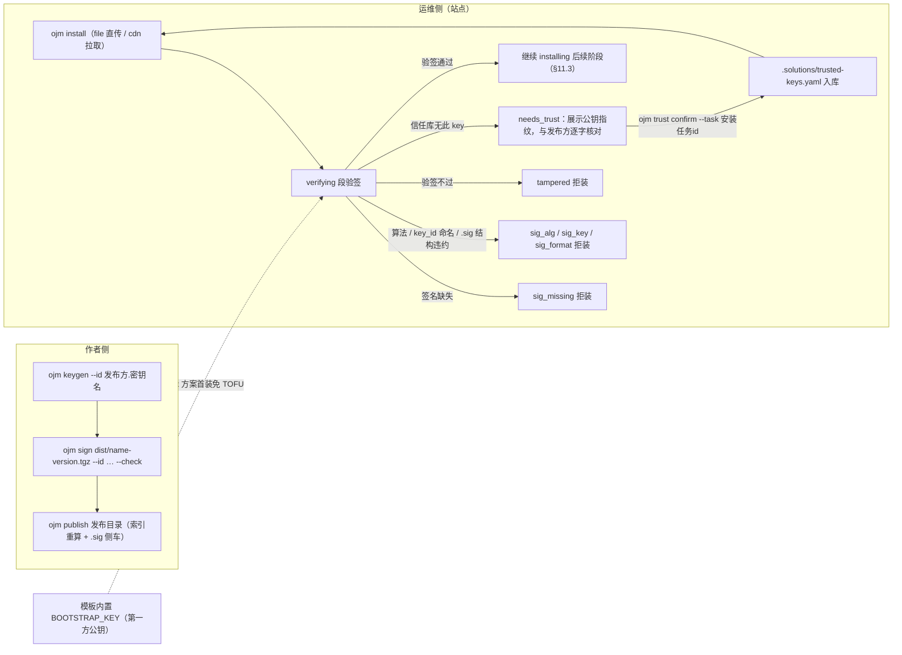

# ojm 模块开发手册

> 面向用 `ojm` 开发前后端一体工程的开发者。
> **按章节号按需读章，不要盲读全文。** 章节目录见文末索引，速查表见 §8。

后端 handler 内部写法（`json` 信封、`db`、`kv`、`jwt`、`manifest.yaml`、`oj test`）
属于 **`oj-api-dev` skill** 的范围；本手册讲的是它到前端这一侧的对接。

---

## §1 工程结构

### 1.1 脚手架产物

`ojm init <目录>` 生成（幂等补缺，重跑只补缺失文件，**永不覆盖已有文件**）。
模板拷贝按 `packages/cli/templates/init.include.yaml` **白名单**执行——未收录的
路径一律不拷（demo-only 演示模块、模板自运行产物都在清单外）：

```
<工程根>/
├── README.md
├── package.json           # scripts: dev / build / preview / info / typecheck；devDeps 钉死真实版本
├── pnpm-workspace.yaml    # 构建审批（esbuild）+ redocly 钉版（init 生成，非模板拷贝）
├── web.config.ts          # 前端模块清单（name + entry）
├── openapi.json           # 契约唯一事实源（oj openapi 产物，模板随附，ojm api --check 开箱即过）
├── tsconfig.json
├── global.d.ts            # 后端 oj 全局对象（db/json/http…）类型声明
├── env.d.ts               # ImportMeta.env 类型补丁
├── .gitignore
├── api/
│   ├── config.yaml        # oj 服务配置（mounts / db / auth / secrets）
│   ├── config/            # 现场签发：证书三件套（private/public.pem + cert.jws）+ secrets 密钥对
│   ├── .ojm-api-exempt.json
│   ├── seed.mysql.sql / seed.pg.sql
│   ├── vitest.config.ts
│   ├── tests/             # 后端 BDD 测试（node:sqlite 内存库 + 真实迁移建表）
│   └── src/
│       ├── _platform/     # 框架级：users 表 / rbac / 市场编排 / 生命周期
│       ├── auth/          # login / refresh / logout / ldap-login
│       ├── notification/  # 通知互动（表 + push + del）
│       ├── notifications/ # root 级 /api/notifications（通知铃的后备实现）
│       ├── personal-center/ # 头像上传
│       ├── system/        # 用户 / 角色 / 权限 / 设置 / oplog / login-methods
│       └── web/           # hello / user-info / get-async-routes
├── web/
│   └── src/
│       ├── home/ demo/ login/          # 带页面模块（home/login 不可少，见 SKILL 红线）
│       ├── personal-center/ notification/ system/  # 其余默认前端模块
│       ├── _platform/ auth/ notifications/ web/     # 仅 __client 生成物（无页面）
│       └── styles.css
├── bin/                   # oj 二进制 + plugins/ + devkit/（不入库）
└── .claude/skills/        # ojm-module-dev（本 devkit）+ oj-api-dev（随 oj 二进制）
```

> 模板里还有一批 demo-only 模块（`api/src/{demo,home}`、`web/src/{about,access,
> exception,outside,route-nest,oj-market}`）仅供模板自演示，**不进脚手架**；
> 其 `web.config.ts` 条目带 `// #region demo-only` 标记，init 拷贝时整段剥离。

登录账号 `admin / 123456`。端口：前端 devServer **5174**，oj 后端 **9778**
（以 `api/config.yaml` 的 `server.port` 为准）。

### 1.2 两个模块体系，同名不同物

前后端各有自己的"模块"，目录名一致是**约定**（契约会强制校验：apiPrefix 必须字面等于后端目录名）：

| | 前端模块 | 后端模块 |
|---|---|---|
| 位置 | `web/src/<模块>/` | `api/src/<模块>/` |
| 入口 | `entry.ts`（`defineModule`） | `manifest.yaml` |
| 加接口 | 消费生成的 client | 写 `api.ts` handler |
| 注册处 | `web.config.ts` | 目录存在即注册（无需清单） |

### 1.3 后端路由 = 目录镜像

```
api/src/<模块>/<路径...>/api.ts   →   /api/<模块>/<路径...>
```

`api/src/web/hello/api.ts` → `GET|POST /api/web/hello`。
`api.ts` 默认导出一个对象，**方法名就是 HTTP 方法名**：
`get/post/put/patch/del`（注意是 `del`，**不是 `delete`**——写成 `delete` 返回 405）。

### 1.4 重启边界（最容易卡住新人的一点）

| 改动 | 生效方式 |
|---|---|
| 已有 `api.ts` 的**文件内容** | 保存即热更 |
| **新增/删除**后端模块目录 | **必须重启 `ojm dev`** |
| 改 `schema.yaml` / `migrations/` / `config.yaml` | **必须重启** |
| 前端 `web/src/**` | 模块重建 + 浏览器自动刷新 |

### 1.5 建一张新表：三个文件，缺一不可

新手最容易在这里少写文件——**加表不是只写 `schema.yaml`**。给一个模块加表要动三处：

| 文件 | 角色 | 规矩 |
|---|---|---|
| `api/src/<模块>/migrations/{seq:04}__{desc}.sql` | **DDL 的真正定义（实际 SQL）** | **DDL 只能写在 migrations 里**。序号连续且唯一，`CREATE TABLE IF NOT EXISTS` |
| `api/src/<模块>/schema.yaml` | 声明式表结构（供归属图与列白名单使用） | 列名、null 性、默认值要与 migration **逐字段一致** |
| `api/src/<模块>/manifest.yaml` | `tables: [表名]` | **与 `schema.yaml` 双向一致**（约定），只写一边启动即失败 |

> 少了 migration → 表根本建不出来；少了 `schema.yaml` / `manifest.tables`
> → 启动归属校验失败，且任何经 `db.table("<表名>")` 访问该表的代码都会被 oj 的 DB 构造器以
> `unknown table` 拒绝（2026-10-19 演练实踩：仅由迁移建表、未声明的 `sys_rate_window` /
> `sys_login_throttle` 导致登录恒 500）；两边列定义漂移 → reconcile 报差异（`oj schema diff` 可见）。

### 1.6 迁移与 seed 的应用时机

| 文件 | 何时生效 |
|---|---|
| `migrations/*.sql` | 启动（dev `migrate_on_start: auto`）；release 默认 `verify`，账本落后则**拒绝启动** |
| `seed.sql` | **每次启动都重放**（sqlite 默认库）——必须幂等，用 `INSERT OR IGNORE` |
| `schema.yaml` | 声明；加可空列 / 加表 reconcile 能收敛，但**改类型与改名必须走 migrations** |

> `seed.sql` 按 `;` 朴素切分，**注释里不许出现分号字面量**，否则语法错。

### 1.7 handler 四红线（oj 运行时实测钉出，2026-10-16 RBAC 阶段）

以下四条都是真机冒烟（`ojm init` + `ojm dev`/`build`）实测钉出的 oj 运行时行为，
**dev 模式体感正常、一到构建/并发就炸**——vitest 直引 service 的测试结构性覆盖不到，
提交前必查。逐条展开：

1. **未捕获异常恒 500，不读 `err.status`。** handler 抛出任何异常，oj 运行时一律回
   `{"code":500,"msg":"Error: ..."}`——你在 service 层精心设计的 401/403/409 全被抹平。
   **红线**：handler 业务体必须收口成 `json.fail(status, msg, extra?)`；模板统一约定
   `_platform/_shared/respond.ts` 的 `respond(fn)`——service 抛 `Error & {status?, ...extra}`，
   handler 写 `await respond(async () => { ...; return data; })` 即自动映射
   （extra = error 的 own 可枚举属性除去 `status`/`message`，进信封 `data`）。
2. **相对 import 按「目录」解析，不是按文件层级。** 路由加载器以**含 `api.ts` 的目录**
   为基准解析相对路径——多写一层 `../` 在 dev 日志里是 route error（模块像没注册），
   vitest 直引 service 永远发现不了。正确深度：

   | 文件位置 | 到 `_platform/_shared` 的写法 |
   |---|---|
   | `api/src/system/<x>/api.ts` | `../../_platform/_shared/...` |
   | `api/src/system/<x>/<y>/api.ts` | `../../../_platform/_shared/...` |
   | `api/src/auth/api.ts` | `../_platform/_shared/...` |
   | `api/src/auth/<z>/api.ts` | `../../_platform/_shared/...` |
   | `api/src/_platform/<x>/api.ts` | `../_shared/...` |
   | `api/src/_platform/<x>/<y>/api.ts` | `../../_shared/...` |
3. **模块级可变状态不跨请求存活。** oj **每请求重建 handler 模块实例**（实测：模块级
   计数器连打三次恒为初值）——`let` / `Map` / `Set` 级状态一律视为**单请求作用域**。
   需要跨请求的状态（限速、节流、去重窗口、判权缓存）**必须落库**或走 oj 持久面。
   模板先例：迁移 `0009__sys_throttle`（`sys_login_throttle` 连败节流 +
   `sys_rate_window` 滑动窗口，三方言）。别想着「先内存后 Redis」——内存方案在 oj 下
   连单实例都跑不对。
4. **`oj build` 的 introspect 在无运行时配置的空沙箱里评估模块。** 构建期会加载
   handler 模块提取 `.schema`，此时 `jwt` / `axis` 等运行时全局**不存在**——模块级
   任何触碰运行时全局的语句（`createSession()`、`axis("ldap")`、`bcrypt.xxx`）
   直接炸构建：`introspect api.ts: Error: jwt not configured`。**红线**：handler 模块
   顶部只许 import 与纯常量声明；一切运行时全局的取用移进 handler 函数体内按需执行
   （无状态构造是纯闭包，每请求新建零成本）。

---

## §2 写前端模块

### 2.1 目录

```
web/src/<模块名>/
├── entry.ts          # 元数据唯一来源（没有 package.json / meta.json）
├── pages/            # 页面组件（按需）
├── locales/          # zh-CN.json / en-US.json（按需）
└── __client/         # ojm api 生成物（勿手改）
```

### 2.2 两步缺一不可

1. **有文件**：`web/src/<模块>/entry.ts` 默认导出 `defineModule({...})`；
2. **去登记**：工程根 `web.config.ts` 的 `modules` 数组加一项。

> 模板真出过这个 bug：模块文件都在，就是忘了登记，结果模块安静地没加载、
> 按钮安静地灰着，**全程没有一个报错**。写完模块第一件事就是检查 `web.config.ts`。

**建档顺序很重要**（有接口的模块）：先写 handler 的 `.schema` → 跑 `oj openapi` + `ojm api` → 再写 `entry.ts`。
生成前 `import { createXxxClient } from "./__client/api"` 必然 ts 报红，
那不是你写错了，是产物还没生成。完整流水线见 §3.4。

```ts
// web.config.ts
export default {
	baseUrl: "", // 模块产物 URL 前缀（可填 CDN 绝对域）；与站点部署位置无关
	// siteBase: "/oj", // 站点挂在 https://host/oj/ 下时才需要（默认根路径），见 §13 的路径空间一节
	modules: [
		// home 必须保留且尽量靠前：shell 预构建把 "/" → VITE_BASE_HOME_PATH（=/home）
		// 重定向，缺 /home 路由会让登录回跳 / 点 logo 落错误边界。
		{ name: "home", entry: "web/src/home/entry.ts", enabled: true },
		// login 必须保留：shell 宿主只消费模块路由、不挂 runtime 内置 baseRoutes，
		// 缺它 `/login` 无路由可跳（登出会落空）。
		{ name: "login", entry: "web/src/login/entry.ts", enabled: true },
		{ name: "books", entry: "web/src/books/entry.ts", enabled: true },
	],
};
```

**清单先后顺序 = 接管优先级**（§4.2）。

### 2.3 entry.ts 形状

```ts
import { BookOutlined } from "@ant-design/icons";
import { defineModule } from "@oj-module/runtime";
import { createElement, lazy } from "react";

import { createBooksClient } from "./__client/api";

const Books = lazy(() => import("./pages/index"));

export default defineModule({
	name: "books",
	description: "图书管理",
	version: "0.1.0",
	peerRuntime: ">=0.1.0",        // 声明兼容的宿主 runtime 版本
	routes: [
		{
			path: "/books",
			handle: {
				layout: "container",       // ⚠️ 布局级路由必填（见 §5.1）
				order: 5,                  // 菜单排序（≥0 主区升序；<0 入侧边栏底部固定区）
				title: "books:menu.books", // 命名空间语法 "<模块名>:<key>"
				icon: createElement(BookOutlined),
			},
			children: [
				{
					index: true,
					Component: Books,
					handle: { title: "books:menu.books", keepAlive: true },
				},
			],
		},
	],
	i18n: {
		"zh-CN": () => import("./locales/zh-CN.json"),
		"en-US": () => import("./locales/en-US.json"),
	},
	lifecycle: {
		async onInit(ctx) {
			createBooksClient(ctx);   // 构造即完成对接（连通），见 §3.4
		},
	},
});
```

`defineModule` 字段：`name`（= 目录名）、`description`、`version`、
`peerRuntime`、`routes`、`i18n?`、`lifecycle?`。

> 页面组件用**静态 import 或 `lazy()` 都行**：模板（`templates/web/src/*/entry.ts`）
> 用静态 import，多页面模块可对非首屏页面用 `lazy(() => import("./pages/x"))` 做代码分割。
> 单个页面就用静态 import，少一层间接。

### 2.4 路由 handle 字段（RouteMeta）

| 字段 | 说明 |
|---|---|
| `layout` | `"container"`（完整壳）\| `"parent"`（嵌套父级）\| `"fullscreen"`（全屏）\| `"none"`（默认，裸渲染）\| 自定义名（§5） |
| `order` | 菜单排序值（双段序轴）：`≥0` 主菜单区升序；`<0` 底部固定区（pin 在侧边栏底部，区内仍按 order 升序）；未声明按登记下标兜底；同 order 按根 path 字母序 |
| `title` | 菜单标题，用 `"<模块名>:menu.<key>"` |
| `icon` | `createElement(XxxOutlined)` |
| `keepAlive` | 页面缓存（**必须挂在 `layout: "container"` 下才生效**） |
| `hideInMenu` | 不在菜单显示 |
| `roles` / `permissions` | 路由级权限（页面级 / 按钮级） |
| `iframeLink` | 内嵌 iframe 的外链地址 |

> 另有**模块级** `config.requiredRoles` / `config.requiredPermissions`——它在路由
> **注入之前**就筛掉（模块级权限在路由注入前过滤），与上面的路由级 `roles` / `permissions` 不是一回事。

### 2.5 无页面模块

只接管框架功能、没有页面的模块（如通知）：`routes: []`，甚至整个 `lifecycle` 都可省略。

### 2.6 前端模块能 import 什么

**只有三类**：

1. `@oj-module/runtime`（含 `/contract`、`/contract/errors` 子路径）；
2. 宿主 **importmap 提供的共享依赖**；
3. 自身相对路径。

框架内部的 `#src/*` 在构建期被拦。共享依赖由宿主提供**单例**，
模块工程**不得**打包自己的副本——只在 `devDependencies` 里对齐版本（供 `tsc` 用）。

共享依赖矩阵关键项：`react`、`react-dom`、`react-router`、`@tanstack/react-query`、
`antd`（含 `locale/*`）、`@ant-design/icons`、`@ant-design/pro-components`、
`i18next`、`react-i18next`、`zustand`、`dayjs`、`echarts`、`echarts-for-react`、
`motion`、`@dnd-kit/*`、`keepalive-for-react`、`simplebar-react`、`nprogress`、
`react-countup`、`ahooks`、`ky`、`clsx`、`tailwind-merge`、`pinyin-pro`、`vditor`。
查实际矩阵：`pnpm exec ojm info`。

#### vditor（Markdown 编辑器，软共享）

模块侧写法不变：`import Vditor from "vditor"` + `import "vditor/dist/index.css"`。
两个说明符均由宿主 importmap 供包（`/assets/vditor.js`、`/assets/vditor-index-css.js`），
模块**不得**再把 vditor 写进 `dependencies` 自打包——放 `devDependencies` 对齐版本供 `tsc` 用。
资产惰性加载：importmap 只做映射，宿主自身不 import vditor，`/assets/vditor.js` 仅在
模块产物真正 import 它（进编辑器页）时才被浏览器拉取，不进宿主首屏。

注意：vditor 运行期还要按需加载 lute / i18n / 图标 / 主题 CSS 等资源（默认走第三方 CDN，
宿主 CSP 通常不放行）。这部分**不随共享资产分发**，由模块自行处理（自注入或指向宿主
可服务的同源路径）。直接 `import "vditor/dist/..."` 其它深路径会命中前缀 external 但无
importmap 键，构建期报错——需要新深路径请联系框架方在共享表登记。

### 2.7 本版本共享依赖钉版（0.2.8 快照）

宿主经 importmap 提供以下单例（模块 `devDependencies` 须对齐，供 `tsc` 用）；完整 68 项矩阵以
`pnpm exec ojm info` 或 `packages/cli/shell-dist/versions.json`（构建期生成）为准。

| 包 | 钉版 |
| --- | --- |
| `react` / `react-dom` | 19.2.8 |
| `react-router` | 7.18.2 |
| `@tanstack/react-query` | 5.102.8 |
| `antd` | 6.6.1 |
| `@ant-design/icons` | 6.3.2 |
| `@ant-design/pro-components` | 3.1.12-0 |
| `i18next` / `react-i18next` | 26.4.0 / 17.0.12 |
| `zustand` | 5.0.15 |
| `dayjs` | 1.11.23 |
| `echarts` / `echarts-for-react` | 6.1.0 / 3.0.6 |
| `motion` | 12.43.0 |
| `@dnd-kit/core` | 6.3.1 |
| `keepalive-for-react` | 5.0.11 |
| `simplebar-react` | 3.3.2 |
| `nprogress` | 0.2.0 |
| `react-countup` | 6.5.3 |
| `ahooks` | 3.9.7 |
| `ky` | 2.0.2 |
| `clsx` / `tailwind-merge` | 2.1.1 / 3.6.0 |
| `pinyin-pro` | 3.29.3 |
| `vditor` | 4.0.0 |

框架包版本：`@oj-module/runtime` / `@oj-module/cli` 为 `0.2.8`（**双包 lockstep**）；
`@plane/kit` / `@plane/editor` 是独立版本线（当前 `0.1.20`，随宿主 importmap 提供，
不参与 lockstep）。`oj` 二进制最低版本门禁 `MIN_OJ_VERSION = 0.1.73`——契约流水线要求
oj ≥ 0.1.73：平级 `.response` 出参声明位自 v0.1.72 起、`oj openapi` 的 `del`→`delete`
操作键归一自 v0.1.73 起（低版本 oj 生成 `openapi.json` 会丢出参类型或产出非法
`"del"` 键，`ojm api --check` 必漂移）。

> **`@oj-module/runtime` 到底导出哪些东西？** 权威清单随包发布在
> `node_modules/@oj-module/runtime/dist/index.d.ts`——直接 Read 它，或在编辑器里
> 对 `from "@oj-module/runtime"` 用「跳转到定义 / 自动补全」。**别靠猜**：
> `BasicContent` / `BasicTable` / `AccessControl` / `useAuthStore` / `useUserStore` /
> `usePreferences` / `useTabsStore` 都在里面（详见 §6.3）。猜不到的常见后果是白白退回 antd 原生
> `Table` 重新造轮子。

---

### 2.8 模块如何获取用户/角色等信息（读与写的边界）

模块常要读当前用户、角色、权限，甚至写改密/改角色。**正确姿势是走框架的「公共出口 + 契约客户端」，而不是 import 框架源码**——后者会把 runtime 内部实现打进模块 bundle，造成编译夹带、双份 store / 双 React、版本不一致。本节讲清楚边界与红线。

**读（用户/角色/权限）→ 用 `@oj-module/runtime` 导出的公共 hook/store**

这些是框架写入的同一份 zustand 单例，模块订阅即拿到实时状态，无需自己再拉一份：

- `useUserStore`：当前用户画像（`username` / `roles` / `permissions` / `email` …）；
- `useAuthStore`：`token`、登录/登出（`login` / `logout`）；
- `useAccess` + `AccessControl` 组件：基于 `roles` / `permissions` 的按钮/菜单门禁，别自己拿 `roles` 数组手算；
- 其它：`usePreferences`、`useTabsStore`、`useSlotNodes`（§5.5）等。

```ts
import { useUserStore, useAccess, AccessControl } from "@oj-module/runtime";

const roles = useUserStore(s => s.roles);
// 或按权限门禁：<AccessControl permission="system:users:read"><Button>用户管理</Button></AccessControl>
```

**写（改密/改角色/改设置）→ 走契约 API client，不碰框架内部**

- 框架已把 `auth/*`、`system/*`、`web/*` 等端点经 OpenAPI 契约定义，并从 `@oj-module/runtime` 导出类型化 fetch（如 `api/rbac` 的 `fetchChangePassword`、`fetchRbacUpdateUserRoles`，`api/user` 的 `fetchUserInfo`）。要调框架内置写接口，直接复用这些导出。**但更推荐模块 own 自己的契约**：在**自己模块的 handler 动词**上写 `.schema`，跑 `oj openapi` + `ojm api` 生成 `web/src/<模块>/__client/api.ts`，模块经自己的 client 调框架端点——接口由契约（versioned OpenAPI）对齐，而非把框架源文件打进来。
- 底层都走同一个 `request` 单例 + 契约 URL；模块侧请求被 `defineModule` 的 `ctx` 收敛到登记过的 `apiPrefix`，越界 / `../` 穿越 / 逐请求 prefix 覆盖均被拒（请求边界见 §2.6 + `tests/runtime/scoped-request.test.ts`）。

**场景：模块记录自己的操作日志（写端）**

解决方案模块经常要审计自身的关键写操作（建单、改配置、删资源…）。**正确姿势：调 runtime 导出的 `fetchRbacOplogPost`，绝不在模块里 import 框架 `#src/audit` 的 `recordOp`**（那是框架内部，违反 §2.6 红线，且模块 bundle 会被夹带框架实现）。

```ts
import { fetchRbacOplogPost } from "@oj-module/runtime";

// 在模块自己的写操作成功后调用；module 取本模块名（defineModule 的 name），
// 用于后端按模块收敛查询与隔离；detail 脱敏红线：不得含口令 / 密钥 / token。
await fetchRbacOplogPost({
	action: "order.create",
	module: "order",              // 本模块名，非 "framework"
	target: String(orderId),
	detail: { sku, qty },
});
```

- 后端 `POST /api/system/oplog` 由框架提供，登录态即可写入（审计面向当前用户，非仅管理员）；`user_id` / `username` 由请求上下文自动落库，调用方无需传。
- 读取走 `fetchRbacOplog`（管理面 `system/oplog` 页，admin 可见）；模块自身只写不读自己的审计流。
- `module` 是隔离锚点：跨模块写别家审计流必须由后端按 `module` 收敛，前端传错模块名不会污染他模块数据。

**为什么不会「版本不一致」**

宿主（cli 内置 `shell-dist`）把 `react` / `antd` / `runtime` 等共享依赖预打包、经 importmap 提供**单例**——宿主与所有模块命中同一份实例。所以模块的 `useUserStore` 和框架的是**同一个 store**，antd `ConfigProvider` 也只有一个：不会出现两份 React / 两份 store 状态不同步。共享依赖版本以 `catalog:` 单一真相钉死（见 §2.7），模块只在 `devDependencies` 对齐版本供 `tsc` 用。

**红线**

- **绝不 `import … from "#src/*"`**：构建期直接拦（§2.6）。模块只 import 三类（§2.6）。
- **`@oj-module/runtime` 的出口是冻结契约**：有 `tests/runtime/runtime-exports.test.ts` 守护，加/删导出即红，属破坏性变更。要用的东西若在出口里没有，**提需求让它进公共出口**，别改成 import 框架内部——否则一发版就碎。
- 需要框架没暴露的能力（如接管某内置功能），走 §4 的 provider 接管，而非源码 import。

## §3 契约与代码生成

### 3.1 一句话

新版「契约代码生成」的**唯一权威源是 `oj` handler 上的 `.schema`（入参）+ `.response`（出参）**，
不再有 `contract.ts` / `defineApi`（旧 DSL + zod 翻译层已退役删除）。开发者在 handler 上手写
`.schema`（JSON Schema 严格子集）与平级 `.response`（`json.ok(data)` 的 data 载荷），
`oj v0.1.73+` 的 `oj openapi` 运行期内省并产出 `openapi.json`（OpenAPI 3.1，落工程根）；
`ojm api` 消费它生成前端 `__client`。整条链路：

```
oj handler .schema（入参，手写）+ .response（出参，平级）——唯一权威源
        │  oj 内省（含组级 .schema / .response 继承合并）
        ▼
oj openapi -c config -d api/src -b /api -o openapi.json   →  OpenAPI 3.1
        │
        ▼
ojm api   →  irFromOpenapi  →  emitZodFromJsonSchema / emitClient
        │
        ▼
web/<模块>/__client/{api.ts, api.schemas.ts}（+ stub / mock）
```

`openapi.json` 即权威文档源，`ojm api --docs` 直接聚合它渲染文档站。`.schema` / `.response`
写法、与 zod 表达力对照等后端侧细节见 `oj-api-dev` skill 的手册（`ojm init` 已装机在
`.claude/skills/oj-api-dev/`，随 oj 二进制更新）的「入参与出参契约 `.schema`」章节；
本文只讲它到前端这一侧的对接。

> 版本要求：平级 `.response` 声明位自 **oj v0.1.72** 起支持；`oj openapi` 把 `del` 动词归一为
> `delete` 操作键自 **v0.1.73** 起（含 `del` 端点的工程须 ≥ 0.1.73，否则 `--check` 必漂移）。
> 旧 `.schema.response` 写法继续生效（存量零破坏），新工程一律用平级 `.response`。

> 旧 `contract.ts` / `defineApi` 工程：翻译层已删除，`ojm api` **不再兼容读取** `contract.ts`
> （找不到 `openapi.json` 即报错）。迁移方法见 **§3.10**（本手册自包含迁移指南）。

### 3.2 产物落点（新口径）

| 工程形态 | 权威源 | 产物流向 |
|---|---|---|
| **uni-dev**（前后端一体，推荐） | 后端 `api/src/<模块>/**/api.ts` 上的 `.schema` | `web/src/<模块>/__client/{api.ts, api.schemas.ts}`（由 `ojm api` 消费 `openapi.json` 生成）；stub → `api/src/<模块>/<路径>/api.ts`（未实现 handler 时补骨架） |
| 纯前端 | 仅消费他人 `openapi.json` | `__client/` 全部落前端侧，无 stub |

`openapi.json` 是项目级单文件、含全部模块，由 `oj openapi` 产出，ojm 不再自产 `routes.json` /
`openapi.yaml`。

**硬约束**：模块目录名即 API 前缀来源——`api/src/order/**` → 线上前缀 `/order`（与旧 `apiPrefix`
字面相等约束同源，只是现在由目录名推导，不再手写字段）。不符即人话报错。

> 工程里有两个 "web"：前端 `web/`，与后端 `api/src/web/`（提供 user-info 等内置接口）。
> 豁免清单里的 `"modules": ["web"]` 指的是**后者**。

### 3.3 handler `.schema`（入参）+ `.response`（出参）写法（JSON Schema 子集）

> 旧 `defineApi` / `contract.ts` 已删除。现在契约直接写在 oj handler 的动词上——这是唯一权威源。

每个动词（含嵌套组动词、子目录 handler）挂 `.schema` 放**入参**（三通道，对应旧
`params/query/body`）；**出参**走与 `.schema` 平级的 `.response`（oj v0.1.72+，对应旧
`defineApi` 的 `data`）：

```ts
// api/src/order/list/api.ts（oj v0.1.72+ 写法，.schema / .response 手写，勿由工具生成）
function get() {
	// ...业务逻辑，json.ok(...) / json.fail(...)
}
get.schema = {
	query: {                       // 入参 query（旧 defineApi 的 query）
		type: "object",
		required: ["page"],
		properties: { page: { type: "number", minimum: 1 } },
	},
};
get.response = {                  // 出参 data 载荷（旧 defineApi 的 data），与 .schema 平级
	type: "object",
	properties: { list: { type: "array", items: { type: "object" } }, total: { type: "number" } },
};

export default { get };
```

`.schema` 入参三通道：

| 通道 | 含义 | 对应旧字段 |
|---|---|---|
| `params` | 路径参数（与 route 的 `{id}` 段对应） | `params` |
| `query` | URL query | `query` |
| `body` | JSON 请求体 | `body` |

`.response`（平级）语义与旧 `.schema.response` 完全相同：响应 `data` 载荷（信封
`code/msg/data` 由 oj 自动包裹），对应旧 `data`。**优先级**（高 → 低）：动词 `.response` >
组 `.response` > 动词 `.schema.response` > 组 `.schema.response`；组级沿嵌套层层继承。
⚠️ 保留键：组对象上的 `response` 被当声明读走，不能用来命名嵌套子组（与 `schema`/`route` 相同）。

**`.schema` 是 oj JSON Schema 白名单子集**，关键字仅限：
`type / required / properties / items / additionalProperties / minimum / maximum /
minLength / maxLength / pattern / enum / nullable / minItems / maxItems / default`。
白名单外关键字（`$ref` / `oneOf` / `format` / `transform` 等）**fail-fast**，不静默降级。

- **`pattern` 是 Rust regex**：oj 运行期用于校验；ojm 生成前端 zod 时**不进运行时**
  （跨语言语义漂移 + ReDoS 风险），仅发 `// @oj-warn` 注释。需严格校验请下移到 handler。
- **`default` 不射前端 zod `.default()`**：oj 运行期不为缺参补默认值；前端若补会让可选字段
  变必填、掩盖契约漂移。仅发 `// @oj-note` 注释。
- **`nullable` / 类型数组**：`{ type: ["string", "null"] }` → 前端 `z.string().nullable()`；
  表达 union（如 `z.union([z.string(), z.number()])`）用类型数组 `["string", "number"]`
  （oj 白名单不支持 `oneOf`/`anyOf`）。
- **`additionalProperties: false`** → 前端 `.strict()`；`true` → `.catchall(z.unknown())`。
- 所有动态键名 / 枚举值经 `JSON.stringify` 字面量注入，防注入。

**端点方法名 / 类型名来自 `operationId`**（oj 由「去 base 子路径 + 方法」派生，非字母数字转 `_`）：
`order/list` + `get` → `order_list_get` → 前端 `orderListGet`、`OrderListGetData`、
`OrderListGetQuery` 等。这与旧 `defineApi` 的人类命名（`listBooks`）不同，迁移时用「逐字节比对」
识别为丢失面（见 §3.10）。

**上传文件（multipart/form-data）**：当前 `ojm api` 的 openapi 流水线**不生成** form 通道的
前端 client（文件部件是二进制，不进 JSON Schema）。惯例走 antd `Upload` **直连**后端
（不经 JSON client），handler 用 `http.files` / `http.file(i)` 读字节，仅平级声明
`.response`（见 `api/src/personal-center/upload/api.ts` 范本）。

**不要手写 `content-type`**：运行时（ky）见到 `FormData` 会自己补 `multipart/form-data;
boundary=…`，手写反而丢 boundary。

> 不返回数据的接口：**省略 `.response`** 声明（而非写空对象）。校验一律放后端（`.schema` 在 oj
> 侧于 handler 调用前校验入参，违反即 `400`，handler 不被调用）。

### 3.4 生成物使用契约

生成的 `web/src/<模块>/__client/api.ts` 导出：

- 裸请求函数（`fetchNotifications`、`markRead`…）——**直接 import 调用**；
- `API_PREFIX` 常量——契约前缀的唯一真源；
- `create<Module>Client(ctx)` 工厂——**构造即完成对接（连通）**，一行完成两件事：
  登记 `apiPrefix` + 把圈好前缀的 `ctx.utils.request` 绑给 client。

```ts
// entry.ts 的 onInit 里，创建一次
const booksClient = createBooksClient(ctx);
```

**关键约束**：

- **一模块一 client**，只在 `onInit` 创建一次。页面/组件/事件回调里**不要再创建**——
  生成物内部是 `let req` 单槽，后创建者覆盖先创建者。
- 创建后请求自动走 `/api/<前缀>/...`。**越界**调别家模块或 root 级接口、
  `../` 向外穿越、逐请求覆盖 prefix，都在发请求**之前**被客户端拒绝（前端请求前缀收敛校验）。
- 忘创建就调裸函数 → 人话报错「请求未绑定」，指路 `create<Module>Client(ctx)`。
- 重复构造幂等安全；`onInit` 每模块只跑一次（HMR / StrictMode 不重复执行）。

> **生成 ≠ 使用。** `ojm api` 为 **openapi.json 里出现的每个模块**（`tags[0]`）生成
> `web/src/<模块>/__client/`，**不看有没有人 import**。所以「handler 在、`__client/`
> 目录却不在」只有一种解释：那个模块的 `__client/` 从没生成过（模板里的
> personal-center 上传走 antd Upload 直连，不经过 JSON client，故没人 import 它的 `__client`）。
> 你在自己工程跑一次 `ojm api`，它就会出现。
> 判断某模块**要不要用** client 的标准只有一个：代码里有没有人 import `./__client/api`。
> 有就在 onInit 里 `create<Module>Client(ctx)` 一次；没有就什么都不写，
> 生成了但没人 import 也不报错。

> **只能创建（绑定）自己模块的 client。** 工厂构造时核对 `ctx.module.name` 与契约前缀；
> 在 A 的 onInit 里创建 B 的 client，DEV 控制台警告「模块 A 正在为 /b 路径创建 client（越界）」。
> 跨模块创建别的模块的 client 会共享同一个 request 单槽，且 A 被卸载时 B 的 client 跟着断线。
> 要用别家的接口，正路是 **B 自己创建 client、通过 provider 提供能力，A 消费 provider**。

### 3.5 生成物勿手改

`__client/api.ts`、`__client/api.schemas.ts` **重跑即覆盖**（eslint 已忽略这些路径）。
改需求 = 改 handler 的 `.schema`（或路由），重跑 `oj openapi` + `ojm api`。

**唯一例外：stub。** `api/src/**/api.ts` 的 stub 文件头带指纹
（`// ojm-api:stub <name> sha256:...`）。人碰过的 stub，工具**永不写永不删**——
实现 handler 就是在 stub 里填业务逻辑（`.schema` 由开发者手写，工具不注入）。

生成是**幂等**的：内容逐字节比对，无变化不写盘，重复跑 `ojm api` 的 git diff 为空。

命名规则：生成的函数名 = `camelCase(operationId)`（如 `orderListGet`）；类型名 =
PascalCase(operationId) + `Query` / `Params` / `Body` / `Data`
（`OrderListGetQuery`、`OrderListGetData` 等）。这与旧 `defineApi` 的人类导出名（`listBooks`）
不同。

### 3.6 命令

```bash
# 1) oj 产出 OpenAPI 规范（base 从 config 的 api 挂载前缀读；dev 用 -d api/src 内省）
oj openapi -c api/config.yaml -d api/src -b /api -o openapi.json
# 2) ojm 消费生成前端 __client（按 tags[0] 分组到各模块）
pnpm exec ojm api
# 3) 校验同步 / route 双向对账（只读）
pnpm exec ojm api --check
# 4) 聚合 openapi.json → redoc 静态文档站
pnpm exec ojm api --docs
```

> `oj openapi` 是 **oj 透传命令**（ojm 自动补 `-c api/config.yaml`），参数照 oj 原版语义。
> 找不到 `openapi.json` 时 `ojm api` 直接报错指引先跑 `oj openapi`（旧 `contract.ts` 不兼容读取）。

`--check` 对四件事（只读，绝不写盘、绝不修文件）：



1. **生成物同步（artifact-stale）**：内存重跑 `ojm api` vs 磁盘逐字节 diff（`__client/{api.ts,api.schemas.ts}`）；
2. **route 双向对账**：生成物端点 ⊄ handler 已实现表 → `route-not-implemented`；handler 表 ⊄ 生成物 → `route-unregistered`（参数段不一致 error）；
3. **`routes.js` diff**：`oj build` 产物路由表 vs 生成物；无 dist 给提示不判违规；
4. **WS 路由鉴权**：目录里的 `ws.ts` 会产生 `GET {base}/<模块>/<路径>/ws`——oj v0.1.30 起
   WS 握手也过鉴权守卫，不在 `auth.anonymous_paths` 里的 WS 会让未带凭据的客户端握手 401
   （表现为「文件在却连不上」）。只 warn（带 Bearer/Cookie 的受保护 WS 是正当用法）；
   读不到 config 就不判。

`ojm dev` 内置 `openapi.json` 变更 watch：规范变更 → 自动重跑 `ojm api` → 产物写入 `web/` 树
触发模块重建 + 浏览器刷新。改完 handler `.schema` 需先重跑 `oj openapi` 更新规范。

> ⚠️ **新模块目录的诞生不在 watch 范围**——新建后端模块目录要先重启
> `ojm dev`（目录注册发生在启动期），之后该模块的 `.schema` 改动才走热更。

### 3.7 后端入参契约（`.schema`，v0.1.44+ 手写）

`.schema` 是**开发者手写**在 handler 动词上的（见 §3.3），oj 在 **JS 之前**校验入参：违反即
`400` 信封，handler 根本不会被调用。于是**一份 `.schema` 同时给出**：oj 运行期入参校验、
前端 DEV 期 zod 校验、OpenAPI 文档——前端 client 类型则来自 `oj openapi` 产出的 `openapi.json`。

```ts
// api/src/order/list/api.ts（.schema 由开发者手写，oj 运行期据此校验入参）
function get(): void {
	json.ok({ /* TODO */ });
}
get.schema = {
	query: {
		type: "object",
		properties: { page: { type: "number", minimum: 1 } },
		required: ["page"],
	},
};
export default { get };
```

开关在 `api/config.yaml` 的 `server.schema_validation`（默认 `true`，置 `false` 为逃生门）。
白名单裁剪规则与降级（无 `format`/`oneOf`、Rust regex 不支持零宽断言、params/query 只允许扁平
标量等）在 `oj openapi` 内省期或 ojm 生成期 fail-fast / 告警，详情见 §3.3 与 `oj-api-dev` skill
手册（`.claude/skills/oj-api-dev/`）。

### 3.8 豁免清单 `api/.ojm-api-exempt.json`

把"确认无害"的对账差异从 error 降级为 skip（**只降级，绝不引入新错误**）：

```jsonc
{
	"_comment": "说明文字写这里——本文件是严格 JSON，写 // 注释会解析失败、豁免静默全失效！",
	"modules": ["web"],      // 整模块跳过（值 = api/src/<模块> 目录名）
	"paths": ["/auth/*"]     // /xxx/* 一层通配；其余为精确前缀
}
```

文件缺失或损坏时静默按空豁免处理。cli ≥ 0.1.5 的 `ojm init` 已内置该文件。

### 3.9 DDD 判据速查（oj v0.1.64 嵌套 handler 组）

| 场景 | 形态 |
|---|---|
| 同聚合多动词 | 单文件嵌套组（组名 = 路径段，`const login = { async post() {...} }`） |
| 不同聚合 | 各自目录/文件 |
| ≤3 动词单一聚合 | 可平铺单文件 |

规则与红线：组名即路径段（`login` → `POST /auth/login`，路由不变）；嵌套 ≤4 层；
`route`/`schema` 是保留键；**`del` 是保留动词键，不能作组名**（删通知这类端点目录
`del/` 是唯一例外形态）；组名可连字符（`"push-broadcast"`），checker 已支持字符串字面量键对账。

反例信号：文件过胖 = 聚合过胖，**拆聚合而不是回退动词目录**；出现动词子目录
（`read/api.ts` 这类）说明是旧形态，按上表 reshape。

### 3.10 从旧 `contract.ts` / `defineApi` 工程迁移

适用于 0.1.20 之前、用「`api/src/<模块>/contract.ts`（`defineApi` + zod）」声明契约的工程。
翻译层已删除，`ojm api` 不再读取 `contract.ts`——不迁移则找不到 `openapi.json` 直接报错。

**前置条件**

- `oj` ≥ **0.1.73**（`oj openapi` 子命令 + 平级 `.response` + `del`→`delete` 归一；低版本会丢出参类型或产出非法方法键）
- `@oj-module/cli` / `@oj-module/runtime` ≥ **0.1.20**（lockstep）
- `api/config.yaml` 站点挂载已是顶层 `mounts:`（oj v0.1.58 起旧键 fail-fast）

**字段映射（旧 `defineApi` → 新声明位）**

| 旧 `defineApi` 字段 | 新声明位 | 说明 |
|---|---|---|
| `route` / `method` | handler 所在目录/文件名 + 动词函数名 | 路由由目录镜像推导，不再手写（前缀 = 后端模块目录名，见 §3.2 硬约束） |
| `params` | `.schema.params` | 路径参数，与 route 的 `{id}` 段对应 |
| `query` | `.schema.query` | URL query |
| `body` | `.schema.body` | JSON 请求体 |
| `data` | **平级 `.response`** | 出参 data 载荷（信封 `code/msg/data` 由 oj 自动包裹） |
| `form` | —（丢失面） | 文件上传，当前流水线不生成前端 client，改 antd `Upload` 直连 |
| `raw` | —（丢失面） | `openapi.json` 不携带 raw 标记，需人审 |
| `ignoreLoading` | —（丢失面） | 透传标记，需人审 |

**迁移步骤**

1. **盘点**：列出每个 `contract.ts` 的全部端点（route / method / 入参 / data / form / raw / ignoreLoading）。
2. **翻译**：对每个端点在对应 handler 动词上写 `.schema`（入参，JSON Schema 白名单子集）+
   平级 `.response`（出参）。zod → JSON Schema 手工对照：`z.string()` → `{type:"string"}`、
   `z.number()` → `{type:"number"}`、`z.enum([...])` → `{type:"string", enum:[...]}`、
   `z.union([z.string(),z.number()])` → 类型数组 `["string","number"]`、`.nullable()` →
   `["string","null"]`；`refine`/`transform` 必须下移到 handler 校验（丢失面）。
3. **生成规范**：`oj openapi -c api/config.yaml -d api/src -b /api -o openapi.json`
   （项目级单文件、含全部模块；组级 `.schema`/`.response` 已由 oj 内省期合并）。
4. **生成 client**：`ojm api` → `web/src/<模块>/__client/{api.ts, api.schemas.ts}`。
5. **改前端消费点**：函数名从旧人类命名（`fetchNotifications`）改为
   `camelCase(operationId)`（`notificationNotificationsGet`）——用「逐字节比对」识别，
   逐个改 import 与调用；`tsc --noEmit` 应收敛到 0 错误。
6. **删旧文件**：删除各 `contract.ts`，以及旧流水线产物 `api/src/<模块>/routes.json`、
   `api/src/<模块>/openapi.yaml`（ojm 不再自产；`api/docs/openapi.yaml` 仅 `--docs` 时生成，保留）。
7. **对账**：`ojm api --check` 应 `0 error / 0 warn`；内置端点（`auth/*`、`web/*`、
   `notifications`）经 `api/.ojm-api-exempt.json` 豁免（init 已内置）。

**迁移后自检**

- [ ] 工程根有 `openapi.json`，`--check` 零漂移
- [ ] 每个 `__client` 的 `XxxData` 类型非 `unknown`（出参声明生效）
- [ ] 无 `contract.ts` / per-module `routes.json` / `openapi.yaml` 残留
- [ ] `ojm dev` 起服后接口联调通过（登录 / 列表 / 写操作 / 401）

---

## §4 接管框架内置功能（provider）

### 4.1 是什么

框架自带一批功能（登录、通知铃、头像上传、动态菜单…）。
Provider 就是：「这块别用框架自带的了，换成我的实现。」你的模块在 `onInit` 里跟框架说一声，
框架以后要用该功能时来找你；没说的地方继续用自带。**框架代码一行不用改。**

### 4.2 都能接管什么（`ctx.register.*`）

| 入口 | 接管什么功能 | 要提供什么 | 不接管时框架用啥 |
|---|---|---|---|
| `authProvider` | 登录、登出、查用户信息 | 3 个方法 | 自带登录接口 |
| `systemApi` | 角色、菜单管理 | 11 个方法 | 自带 |
| `notificationsApi` | 通知读和写 | 4 个方法：拉列表、标一条已读、全部已读、清空 | 自带**只读**接口（铃铛按钮变灰） |
| `uploadApi` | 头像/文件上传 | `action` + `headers()` | 自带 |
| `routesApi` | 登录后从后端拿菜单/路由 | `fetchAsyncRoutes` 1 个方法 | 自带 `web/get-async-routes` |
| `layout("名字", 组件)` | 换页面外壳 | 一个 React 组件 | 自带三种壳（§5） |
| `registerSlot(位置, 节点)` | 往页面头部塞自定义内容 | 一个 React 节点 | 空着 |
| `apiPrefix("/前缀")` | 声明本模块 API 的前缀范围（用于路由归属，并非接管框架功能） | `/` 开头的路径 | — |
| `store(名字, store)` | 注册额外 zustand store | 一个 store 实例 | — |

> `apiPrefix` 用生成 client 时**不用手写**——`create<Module>Client(ctx)` 构造时就替你登记了。

### 4.3 规矩

**① 什么时候报名：onInit 结束之前。** 框架等你 `onInit` 里的代码全部跑完
（含 `await`）才开始解析路由、渲染铃铛。所以 onInit 里直接注册稳，
先 `await import(...)` 加载个大组件再注册也稳；拖到 `onActivate` 或某个
不管不顾的异步回调里注册——不保证来得及。

**② 两个模块同时接管同一功能入口：先注册的生效。** 每个入口只认第一个报名的模块，第二个被忽略
并在控制台留一条警告（说清谁赢了）。**没有优先级数字可填——`web.config.ts`
里的排班顺序就是优先级。**

> 模块清单若是 `ojm merge` 合并出来的，谁前谁后取决于合并参数顺序。
> 两个团队合并顺序不同，赢的可能不是同一个——而且这事只在浏览器控制台里看得出来。

**③ 既然接管就整套接管。** 每个入口的方法一个都不能少——不能说"通知我只做读取、
写操作还用框架的"。接口以后升级加了新方法时，老模块会和新框架对不上，
这种升级要发版说明里专门提醒。

**④ 卸载自动归还。** 框架下线模块时会按模块名清掉它注册的 provider / 布局 / 插槽
（不误伤别人）。但**已渲染的页面不会自动换**——刷新才是全新开始。

**⑤ 老模块遇上新框架。** TypeScript 管不到已打包发布的老模块。框架用之前先挨个检查
方法在不在，缺了就提醒一次然后**降级成只读**，不会崩。你自己写模块时把
`peerRuntime` 标对版本就行。

### 4.4 案例：接管通知功能（标准四文件）

**① handler `.schema`**（`api/src/notification/api.ts` 上各动词挂的 `.schema`）——见 §3.3 与 §3.4。

**② handler**（`api/src/notification/api.ts`，模块根嵌套组——组名 = 路径段，oj v0.1.64）：

```ts
const notifications = {
	// POST /api/notification/notifications/read —— 单条通知已读。
	// body.id 为命名空间串 "u:<id>"（按人）/"b:<id>"（广播）；按人项校验归属，非本人 403。
	read: {
		async post() {
			const uid = http.user?.id;
			if (!uid) { json.fail(401, "unauthorized"); return; }
			const body = (http.body ?? {}) as { id?: unknown };
			const id = String(body.id ?? "");
			if (!id) { json.fail(400, "id is required"); return; }
			const ok = await markRead(id, uid);
			if (!ok) { json.fail(403, "forbidden"); return; }
			json.ok(null);
		},
	},
	// read-all / clear 子组同理（全部已读 / 清空，按当前用户）
};

export default { notifications, /* push, "push-broadcast" 等同理 */ };
```

> reshape 判据与嵌套组规则（保留键、层级上限）见 §3.9「DDD 判据速查」。

**③ 生成**：`pnpm exec ojm api`

**④ 对接**（`entry.ts`）：

```ts
import type { NotificationsApiProvider } from "@oj-module/runtime";
import { defineModule } from "@oj-module/runtime";
import { createNotificationClient } from "./__client/api";

export default defineModule({
	name: "notification",
	description: "通知模块",
	version: "0.1.0",
	peerRuntime: ">=0.0.0",
	routes: [],                        // 没有页面
	lifecycle: {
		async onInit(ctx) {
			const notificationClient = createNotificationClient(ctx);
			ctx.register.notificationsApi({
				fetchNotifications: () => notificationClient.fetchNotifications(),
				markRead: id => notificationClient.markRead({ id: Number(id) }).then(() => {}),
				markAllRead: () => notificationClient.markAllRead().then(() => {}),
				clearAll: () => notificationClient.clearAll().then(() => {}),
			});
		},
	},
});
```

**⑤ 跨模块发射原语（任何后端模块都能推通知）**

通知不是「只有通知模块自己用」的功能——下单、审核、@我等其它模块也需要给某个人推一条提醒。
把发射逻辑收敛成 `api/src/notification/_shared/notify.ts` 里的纯函数原语，其它模块**相对导入直接调用，
无需走 HTTP**：

```ts
// 在其它模块的 handler 里
import { pushNotice } from "../../notification/_shared/notify";

export default {
	async post() {
		// ...业务逻辑...
		const id = await pushNotice({ userId: 2, title: "你的订单已发货", message: "单号 SO123" });
		json.ok({ id }); // 返回命名空间 id "u:<id>"
	},
};
```

原语清单（`_shared/notify.ts`）：

| 原语 | 作用 | 返回 |
|---|---|---|
| `pushNotice({ userId, title, message, link?, avatar?, category? })` | 给指定用户推一条按人通知（一行 `notifications`） | 命名空间 id `"u:<id>"` |
| `pushBroadcastNotice({ title, message, ... })` | 广播一条（一行 `notifications_broadcast`，全员可见、一行存储） | 命名空间 id `"b:<id>"` |
| `delNotice(id, userId)` | 删按人项（校验归属，非本人返回 `false`）；广播项仅删本人回执 | `boolean`（是否命中） |
| `noticesFor(userId)` | 合并列表：广播 LEFT JOIN 回执算 `is_read` UNION 按人 `WHERE user_id=?` | `NoticeItem[]` |
| `markRead(id, userId)` | 按人项校验归属（非本人 `false` → 端点映射 403）；广播项 upsert 回执 | `boolean` |
| `markAllRead(userId)` / `clearNotices(userId)` | 全部已读 / 清空（按当前用户） | `void` |

约定：
- **原语不做业务判断**（不判空间/角色/可见性），收件人过滤是发送方责任（`pushNotice` 的 `userId` 谁都能传，按人隔离靠存储 `user_id` 保证）。
- **后端不能 `import '@oj-module/runtime'`**：oj 解析裸 specifier 以 `api/` 为项目根并钳制不越界（越界报
  `escapes project root`）；`@oj-module/runtime` 符号链接在 `packages/runtime`，属项目根之外。原语必须落在
  `api/src` 内（相对导入）；类型与 runtime 的 `@oj-module/runtime/notify` 保持同形即可，共享契约类型单一真源在 runtime。
- **`_shared` 必须嵌进所属模块目录**（`api/src/notification/_shared/`），不能放 `api/src/_shared/`——oj 把
  `api/src` 的**顶层**目录都当模块（须有 `manifest.yaml`），顶层 `_shared` 会被当成缺 manifest 的模块，
  `oj serve` 直接退（`module '_shared' missing manifest.yaml`）。
- **归属校验返回 403**：跨用户 `del` / `read` 他人按人项，原语返回 `false`，端点 `json.fail(403, "forbidden")`——
  与「按人隔离」对称（A 推给 B 后 A 不可见、B 不可删/读 A 的）。

**验证**：`pnpm dev` → `admin / 123456` 登录 → 右上角铃铛有蓝点 → 点开 →
点任意一条蓝点消失 → 「全部已读」全清 → 「清空」列表变空。

**加接口的通用流水线**：

```
写 handler .schema → 写 handler 业务逻辑(api.ts) → oj openapi + ojm api 生成 client → entry.ts 里 create client + 注册
```

### 4.5 案例：接管头像上传（不写契约的最简入口）

`uploadApi` 只要两个字段，不用写契约、不用生成代码：

```ts
const provider: UploadApiProvider = {
	action: "/api/personal-center/upload",   // 上传直接发到这，不走过生成代码
	// ⚠️ headers 是个「方法」，点上传那一刻才被调用——
	// 因为 token 会刷新，不能提前写好固定值
	headers: () => {
		const token = useAuthStore.getState().token;
		return token ? { Authorization: `Bearer ${token}` } : {};
	},
};
ctx.register.uploadApi(provider);
```

**验证**：个人中心换头像 → 显示新头像 → 刷新页面还在（说明真存上了）。
报 401 九成是 `headers` 写成了固定对象而不是方法。

### 4.6 案例：菜单从后端下发（routesApi）

```ts
const menuClient = createMenuClient(ctx);   // 构造即登记 /menu 前缀 + 绑定 request
ctx.register.routesApi({
	fetchAsyncRoutes: () => menuClient.getAsyncRoutes(),
});
```

后端返回路由列表：

```ts
export default {
	async get() {
		// 表须按 §1.5 三件套在 schema.yaml + manifest.yaml 声明；db.table() 构造器要求表已声明
		const rows = await db.table("menus").select(["path", "title", "icon"]).orderBy([{ field: "sort" }]).all();
		json.ok(rows.map(r => ({
			path: String(r.path),
			handle: { layout: "container", title: String(r.title) },
			children: [{ index: true, Component: "exception/403" }],  // 页面只能引用框架已有的
		})));
	},
};
```

> **边界**：后端下发的页面组件**只能是框架里已有的**（按框架页面目录解析）。
> 推自己模块写的页面，走模块自己的 `routes` 静态注册。这条路适合做的是
> 「同一个框架页面，谁可见」的权限控制。

---

## §5 布局与插槽

布局决定一个路由「页面之外」长什么样：有没有顶栏、侧边栏、页签、页脚。框架内置四种布局，
模块用路由 `handle.layout` 选用，也可以自己注册新布局或覆盖内置布局。

> **适配总纲**：模块只负责**内容区**（`<Outlet/>` 渲染的页面），外壳由布局提供。
> 写页面时把它塞进 `BasicContent` 再进主内容滚动区——不要自己开第二根滚动条、
> 也不要把可滚动高度写死，外壳的顶栏 / 页签 / 页脚高度是可变的。

### 5.1 内置布局

| 名字 | 组件 | 用途 / 何时用 |
|---|---|---|
| `container` | `ContainerLayout` | **有页面的业务路由必写**。完整外壳：顶栏 + 侧边/顶部导航 + 页签（keepAlive）+ 主内容 + 可选页脚 + 回到顶部 + 水印 |
| `parent` | `ParentLayout` | 嵌套父级，自身只渲染 `<Outlet/>`（不挂任何 chrome），用于「菜单分组 / 多级路由」的父节点 |
| `fullscreen` | `FullscreenLayout` | 全屏外壳：占满视口 + 品牌区（logo + 应用标题）+ 右上角工具（布局预览/主题/语言）+ 横幅 + 页脚，**无侧边栏/页签**。登录页即用它 |
| `none` | 裸 `<Outlet/>` | 不挂任何外壳，页面裸渲染。**不写 `layout` 时运行时回落为此值** |

> 红线（见 SKILL.md）：有页面的路由 handle 忘写 `layout: "container"`，页面会**裸奔**
> （无侧边栏/页签/顶栏），且 `keepAlive` 失效。
>
> 迁移说明：类型定义里 `handle.layout` 当前标了默认 `"container"` 仅为向后兼容，
> **目标态是改为 `"none"`**——不要依赖默认值，每个路由都显式写 `layout`。

### 5.2 路由如何选布局

```ts
// web/src/<模块>/entry.ts
routes: [
	{
		path: "books",
		handle: { layout: "container", title: "books:menu.books" }, // ✅ 有页面 → container
		children: [{ index: true, Component: () => import("./pages/books-list") }],
	},
	{
		path: "settings",
		handle: { layout: "parent" }, // 父级只做分组，不挂 chrome
		children: [/* … */],
	},
],
```

- `handle.layout` 接受内建四名，或模块经 `ctx.register.layout` 登记的名字（含覆盖内建名）。
- 模块路由**不再自己 import 布局组件**——框架在 module-loader 出口按 `handle.layout`
  统一包裹（见 `resolveRouteLayouts`）：父级路由若没写 `Component` 但有 `children`，就按
  `handle.layout` 注入布局；已写 `Component` 的页面路由不受影响。
- 后端下发的父级路由也必须在 `handle` 里带 `layout`，否则回落裸 `<Outlet/>`。
- 名字写错（既非内建也无模块登记）→ 控制台 warn-once 一次
  `[layout] 未知名布局 "xxx" … 回落 Outlet`，不崩但页面没壳。

### 5.3 容器外壳构成（适配必读）

`container` 在一条 `h-screen flex flex-col` 里分层（响应式、可配置）。从上到下：

1. **顶栏 `LayoutHeader`（高 48px）**：左侧是面包屑（侧边导航时）或顶部菜单（顶部/混合导航时）；
   右侧操作区依次是 **header-actions 插槽节点 → 全局搜索 → 偏好设置 → 主题 → 语言 →
   全屏 → 通知铃 → 用户菜单**；移动端最左侧多一个展开侧边栏的汉堡键。
2. **页签 `LayoutTabbar`（高 35px，可关）**：已打开页面的标签页，**keepAlive 缓存就活在它背后**。
3. **侧边栏 / 双列导航 / 移动抽屉**：按导航风格与设备类型切换（见 5.6）。
4. **主内容 `LayoutContent`**：`id="__react-antd-admin_main_content"`，是唯一的滚动容器
   （`overflow-y-auto`），页面内容应渲染在它内部。
5. **页脚（可选，可固定）** + **回到顶部悬浮按钮**（滚动目标就是这个主内容容器）。

外壳对外暴露的尺寸（CSS 变量，内容区实时同步，可直接在样式里 `var(...)` 读取）：

| CSS 变量 | 含义 |
|---|---|
| `--react-antd-admin-content-height` | 主内容区实时高度（ResizeObserver 同步） |
| `--react-antd-admin-content-width` | 主内容区实时宽度 |
| `--react-antd-admin-header-height` | 顶栏高度（最大化页签时退为 0） |
| `--react-antd-admin-footer-height` | 页脚高度 |

固定常量（参考，非变量）：`headerHeight=48`、`tabbarHeight=35`、`footerHeight=40`、`sidebarTitleHeight=52`。

**适配约定**：
- 页面内容放进 `BasicContent`（`import { BasicContent } from "@oj-module/runtime"`），
  它会处理内边距与背景，并自然落在主内容滚动区内。
- 需要「固定」在内容区内的浮层（抽屉、弹层、sticky 工具条）用 `position: fixed` 时，
  相对的是主内容容器而非整窗——高度参考 `--react-antd-admin-content-height`，
  避免被顶栏/页签遮挡或溢出。
- 不要自己再包一层 `overflow:auto` 的容器，否则会出现**双滚动条**、且「回到顶部」失效
  （回到顶部按钮的滚动目标是 `#__react-antd-admin_main_content .simplebar-content-wrapper`）。
- `ContainerLayout` **禁止用 `lazy()` 加载**（切换路由会闪屏，源码注释已标）。

### 5.4 自定义布局

**① 写组件**（普通 React 组件，**必须渲染 `<Outlet/>`**，否则子页面无处可去）：

```tsx
import { Outlet } from "react-router";

export default function ProLayout() {
	return (
		<div className="min-h-screen flex flex-col">
			<header className="h-12 flex items-center px-4 border-b">My Brand</header>
			<main className="flex-1 p-6"><Outlet /></main>
		</div>
	);
}
```

**② 起名**（某模块 onInit 里，同 provider 规则——先到先得、重名 warn、onInit 结束前报名、
模块卸载自动清理）：

```ts
ctx.register.layout("pro", ProLayout);
```

**③ 谁想用谁用**——任何路由（含后端下发的）在 `handle.layout` 写 `"pro"`。

**验证**：打开该路由只剩顶栏和内容区。名字写错会 warn-once
`[layout] 未知名布局 "por"`，然后按"没外壳"渲染，不会崩。

> ⚠️ **把 `container` 整个换掉 = 自己背起全部家当**：页签缓存（keepAlive）、通知铃、
> 头部操作区插槽、偏好设置抽屉、全局搜索、主题/语言切换、水印、回到顶部……全住在自带
> 外壳里。覆盖 `container` 后这些能力**一并消失**，你得自己重建。除非你确实想要极简壳
> （如大屏看板/嵌入式场景），否则别覆盖它——真要定制，优先用 **插槽（5.5）** 往内置
> 外壳里加东西，而不是换掉外壳。
>
> 补充：布局在**路由加载那一刻**定下来，改了组件要刷新页面才看到新的。

### 5.5 布局插槽（往内置外壳注入片段）

`ctx.registerSlot(slotName, node)` 往布局指定位置塞一个 React 节点；不注册就是空着。
模块卸载时节点自动消失（不会泄漏）。

目前内置外壳开放的位置：

| slotName | 位置 | 典型用途 |
|---|---|---|
| `"header-actions"` | 顶栏右侧、**全局搜索之前** | 跨模块的快捷操作按钮（如「新建」「刷新」「导入」） |

模块侧：

```ts
ctx.registerSlot("header-actions", <Button icon={<PlusOutlined />}>新建</Button>);
```

布局侧（内置外壳已接好，模块一般不用管；自建布局时这么消费）：

```tsx
import { useSlotNodes } from "@oj-module/runtime";
import { Fragment } from "react";

const actions = useSlotNodes("header-actions"); // 订阅：注册/卸载时自动重渲染
// <>{actions.map((node, i) => <Fragment key={i}>{node}</Fragment>)}</>
```

- 注册表按 `slotName → moduleName` 两级组织：同名重注册覆盖，卸载按模块清理。
- 多个模块往同一插槽注册，按注册顺序渲染（无优先级数字可填，先注册者在前）。

### 5.6 响应式与断点

外壳与导航风格按设备类型自适应。断点（ahooks `useResponsive`）：

| 断点 | 宽度 |
|---|---|
| `xs` | 0 |
| `sm` | 576 |
| `md` | 768 |
| `lg` | 992 |
| `xl` | 1200 |

设备判定（`useDeviceType`）：

- **移动端** `isMobile`：`xs && !sm`（<576）或 `sm && !md`（576–767）
- **iPad** `isIpad`：`md && !xl`（768–1199）
- **PC** `isPC`：`xl`（≥1200）

`ContainerLayout` 的自动行为：
- **iPad**（`lg && !xl`）→ 侧边栏自动折叠；
- **PC**（`xl`）→ 侧边栏自动展开；
- **移动端** → 导航风格强制为侧边导航，侧边栏收进**抽屉**（`LayoutMobileMenu`），
  顶栏出现汉堡键展开；此刻页签/最大化态下侧边栏宽度为 0。

**适配约定**：
- 页面布局用 Tailwind 响应式工具类（`md:` / `lg:` / `xl:`）而非媒体查询写死，与外壳断点对齐。
- 不要假设侧边栏常驻：移动端它进抽屉、iPad 默认折叠、用户也可在偏好里关掉侧边栏
  （`sidebarEnable`）。内容区宽度随这些状态变化——靠 `--react-antd-admin-content-width`
  取实时宽度，别硬编码。

### 5.7 用户偏好（preferences）与适配

用户在右上角「偏好设置」抽屉调的东西会 **localStorage 持久化**（key 带应用 namespace），
并实时驱动外壳。模块不需、也不应去「同步」这些状态——渲染在内容区里、让外壳自己变即可。
常用开关（默认值）：

| 分组 | 关键项 | 默认 | 对适配的影响 |
|---|---|---|---|
| 布局 | `navigationStyle` | `side`（侧边） | 还可选 `top` / `mixed` / `two-column`——顶栏会变菜单、侧边栏形态不同 |
| 布局 | `sidebarEnable` / `sidebarWidth` / `sideCollapsedWidth` / `sidebarCollapsed` | 开 / 210 / 56 / 关 | 内容区左缩进随它变 |
| 页签 | `tabbarEnable` | 开 | 关掉则无页签、keepAlive 失效 |
| 页脚 | `enableFooter` / `fixedFooter` | 开 / 固定 | 固定页脚会占内容区底部高度 |
| 通用 | `watermark` / `enableBackTopButton` / `pageLayout` | 关 / 开 / `layout-right` | 水印铺满、回到顶部悬浮、登录页品牌区左右/居中 |
| 主题 | `theme`(`auto`) / `themeColorPrimary` / `themeRadius` / `builtinTheme` | — | 暗色模式由外壳 `ConfigProvider` + CSS 变量统一，模块用 `bg-colorBgContainer` 等语义色即可 |

> 模块读偏好用 `usePreferences`（`import { usePreferences } from "@oj-module/runtime"`），
> 但**绝大多数情况不需要**——外壳已据偏好自适配，模块只管内容区。

### 5.8 适配陷阱速查

| 症状 | 原因 | 处置 |
|---|---|---|
| 页面无侧边栏/页签、keepAlive 失效 | 路由 handle 没写 `layout: "container"` | 补上 |
| 出现双滚动条 / 回到顶部点了没用 | 页面里自己又包了一层 `overflow:auto` | 删掉，让内容落在主内容滚动区（`BasicContent`） |
| 固定浮层被顶栏/页签挡住或溢出 | `position:fixed` 相对整窗算高度 | 用 `--react-antd-admin-content-height/width` 取实时高度 |
| 移动端侧边栏「不见了」 | 移动端侧边栏进抽屉、iPad 默认折叠 | 正常；点顶栏汉堡展开；别硬编码侧栏宽度 |
| 切路由内容闪一下 | 布局用了 `lazy()` 加载 | 改普通 import（ContainerLayout 已标禁 lazy） |
| 覆盖 `container` 后通知铃/页签没了 | 覆盖了内置外壳，自带 chrome 全失效 | 别覆盖；要加东西用 `header-actions` 插槽 |
| 后端下发的布局名页面没壳 | 提供该布局的模块没加载 | 看控制台 `[layout] 未知名布局` 提醒 |
| 自定义布局里子页面空白 | 组件没渲染 `<Outlet/>` | 补 `<Outlet/>` |

---

## §6 i18n 与样式

### 6.1 i18n

模块 i18n 自包含：每个模块有自己的 `locales/`，在 `entry.ts` 里按语言注册：

```ts
i18n: {
	"zh-CN": () => import("./locales/zh-CN.json"),
	"en-US": () => import("./locales/en-US.json"),
},
```

注册进 i18next 时**以模块名为 namespace**，所以引用一律带前缀：

```json
{ "menu": { "books": "图书管理" }, "title": "书名" }
```

```tsx
t("books:menu.books")   // ✅
t("menu.books")         // ❌ 会去 common namespace 找
```

框架级 `common.json` 只放共享 UI 字符串，**不放模块菜单文案**。

### 6.2 样式

- **Tailwind CSS 4**（`@tailwindcss/vite`），直接写 utility class；
- **antd** 主题定制走 `ConfigProvider` theme prop + CSS 变量；
- 动态主题相关样式用 **JSS**（`jss-theme-provider`）。

工程内的格式化约定：**Tab 缩进、双引号、必须有分号**（ESLint only，Prettier 已禁用）。

### 6.3 写一个 CRUD 页面

业务开发 90% 的工作量在这里。可用的框架组件（从 `@oj-module/runtime` 导入）：

| 组件 / 全局 | 用途 |
|---|---|
| `BasicContent` | 页面容器（内边距、背景），页面最外层 |
| `BasicTable` | antd Table 封装，自带 loading / 分页 / 搜索表单 |
| `AccessControl` | 按角色/权限控制按钮可见性 |
| `window.$message` | 全局 toast（runtime 的 antd-app 注入，模块内直接用，**无需 import**） |
| `useAuthStore` / `useUserStore` / `usePreferences` | 读 token / 用户 / 偏好 |
| `useTabsStore` | 页签（`setTableTitle(routePath, title)` / `resetTableTitle(routePath)`） |

**页签标题跟随内容**：页签文案默认取路由 `handle.title`（静态 i18n key），要让它跟随当前文档名等
**运行期数据**，在页面里把数据拿到后覆盖：

```tsx
import { useTabKey, useTabsStore } from "@oj-module/runtime";

const setTableTitle = useTabsStore(s => s.setTableTitle);
const tabKey = useTabKey(); // 本页自己的页签 key（见下方陷阱说明，**不要**用 useLocation 现取值）

useEffect(() => {
	if (doc?.name) setTableTitle(tabKey, doc.name);
}, [doc?.name, tabKey, setTableTitle]);
```

> 陷阱（keepAlive）：开启多页签后，keepalive-for-react 把页面缓存在隐藏容器里，而
> LocationContext 在 KeepAlive **之上**——切页签时缓存树随**激活页**位置重渲染，缓存页里的
> `useLocation()` 返回的是别家页签的路径。用它当 key 会把本页标题写到当前激活页签上
> （典型症状：最后打开的文档页把之后切换到的每个页签都改成自己的标题）。`useTabKey()`
> 首渲染捕获本页真实 key，存活期内稳定，是 `setTableTitle` / `resetTableTitle` / `addTab`
> 定位页签的**唯一**正确取口。runtime < 0.1.21 无此 hook 时，本地等价实现：首渲染
> `useRef(removeTrailingSlash(useLocation().pathname))` 捕获一次。

三点约束：

1. 页签 key 一律经 `useTabKey()` 取（= `removeTrailingSlash(location.pathname)` 归一后的值）；
2. `setTableTitle` 只改**已打开**的页签，故要在页面渲染后（数据就绪时）调用，不能提前于路由挂载；
3. 只在页签 key 与内容**一一对应**时这样用（如 `/doc/:id`——一个 id 一个页签）。若同一路径会被
   复用展示不同内容（列表页/`index` 路由），离开时必须 `resetTableTitle(tabKey)`，否则再进来看到
   上一个内容的标题。

推荐形态（照 `web/src/home/pages/`、`web/src/personal-center/pages/my-profile/` 抄）：
`BasicContent` 包一层 → 搜索区 + `BasicTable` → 新增/编辑用 antd `Modal` + `Form`
→ 提交后重新拉列表。数据来自 §3.4 的生成函数，**页面里直接 import 裸函数调用**。

> `window.$message` 的类型声明在工程根 `env.d.ts`——那里也放着 `ImportMeta.env` 补丁。

### 6.4 页签与未保存守卫（`beforeClose`，runtime ≥ 0.1.18）

页签有未保存内容时，关闭前弹确认框的完整链路：`addTab` 给页签挂 `beforeClose` 守卫，
五个关闭动作（单个/右/左/其他/全部）关闭前**顺序 await** 守卫，任一返回 false 或
抛错则**整批取消**（事务式）。守卫 await 期间页签保留、组件保持挂载，可安全弹 Modal。

```tsx
const TAB_KEY = "/demo/guard"; // 页签 key = 路由路径
const [confirmResolver, setConfirmResolver] = useState<((ok: boolean) => void) | null>(null);
const addTab = useTabsStore(s => s.addTab);
const dirty = form.isFieldsTouched();

useEffect(() => {
	addTab(TAB_KEY, {
		key: TAB_KEY,
		label: t("demo:menu.guard"),
		// 守卫应是稳定引用（useCallback 包裹）；去重按函数引用，
		// keep-alive 重挂载重复注册同一函数不会叠加
		beforeClose: dirty
			? () => new Promise<boolean>((resolve) => {
					setConfirmResolver(() => resolve);
				})
			: null, // null 清除该页签全部守卫（含他人注册的）；undefined 不动
	});
}, [dirty, addTab, t]);

<Modal
	open={confirmResolver !== null}
	onOk={() => { confirmResolver?.(true); setConfirmResolver(null); }}   // 放行关闭
	onCancel={() => { confirmResolver?.(false); setConfirmResolver(null); }} // 取消关闭
>
	有未保存的修改，确定关闭吗？
</Modal>
```

约定与陷阱：

- **守卫抛错 = 取消关闭 + console.error**（fail-safe：宁可不关门也不误关丢内容）；
  页签「怎么点都关不掉」先查控制台 `[tabs] beforeClose` 报错。
- **批量关闭串行弹 N 个确认框是语义正确结果**（每个有未保存内容的页签都须用户裁决）；
  任一否决整批回滚。
- home 页（`VITE_BASE_HOME_PATH`）永不可关、不在守卫范围；`resetTabs`（登出/401 下线）
  **显式绕过守卫**直接清空——业务守卫不得阻塞下线。
- **登出/刷新后守卫消失需重挂**：守卫只活在内存 store；重新打开页签时由页面
  `useEffect` 重新注册（上面的形态天然满足）。
- 同一 key 关闭流程进行中再次触发被忽略（per-key in-flight 去重），双击不会弹两个框。

可运行示例见 playground-oj `web/src/demo/pages/guard.tsx`（表单 dirty → 关页签弹确认）。

### 6.5 `pnpm typecheck` 看不到 `api/`

工程 `tsconfig.json` 的 `include` 只有 `web`、`web.config.ts`、`global.d.ts`、`env.d.ts`，
**不含 `api/`**。也就是说契约与 handler 的类型错误 `pnpm typecheck` 不报，
只有 `pnpm exec ojm api` 真正求值契约时才会炸出来。

所以：**契约改完一定要跑一次 `ojm api`**，别指望 typecheck 替你验。

---

## §7 构建与发布

```bash
pnpm dev             # 开发：devServer + oj 后端（api/src 保存即热更）
# 交互快捷键（仅 TTY 终端启用，类 Vite）：
#   r  强制重建并热更新    h  显示帮助    c  清屏    o  浏览器打开    q  退出（oj 一并终止）
# Ctrl+C（SIGINT）/ kill（SIGTERM）终止 dev 时，前端与后端 oj 一起终止：
# 先关 SSE 通道 → 停 oj 子进程 → 打印「后端 oj 已随前端一起终止」，不留 oj 孤儿占端口
pnpm build           # = ojm build：oj build（生成 routes.js）+ 前端全站合并到 web/dist
pnpm preview         # = ojm preview：oj migrate（verify 闸）→ oj serve 单服务（API + 静态 SPA 同进程）
pnpm typecheck       # = tsc --noEmit
pnpm exec ojm info   # 版本矩阵 + 模块清单（报障用）
pnpm exec ojm vendor # 下载/重装 oj 二进制
```

`ojm build` 的两条产物线与全站合并：



- `web/dist/` = **完整站点**（`index.html`、`assets/`、`modules/`、`modules.json`、`versions.json`）。
- `api/dist/` = oj build 产物。**release 下只有 `routes.js` 里的路由存在，
  目录镜像路由不生效**——所以参数路由要先 `oj build` 再测。
- 部署包 = `config.yaml` + `dist/` + 可选 `seed.sql`。
- **`oj` 子命令透传**：`ojm` 直接转发 `oj` 的 `test` / `exec` / `openapi` / `migrate` /
  `schema` 子命令，并自动补 `-c api/config.yaml`（config 在 `api/` 下，相对 CWD 会读不到）。
  例如 `ojm migrate -d api/dist`、`ojm schema diff` 等价于带绝对 `-c` 的 `oj` 调用——
  不用再手敲 `-c`。**完整命令参考与「oj 原生命令 vs ojm 透传」的差异区分见 §10。**

**按路由注入 HTML（`htmlTransform`，SEO / IM 链接预览）**：SPA 的服务端只有一份
`index.html`——想让 `/issues/<id>` 这类路由带自己的 `<title>`/`og:*`（微信、Slack、飞书预览
与不执行 JS 的爬虫只看服务端 HTML，客户端 `document.title` 无效），在 `web.config.ts` 配：

```ts
// web.config.ts
export default { baseUrl: "...", modules: [...], htmlTransform: "./html-transform.ts" }
```

```ts
// html-transform.ts（工程根）——default 导出即变换函数
export default async (path: string, html: string) => {
	if (!path.startsWith("/issues/"))
		return html;
	const id = path.slice("/issues/".length);
	const name = await fetchIssueTitle(id);          // 你的取数方式
	return {
		html: html.replace("<title>", `<title>${escapeHtml(name)} · `),
		cacheControl: "public, max-age=60",            // 逐路由缓存策略（可选）
	};
};
```

- 生效范围：`/`、`/index.html` 与 SPA history 回落的深链接（`path` 为**解码后**的请求路径）；
  顺序是 transform → dev 的 reload 脚本注入，`ojm dev` 照旧热更。
- 返回 `string` 或 `{ html, cacheControl? }`；**未配置时输出与历史逐字节一致**，抛错/坏返回只
  打日志并回退原文（不会 500），非 HTML 资产完全不受影响。
- 配置的模块缺失或 default 不是函数 → `ojm dev` **启动即报错**（不留半个 oj 进程）。
- **单服务 preview 例外**：preview 静态由 oj 二进制直出（web 挂载），不经 ojm 静态层，本钩子
  不生效（启动检测到配置即 WARN，不加载模块）；逐路由 meta 用 oj 的 `server.html_meta`
  （构建期 JSON）或 `server.html_meta_handler`（动态 handler）——见 oj devkit 手册
  「静态站点与 per-route meta」。

> release 的 `server.migrate_on_start` 默认 `verify`：迁移账本落后会**拒绝启动**，
> 先跑 `ojm migrate -d api/dist`（透传自动补 `-c api/config.yaml`）。

---

## §8 排查

### 8.1 五步清单（按顺序来，九成问题死在前两步）

1. **模块跑起来了吗**：`web.config.ts` 登记了吗？`pnpm exec ojm info` 能看到它吗？
   控制台有没有 `[module-loader]` 开头的报错？
2. **onInit 进了吗**：在 onInit 第一行写句 `console.log("我进来了")`——
   没打印就是加载问题，别怀疑注册代码。
3. **报名成功了吗**：控制台搜 `[api]`、`[layout]` 开头的黄字——
   「已由模块 A 提供，忽略 B」说明框架内置实现已被接管（替换）。
4. **请求发哪去了**：F12 → Network 看请求地址——带 `/api/你的模块名/`
   说明已接管（用了模块自己的实现）；打到不带前缀的地址说明还在用自带的。
5. **自带的也报错**：看响应里的 `{code, msg}`，后端把原因写在 msg 里了。

### 8.2 症状 → 病根 → 药方

| 症状 | 病根 | 药方 |
|---|---|---|
| 模块像不存在：没路由、没反应、也不报错 | `web.config.ts` 里没登记 | 登记后重启 `ojm dev` |
| 注册了却没效果 | 注册代码不在 `onInit` 里 | 挪进 `onInit` |
| 控制台「重复的 xx provider 忽略」 | 两个模块同时接管同一功能入口 | 排前面的生效；调顺序或撤一处 |
| 铃铛按钮全灰 | 没注册通知 provider，或只写了拉列表一个方法 | 4 个方法补齐；老模块见 §4.3⑤ |
| 调用报「请求未绑定」 | onInit 里没调 `create<Module>Client(ctx)` | onInit 里先 create 再发请求 |
| 在页面/组件里又 create 了一个 client | 创建只该发生在 onInit 一次 | 页面里直接 import 裸函数，不要再创建 |
| 控制台「模块 A 正在为 /b 路径创建 client（越界）」 | A 创建了 B 的 client | 由 B 创建并通过 provider 提供能力 |
| 改了契约，前端类型没变 | 没重新生成 | 跑 `ojm api`；生成确定，diff 应只含你改的部分 |
| `ojm api` 报「schema 超出白名单」 | 契约里写了白名单外关键字（`oneOf`/`$ref`/`format` 等） | 改用白名单子集（§3.3）；union 用类型数组、nullable 用 `["string","null"]`；校验放后端 |
| `ojm api` 报「apiPrefix 与目录名不符」 | 契约要求 apiPrefix 字面等于后端目录名 | 改 `apiPrefix` 或移动契约目录 |
| `ojm api` 报错「未发现 openapi.json」 | 没跑 `oj openapi` 生成规范 | 先 `oj openapi -c api/config.yaml -d api/src -b /api -o openapi.json`，再 `ojm api`；旧 `contract.ts` 工程须先迁移（见 §3.10） |
| `--check` 报 artifact-stale | 改了契约没重跑 | 重跑 `ojm api` |
| `--check` 报 handler 未登记 | 内置/手写 handler 无契约 | 补契约，或登记豁免清单 |
| 豁免写了 `//` 注释后全部失效 | 严格 JSON 解析失败、静默回退 | 注释写进 `_comment` 字段 |
| 新建后端模块目录后 API 404 | 目录镜像路由未热更 | **重启** `ojm dev` |
| DELETE 返回 405 | 方法名写成了 `delete` | 改成 `del` |
| IM 预览/爬虫只有默认标题（页面 JS 改了没用） | 服务端没做 HTML 注入 | 配 `htmlTransform`（见 §7；单服务 preview 要改到 oj 侧 `server.html_meta`/`server.html_meta_handler`） |
| 配了 `htmlTransform` 但没生效 | 路径写错 / default 不是函数会**启动报错**；能起来却没效果 → 检查该请求是否命中静态层（`/api` 前缀与带扩展名的资源都不过钩子） | 见 §7 的生效范围 |
| 上传报 401 | `headers` 写成固定对象，token 过期 | 写成方法，用时现取（§4.5） |
| 后端菜单用了我的布局名，页面却没壳 | 注册该布局的模块没加载 | 看控制台 `[layout] 未知名布局` 提醒 |
| 后端下发的页面组件找不到 | 下发的组件名必须在框架页面目录里 | 自己模块的页面走模块 `routes` |
| 下线模块后页面没变 | 已渲染的页面不自动换 | 刷新页面 |
| 登录 401 且 msg 不是 `invalid credentials` | `/auth/*` 不在 `anonymous_paths` | 加进 `api/config.yaml`，重启 |
| 登出/回登录页空白或 404 | 工程缺 `login` 模块（shell 无内置登录回落） | 在 `web.config.ts` 保留 `login` |
| 登录后 / 点 logo 落 React Router 错误边界 | 工程缺 `home` 模块 | 在 `web.config.ts` 保留 `home`（尽量靠前） |
| 通知铃 404 `no route matched` | 缺 root 级 `/api/notifications` | 补 `api/src/notifications` 模块 |
| `@types/react` / `typescript` 装成 `*` | 宿主 versions.json 未列 | 安装后按实际版本钉死（`*` 不可复现） |
| 迁移账本落后、服务拒绝启动 | release `verify` 闸 | 先 `ojm migrate -d api/dist`（透传自动补 `-c`） |
| `seed.sql` 没生效 / 语法错 | 按 `;` 朴素切分，注释里有分号 | 去掉注释里的分号字面量 |
| 页面图标 / 关闭 × 空白 | 共享资源图标默认值回归 | 重建宿主 shell |
| curl 访问 SPA 路由返回 404 | SPA history 回落要求 `Accept: text/html` | 加 `-H 'Accept: text/html'`（浏览器自带，不是 bug） |
| `oj serve` 启动即退，报 `config uses removed server.* site keys (v0.1.58): api_prefix`（或 `app_path` / `app_prefix` / `static_sites` / `app_spa_fallback`） | 用了 oj v0.1.58 起删除的旧站点键 | 改 `server.api_prefix: /api` 为顶层 `mounts: [{prefix: "/api", api: "src"}]`（一行=一个 URL 前缀+一个目录，`api`/`web` 恰好其一）；迁移完整 YAML 由报错信息给出；详见后端 devkit「mounts 迁移」 |
| 改完 `mounts:` 仍报 `no route matched`（/api/* 全 404） | `api:` 指向的目录不是 oj 启动目录下的 `src`（相对 config 所在目录） | `mounts[].api` 写 `"src"`，且 `oj serve` 的 `-c` 指向 `api/config.yaml`（ojm dev/preview 已内置正确路径） |
| 业务错误恒返回 `{"code":500}`（401/403/409 全变 500） | handler 抛异常被 oj 一律抹成 500，不读 `err.status` | service 抛 `Error & {status}`，handler 经 `respond()` 收口（§1.7-1） |
| dev 起不来，日志一堆 route error（Cannot find module） | handler 相对 import 多写了一层——按**目录**解析不是按文件（§1.7-2） | 按 §1.7 深度表改 |
| 限速/节流/去重窗口在真实请求下永不累积（测试却全绿） | 模块级 `Map`/`let` 不跨请求存活——oj 每请求重建模块（§1.7-3） | 状态落库（模板 0009 先例）或走 oj 持久面 |
| `ojm build` 报 `introspect api.ts: Error: jwt not configured`（dev 模式正常） | 模块级语句触碰运行时全局，introspect 空沙箱里炸（§1.7-4） | 移进 handler 函数体内按需执行 |

---

## §9 参考

业务工程里**没有框架源码**——所有能抄的东西都在你自己的工程目录里：

| 想抄什么 | 抄这里 |
|---|---|
| 带页面的模块（路由 / i18n / order） | `web/src/home/entry.ts`、`web/src/demo/entry.ts` |
| 接管通知 provider（四方法全量） | `web/src/notification/entry.ts` |
| 上传 provider（action + headers 方法） | `web/src/personal-center/entry.ts` |
| 无页面模块（`routes: []`） | 同 `web/src/notification/entry.ts` |
| handler `.schema` 入参 + 平级 `.response` 出参写法（GET + POST、参数段） | `api/src/notification/api.ts`、模板 `packages/cli/templates/api/src/notification/api.ts` |
| handler 写法（嵌套组列表 / 写入 / 403 归属） | `api/src/notification/api.ts`（模块根单文件，`read`/`read-all`/`clear` 子组） |
| 统一异常出口 `respond()`（service 抛 `Error & {status}` → 信封 `json.fail`） | 模板 `api/src/_platform/_shared/respond.ts` + 各 handler 用法（§1.7-1） |
| 生成物长什么样（含工厂） | `web/src/notification/__client/api.ts` |
| 建表三件套 | `api/src/notification/{schema.yaml,manifest.yaml,migrations/}` |
| 全局类型（`window.$message` 等） | 工程根 `env.d.ts` |

另有：

- **后端 handler 手册**：即 `oj-api-dev` skill 的手册——`ojm init` 已装到工程的
  `.claude/skills/oj-api-dev/`（权威源随 oj 二进制分发在 `bin/devkit/`，随 oj 版本更新）。
  写 handler 遇到 `json` / `db` / `kv` / `jwt` / 租户 / 测试的问题查它；
  站点挂载（`mounts`）、密钥信封（`secrets`）、配置变量（`vars`）、跨域（`cors`）、
  schema 校验（`schema_validation`）、`broker` / `tasks` / `oidc` / `ws` 等 oj 侧能力也都在这套手册里。
- **框架团队内部**：本目录 `framework-dev.md`（改 `packages/runtime`、`packages/cli` 用，
  业务工程不适用）。

> **oj v0.1.58 起的关键变更**：站点挂载从 `server.*` 的旧键（`api_prefix` / `app_path` /
> `app_prefix` / `static_sites` / `app_spa_fallback`）迁到顶层 **`mounts:`** 扁平表
> （一行=一个 URL 前缀+一个目录，`api`/`web` 恰好其一）。旧键出现即被 `oj serve` fail-fast 拒绝。
> ojm 模板 `api/config.yaml` 已落到 `mounts:`，`ojm dev/preview` 的 SPA 深链回落由 ojm 自建静态层负责，
> 不需要 oj 的 spa。详细迁移规则、vars/secrets/cors/schema 用法见 `oj-api-dev` skill 手册。

---

## §10 CLI 子命令参考

`ojm` 暴露两类命令，务必分清（这也是本手册 §7 反复强调的「oj 透传」指的是什么）：

> 每个命令都支持 **`ojm <cmd> --help`**（或 `ojm help <cmd>`）打印该命令的用法与全部选项——
> 记不住参数时直接加 `--help`，不必翻本节。

| 类别 | 命令 | 谁实现 | 一句话 |
|---|---|---|---|
| **ojm 原生** | `init` / `dev` / `build` / `preview` / `api` / `info` / `vendor` / `merge` / `install` / `enable` / `disable` / `uninstall` / `trust` / `keygen` / `sign` / `publish` | `ojm` 自己 | 前后端一体工程的脚手架、开发、构建、契约生成、版本/清单、oj 分发、清单合并；方案包安装面与签名信任（install/enable/disable/uninstall 见 §11，trust/keygen/sign 见 §12，publish 见 §11.2） |
| **oj 透传** | `test` / `exec` / `openapi` / `migrate` / `schema` | `oj`（ojm 仅转发） | 这 5 个**就是 oj 的同名子命令**，ojm 只负责定位 `bin/oj` 并补上 `-c api/config.yaml` |

> **为什么只有这 5 个走透传？** oj 还有 `serve` / `build` / `secret`（`keygen`/`seal` 等）
> 子命令——但它们被 `ojm` **内部调用并附带额外逻辑**（如 `ojm build` 在 `oj build`
> 之后还要做前端全站合并；`ojm preview` 在 `oj migrate` 之后起 `oj serve` 单服务），
> 所以不单独透传给用户，避免绕开 ojm 的工程化处理。需要原汁原味跑 oj 其它子命令时，
> 直接 `./bin/oj <sub> ...`（记得手动 `-c api/config.yaml`）。

### 10.1 ojm 原生命令

#### `ojm init [dir] [--yes]`

前后端一体工程脚手架。**幂等补缺**：重跑只补缺失文件，**永不覆盖已有文件**
（config、用户代码、`.ojm-api-exempt.json` 都不动）。

- `dir`：目标目录（缺省 = 当前目录 `cwd`）。
- `--yes`：跳过交互确认，直接补缺。

产物见 §1.1（`api/` 后端骨架 + `web/` 前端骨架 + `bin/`、`web.config.ts`、`tsconfig.json` 等）。
模板拷贝按 `packages/cli/templates/init.include.yaml` 白名单——demo-only 演示模块
与模板自运行产物不在清单内，不会进工程（§1.1）。
`bin/oj` 缺失时自动经 npm 包 `@oj-bin/oj` 下载（与 `ojm vendor` 同款，受
`MIN_OJ_VERSION` 门禁约束）；下载失败即报错——可先 `ojm vendor`，或把本机 oj
预置进 `bin/` 后重跑（`bin/oj` 已在则跳过下载，init 幂等）。

#### `ojm dev [port]`

启动开发服务器：前端 devServer + 反代 oj 后端（`/api` 前缀转发到 oj）+ 模块重建 + SSE 自动刷新。

- `port`：前端端口（缺省 **5174**；oj 后端端口以 `api/config.yaml` 的 `server.port` 为准，默认 **9778**）。
- **开发模式快捷键**（仅 **TTY** 终端启用，类 Vite）：
  - `r` 强制重建并热更新
  - `h` 显示帮助
  - `c` 清屏（ANSI 复位）
  - `o` 浏览器打开（默认地址）
  - `q` 退出——前端与后端 oj **一并终止**
- **终止语义**：`Ctrl+C`（SIGINT）/ `kill`（SIGTERM）/ `q` 退出时，ojm 会先关 SSE 通道、
  再 `SIGTERM` 停 oj 子进程、打印「后端 oj 已随前端一起终止」，不留 oj 孤儿占端口；
  极端情况下（3s 未退）升级 `SIGKILL`，并在进程退出时以 `kill()` 强杀作为最后手段，防止 oj 孤儿化。
- 内置 `openapi.json` watch：规范变更 → 自动重跑 `ojm api` → 产物写入 `web/` 触发模块重建 + 刷新。
  **新模块目录的诞生不在 watch 范围**——新建后端模块目录要先重启 `ojm dev`（目录注册发生在启动期）。

#### `ojm build`

构建后端与前端产物（设计 §5）：

1. **后端**：`oj build`——生成 `api/dist/routes.js`（目录镜像路由 + 参数路由在此确定）；
2. **前端**：模块构建 + **全站合并**到 `web/dist/`（仅 `build` 做清场合并）。

> release 下只有 `routes.js` 里的路由存在，目录镜像路由不生效——所以参数路由要先
> `ojm build` 再测（见 §7）。

#### `ojm preview [port]`

生产形态预览（设计 §6，2026-10-19 单服务化）：

1. 启动前 **fail-fast 四查**（缺 oj 二进制 / `config.yaml` / `web/dist/index.html` /
   `api/dist/manifests.yaml` 任一即报错并给补救指引，绝不留下 oj 孤儿）；
2. `oj migrate`（应用待执行迁移，非零退出即退、不起 server）；
3. 生成派生 config `api/.ojm-preview.yaml`（原 config 副本 + upsert `/` web 挂载 +
   `spa: true`；显式 `port` 时覆盖 `server.port`）；
4. `oj serve`（release/js，**单进程同时出 API 与静态**，SPA 深链回落）。

- `port`：preview 端口（缺省用 config 的 `server.port`，默认 9778）；显式传参经派生 config 覆盖。
- ojm 不再自建 http server、不反代、不传 `--app-path`——与「oj serve + web 挂载」的生产公式同形。
- 派生 config 为临时产物，退出三路清理（SIGINT / 进程退出兜底 / 编程式 stop），模板 .gitignore 已收录。
- `web.config.ts` 的 `htmlTransform` 在单服务 preview **不生效**（启动 WARN 指向 oj
  `server.html_meta` / `server.html_meta_handler`）。

#### `ojm api [dir] [--check] [--docs] [--exempt <path>]`

契约代码生成（详见 §3）：消费 `openapi.json`（oj v0.1.73+ `oj openapi` 产物）生成前端 `__client` / 后端 stub。

- `dir`：项目目录（缺省 `cwd`；显式目录必须先存在，否则报错）。
- `--check`：**四重对账**（只读、绝不写盘）：① 生成物同步 ② route 双向对账
  ③ `routes.js` diff ④ WS 路由鉴权（§3.6）。
- `--docs`：聚合 OpenAPI → redoc 自包含静态文档站（单文件离线可看）。
- `--exempt <path>`：指定豁免清单，覆盖默认 `api/.ojm-api-exempt.json`（§3.8）。

生成物重跑即覆盖（eslint 已忽略）；唯一例外是带 `// ojm-api:stub` 指纹的 stub，人碰过则工具永不写删。

#### `ojm info`

输出版本矩阵（`@oj-module/cli` / `@oj-module/runtime` / 钉版 `@plane/*` / `oj` 二进制）与模块清单。
**报障用**：拿不准「工程里到底装了什么版本、哪些模块被登记」时，先 `ojm info` 贴出来。

#### `ojm vendor [tag] [--force]`

下载 / 重装 oj 二进制（经 npm 包 `@oj-bin/oj`，落到 `bin/oj`，不覆盖 config 与用户代码）。

- `tag`：版本号，形如 `v0.1.13` 或 `0.1.13`（缺省追 npm latest）。非法形状即报错（防误把目录当版本）。
- `--force`：即使已存在也重新下载（覆盖旧版本）。

`ojm init` 与 `ojm vendor` 都受最低版本门禁约束（`src/vendor.ts` 的 `MIN_OJ_VERSION`）——
老版本 oj 装不上，保证与最新 oj 对齐。

#### `ojm merge <out.json> <in1.json> [in2.json ...]`

合并多团队清单：把多个 `web.config.ts` 合并产出的清单合并为一个，输出到 `out.json`。
**注意**：清单先后 = 接管优先级（§4.3②）——合并参数顺序决定谁在前、谁生效。

### 10.2 ojm 封装的 oj 透传命令

`ojm test` / `exec` / `openapi` / `migrate` / `schema` —— **它们就是 oj 的同名子命令，ojm 不重写逻辑，只做两件事**：

1. **定位 `bin/oj`**：缺失给人话报错，指路 `ojm init` / `ojm vendor`；
2. **自动补 `-c`**：当用户没给 `-c` / `--config` 且 `api/config.yaml` 存在时，自动注入
   `-c <project>/api/config.yaml` 的绝对路径。

> **oj 原生命令 vs ojm 透传的差异，仅此一点**：oj 的 `-c` 缺省是 `./config.yaml`（相对 CWD），
> 而 ojm 工程的 config 在 `api/` 下——从工程根直接 `oj test` 会读不到 config。
> ojm 透传替你补上这个绝对路径，**其余参数原样转发**（含 `-d`/`--db` 等 oj 自己的选项，
> ojm 不替你猜）。
> 等价关系：`ojm migrate -d api/dist` ≡ `oj migrate -c <abs>/api/config.yaml -d api/dist`。

常用示例（参数照写 oj 原版语义）：

| 透传命令 | 说明 |
|---|---|
| `ojm test --anonymous` | 跑后端 handler 测试（oj 测试框架），匿名跑 |
| `ojm migrate --db report` | 应用 / 报告迁移（release `verify` 闸失败会拒绝启动，见 §7） |
| `ojm openapi --check` | 校验 OpenAPI 产出 |
| `ojm schema diff` | 比对 `schema.yaml` 与数据库实际结构差异 |
| `ojm exec "<sql>"` | 在数据库上执行 SQL |

`secret`（`keygen` / `seal` 等）**不在透传集合内**——它不需要 config，需直接 `./bin/oj secret ...`。

### 10.3 本地市场链路：`ojm market` 子命令

`market` 是一组**本地模拟 CDN + 市场链路**工具，专供作者在本机验证「方案包能不能发、能不能装」，
**不触碰真实生产 CDN**。所有产物落在工程根 `cdn/`（由 `api/config.yaml` 的 `/cdn` 挂载直出），
首跑用 `market setup` 把系统设置 `framework.market_cdn_url` 指过去即可在本地市场页看到。

> 跑任何子命令前先 `ojm market setup` 一次（把模拟 CDN 地址写进站点配置）。
> 想看「这个包到底能不能装」而不污染工程，用 `ojm market trial`（一次性隔离站点，跑完即毁）。
> 每个子命令都能 `ojm market <sub> --help` 单独看帮助。

| 子命令 | 一句话 |
|---|---|
| `ojm market setup [--url <站点>] [--user <u> --pass <p>] [--new-pass <p>]` | 把 `framework.market_cdn_url` 指向本地 `cdn/`；首跑若账号处于首次改密期会先自动改密再写入 |
| `ojm market publish [--fixture <name>@<version>] [--real <方案工程>] [--id <key>] [--key <pem>] [--rebuild-index] [--check]` | 把方案包落进 `cdn/` 并做包级 detached 签名；**不碰索引**（索引由 `build-index` 重建，避免多人发布互相覆盖） |
| `ojm market build-index [--id <key>] [--key <pem>] [--check]` | 扫描 `cdn/*.tgz`、提取包内 manifest，全量重建 `bundles.yaml` + `manifests.yaml` 并签名；结果只取决于目录内容，连续执行字节一致 |
| `ojm market verify [--file <tgz>] [--rebuild-index]` | 离线验包（不起站点、不装、不要凭据）：sha256 完整性 / 包级 Ed25519 验签 / 索引验签 / manifest 结构分列输出；`--rebuild-index` 额外比对重建索引与盘上索引的漂移 |
| `ojm market trial [--fixture <name>@<version>] [--keep]` | 在一次性隔离站点里跑完整安装，跑完即毁；`--keep` 保留现场供排查 |

- `--fixture <name>@<version>`：用内置合成包（无需先 build）；`--real <方案工程>`：先 `ojm build --bundle` 再拿真实产物。
- `--id <key>` / `--key <pem>`：包级签名身份（与 `ojm sign` 同体系，默认取 `~/.ojm/keys`）。
- `--check`：离线自检签名（不必靠装失败发现签错）。
- `verify` 的边界声明保留：**校验通过只说明来源与完整性，不构成内容安全性背书**。

---

## §11 方案包：打包与分发

「站点级构建」见 §7；本节讲**方案包**（solution bundle）——单方案的可分发产物与到达站点的方式。

### 11.1 打包：`ojm build --bundle`

```bash
ojm build --bundle            # --out <dir> 缺省 dist/
# [ojm] 方案包已生成 → dist/<name>-<version>.tgz
# [ojm] sha256：…（确定性打包：同源同字节）
```

- 打包即校验（fail-fast，坏清单出不了包）：方案 manifest 契约校验（字段齐全 / 类型白名单 /
  保留名 / 键空间 → 可读违规清单）→ 文件面校验（`api.tables` ↔ `schema.yaml`、locales 双语齐备）。
- **只出包不签名**——签名见 §12（关注点分离：作者签名是显式动作，不是构建副产品）。
- 产物内 `manifest.yaml` 的 `archive` 段是 **Form A**（仅 `file`）；`sha256`/`size` 由
  file 源上传时点补齐（宿主安装器）或发布通道 Form B 自带。
- **入包红线**：`*.pem` / `*.key` / `.env` / `id_ed25519` / `id_rsa` 等私钥形态文件禁入包
  （与 `modules.json` 禁入同款自检）——私钥入包即信任根基烧毁。

### 11.2 两种分发源

| 源 | 形态 | 说明 |
|---|---|---|
| **file** | `ojm install dist/<name>-<version>.tgz` | multipart 直传（同目录 `<tgz>.sig` 自动探测随包上传，§12） |
| **cdn** | `ojm install <name>[@version]` | 站点从 CDN 拉 Form B 索引：`bundles.yaml`（版本清单）+ `manifests.yaml`（聚合清单）+ 分发包 |

Form B 索引规范（宿主侧强制，防索引投毒）：`versions[].file` 必须逐字
`<name>-<version>.tgz`（禁 `../`、绝对路径、异名、异版本）；`archive.size` 在下载段立即
比对；索引拉取恒 `Cache-Control: no-cache`。索引本身未签名（签名只保护分发包本身，
`.sig` 侧车随包上传）。

**作者侧**：索引的产出/重签用 `ojm publish <发布目录>`——对 `bundles.yaml` +
`manifests.yaml` 重算（确定性 stringify）→ detached 签名（`.sig` 侧车）→ 写回
（本地文件目标；CDN 推送走同一 resolveCdn 面）。发布方 key 与 `ojm sign` 同身份体系
（`~/.ojm/keys`）。

### 11.3 安装面速览

`ojm install`（file/cdn 双源）→ 站点编排端点 `POST /api/_platform/market/install`
（需 superadmin）→ 十阶段状态机（§7 verify 闸语义的方案版，失败语义见下图）→
任务记录 `.install-tasks/<id>.json`（保留 10 条，800ms 轮询消费面）。市场页族端点
（install/task/index/meta/trust/uninstall…）已全量登记 openapi.json，
前端经 `web/src/_platform/__client` 消费。

十阶段（阶段名如下）+ 失败语义：



- **needs_trust 确认后重试同一安装**即可续跑；一切消费面须把它当**非成功态**渲染。

### 11.4 生命周期命令与站点寻址约定

`install` / `enable` / `disable` / `uninstall` / `trust` 都是**瘦客户端**——它们把请求发到目标站点
（需 superadmin），本地只做「登录 → 提交 → 轮询任务至终态」并打印结果。三处寻址约定完全一致：

- `--url <站点地址>`：缺省 `http://127.0.0.1:9778`；
- `--user <账号>` / `--pass <密码>`：站点凭据；
- 等价环境变量 `OJM_URL` / `OJM_USER` / `OJM_PASS`（命令行缺省时回退读取，**凭据只走内存不落盘**）；
- `--locale <zh-CN|en-US>`：`install` 专用，切换失败文案双语（默认按站点 locale）。

| 命令 | 作用 | 注意 |
|---|---|---|
| `ojm install <file.tgz \| name[@version]> [--name <n>] [--version <v>]` | 安装方案包（file 直传 / cdn 拉取，见 §11.2），十阶段状态机见 §11.3 | `<name>-<version>.tgz` 文件名推导身份，可用 `--name`/`--version` 覆盖 |
| `ojm enable <name>` / `ojm disable <name>` | 启用 / 禁用已装方案 | 四处同写：锁 / sidecar / 路由清单 / 模块清单 |
| `ojm uninstall <name>` | 卸载已装方案 | 四处同删 + 权限级联清理 + 版本目录移除；**站点至少保留一个已锁模块** |
| `ojm trust ls\|add\|revoke\|confirm` | 站点信任库管理（§12.2） | `confirm --task <id>` 把 needs_trust 待确认 key 入库 |

> `enable`/`disable`/`uninstall` 失败多半是「站点地址/凭据没给对」或「站点没这个方案」——
> 先 `ojm info` 贴出版本矩阵与模块清单，确认目标站点与方案名无误再重试。

---

## §12 签名与信任

方案的发布与安装建立在 **Ed25519 detached 签名 + 站点信任库** 之上。
**硬 fail-closed：未签名包拒装（sig_missing），无任何逃生开关。**
（fail-closed = 校验不过时**拒绝安装**，而不是放行、也不是告警后继续——
信任链上一律不做「先装了再说」的妥协。）



### 12.1 发布流程（作者侧，三步）

```bash
# ① 一次性：生成 Ed25519 密钥对（私钥 ~/.ojm/keys/<id>/ 永不出目录——--out 指进工程树须 --yes）
ojm keygen --id <publisher>.<key-name>

# ② 每次发布：签名（产物 = 同目录 <tgz>.sig；--check 离线自检，不必靠装失败发现签错）
ojm sign dist/<name>-<version>.tgz --id <publisher>.<key-name> --check

# ③ 安装/分发：.sig 自动探测随包上传
ojm install dist/<name>-<version>.tgz --url <站点> --user admin --pass …
```

宿主验签六码（失败文案双语，`--locale` 切换）：`sig_missing`（缺签）/ `sig_alg`（算法
不受接受）/ `sig_key`（key_id 命名空间违约）/ `tampered`（验签不过）/ `unknown_key`
（信任库无此 key → **needs_trust 第五终态**）/ `sig_format`（.sig 结构违约）。

### 12.2 信任库与 TOFU（运维侧）

**TOFU = Trust On First Use（首次使用即信任）**：陌生发布方的第一个包，安装器无法判断
该不该信，于是把公钥指纹摆出来让人核对——核对通过才入库，之后同一 key_id 直接放行。
信任的建立因此有两条路：**第一方**走模板内置公钥免核对（§12.3），**第三方**走本节的
人工核对。

- 信任库 = `.solutions/trusted-keys.yaml`（key_id → 公钥 + added_at；首次绑定不可改，
  轮换 = 新增 key_id）。
- **TOFU 双轨**：未知发布方首装 → 任务终态 `needs_trust`（非成功非崩溃，staging 不清场），
  展示公钥指纹；**与发布方逐字核对指纹后**确认入库并重试：

```bash
ojm trust ls                     # 列已信任 key（含 sha256 指纹分组）
ojm trust confirm --task <id>    # 把 needs_trust 待确认 key 入库，然后重跑 install
ojm trust add <key_id> <pubhex>  # 直接登记
ojm trust revoke <key_id>        # 吊销：阻断新装/升级，不动已装方案
```

### 12.3 第一方 bootstrap key（首装免 TOFU）

平台模板内置第一方发布方**公钥**（`api/src/_platform/market/bootstrap.ts` 的
`BOOTSTRAP_KEY`）：信任库文件首次初始化时自动播种一次——**market 方案首装免 TOFU 直接过
验签**。发布时序（平台发行人执行）：`ojm keygen` → 签 oj-market 首发包 → 公钥 + key_id
回填 `BOOTSTRAP_KEY` 随模板发布。播种纪律：库已初始化（含空库）不播种——运维 `revoke`
后不复活。**模板内只有公钥**（packages/cli 全树私钥零命中钉成测试；私钥只活在发行人
`~/.ojm/keys/`）。

---

## §13 方案菜单归组规则

> 适用：写方案（前后端一体模块）时让路由菜单按模块自动分组。归组是**纯视觉层**——
> 归组元数据（`category` / `order` / `module`）的真源是 **`entry.ts` 路由 handle**，因此
> **连 dev 形态（`sys_solution_route` 为空）也会归组**，不再依赖方案路由行就绪。
> 完整心智模型与流水线见 [`menu-rules.md`](./menu-rules.md)。

> **2026-10 起设计已变**：取消「`main` ≥2 条按模块收合成父菜单」的旧归组；改为**单根模块约定**
> （一个方案只有一个根路由，它本身就是第一级菜单），admin 走**路由层真重写**到
> `/system/<模块 root path>/*` 再视觉归组，管理子组与模块根菜单共用 `<模块>:menu.main` 一个 key。
> 完整规则、流水线、`currentActiveMenu`、模块内路径助手见 [`menu-rules.md`](./menu-rules.md)（自包含）。
> **路径写法另见同文件 §7「两个路径空间」**：模块内只产出**路由空间**路径（`/wiki/...`），
> 禁止拿 `window.location.pathname` 做匹配、禁止读 `import.meta.env.BASE_URL`；站点要挂到
> 非根前缀（`/oj`）时改 `web.config.ts` 的 `siteBase` 一项即可，用法与原理也在那一节
> （配好后用 `pnpm verify:subpath` 一键验收：真构建 + 真 `oj serve` + 深链刷新）。

### 13.1 单根模块约定（第一级菜单 = 模块根路由）

一个方案 `entry.ts` `routes` 只有**一个根路由**（如 `path: "wiki"`），它直接渲染为侧栏第一级菜单项；
其余页面是其 `children`。根路由 `handle.title` 用 `<模块>:menu.main`。不要为归组另写分组根路由。

```ts
export default defineModule({
  name: "wiki",
  routes: [{
    path: "wiki",
    handle: { title: "wiki:menu.main", layout: "container" },
    children: [
      { path: "space",       handle: { title: "wiki:menu.space",       layout: "parent" } },
      { path: "admin",       handle: { title: "wiki:menu.admin", category: "admin", layout: "container" } },
      { path: "status/detail", handle: { title: "wiki:menu.statusDetail", category: "hidden" } },
    ],
  }],
});
```

### 13.2 category 三值语义

`handle.category`：

- 省略 / `""` / 旧 `"main"` → 普通可见菜单项。**`"main"` 不再产生合成父菜单**（扁平 main 归组已取消），新代码直接省略。
- `"hidden"` → 有效路由但**不进菜单**（等价于 `hideInMenu: true`），用于详情页等。
- `"admin"` → 路由层被 `rewriteAdminPaths` 真重写为 `/system/<模块 root path>/*`（运行时 URL 真正归到系统设置），菜单层再被 `groupSolutionMenus` 收进 `/system` 子组 `solgroup:admin:<模块>`。

> `/system` 是框架侧断言，方案只标 `category: "admin"`，挂载点交给框架；宿主缺 `/system` 时告警一次。

### 13.3 menu.main 统一 + 路径助手

- 模块根菜单标题与 /system 下的管理子组标题**共用** `<模块>:menu.main` 一个 i18n key（嵌套在 `menu.main`，是模块级标题的唯一真源，缺则构建期 fail-fast）。
- 模块内所有前端路径——`navigate` / `Link to` / `useMatch`·`matchPath` / `currentActiveMenu` / SEO 正则——统一从模块基路径助手（如 `paths.ts` 的 `wikiPath(...)` / `wikiBase`）派生，不散落 `/wiki/...` 字面量；`currentActiveMenu` 必须写绝对路径（指向真实菜单 key）。`tree/bus.ts` 的 room 名是后端 WS 契约，非前端路由，不动。

### 13.4 开发者的该做 / 别做

该做（DO）：

- 在 `entry.ts` 路由 handle 直接声明归组/菜单元数据（**真源**）：
  `{ title: "wiki:menu.space", layout: "parent" }`、
  `{ title: "wiki:menu.admin", category: "admin", layout: "container" }`
- 模块只设一个根路由，根 `title` 用 `<模块>:menu.main`；`manifest.yaml` 的 `routes[]` 不必手写（构建期从 handle 派生覆盖）。
- 在 `locales/{zh-CN,en-US}.json` 里补嵌套的 `menu.main`。
- `admin` 路由统一 `category: "admin"`；模块内路径走 `paths.ts` 助手，`currentActiveMenu` 写绝对路径且从助手派生。

别做（DON'T）：

- 为归组父菜单手写额外分组根路由；用 `category:"main"` 想「归到一组」（扁平 main 归组已取消）；
- 直接写中文 `label`/`title`（必须 i18n key）；假设 `/system` 的 key/结构；给 hidden/禁用路由指望进菜单；
- 把 `currentActiveMenu` / `Link to` / `useMatch` 写成散落全路径字面量（统一走模块基路径助手）；
- 手工双写 `manifest.yaml` routes[] 与 entry.ts handle（单一真源是 entry.ts）；改 `tree/bus.ts` room 名当路由。

---

## 附录：章节目录

| 章 | 内容 | 什么时候读 |
|---|---|---|
| §1 工程结构 | 脚手架产物、两个模块体系、目录镜像路由、重启边界、建表三件套、迁移与 seed | 新人第一遍；改后端目录结构 |
| §2 写前端模块 | 目录、两步注册、entry.ts 形状、路由 handle、import 红线、共享依赖钉版 | 加页面 / 加模块 |
| §3 契约与代码生成 | `.schema` 入参 + 平级 `.response` 出参、生成物契约、命令、豁免清单、DDD 判据、**§3.10 旧 contract.ts 工程迁移** | 加接口；从旧工程迁移 |
| §4 接管框架内置功能 | provider 机制、通知 / 上传 / 菜单三案例 | 接管通知铃、头像上传、动态菜单 |
| §5 布局与插槽 | 内置布局、容器外壳、自定义布局、插槽、响应式、偏好 | 改页面外壳 / 适配 |
| §6 i18n 与样式 | 命名空间 i18n、样式约定 | 加文案 / 改样式 |
| §7 构建与发布 | build / preview、htmlTransform、verify 闸 | 发布前 |
| §8 排查 | 五步排查法、症状速查表 | 任何「没生效」 |
| §9 参考 | 可抄的工程内文件、oj-api-dev 手册指引 | 找范本 |
| §10 CLI 子命令参考 | ojm 原生命令 vs oj 透传命令；`market` 子命令（本地模拟 CDN） | 查命令用法；`ojm <cmd> --help` 看单命令帮助 |
| §11 方案包：打包与分发 | build --bundle、Form A/B、分发源、索引规范 | 发布方案包 |
| §12 签名与信任 | keygen/sign/install 发布流程、信任库、TOFU、bootstrap key | 首次签名发布；管理信任 |
| §13 方案菜单归组规则 | 单根模块约定（根路由=第一级菜单）、category 三值（普通/hidden/admin）、admin 真重写 `/system/<模块 root>/*` + 视觉归组、menu.main 统一、模块内路径助手、开发者 DO/DON'T | 写方案要让菜单按模块分组、admin 归系统设置 |
