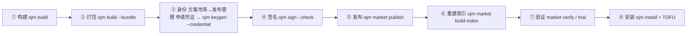

# 方案包发布全流程——新手照做版

适用 ojm ≥ 0.2.22（写作时 0.2.66）。本文自包含：从「代码写完了」到「装进站点」一条命令链照着敲，每步附期望输出与通过判据。
字段规范与错误码全口径见同目录 `manual.md` §11/§12——**本文不引用包外文件**，照着读完即可完成发布。

---

## 0. 全景与前提



信任链硬 fail-closed：未签、签错、key 不被信任的包一律拒装，没有「先装了再说」的开关。
**开始前确认三件事**：

1. 方案契约在位：`src/<模块>/solution.yaml`（`name` / `version` / `summary`；纯前端可省 `api` 段，纯后端可省 `web` 段）；
2. 前端入口在位：`src/<模块>/web/entry.ts`。module-root 布局（0.2.20+）以**扫描**为准，
   `web.config.ts` 的 `modules` 登记只影响加载顺序，漏登记**不会**漏构建（登记了不存在的 entry 才会报错）；
3. 双语 locale 在位：`src/<模块>/web/locales/{zh-CN,en-US}.json`（key 必须嵌套，如 `{"menu":{"main":"…"}}`）。

---

## 1. 构建与打包

```bash
ojm build               # ① 站点产物 dist/web/ + 后端产物 dist/api/
ojm build --bundle      # ② 打包全部用户方案 → dist/<name>-<version>.tgz
ojm build --bundle crm  #    只打 src/crm/ 这一份（多方案工程用）
```

期望输出（②）：

```
[ojm] 方案包已生成 → dist/<name>-<version>.tgz
[ojm] sha256：…（N 字节；确定性打包：同输入两次打包哈希一致）
```

三个要点：

- `--bundle` **只组装、不重跑构建**——先 ① 后 ②，顺序反了装的是旧产物。
- **确定性打包**：同一份源码在任何机器上打出的包字节一致（sha256 相同）——这是多人协作与幂等重发的地基。
- 打包即校验（fail-fast）：契约字段、表集对照、双语齐备、**私钥形态文件禁入包**（`*.pem`/`*.key`/`.env` 系等自动拦截）。两段式出包：校验全绿才开始写盘，失败则 dist/ 零增量。

版本号升了吗？`solution.yaml` 的 `version` 与文件名一致，**发布前必须升**（见 §7 版本冲突行）。

---

## 2. 一次性：拿发布身份（站点凭证）

发布身份 = 一把 Ed25519 密钥 + 一个**站点认可**的身份名（`<产品名>.<账号>`）。
身份名不自拟：站点要靠它在「发布管理」页留档，说清「谁、为哪个产品」发的包。
所以主流程是「先申请凭证，再在本机兑换」：

> 站点保证的是 **key_id 唯一**（同一产品名 + 同一账号 → 同一个身份，同一身份换机重申请是允许的），
> 不是产品名独占：不同账号申请同名产品会各自得到 `<产品名>.<自己的账号>`。
> 所以「谁有资格发这个方案」仍靠团队约定与市场侧的包名/版本冲突拦截，不能指望站点替你裁决。

> 谁能申请：**任何登录用户**，不要求超管。但新建账号首次登录处于「必须先改密」状态，
> 此时除改密外的写接口一律 `403 password change required`——先在页面或 `PUT /api/auth/password`
> 改掉临时口令，再申请凭证。

1. 浏览器进 **方案市场 → 发布管理 → 申请发布凭证**，填产品名（如 `demo-solution`）；
2. 复制弹窗里的凭证或整条命令（**只显示这一次**，关闭后只能撤销重申请）；
3. 本机执行其中一条：

```bash
ojm keygen --credential <token>
OJM_PUBLISH_CREDENTIAL=<token> ojm keygen     # 或走环境变量，避免令牌进 shell 历史
```

- key_id 由站点按 `<产品名>.<编码后用户名>` 算好下发（例：`demo-solution.wecom-everpan`），
  CLI 不做任何推导；落点 `~/.ojm/keys/<key_id>/`：`private.pem`（0600）+ `public.hex`。
- 期望输出里有一行 **`指纹（sha256(publicKey)，公布给宿主核对）：…`**——抄下来，首装核对要用（§6）。
- 凭证**一次性**：兑换成功即作废；兑换失败（已用/已过期/已撤销/网络不通）**不写入任何密钥文件**。
- 站点地址：`--site-url` > `OJM_SITE_URL` > `http://127.0.0.1:9778`；兑换端点匿名可达，不需要 `--user/--pass`。
- `--credential` 与 `--id` 互斥（同时给 exit 2）；`--out` / `--yes` 仍按离线版规则生效
  （`--out <dir>` 相对路径按**进程 cwd** 解析，指进当前工程树会要求 `--yes`——私钥入仓即泄露）。
- **它不替你建信任**：公钥是本地生成的，站点在兑换时拿不到，所以首装仍是陌生 key →
  `needs_trust`，仍要按 §6 逐字核对指纹后 `trust confirm`。凭证解决的是「身份命名与归属」，
  不是「信任免检」。
- 兑换完成后，「方案市场 → 发布管理」该条记录变为**已兑换**并显示 key_id。
- 发版之后，「方案市场 → 发布历史」（`/oj-market/history`）按发布时间倒序列出所有产品/版本：
  数据由站点从签名索引对账落库，**不需要 CLI 额外上报**；发布时间优先取分发包落 CDN 的
  `Last-Modified`，源不提供时回落索引生成时间并标「索引时间」标签。

### 2.1 没有站点时：离线自建身份（旁路）

站点不可达、或你维护的是纯自建/离线 CDN（根本没有「发布管理」页）时，才自己起 key_id：

```bash
ojm keygen --id acme.alice.macbook     # 例：<团队/产品>.<人名>.<环境>
```

- **站点不知道这个身份**：发布管理页没有它的记录，产品归属与申请人无从追溯；能不能装，
  完全取决于超管愿不愿意为这枚指纹手工放行。有站点的市场请走 §2 凭证，不要自建。
- 其余规则与凭证通道一致：key_id 必须**全小写、至少两段**（`<publisher>.<id>`），
  禁裸通用名如 `mykey`——违约包能签出来但装不进（`sig_key` 拒装）。

私钥纪律（两条路都适用，逐条照做，违者 = 任何人都能以你的身份发包）：

| 纪律 | 原因 |
|---|---|
| 私钥只活在 `~/.ojm/keys/<id>/`，永不出目录 | 唯一受管位置；换机 = 重新 keygen 新 id 走信任流程 |
| 绝不提交进任何仓库、绝不写进方案包 | 打包自检会拦私钥文件，但别依赖最后一道闸 |
| 一台机器可多把 key（按项目/环境分 `<key-name>`），一次发布固定一把 | `.sig` 记 key_id，安装侧按 key_id 查信任库 |
| CI 签名用临时密钥对，发布后即吊销；或经 secret 注入只在内存停留 | 长期私钥不落 CI 工件/缓存 |

---

## 3. 每次发布：签名

```bash
ojm sign dist/<name>-<version>.tgz \
  --id <key_id> \
  --registry-id oj-registry \
  --check
```

- `<key_id>` 就是上一步拿到的身份：走凭证是站点下发的 `demo-solution.xxx`，走离线旁路是
  §2.1 里 `--id` 填的那个。私钥缺省取 `~/.ojm/keys/<key_id>/private.pem`；只有把 key 放到了
  别处（如 `--out ./keys`）才需要再加 `--key <path>/private.pem`，且此时 `--id` 仍必须给
  （`.sig` 按它记发布方）。
- `--registry-id` **必填**：发布仓库的自拟标识（同一市场的所有发布方用同一个值，如 `oj-registry`）。它进签名规范串防「把 A 仓库的包重放到 B 仓库」；站点若配置了自身 registry 身份则必须与之一致（默认模板未配置，不比对）。
- 产物 = 同目录 `<tgz>.sig` 侧车文件。**签了再改包 = 签名作废**；重打包必须重签。
- `--check` 离线自检（本地验一遍），不必等安装失败才发现签错。期望输出：`[ojm] 自检通过…`。

---

## 4. 发布到 CDN

CDN 就是**一个装着固定命名文件的目录**：`<name>-<version>.tgz`（+ `.sig`）与索引。发布 = 把文件放进去 + 重建索引。推到远端真 CDN（OSS/S3）只是目录同步（rsync/工具上传），包文件名含版本、内容不可变，多人并发推不冲突。

### 4.1 单方案工程（一条命令）

```bash
ojm market publish --real . \
  --id <key_id> \
  --registry-id oj-registry \
  --rebuild-index
```

期望输出：`[ojm] 包已落 CDN → cdn/<name>-<version>.tgz（N 字节）` + 发布方指纹。
`cdn/` 是**三级索引**布局：`catalog.yaml`（+`.sig`）、`shards/<n>.yaml`（+`.sig`）、
`<name>-<version>.tgz`（+`.tgz.sig`）；分片数随方案数增长，不要按固定文件数核对。

> 引用式方案（契约 `api` 段省略 `tables`/`deps`）会打印「引用式方案…非漏配」提示——那是合法形态，不是错误。

### 4.2 多方案工程（显式四步）

`src/` 下有多份 `solution.yaml` 时，`market publish --real .` 会被拒并提示改走显式链路（一次只发一份，防误发整批）：

```bash
ojm build --bundle crm                                            # ① 打包指定方案
ojm sign dist/crm-1.0.0.tgz --id <key_id> \
  --registry-id oj-registry --check                               # ② 签名（私钥缺省取 ~/.ojm/keys/<key_id>/）
cp dist/crm-1.0.0.tgz dist/crm-1.0.0.tgz.sig cdn/                # ③ tgz + .sig 放进 cdn/
ojm market build-index --id <维护者key> --check                   # ④ 重建索引（见 §4.3）
```

### 4.3 多人协作纪律（同一仓库、不同开发者、不同环境各自发包）

`market publish` 的设计就是为多人并发而做的：**每人只写自己的 `<name>-<version>.tgz`**，没有共享可变文件，互不干扰。四条纪律：

1. **落包并发安全**：谁都可以随时 `market publish` 落自己的包，不用排队。
2. **索引重建要中心化**：publish 落包后**索引不自动重建**（日志会提示「多人场景请由维护者跑 `ojm market build-index`」）。包落了但没重建索引 = 站点装不到。约定一个触发点：维护者定期跑，或 CI 钩子。**不要两人同时对同一 cdn/ 跑 build-index**（重建本身设计为单执行者）。
3. **同版本号字节冲突会被拒**：`crm@1.0.0` 已存在且字节不一致时 publish 直接报错——内容有变就升 version 重发，同一版本号全宇宙只允许一份字节。同源重发字节一致则幂等通过。
4. **同名方案两把 key 是治理问题**：技术上可行（索引按名字聚合版本、信任按 key），但「这个方案名归谁」机制不裁决——不同人发**不同方案**随便；发**同一方案名**需团队事先约定（推荐：方案名归属唯一发布方，他人在该方案上协作走代码仓库而非另起 key 发布）。

---

## 5. 验证发布（不起站点）

```bash
ojm market verify --rebuild-index     # 逐项验：完整性 / 包级签 / manifest 结构 / 索引签（catalog+分片）/ 索引同代 / 索引时效 / 迁移一致性
ojm market trial --fixture <name>@<version>       # 隔离站点跑完整安装，跑完即毁，不污染工程
ojm market walkthrough --fixture <name>@0.1.0     # 14 项 AC：主链 9 + 负向 5；报告落 logs/walkthrough-<ts>.md
```

- `verify` 的检查项数随包数与分片数变化，判据是**末行「全部校验通过（N 项）」且无未通过项**，
  不要按固定条数核对。
- `walkthrough` 的 fixture **必须是 `@0.1.0`**：主链的 upgrade/rollback 硬编码 0.1.0→0.2.0，
  给别的版本这两项会 FAIL（是 fixture 选错，不是框架缺陷）。

walkthrough 期望 `14 PASS / 0 FAIL`。负向 5 项是**预期失败口径**：防线没拦住（恶意包装成了）才算 FAIL。

---

## 6. 装到站点（运维侧）

```bash
# ⓪ 先构建：release 形态服务的是产物，不先 build 会缺 dist/api（或装到旧产物）
ojm build

# ① 站点以 release 形态起（dev/preview 完不成安装的热更段）
#    先把 config.yaml 的 platform.root 从 src 改成 dist/api——必须与 --api-path 同源，
#    否则 oj serve 直接拒启：platform.root (...) must be mounted as an api mount
#    再配 vars.canonical_origin（本地演练填 http://127.0.0.1:9778）：市场基址 /cdn 是相对路径，
#    服务端要靠它补全成绝对 URL；缺了安装直接 503（REG-CS6 不读 Host 头，不会替你猜）
oj serve -c config.yaml -b /api --api-path dist/api

# ② 市场地址：本地自供 /cdn 是模板默认，**不需要 setup**；
#    只有指向外部真 CDN 才要执行（首跑可能强制改密，故下一步的 --pass 用新口令）：
#    ojm market setup --site-url http://127.0.0.1:9778 --user superadmin --pass <当前口令> --new-pass <新口令>

# ③ 安装（从 CDN 拉：name[@version]；直传文件则给 tgz 路径，.sig 同目录自动随包）
#    只对 release 站点装；别对着 `ojm dev` 装——dev 的文件监听会在安装器 reload 之前
#    先吃掉 config 改动，安装器自己再 reload 时得到 unchanged，判 partial（reloading）
ojm install crm@1.0.0 --site-url http://127.0.0.1:9778 --user superadmin --pass <口令>

# ④ 首装陌生 key 必停在 needs_trust：响应 trust.fingerprint 与 §2 记下的指纹【逐字】核对
#    核对通道用当面/电话/既有加密聊天——不要用 CDN 页面上的指纹（那正是攻击者能改的地方）
ojm trust confirm --task <task-id> --site-url http://127.0.0.1:9778 --user superadmin --pass <口令>
ojm install crm@1.0.0 --site-url http://127.0.0.1:9778 --user superadmin --pass <口令>   # 重跑续跑
```

`<口令>` 就是登录站点用的那个：没跑过 `market setup` 时是脚手架种子口令（`superadmin / aA123456`），
跑过则用 `--new-pass` 设的新口令。

通过判据：`dist/api/manifests.yaml` 出现 `<name>: <version>`；**重启一次 `oj serve`**（新方案路由要重启才注册，热更只覆盖 vars）后
`curl -H 'X-TENANT-ID: default' /api/<name>/ping` 返回 `code:0`——**不带租户头会 400 `missing tenant header`**，
那是缺参数，不是装失败。

TOFU 没有免检通道：**只有模板内置的 oj-market（第一方包）用内置 bootstrap 公钥首装免核对**；
你自己 keygen 出来的任何身份——包括站点凭证下发的——首装都要人工核指纹。key 轮换 = 新 key_id
重发 + 站点 `trust add` 新公钥 + `trust revoke` 旧 key（吊销只阻断新装，不动已装方案）。

---

## 7. 失败速查（症状 → 病根 → 药方）

| 症状（安装拒装码 / 命令报错） | 病根 | 药方 |
|---|---|---|
| `sig_missing` | 没签，或 `.sig` 没随包在同目录 | `ojm sign --check` 后确认 `.sig` 与 tgz 同目录再装 |
| `tampered` | 签完又动过包，或传输损坏 | 重打包重签；核对 sha256 |
| `sig_key` | key_id 不是 `<publisher>.<id>` 全小写两段式 | 凭证通道回「发布管理」重申请（产品名须小写合规）；离线旁路换合规 id 重 keygen 再重签 |
| `keygen --credential` 报「发布凭证无效或已失效」 | 一次性令牌已兑换/已过期/已撤销，或站点地址不对 | 回「发布管理」重新申请；同一 token 不能给第二台机器 |
| 申请凭证 403 `password change required` | 新建账号首次登录还在「必须先改密」悬挂期 | 先改密（页面或 `PUT /api/auth/password`），再申请 |
| 安装 503 `安装需要站点 canonical origin` | `config.yaml` 的 `vars.canonical_origin` 没配，而市场基址是相对路径 `/cdn` | 配成站点对外地址（本地演练 `http://127.0.0.1:9778`）后重启 |
| 安装 partial（stage `reloading`，`reloadConfig 返回 unchanged`） | 对着 `ojm dev` 装：dev 的文件监听先吃掉了 config 改动 | 换成 `oj serve` release 形态再装；别在 dev 上验证安装 |
| 装完 `curl /api/<name>/ping` 返回 400 `missing tenant header` | 少了 `X-TENANT-ID` 头 | 加 `-H 'X-TENANT-ID: default'` 再探 |
| `sig_alg` / `sig_format` | 签名算法/.sig 结构不符 | 用当前 ojm 重签（旧版本工具产物） |
| `needs_trust`（第五终态，非成功） | 站点第一次见这个 key | 与发布方逐字核对指纹 → `trust confirm --task <id>` → 重跑 install |
| publish 报「包冲突：…字节不一致」 | 同 name@version 已有字节不同的包 | **升 version 重发**；确需覆盖先删 CDN 旧 tgz |
| publish 报「一次只发布一份方案」 | 多方案工程走了自动链路 | §4.2 显式四步 |
| 打包报「缺少本方案的站点产物」 | 没先 `ojm build`，或前端入口不在 `src/<模块>/web/entry.ts`（module-root 扫描不到；`web.config.ts` 漏登记**不是**原因） | 补 entry / 先构建再打包 |
| 打包报「缺少 bundle 级契约」 | 没有 `solution.yaml` | 补契约（§0 前提 1） |
| 装不到刚发的包 | 索引没重建 | `ojm market build-index`（§4.3 纪律 2），确认 `cdn/` 的 catalog + 分片 + tgz(+sig) 已同步 |
| 装成后 404 | 方案路由没注册 | 重启 `oj serve`（§6 通过判据） |
| `oj serve` 报 `platform.root (...) must be mounted as an api mount` | release 起站了，但 config 的 `platform.root` 还是 `src` | 改成 `dist/api`（与 `--api-path dist/api` 同源）后重启 |
| `oj serve` 报 `lock points to missing version dir: dist/api/<name>-<ver>` | 锁文件记着某个已装版本，但那个版本目录不在了（清过 dist / 换过机器） | 先 `ojm build`；锁与目录对不上时按站点安装记录重装该方案，别手改锁 |
| 私钥误入工程 | 打包自检拦下 / 被外部拷走 | 立即 `trust revoke` 该 key → 换新 key_id 重发 |

---

## 8. 发布前 checklist

- [ ] `solution.yaml` 的 `version` 已升，与文件名一致；
- [ ] `ojm build` + `ojm build --bundle` 均通过，sha256 记进发布单；
- [ ] `ojm sign … --check` 通过，`.sig` 与 tgz 同目录；
- [ ] 发布身份来自站点凭证（有发布管理页时），「方案市场 → 发布管理」页该条已变**已兑换**；
- [ ] 发版后「方案市场 → 发布历史」能看到这次的 产品 / 版本 / 发布时间（时间来源为索引兜底时会标「索引时间」）；
- [ ] 新 key 首次发布：指纹已提前交给运维（免得卡在 needs_trust）；
- [ ] `ojm market verify` 末行「全部校验通过（N 项）」，无未通过项；
- [ ] 多人团队：索引重建触发点已约定（维护者或 CI）。
