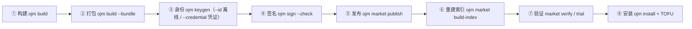

# 方案包发布全流程——新手照做版

适用 ojm ≥ 0.2.22（写作时 0.2.56）。本文自包含：从「代码写完了」到「装进站点」一条命令链照着敲，每步附期望输出与通过判据。
字段规范与错误码全口径见 `manual.md` §11/§12；仓内深度过程视角另见
`docs/guides/solution-dev-build-publish.md`（不随 cli 包发货）。

---

## 0. 全景与前提



信任链硬 fail-closed：未签、签错、key 不被信任的包一律拒装，没有「先装了再说」的开关。
**开始前确认三件事**（缺一件打包就过不去）：

1. 方案契约在位：`src/<模块>/solution.yaml`（`name` / `version` / `summary`；纯前端可省 `api` 段，纯后端可省 `web` 段）；
2. `web.config.ts` 的 `modules` 数组已登记该模块（否则构建不产出站点产物，打包报「缺少本方案的站点产物」）；
3. 双语 locale 在位：`web/src/.../locales/zh-CN.json` 与 `en-US.json`。

---

## 1. 构建与打包

```bash
ojm build               # ① 站点产物 web/dist/ + 后端产物 api/dist/
ojm build --bundle      # ② 打包全部用户方案 → dist/<name>-<version>.tgz
ojm build --bundle crm  #    只打 src/crm/ 这一份（多方案工程用）
```

期望输出（②）：

```
[ojm] 方案包已生成 → dist/<name>-<version>.tgz
[ojm] sha256：…（确定性打包：同源同字节）
```

三个要点：

- `--bundle` **只组装、不重跑构建**——先 ① 后 ②，顺序反了装的是旧产物。
- **确定性打包**：同一份源码在任何机器上打出的包字节一致（sha256 相同）——这是多人协作与幂等重发的地基。
- 打包即校验（fail-fast）：契约字段、表集对照、双语齐备、**私钥形态文件禁入包**（`*.pem`/`*.key`/`.env` 系等自动拦截）。两段式出包：校验全绿才开始写盘，失败则 dist/ 零增量。

版本号升了吗？`solution.yaml` 的 `version` 与文件名一致，**发布前必须升**（见 §7 版本冲突行）。

---

## 2. 一次性：生成发布身份（keygen）

每个开发者/每个环境**各自生成一把** Ed25519 密钥对，只需做一次：

```bash
ojm keygen --id acme.alice.macbook     # 例：<团队/产品>.<人名>.<环境>
```

- 期望输出里有一行 **fingerprint**（`sha256(公钥)`）——**抄下来发给运维**，TOFU 核对要用（§8）。
- 落点 `~/.ojm/keys/<id>/`：`private.pem`（权限 0600）+ `public.hex`。
- key_id 必须**全小写、至少两段**（`<publisher>.<id>`），禁裸通用名如 `mykey`——违约包能签出来但装不进（`sig_key` 拒装）。

### 2.1 站点签发身份：凭证通道（推荐）

站点有「发布管理」页时，身份不用自己起名，也不必和运维核对 fingerprint（TOFU 由站点代劳）：

1. 浏览器进 **发布管理 → 申请发布凭证**，填产品名（如 `demo-solution`）；
2. 复制弹窗里的凭证或整条命令（**只显示这一次**，关闭后只能撤销重申请）；
3. 本机执行其中一条：

```bash
ojm keygen --credential <token>
OJM_PUBLISH_CREDENTIAL=<token> ojm keygen     # 或走环境变量，避免令牌进 shell 历史
```

- key_id 由站点按 `<产品名>.<编码后用户名>` 算好下发（例：`demo-solution.wecom-everpan`），
  CLI 不做任何推导；想完全自定义身份就继续用上面的离线 `--id`。
- 凭证**一次性**：兑换成功即作废；兑换失败（已用/已过期/已撤销/网络不通）**不写入任何密钥文件**。
- 站点地址：`--site-url` > `OJM_SITE_URL` > `http://127.0.0.1:9778`；兑换端点匿名可达，不需要 `--user/--pass`。
- `--credential` 与 `--id` 互斥（同时给 exit 2）；`--out` / `--yes` 仍按离线版规则生效。
- 兑换完成后，「发布管理」页该条记录变为**已兑换**并显示 key_id；后续 §3 起的签名/发布流程完全一致。

私钥纪律（逐条照做，违者 = 任何人都能以你的身份发包）：

| 纪律 | 原因 |
|---|---|
| 私钥只活在 `~/.ojm/keys/<id>/`，永不出目录 | 唯一受管位置；换机 = 重新 keygen 新 id 走信任流程 |
| 绝不提交进任何仓库、绝不写进方案包 | 打包自检会拦私钥文件，但别依赖最后一道闸 |
| 一台机器可多把 key（按项目/环境分 `<key-name>`），一次发布固定一把 | `.sig` 记 key_id，安装侧按 key_id 查信任库 |
| CI 签名用临时密钥对，发布后即吊销；或经 secret 注入只在内存停留 | 长期私钥不落 CI 工件/缓存 |

---

## 3. 每次发布：签名

```bash
ojm sign dist/<name>-<version>.tgz \
  --id acme.alice.macbook \
  --key ~/.ojm/keys/acme.alice.macbook/private.pem \
  --registry-id oj-registry \
  --check
```

- `--registry-id` **必填**：发布仓库的自拟标识（同一市场的所有发布方用同一个值，如 `oj-registry`）。它进签名规范串防「把 A 仓库的包重放到 B 仓库」；站点若配置了自身 registry 身份则必须与之一致（默认模板未配置，不比对）。
- 产物 = 同目录 `<tgz>.sig` 侧车文件。**签了再改包 = 签名作废**；重打包必须重签。
- `--check` 离线自检（本地验一遍），不必等安装失败才发现签错。期望输出：`[ojm] 自检通过…`。

---

## 4. 发布到 CDN

CDN 就是**一个装着固定命名文件的目录**：`<name>-<version>.tgz`（+ `.sig`）与索引。发布 = 把文件放进去 + 重建索引。推到远端真 CDN（OSS/S3）只是目录同步（rsync/工具上传），包文件名含版本、内容不可变，多人并发推不冲突。

### 4.1 单方案工程（一条命令）

```bash
ojm market publish --real . \
  --id acme.alice.macbook \
  --key ~/.ojm/keys/acme.alice.macbook/private.pem \
  --registry-id oj-registry \
  --rebuild-index
```

期望输出：`[ojm] 包已落 CDN → cdn/<name>-<version>.tgz（N 字节）` + 发布方指纹。`cdn/` 下落齐六件：tgz / .tgz.sig / 索引两份 yaml（+ 各自 .sig）。

> 引用式方案（契约 `api` 段省略 `tables`/`deps`）会打印「引用式方案…非漏配」提示——那是合法形态，不是错误。

### 4.2 多方案工程（显式四步）

`src/` 下有多份 `solution.yaml` 时，`market publish --real .` 会被拒并提示改走显式链路（一次只发一份，防误发整批）：

```bash
ojm build --bundle crm                                            # ① 打包指定方案
ojm sign dist/crm-1.0.0.tgz --id acme.alice.macbook \
  --key ~/.ojm/keys/acme.alice.macbook/private.pem \
  --registry-id oj-registry --check                              # ② 签名
cp dist/crm-1.0.0.tgz dist/crm-1.0.0.tgz.sig cdn/                # ③ tgz + .sig 放进 cdn/
ojm market build-index --id <维护者key> --check                   # ④ 重建索引（见 §4.3）
```

### 4.3 多人协作纪律（同一仓库、不同开发者、不同环境各自发包）

`market publish` 的设计就是为多人并发而做的：**每人只写自己的 `<name>-<version>.tgz`**，没有共享可变文件，互不干扰。四条纪律：

1. **落包并发安全**：谁都可以随时 `market publish` 落自己的包，不用排队。
2. **索引重建要中心化**：publish 落包后**索引不自动重建**（日志会提示「多人场景请由维护者跑 `ojm market build-index`」）。包落了但没重建索引 = 站点装不到。约定一个触发点：维护者定期跑，或 CI 钩子。**不要两人同时对同一 cdn/ 跑 build-index**（重建本身设计为单执行者）。
3. **同版本号字节冲突会被拒**：`crm@1.0.0` 已存在且字节不一致时 publish 直接报错——内容有变就升 version 重发，同一版本号全宇宙只允许一份字节。同源重发字节一致则幂等通过。
4. **同名方案两把 key 是治理问题**：技术上可行（索引按名字聚合版本、信任按 key），但「这个方案名归谁」机制不裁决——不同人发**不同方案**随便；发**同一方案名**需团队事先约定（推荐：方案名归属唯一发布方，他人在该方案上协作走代码仓库而非另起 key 发布）。

---

## 5. 验证发布（不起站点）

```bash
ojm market verify --rebuild-index     # 五项自检：完整性/包级签/索引签×2/manifest 结构，全 ✓ 才算过
ojm market trial --fixture <name>@<version>       # 隔离站点跑完整安装，跑完即毁，不污染工程
ojm market walkthrough --fixture <name>@<version> # 14 项 AC：主链 9 + 负向 5；报告落 logs/walkthrough-<ts>.md
```

walkthrough 期望 `14 PASS / 0 FAIL`。负向 5 项是**预期失败口径**：防线没拦住（恶意包装成了）才算 FAIL。

---

## 6. 装到站点（运维侧）

```bash
# ① 站点以 release 形态起（dev/preview 完不成安装的热更段）
oj serve -c config.yaml -b /api --api-path dist/api

# ② 市场地址指向站点自供的 /cdn（默认即如此；外部真 CDN 才需要 setup 写绝对地址）
ojm market setup --site-url http://127.0.0.1:9778 --user superadmin --pass … --new-pass <新口令>

# ③ 安装（从 CDN 拉：name[@version]；直传文件则给 tgz 路径，.sig 同目录自动随包）
ojm install crm@1.0.0 --site-url http://127.0.0.1:9778 --user superadmin --pass <新口令>

# ④ 首装陌生 key 必停在 needs_trust：响应 trust.fingerprint 与 §2 记下的指纹【逐字】核对
#    核对通道用当面/电话/既有加密聊天——不要用 CDN 页面上的指纹（那正是攻击者能改的地方）
ojm trust confirm --task <task-id> --site-url http://127.0.0.1:9778 --user superadmin --pass <新口令>
ojm install crm@1.0.0 --site-url http://127.0.0.1:9778 --user superadmin --pass <新口令>   # 重跑续跑
```

通过判据：`dist/api/manifests.yaml` 出现 `<name>: <version>`；**重启一次 `oj serve`**（新方案路由要重启才注册，热更只覆盖 vars）后 `curl /api/<name>/ping` 返回 `code:0`。

第一方方案走模板内置公钥（bootstrap key），首装免 TOFU；第三方走上面的人工核对。key 轮换 = 新 key_id 重发 + 站点 `trust add` 新公钥 + `trust revoke` 旧 key（吊销只阻断新装，不动已装方案）。

---

## 7. 失败速查（症状 → 病根 → 药方）

| 症状（安装拒装码 / 命令报错） | 病根 | 药方 |
|---|---|---|
| `sig_missing` | 没签，或 `.sig` 没随包在同目录 | `ojm sign --check` 后确认 `.sig` 与 tgz 同目录再装 |
| `tampered` | 签完又动过包，或传输损坏 | 重打包重签；核对 sha256 |
| `sig_key` | key_id 不是 `<publisher>.<id>` 全小写两段式 | 重新 keygen 合规 id，用新 key 重签 |
| `sig_alg` / `sig_format` | 签名算法/.sig 结构不符 | 用当前 ojm 重签（旧版本工具产物） |
| `needs_trust`（第五终态，非成功） | 站点第一次见这个 key | 与发布方逐字核对指纹 → `trust confirm --task <id>` → 重跑 install |
| publish 报「包冲突：…字节不一致」 | 同 name@version 已有字节不同的包 | **升 version 重发**；确需覆盖先删 CDN 旧 tgz |
| publish 报「一次只发布一份方案」 | 多方案工程走了自动链路 | §4.2 显式四步 |
| 打包报「缺少本方案的站点产物」 | `web.config.ts` 没登记 / 没先 `ojm build` | 登记后重跑构建再打包 |
| 打包报「缺少 bundle 级契约」 | 没有 `solution.yaml` | 补契约（§0 前提 1） |
| 装不到刚发的包 | 索引没重建 | `ojm market build-index`（§4.3 纪律 2），确认 CDN 六文件同步 |
| 装成后 404 | 方案路由没注册 | 重启 `oj serve`（§6 通过判据） |
| 私钥误入工程 | 打包自检拦下 / 被外部拷走 | 立即 `trust revoke` 该 key → 换新 key_id 重发 |

---

## 8. 发布前 checklist

- [ ] `solution.yaml` 的 `version` 已升，与文件名一致；
- [ ] `ojm build` + `ojm build --bundle` 均通过，sha256 记进发布单；
- [ ] `ojm sign … --check` 通过，`.sig` 与 tgz 同目录；
- [ ] 新 key 首次发布：fingerprint 已提前交给运维（免得卡在 needs_trust）；
- [ ] `ojm market verify` 五项全 ✓；
- [ ] 多人团队：索引重建触发点已约定（维护者或 CI）。
