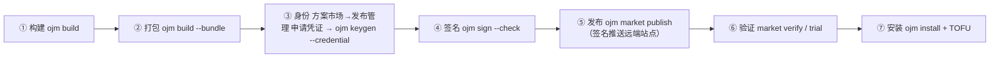

# 方案包发布全流程——新手照做版

适用 ojm ≥ 0.2.22（0.3.0 改写：发布改远端签名推送，索引机制退役）。本文自包含：从「代码写完了」到「装进站点」一条命令链照着敲，每步附期望输出与通过判据。
字段规范与错误码全口径见同目录 `manual.md` §11/§12——**本文不引用包外文件**，照着读完即可完成发布。

---

## 0. 全景与前提



信任链硬 fail-closed：未签、签错、key 不被信任的包一律拒装，没有「先装了再说」的开关。
**开始前确认三件事**：

1. 方案契约在位：`src/<模块>/solution.yaml`（`name` / `version` / `summary`；纯前端可省 `api` 段，纯后端可省 `web` 段）；
2. 前端入口在位：`src/<模块>/web/entry.ts`。module-root 布局（0.2.20+）以**扫描**为准，
   `web.config.ts` 的 `modules` 登记只影响加载顺序，漏登记**不会**漏构建（登记了不存在的 entry 才会报错）；
3. 双语 locale 在位：`src/<模块>/web/locales/{zh-CN,en-US}.json`（key 必须嵌套，如 `{"menu":{"main":"…"}}`）；
4. **匿名端点已在契约声明**：凡不带 token 可访问的端点（`ojm new` 骨架的 `ping` 就是），必须在
   `solution.yaml` 的 `api.anonymous` 里列出（如 `anonymous: ["<模块>/ping"]`，模块相对路径）——
   漏声明安装预检 `anonymous_residual` 直接拒装（0.2.68 起 `ojm new --api` 骨架已自带这行；
   自己加端点时记得同步维护这份清单）。
5. **别把方案建进保护根**：`src/app`、`src/oj-market` 受完整性门禁保护（0.2.68+，见 `src/README.md`），
   `ojm build` 会先比对上游模板、有漂移即拒；用户方案放 `src/<你的名字>/`。

---

## 0.5 站点侧前置条件（发布前必做，否则推送必败）

远端签名推送对目标站点有三项硬前提，缺任何一项都会在某一步被拒。这些都在**站点 config**（不是 CLI 侧）配置，发布前先确认：

1. **市场匿名面**：`oj serve -c <文件>` 实际加载的那份 config 的 `auth.anonymous_paths` 与 `tenant.anonymous_paths` 都必须含以下三条——

   ```yaml
   # auth.anonymous_paths（Bearer 守卫逃生口）
   - /oj-market/catalog/**
   - /oj-market/cdn/upload
   - /oj-market/yank
   # tenant.anonymous_paths（缺租户头守卫逃生口，同条目）
   - /oj-market/catalog/**
   - /oj-market/cdn/upload
   - /oj-market/yank
   ```

   CLI 的目录探测（匿名 GET `/api/oj-market/catalog`）与上传/下线（裸 fetch，靠签名头鉴权）都**不带凭据**，漏列则 401 被守卫硬挡。改完须**重启站点**（config 是启动冻结段）。

2. **registry_id**：`oj serve -c <文件>` 实际加载的那份 config（任意文件名，常见 `config-release.yaml`）的 `vars` 下加 `registry_id: <站点身份>`（如 `oj-registry`）——推送 canonical 首段 = 站点身份，缺它 503「未配置 registry_id」。
   **配置名无关**：市场模块读 `registry_id` / `canonical_origin` 走 `vars` 全局（config-filename-agnostic），即被 `-c` 加载的那份 config 的 `vars` 段，不论文件名都能读到。**无需**再把配置额外抄进 `config.yaml`，只写进真正被 `-c` 加载的那一份 `vars` 即可。

3. **信任库**：`keygen --credential` 兑换只分配 `key_id` + 生成本地私钥，**公钥不会回传站点**，所以站点信任库里没有这把 key。首次推送前，站点 superadmin 必须把公钥登记进去，否则上传 **403**（「发布 key 不在信任库」）：

   ```bash
   ojm trust add <key_id> <public.hex> \
     --site-url https://your-site --user superadmin --pass <口令>
   ```

   `<public.hex>` 取 keygen 输出的 `public_key` 行（或 `~/.ojm/keys/<key_id>/public.hex`）；市场信任页也能做同样的事。

---

## 1. 构建与打包

```bash
ojm build               # ① 站点产物 dist/web/ + 后端产物 dist/api/
ojm build --bundle      # ② 打包全部用户方案 → dist/<name>-<version>.tgz
ojm build --bundle crm  #    只打 src/crm/ 这一份（多方案工程用）
```

期望输出（②）：

```
[ojm] 方案包已生成 → dist/<name>-<version>.tgz
[ojm] sha256：…（N 字节；确定性打包：同输入两次打包哈希一致）
```

三个要点：

- `--bundle` **只组装、不重跑构建**——先 ① 后 ②，顺序反了装的是旧产物。
- **确定性打包**：同一份源码在任何机器上打出的包字节一致（sha256 相同）——这是多人协作与幂等重发的地基。
- 打包即校验（fail-fast）：契约字段、表集对照、双语齐备、**私钥形态文件禁入包**（`*.pem`/`*.key`/`.env` 系等自动拦截）。两段式出包：校验全绿才开始写盘，失败则 dist/ 零增量。

版本号升了吗？`solution.yaml` 的 `version` 与文件名一致，**发布前必须升**（见 §7 版本冲突行）。

---

## 2. 一次性：拿发布身份（站点凭证）

发布身份 = 一把 Ed25519 密钥 + 一个**站点认可**的身份名（`<产品名>.<账号>`）。
身份名不自拟：站点要靠它在「发布管理」页留档，说清「谁、为哪个产品」发的包。
所以主流程是「先申请凭证，再在本机兑换」：

> 站点保证的是 **key_id 唯一**（同一产品名 + 同一账号 → 同一个身份，同一身份换机重申请是允许的），
> 不是产品名独占：不同账号申请同名产品会各自得到 `<产品名>.<自己的账号>`。
> 所以「谁有资格发这个方案」仍靠团队约定与市场侧的包名/版本冲突拦截，不能指望站点替你裁决。

> 谁能申请：**任何登录用户**，不要求超管。但新建账号首次登录处于「必须先改密」状态，
> 此时除改密外的写接口一律 `403 password change required`——先在页面或 `PUT /api/auth/password`
> 改掉临时口令，再申请凭证。

1. 浏览器进 **方案市场 → 发布管理 → 申请发布凭证**，填产品名（如 `demo-solution`）；
2. 复制弹窗里的凭证或整条命令（**只显示这一次**，关闭后只能撤销重申请）；
3. 本机执行其中一条：

```bash
ojm keygen --credential <token>
OJM_PUBLISH_CREDENTIAL=<token> ojm keygen     # 或走环境变量，避免令牌进 shell 历史
```

- key_id 由站点按 `<产品名>.<编码后用户名>` 算好下发（例：`demo-solution.wecom-everpan`），
  CLI 不做任何推导；落点 `~/.ojm/keys/<key_id>/`：`private.pem`（0600）+ `public.hex`。
- 期望输出里有一行 **`指纹（sha256(publicKey)，公布给宿主核对）：…`**——抄下来，首装核对要用（§6）。
- 凭证**一次性**：兑换成功即作废；兑换失败（已用/已过期/已撤销/网络不通）**不写入任何密钥文件**。
- 站点地址：`--site-url` > `OJM_SITE_URL` > `http://127.0.0.1:9778`；兑换端点匿名可达，不需要 `--user/--pass`。
- `--credential` 与 `--id` 互斥（同时给 exit 2）；`--out` / `--yes` 仍按离线版规则生效
  （`--out <dir>` 相对路径按**进程 cwd** 解析，指进当前工程树会要求 `--yes`——私钥入仓即泄露）。
- **它不替你建信任**：公钥是本地生成的，站点在兑换时拿不到，所以首装仍是陌生 key →
  `needs_trust`，仍要按 §6 由 superadmin 在发布管理页「信任审核」列表确认指纹。凭证解决的是
  「身份命名与归属」，不是「信任免检」。
- 兑换完成后，「方案市场 → 发布管理」该条记录变为**已兑换**并显示 key_id。
- 发版之后，「方案市场 → 发布历史」（`/oj-market/history`）按发布时间倒序列出所有产品/版本：
  数据由站点在签名推送完成时直写目录库，**不需要 CLI 额外上报**；经站点回填命令补录的存量包
  `published_at` 取回填时刻并标「回填时间」标签（与推送直写的行区分）。

### 2.1 没有站点时：离线自建身份（旁路）

站点不可达、或你维护的是纯自建/离线 CDN（根本没有「发布管理」页）时，才自己起 key_id：

```bash
ojm keygen --id acme.alice.macbook     # 例：<团队/产品>.<人名>.<环境>
```

- **站点不知道这个身份**：发布管理页没有它的记录，产品归属与申请人无从追溯；能不能装，
  完全取决于超管愿不愿意为这枚指纹手工放行。有站点的市场请走 §2 凭证，不要自建。
- 其余规则与凭证通道一致：key_id 必须**全小写、至少两段**（`<publisher>.<id>`），
  禁裸通用名如 `mykey`——违约包能签出来但装不进（`sig_key` 拒装）。

私钥纪律（两条路都适用，逐条照做，违者 = 任何人都能以你的身份发包）：

| 纪律 | 原因 |
|---|---|
| 私钥只活在 `~/.ojm/keys/<id>/`，永不出目录 | 唯一受管位置；换机 = 重新 keygen 新 id 走信任流程 |
| 绝不提交进任何仓库、绝不写进方案包 | 打包自检会拦私钥文件，但别依赖最后一道闸 |
| 一台机器可多把 key（按项目/环境分 `<key-name>`），一次发布固定一把 | `.sig` 记 key_id，安装侧按 key_id 查信任库 |
| CI 签名用临时密钥对，发布后即吊销；或经 secret 注入只在内存停留 | 长期私钥不落 CI 工件/缓存 |

---

## 3. 每次发布：签名

```bash
ojm sign dist/<name>-<version>.tgz \
  --id <key_id> \
  --registry-id oj-registry \
  --check
```

- `<key_id>` 就是上一步拿到的身份：走凭证是站点下发的 `demo-solution.xxx`，走离线旁路是
  §2.1 里 `--id` 填的那个。私钥缺省取 `~/.ojm/keys/<key_id>/private.pem`；只有把 key 放到了
  别处（如 `--out ./keys`）才需要再加 `--key <path>/private.pem`，且此时 `--id` 仍必须给
  （`.sig` 按它记发布方）。
- `--registry-id` **必填**：发布仓库的自拟标识（同一市场的所有发布方用同一个值，如 `oj-registry`）。它进签名规范串防「把 A 仓库的包重放到 B 仓库」；站点若配置了自身 registry 身份则必须与之一致（默认模板未配置，不比对）。
- 产物 = 同目录 `<tgz>.sig` 侧车文件。**签了再改包 = 签名作废**；重打包必须重签。
- `--check` 离线自检（本地验一遍），不必等安装失败才发现签错。期望输出：`[ojm] 自检通过…`。

---

## 4. 发布到站点（远端签名推送）

发布 = 把 `.sig` 旁车 + `.tgz` 包体**按序推到目标站点的市场上传端点**
（`POST /api/oj-market/cdn/upload`）。不经账号口令：身份与完整性全靠
`X-OJM-Key-Id` / `X-OJM-Signature` 请求头（信任库 + Ed25519）——站点信任库认这个 key，
推送即被接受。CLI 可能根本没账号（CI/企微用户），推送链路为此设计。

### 4.1 单方案工程（一条命令）

```bash
ojm market publish --real . \
  --site-url https://your-site \
  --id <key_id> \
  --registry-id <站点 registry_id>
```

期望输出：`[ojm] 发布完成：<name>@<version> 已进 https://your-site 市场目录（DB 目录行 + cdn/ 字节）`。

命令内部四步：构建 → 包级签名（同 §3）→ 目录探测（读站点 `registry_id`）→ 先推 `.sig` 再推 `.tgz`。
**pair 约束**：服务端只有配对的 `.sig` 在手才收 `.tgz`——顺序由命令保证，无须人工干预。

- `--site-url` 缺省读环境变量 `OJM_SITE_URL`；两个都没有 → 人话报错（不猜默认站点）。
- 站点版本探测：推送前 CLI 先匿名 GET 目录 API——旧站点（文件索引时代）无此 API → 404 →
  「站点版本过旧」人话 + 迁移指南指向；站点未配 `registry_id` → 明确指向「被 `-c` 加载的那份 config 的 `vars`」设置项（文件名任意，见 §0.5 前置 2）。
- **半成功自愈**：`.sig` 已推、`.tgz` 被拒（如网络中断）——报错会提示「重跑本命令幂等补齐」：
  同字节重传幂等，pair 自动完成，无人工清场负担。
- **目标站点要先信任你的 key**（`ojm trust add` 或市场页信任确认）——否则推送 403，
  与安装的 `needs_trust` 同一信任库。

> **`--real` 仅限单方案工程**（`src/` 下只有一份 `solution.yaml`）；`ojm new` 生成的方案长在宿主工程里
> （宿主还自带 `app`/`oj-market`），多方案工程走 §4.2 显式四步。
> **`--fixture` 不是发布通道**：`ojm market publish --fixture <name>@<ver>` / `trial` / `walkthrough`
> 里的 fixture 是**现场合成的最小合法测试包**（固定 ping 形状），专供演练与隔离验证——
> 它不会打包你的真实代码，别拿它发真方案。

> 引用式方案（契约 `api` 段省略 `tables`/`deps`）会打印「引用式方案…非漏配」提示——那是合法形态，不是错误。

### 4.2 多方案工程（显式四步）

`src/` 下有多份 `solution.yaml` 时，`market publish --real .` 会被拒并提示改走显式链路（一次只发一份，防误发整批）：

```bash
ojm build --bundle crm                                            # ① 打包指定方案
ojm sign dist/crm-1.0.0.tgz --id <key_id> \
  --registry-id <站点 registry_id> --check                          # ② 签名（私钥缺省取 ~/.ojm/keys/<key_id>/）
ojm market publish --real . --site-url https://your-site \
  --id <key_id> --registry-id <站点 registry_id>                    # ③ 远端签名推送（同 §4.1）
```

### 4.3 多人协作纪律（不同开发者、不同环境各自发包）

上传端点天然支持多人并发：**每人推自己的 `<name>-<version>`**，服务端按库仲裁。三条纪律：

1. **并发安全**：谁都可以随时推自己的包；同一 `name@version` 同字节重传幂等通过。
2. **同版本号字节冲突会被拒（409）**：`crm@1.0.0` 已存在且字节不一致 → 内容有变就升 version 重发，
   同一版本号全宇宙只允许一份字节。
3. **方案名所有权绑定首发 key（409）**：`crm` 的第一个上传者把名字绑定到自己的 key_id，
   别的 key 推 `crm@*` 会被拒——换主是站点 superadmin 操作（端点不提供）。

### 4.4 下线与恢复（yank）

```bash
ojm market yank crm 1.0.0 --site-url https://your-site --id <key_id>                     # 下线（仅发布者本人）
ojm market yank crm 1.0.0 --site-url https://your-site --id <key_id> --restore          # 恢复
```

- 签名鉴权同推送（canonical = `market-yank:<站点 registry_id>:<产品>:<版本>`），
  **只有行内记录的发布 key 可下线/恢复**（key 不符 403）；重复 yank/restore 幂等 200。
- yank **不动已装站点**：只把版本从目录摘除（详情标 `yanked:true`），已装的方案照常运行；
  精确版本安装被 409 人话拒。`--reason`/`--by` 留审计痕（发布历史可见）。

### 4.5 内网交付：页面上传入库（无私钥场景，2026-11-10）

内网站点拿不到发布方私钥（私钥不出安全区）时，`ojm market publish` 的头签名推送用不了。
替代路径：外网完成构建 + 签名（§3），把 `<name>-<version>.tgz` 与 `<name>-<version>.tgz.sig`
**成对**带入内网，superadmin 在「方案市场 → 发布管理 → 离线包上传」区上传：

- 服务端即时配对验签：重算 sha256 重构包级 canonical（首段 = 旁车自带签发方 registry 身份），
  不绑定 409 不碰盘；同版本同字节幂等（缺文件自愈）、异字节 409；name 所有权首发绑定同 cdn 推送。
- **前端配对约束**：两个上传槽各选一个文件，`.sig` 文件名必须是 tgz 文件名 + `.sig`
  （`<n>-<v>.tgz.sig`），不配对提交即拒（pairMismatch）；响应的 `key_id`/指纹与 §3 签名输出逐字比对。
- **未审指纹放行**：发布方 key 不在站点信任库也入库（结果区 `trusted=false` 如实提示）；
  信任判定在安装——verify 段 unknown_key 停 needs_trust，「信任审核」列表确认后重装即可。
- 入库后升级 = 上传更高版本包，市场页对该方案点安装/升级（十阶段 + migrate 复用）。
- 等价 HTTP：`POST /api/oj-market/upload?name=<n>-<v>.tgz`，multipart 双文件顺序 `[tgz, sig]`；
  该区 superadmin 专属（普通账号探测 `GET /api/oj-market/trust` 得 403，页面整区不渲染）。
- 真机演练判据（2026-11-10 全链 PASS）：上传 Alert 逐字核指纹 → 目录行出现（`installed:null`）→
  TOFU 安装闭环（needs_trust 指纹逐字 → 信任确认 → 两段式重装 → done）→ 幂等重传 `idempotent:true`
  （信任确认后 `trusted:true`）→ 篡改 1 字节同名重传 409 且在库包 sha256 不变。

## 5. 验证发布（不起站点）

```bash
ojm market verify --file dist/<name>-<version>.tgz  # 包级验证：结构 / 包级签 / 迁移一致性
ojm market trial --fixture <name>@<version>         # 隔离站点跑完整安装，跑完即毁，不污染工程
ojm market walkthrough --fixture <name>@0.1.0       # 13 项 AC：主链 9 + 负向 4；报告落 logs/walkthrough-<ts>.md
```

- `verify --file` 验**单个包**（发布前自检）：manifest 结构、包级 detached 签名、
  契约-迁移一致性；末行「全部校验通过（N 项）」。市场目录的一致性由站点目录库自保证，
  不再有「索引文件」这层需要人工重建/校验的东西。
- `walkthrough` 的 fixture **必须是 `@0.1.0`**：主链的 upgrade/rollback 硬编码 0.1.0→0.2.0，
  给别的版本这两项会 FAIL（是 fixture 选错，不是框架缺陷）。

walkthrough 期望 `13 PASS / 0 FAIL`。负向 4 项（tamper / nosig / stranger / evil）是**预期失败口径**：
防线没拦住（恶意包装成了）才算 FAIL。（旧稿「14 项 / 负向 5」已随索引机制退役作废，勿再引用。）

---

## 6. 装到站点（运维侧）

```bash
# ⓪ 先构建：release 形态服务的是产物，不先 build 会缺 dist/api（或装到旧产物）
ojm build

# ① 站点以 release 形态起（dev/preview 完不成安装的热更段）。两种等价形态，**首选 A**：
#    A. config 挂载形态（零 CLI 旗标；2026-11-07 实证重启持久可达）：config.yaml 做两处改动——
#         platform.root: dist/api          # 从 src 改过来，必须与 api 供给同源
#         mounts: 加一条  - prefix: /api
#                         api: dist/api    # 锁驱动装配：已装方案的版本目录也进路由表
#       然后：oj serve -c config.yaml      # API 基座 = 挂载前缀 /api
#    B. CLI 旗标形态（config 不加 api 挂载）：oj serve -c config.yaml -b /api --api-path dist/api
#       此形态下 "/" 的 web 挂载路径必须写绝对路径（web: /abs/.../dist/web）——相对路径 + -b
#       组合会让静态文件全 404（SPA 回落正常，极具迷惑性）。
#    两形态共同红线：platform.root 与 api 供给不同源，oj serve 直接拒启
#    （platform.root (...) must be mounted as an api mount）。
#    注意 platform.root 是 dev/release 开关：改成 dist/api 后 `pnpm dev` 会同样拒启——
#    dev 从 src 树供给 api；要开发就切回 src，要 release 起站就保持 dist/api（两形态互斥，
#    同一份 config 不能同时喂 dev 和 release）。0.2.72+ 起 dev/例行 build 重建 modules.json
#    会自动并入已装方案登记（web 面从版本目录重物化），不再冲掉菜单（见 §7 速查对应行）。
#    另配 vars.canonical_origin（本地演练填 http://127.0.0.1:9778）：市场基址 /cdn 是相对路径，
#    服务端要靠它补全成绝对 URL；缺了 cdn 源安装直接 503（不读 Host 头，不会替你猜）。
#    file 直传安装不读 canonical_origin——只有按名从市场目录拉才需要。
oj serve -c config.yaml        # 形态 A（config 已加 api 挂载时）；或形态 B 的旗标命令见上

# ② 市场地址：本地自供 /cdn 是模板默认，**不需要 setup**；
#    只有指向外部真 CDN 才要执行。注意 setup 不一定改密：账号不在「必须改密」悬挂期时
#    （当前 seed 的 superadmin 就是），--new-pass 不生效、原口令继续可用——
#    2026-11-06 演练实踩：setup 后拿新口令登录得 401。真触发了改密闭环才用新口令：
#    ojm market setup --site-url http://127.0.0.1:9778 --user superadmin --pass <当前口令> --new-pass <新口令>

# ③ 安装（从 CDN 拉：name[@version]；直传文件则给 tgz 路径，.sig 同目录自动随包）。
#    只对 release 站点装；别对着 `ojm dev` 或 --module-root 形态装——src 树供给不含 dist 产物，
#    十阶段可以全 done 但重启后 /api/<name>/ping 与方案页面全 404（装而不达，2026-11-07 实证）；
#    也别对 `ojm dev` 装第二个理由：dev 的文件监听会在安装器 reload 之前先吃掉 config 改动，
#    安装器再 reload 时得到 unchanged，判 partial（reloading）
ojm install crm@1.0.0 --site-url http://127.0.0.1:9778 --user superadmin --pass <口令>

# ④ 首装陌生 key 必停在 needs_trust：指纹已随任务隐式提交，无需人工核对。
#    superadmin 打开「方案市场 → 发布管理」，「信任审核」列表中找到该行，将
#    trust.fingerprint 与 §2 记下的指纹比对后点「确认信任」——确认即入库；
#    安装人随后重跑 install 续跑：
ojm install crm@1.0.0 --site-url http://127.0.0.1:9778 --user superadmin --pass <口令>   # 重跑续跑

# ⑤ 带 seed 的方案：装完数据面默认空（安装器迁移命令未带 --with-seed，oj 0.1.125 交付边界），
#    验收种子数据前显式补跑一条（幂等、可重复；oj ≥ 0.1.125；`-d` 指 dist/api 聚合树，不是 dist）：
oj migrate --with-seed -c config.yaml -d dist/api crm-1.0.0
#    期望 `seed 重放 1/1 模块` + seed 表行数 = seed.sql 行数；非幂等语句会被门禁整轮拒绝（exit 非 0）。
#    详情见 manual §1.6「安装期 seed 重放」与 oj-api-dev/api-manual §10。
```

`<口令>` 就是登录站点用的那个：没跑过 `market setup` 时是脚手架种子口令（`superadmin / aA123456`）；
跑过 setup 也不一定变——只在真触发了「必须改密」闭环时才用 `--new-pass` 的新口令（见 ②）。

**首装终态两段式（oj 0.1.122+ 正常语义）**：install 走完 11 段全 ok 但 `status=partial`——
message 明示 `restart_pending`（新模块的路由/模块注册要宿主重启才生效，如「待重启段 [auth]」）。
**重启一次 `oj serve`** 后再 retry 同一条 install → `status=done`、冒烟三项（探活/完整性/注册一致性）全过。

通过判据：`dist/api/manifests.yaml` 出现 `<name>: <version>`；重启后
`curl -H 'X-TENANT-ID: default' /api/<name>/ping` 返回 `code:0`——**不带租户头会 400 `missing tenant header`**，
那是缺参数，不是装失败。

TOFU 没有免检通道：**只有模板内置的 oj-market（第一方包）用内置 bootstrap 公钥首装免核对**；
你自己 keygen 出来的任何身份——包括站点凭证下发的——首装都要人工核指纹。key 轮换 = 新 key_id
重发 + 站点 `trust add` 新公钥 + `trust revoke` 旧 key（吊销只阻断新装，不动已装方案）。

---

## 7. 失败速查（症状 → 病根 → 药方）

| 症状（安装拒装码 / 命令报错） | 病根 | 药方 |
|---|---|---|
| `sig_missing` | 没签，或 `.sig` 没随包在同目录 | `ojm sign --check` 后确认 `.sig` 与 tgz 同目录再装 |
| `tampered` | 签完又动过包，或传输损坏 | 重打包重签；核对 sha256 |
| `sig_key` | key_id 不是 `<publisher>.<id>` 全小写两段式 | 凭证通道回「发布管理」重申请（产品名须小写合规）；离线旁路换合规 id 重 keygen 再重签 |
| `keygen --credential` 报「发布凭证无效或已失效」 | 一次性令牌已兑换/已过期/已撤销，或站点地址不对 | 回「发布管理」重新申请；同一 token 不能给第二台机器 |
| 申请凭证 403 `password change required` | 新建账号首次登录还在「必须先改密」悬挂期 | 先改密（页面或 `PUT /api/auth/password`），再申请 |
| 安装 503 `安装需要站点 canonical origin` | 站点实际加载的 config（`oj serve -c <文件>`，任意文件名）的 `vars.canonical_origin` 没配，而市场基址是相对路径 `/cdn` | 配成站点对外地址（本地演练 `http://127.0.0.1:9778`）后重启 |
| 安装 partial（stage `reloading`，`reloadConfig 返回 unchanged`） | 对着 `ojm dev` 装：dev 的文件监听先吃掉了 config 改动 | 换成 `oj serve` release 形态再装；别在 dev 上验证安装 |
| 安装 partial（11 段全 ok，message 含 `restart_pending` /「请重启 oj serve」） | **正常语义**（oj 0.1.122+）：新模块的路由/模块注册要宿主重启 | 重启 `oj serve` 后 retry 同一条 install → `done`（§6 首装终态两段式） |
| 安装拒 `anonymous_residual`（preflight，不可自动重试） | 有端点实际匿名可达，但 `solution.yaml` 的 `api.anonymous` 没声明（换包时含上一版声明了、新包漏声明的残留比对） | 把该端点补进 `anonymous: ["<模块>/<路由>"]`（模块相对路径），重打包重签重发；`ojm new --api` 骨架 0.2.68 起自带 ping 声明 |
| 安装拒「包内原生清单含白名单外键 `permissions、roles`…」（extracting 段，不可自动重试） | 角色/权限声明写进了 `api/manifest.yaml`（oj 原生七键清单） | 声明挪到方案契约 `solution.yaml`（上级目录那一份）；`api/manifest.yaml` 只留 oj 原生七键（2026-11-06 演练实踩） |
| 安装 preflight 拒 RBAC 声明 | 声明形状不符：权限 code / 角色 name 没带 `<name>.` 前缀、`title_key` 缺失或 ns 不符、角色引用了未声明的权限（悬空） | 按报错条款改 `solution.yaml` 的 `permissions[]` / `roles[]`（字段细则见 devkit 手册 §11.5） |
| 装完 `curl /api/<name>/ping` 返回 400 `missing tenant header` | 少了 `X-TENANT-ID` 头 | 加 `-H 'X-TENANT-ID: default'` 再探 |
| 安装/收敛卡在 reloading 段 `NotCapable`（市场编排端点） | 站点 config 缺市场编排模块授权：`platform.exec` 没有该模块的白名单条目，或 `platform.modules` 列表缺它（安装器热更 config / 写信任库需要这份特权） | 给市场编排模块配与 `_platform` 逐字相同的 exec 白名单并加入 `platform.modules`（新工程模板自带；**旧工程升级脚手架不会自动补**，需手工改 config 后重启宿主） |
| `-b /api` 起站后 API 正常但静态文件全 404（`/modules/<name>/<ver>/entry.js` 返回 API 信封 `no route matched`；SPA 回落却正常） | web 挂载用了**相对路径**：`-b` 基座覆盖与相对路径组合时静态层解析落空（极具迷惑性） | web 挂载写绝对路径（`web: /abs/path/dist/web`）；或改用 config 挂载形态起站（§6 ① 形态 A，零 CLI 旗标、无此坑） |
| `pnpm dev` 启动即退：`platform.root (...) must be mounted as an api mount` | config 处于 release 形态（platform.root 改成了 dist/api，见 §6 ①）——dev 从 src 树供给 api，与 release 互斥 | 要开发：platform.root 切回 `src` 再 `pnpm dev`；要 release 起站：保持 dist/api 用 §6 ① 的 serve 命令（别用 pnpm dev） |
| 例行 `pnpm build`（`ojm build`）/跑过 `pnpm dev` 后，已装方案的市场菜单/页面全消失（`dist/web/modules.json` 只剩 app） | **0.2.72+ 已根治**：重建 modules.json 时自动从版本目录重物化已装方案 web 面并并入（条目旁车 `.ojm-module.json` 双落点）。此症状只在旧版出现；旧版愈合两步：① `POST /api/oj-market/backfill` 扫 `cdn/` 补市场目录行（从市场目录装的方案需要）；② 逐方案 `ojm install <name>[@version]` 重装同名同版本——web-only 包 api 锁零变更，重装只补 web 面 | 升 0.2.72+ 后例行 build/dev 不再冲菜单，无需任何愈合动作 |
| 随站 bundle 反复装不上（方案市场页不见 oj-market 条目/无安装动作；审计表有收敛失败行） | 信任空窗（BOOTSTRAP_KEY 被吊销且信任库无 platform.release 公钥），或刚失败过仍在收敛冷却期 | 先推发布公钥进信任库，再删冷却文件 `modules/.install-tasks/.bundle-converge-cooldown.json` 立即重试（冷却默认 10 分钟，自愈等待亦可）。出厂首装（信任库空）由 BOOTSTRAP_KEY 自动播种，正常不该落此格 |
| `sig_alg` / `sig_format` | 签名算法/.sig 结构不符 | 用当前 ojm 重签（旧版本工具产物） |
| `needs_trust`（第五终态，非成功） | 站点第一次见这个 key | 指纹已随任务提交：superadmin 在发布管理「信任审核」列表确认 → 重跑 install |
| publish 报「包冲突：…字节不一致」（409） | 同 name@version 已有字节不同的包 | **升 version 重发**；确需覆盖须站点侧删行（superadmin） |
| publish 报「name 所有权：已由 key 首发绑定」（409） | 方案名绑定过别的发布 key | 换方案名；或站点 superadmin 换主 |
| publish 报「站点版本过旧（无 /api/oj-market/catalog）」 | 目标站点是文件索引时代的旧版 | 站点先升级到 DB 目录版本（迁移指南见 docs/migration/ 市场远程发布篇） |
| publish 报「站点未配置 registry_id」（503） | 站点实际加载的 config（`oj serve -c <文件>`，任意文件名）的 `vars` 缺 `registry_id` | 站点管理员在「被 `-c` 加载的那份 config」的 `vars` 下补 `registry_id: <站点身份>` 后重启 |
| 推送 401（签名不符） | 换字节/跨站重放，或 canonical 与站点重算不一致 | 原样重跑本命令（同字节幂等）；改过包则重签重推 |
| 推送 403（key 不在信任库） | 站点还没信任你的发布 key | 站点 superadmin `ojm trust add` 或市场页信任确认 |
| publish 报「一次只发布一份方案」 | 多方案工程走了自动链路 | §4.2 显式四步 |
| 页面上传（§4.5）报 409「.sig 旁车验签失败——签名与实收字节不绑定」 | 两个上传槽里的 tgz 与 .sig 不是同批字节（签完又动过包 / 两对不同批次的文件混选） | 重新成对导出（§1 打包 + §3 签名），两个槽选同批文件；在库同版本包不受影响（拒绝不覆盖，sha256 可证） |
| 页面上传（§4.5）提交即拒 pairMismatch | `.sig` 文件名不是 tgz 文件名 + `.sig`（协议按文件名配对） | 旁车保持 `<n>-<v>.tgz.sig` 原名成对带入，别改名 |
| yank 403 | 不是该版本的发布 key（行 key_id 仲裁） | 用首发 key 操作；换主是 superadmin 面 |
| 打包报「缺少本方案的站点产物」 | 没先 `ojm build`；或**卸载方案时把 `dist/api/<name>-<ver>` 一并移除了**（2026-11-06 实测：卸载四同删含版本目录，重发同版本前必须重建）；或前端入口不在 `src/<模块>/web/entry.ts` | 先 `ojm build` 再 `--bundle`；补 entry |
| 打包报「缺少 bundle 级契约」 | 没有 `solution.yaml` | 补契约（§0 前提 1） |
| 装不到刚发的包 | 推送未完成（半成功）或 .sig/.tgz 顺序颠倒 | 重跑 publish（同字节幂等补齐）；站点 superadmin 可跑 `POST /api/oj-market/backfill` 对账自愈 |
| 装成后 404 | 方案路由没注册 | 重启 `oj serve`（§6 通过判据） |
| `oj serve` 报 `platform.root (...) must be mounted as an api mount` | release 起站了，但 config 的 `platform.root` 还是 `src` | 改成 `dist/api`（与 `--api-path dist/api` 同源）后重启 |
| `oj serve` 报 `lock points to missing version dir: dist/api/<name>-<ver>` | 锁文件记着某个已装版本，但那个版本目录不在了（清过 dist / 换过机器） | 先 `ojm build`；锁与目录对不上时按站点安装记录重装该方案，别手改锁 |
| 私钥误入工程 | 打包自检拦下 / 被外部拷走 | 立即 `trust revoke` 该 key → 换新 key_id 重发 |

---

## 7.5 第一方随站 bundle（oj-market 自身）发布流程

> 仅框架发布人需要；业务方案发布用 §1–§6 常规流程。oj-market 市场 UI 是第一方
> **纯 web 方案包**（契约 `templates/src/oj-market/solution.yaml`，第一方专用，
> 第三方方案不得仿照 `/api/oj-market/*` 调用面）。**2026-11-07 策略变更：出厂即装**——随站 bundle 在 `ojm dev`/`ojm preview` 后端就绪后自动收敛安装（BOOTSTRAP_KEY 已回填 platform.release 免信任确认；dev 自动补 `dist/api/versions.json` 安装器版本比对真源；重建合并已装登记），superadmin「方案安装」首装页已退役：

- **打包**：templates 工程 `pnpm build` → `ojm build --bundle oj-market`
  （产 `templates/dist/oj-market-<ver>.tgz`，版本基线 0.2.0 起；双轨版本：包版本随 entry.ts，平台 api 版本随脚手架）；
- **签名**：`ojm sign <tgz> --id <publisher>.<key> --registry-id <registry>` 产 .sig 旁车
  （私钥永不出 `~/.ojm/keys/`，手工动作）；
- **收编**：`pnpm prepack` 的 `scripts/sync-bundles.mjs` 把 templates/dist 里**已签名**
  的 tgz+.sig 收进 `shell-dist/bundles/` 随 cli 包发布（未签名不收；dist 未构建则告警跳过）；
- **信任根基**：把签名公钥（64 hex）+ key_id 回填 `templates/src/oj-market/api/bootstrap.ts`
  的 `BOOTSTRAP_KEY`（模板内只有公钥；不回填则首装落 needs_trust 走 TOFU）；
- **分发**：`ojm init --yes` 把 bundle 拷入新工程 `cdn/` 并写 `bundles.json` 意图标记——
  站点首个市场编排请求（如 superadmin 打开 system 域「方案安装」）自动收敛安装；
  **上拉不下拉**：未装→装、bundle 新→升级、bundle ≤ 已装（市场轨升过）→ 跳过不降级。
  交互式 init 零动作（保持手动口径）；bundle 缺失告警不失败。

**运维须知（真机演练钉出的口径）**：

- **部署面双授权，旧工程要手工补**：站点 config 里市场编排模块要有两样——exec 白名单里
  有它的条目（与 `_platform` 逐字相同的解 tar / 跑迁移命令），`platform.modules` 列表同时
  含它（安装器热更 config、写信任库需要这份特权）。新工程随 init 的模板 config 已自带；
  **旧工程升级脚手架不会自动补**，收敛/安装会卡在 reloading 段报 NotCapable，补上重启即可。
- **收敛失败可观测、有冷却**：自动收敛失败不静默——审计落 `market_history`（operator 记
  `bundle-converge`），并写 10 分钟冷却文件 `modules/.install-tasks/.bundle-converge-cooldown.json`
  防风暴。典型是信任空窗（bootstrap key 未回填 + 信任库无发布 key）：推公钥后删冷却文件，
  下一次编排请求立即重试。
- **卸载是墓碑不是暂离**：卸载第一方市场包会把 `cdn/bundles.json` 里的意图条目一并摘掉——
  收敛不会再把它装回来；重装走 system 域「方案安装」页手动入口。
- **纯 web 包的安装语义**：随站 bundle 是 web-only 包——安装时 api 锁零变更（版本目录整体
  就位承载前端产物），市场内不提供降级入口（降级 = 站点产物回滚）。它与平台内建编排模块
  同名（双轨同名）：api 锁/版本目录归平台轨，方案 sidecar 归方案轨，安装/卸载第一方包
  都不碰内建面。
- **例行构建不再冲掉已装方案的 web 面**（0.2.72+ 出厂即装策略）：站点跑 `ojm build`/`pnpm dev`
  重建 `dist/web/modules.json` 时，条目旁车（`.ojm-module.json`，deploy-web 双落点持久化）驱动
  从版本目录重物化已装方案 web 面并并入登记——菜单/页面持续在位，零愈合动作。旧版症状与
  backfill + 逐方案重装愈合法见 §7 速查表对应行。
- 端到端随站收敛演练步骤见框架仓《框架验证演练手册》§7.6（市场线）。

## 8. 发布前 checklist

- [ ] `solution.yaml` 的 `version` 已升，与文件名一致；
- [ ] `ojm build` + `ojm build --bundle` 均通过，sha256 记进发布单；
- [ ] `ojm sign … --check` 通过，`.sig` 与 tgz 同目录；
- [ ] 发布身份来自站点凭证（有发布管理页时），「方案市场 → 发布管理」页该条已变**已兑换**；
- [ ] 发版后「方案市场 → 发布历史」能看到这次的 产品 / 版本 / 发布时间（回填补录的存量包标「回填时间」）；
- [ ] 新 key 首次发布：指纹已提前交给运维（免得卡在 needs_trust）；
- [ ] `ojm market verify --file dist/<name>-<version>.tgz` 末行「全部校验通过（N 项）」，无未通过项；
- [ ] 目标站点已在信任库（`ojm trust add` 或市场页确认），推送 403 预案已知。
