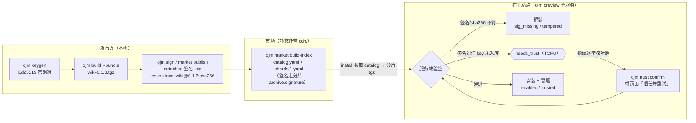

# 教案：脚手架起服 + wiki 方案安装（命令行 / 市场页面两种方式）

记录一次完整实操（2026-10-26）：用 `ojm init` 搭新工程，用 `ojm preview` 起成单服务模式，把 `../oj-wiki` 的 wiki 方案（0.1.3）打包发到市场，再用**命令行**和**市场页面**两种方式把它装上站点。文中命令全部实际跑过，关键输出照实摘录；踩过的坑集中在第 6、7 节。

配套计划文档（含 BDD 用例与逐条问题记录 P1–P6）：`docs/plans/20261026-1715-ojm-init-wiki-market-lesson.md`

## 1. 准备

| 角色 | 目录 | 说明 |
|---|---|---|
| 方案工程（发布方） | `../oj-wiki` | wiki 知识库，契约在 `src/wiki/solution.yaml`（name=wiki，version=0.1.3） |
| 脚手架站点（安装方） | `~/git/only-js/ojm-lesson-remote` | `ojm init` 产物，本教案起在 9779 端口 |
| 市场目录（CDN） | `~/git/only-js/ojm-lesson-cdn` | 存放 catalog + 包 + 签名，用静态服务器托在 9783 端口模拟外部 CDN |

版本：本仓 CLI/runtime 0.2.42（archive 修复将随 0.2.43 发布）、oj 0.1.87。本地跑 CLI 用 `node <oj-module>/packages/cli/bin/ojm.mjs`。

依赖供给：脚手架 package.json 里的 `@oj-module/*` 从本地 verdaccio（4873 端口）取，`~/.npmrc` 已有 scope 映射。不要图省事用 pnpm 的 `file:` 指向本仓——`catalog:`/`workspace:*` 协议一出仓就解析不了，装不上（见第 7 节 P2）。

## 2. 搭站点并起服（preview 单服务）

```bash
ojm init oj-lesson-remote --yes          # 联网装 bin/oj（0.1.87），生成 248 个文件
cd oj-lesson-remote
sed -i '' 's/port: 9778/port: 9779/' config.yaml
# config.yaml 里配上 vars.canonical_origin: "http://localhost:9779"
pnpm install && ojm build                # preview 不自动构建，缺产物会直接报错退出
ojm preview
# [ojm] preview 已启动：http://localhost:9779
```

两点说明：

- **为什么用 preview 而不是 dev**。`ojm dev` 是两套进程：vite 起前端（5174）、oj 起 API（9778），装在这套上的方案 API 不会被 dev 的 oj 供给，冒烟永远 404（P5）。`ojm preview` 是 oj 单进程同时直出 SPA、`/api`、`/cdn`，前后端同站点同端口——这是安装验证要用的形态。
- **起服前必须配 `vars.canonical_origin`**，值就是站点对外地址。安装时服务端拿它把相对市场地址 `/cdn` 补全成绝对 URL；不配直接 503，而且它故意不读请求头的 Host（防伪造），没有将就的余地（P4）。

确认单服务：看进程监听，整个进程树只有 oj 一个 LISTEN（127.0.0.1:9779），然后三个请求打同一 origin：

```bash
curl -o /dev/null -w "%{http_code}\n" http://localhost:9779/                    # 200，SPA
curl -o /dev/null -w "%{http_code}\n" http://localhost:9779/versions.json       # 200
curl http://localhost:9779/api/_system/health                                    # {"status":"OK",...}
```

## 3. 打包并发布到市场

```bash
# ① 发布方密钥，一次生成长期使用（私钥在 ~/.ojm/keys/<id>/，0600）
ojm keygen --id lesson.pub --yes        # 打印 key_id 与指纹，后面 TOFU 核对要用

# ② 方案工程打包（进 ../oj-wiki 跑）
pnpm bundle                             # = ojm build --bundle，产 dist/wiki-0.1.3.tgz
# 输出：sha256：4a6beb33…（确定性打包，重打哈希不变）

# ③ 发布进市场目录（进 oj-lesson-cdn 跑；--real 会进 oj-wiki 重新打包）
ojm market publish --real ../oj-wiki --id lesson.pub --registry-id lesson.local
ojm market build-index --id lesson.pub  # 重建 catalog.yaml + shards/，并签索引

# ④ 离线验包（无需起站点）
ojm market verify --rebuild-index       # 7 项全绿才算完
```

`--registry-id` 不能省。它是签名串的第一段（`lesson.local:wiki@0.1.3:<sha256>`），用来防「A 签的包被搬到 B 的 CDN 装」。站点没配 canonical_origin 时这段比对跳过，本地随便占位；往外部 registry 发则必须等于对方的 canonical_origin（P3）。

市场目录里有什么：`cdn/wiki-0.1.3.tgz` + `.tgz.sig`（包级签名）、`cdn/catalog.yaml` + `.sig`、`cdn/shards/1.yaml` + `.sig`。把 `cdn/` 交给任意静态托管（nginx/OSS 都行），就是一个外部 CDN。

## 4. 安装方式一：命令行

### 4.1 文件直传（不需要任何市场设施）

```bash
# 包要先签名，.sig 放 tgz 旁边，install 会自动随包上传
ojm sign ../oj-wiki/dist/wiki-0.1.3.tgz --id lesson.pub --registry-id lesson.local

ojm install ../oj-wiki/dist/wiki-0.1.3.tgz \
  --site-url http://localhost:9779 --user superadmin --pass 123456
```

首次安装会停在「待信任确认」（TOFU）：终端打印发布方 key_id 和指纹，核对与 keygen 时打印的值一致后：

```bash
ojm trust confirm --task install-<时间戳>-<随机串> \
  --site-url http://localhost:9779 --user superadmin --pass 123456
ojm install ../oj-wiki/dist/wiki-0.1.3.tgz --site-url ...   # 重跑，完成
```

站点是新库时完整走一遍上面的流程即可； trust 确认只需 superadmin 账号，不用登服务器。

### 4.2 从市场 CDN 装

站点自供（把 cdn/ 同步到站点所在机器、保持 config 的 `/cdn` 挂载）：免配置，`ojm install wiki@0.1.3 --site-url ...` 直接装。

外部 CDN：先让站点知道市场在哪（在市场目录工程里跑，地址从该工程 config 的 server.host:port + `/cdn` 推导）：

```bash
cd oj-lesson-cdn
ojm market setup --site-url http://localhost:9779 --user superadmin --pass 123456
# 输出：站点 http://localhost:9779 的市场地址已指向 http://127.0.0.1:9783/cdn

ojm install wiki@0.1.3 --site-url http://localhost:9779 --user superadmin --pass 123456
```

装的过程中站点会去 CDN 拉 catalog → 分片 → 包。验证当天 CDN 服务的访问日志：

```
GET /cdn/catalog.yaml        200
GET /cdn/catalog.yaml.sig    200
GET /cdn/shards/1.yaml.sig   200
GET /cdn/shards/1.yaml       200
GET /cdn/wiki-0.1.3.tgz      200
```

注意没有 `.tgz.sig`：CDN 源不取包级侧车签名，签名信息在分片条目的 `archive.signature` 里（跟文件源的侧车签名等效）。

### 4.3 装完确认

```bash
ojm list --site-url ... 
# NAME  INSTALLED  ENABLED  LATEST  UPGRADABLE  TRUST
# wiki  0.1.3      yes      0.1.3   no          trusted

curl http://localhost:9779/api/wiki/status
# {"code":0,"msg":"ok","data":{"module":"wiki","ok":true,...}}
curl -o /dev/null -w "%{http_code}\n" http://localhost:9779/wiki/space   # 200
```

`list` 显示 trusted、`/api/wiki/status` 匿名可访问、前端路由 200，三件事齐了才算装好了。

## 5. 安装方式二：市场页面（浏览器）

页面入口：登录站点 → 左侧菜单「方案市场」（路由 `/oj-market`）。卡片列出市场上的方案；安装、升级、回滚、启停、卸载都在卡片上操作（仅 superadmin 有操作按钮，其他人只能浏览）。

**首次安装（会碰到信任确认）**：

1. wiki 卡片点「安装」，弹窗自动发起安装并轮询进度；
2. 未知发布方会停在「待信任确认：发布方密钥不在宿主信任库」，框里给出 key_id 和指纹；
3. 跟发布方公布的指纹逐字核对，一致就点「指纹一致，信任并重试」；
4. 弹窗自动续跑，进度条走完显示「done / 冒烟通过：探活、integrity、注册一致性三项全过」，关掉弹窗，卡片状态变成「已启用」。

**自动化 e2e**（playwright，对本仓库 `@playwright/test` 直接写脚本跑，当天两轮通过）：

- 第一轮完整走了 TOFU：登录 → `/oj-market` → 点安装 → 读到 `data-testid="install-trust-fingerprint"` 的指纹并与 keygen 公布值断言一致 → 点「指纹一致，信任并重试」 → 等 `data-testid="install-stage"` 到 done → 截图存证。
- 第二轮（卸载后重跑）：发布方已信任，跳过 TOFU 直接装到 done，卡片断言「已启用」。

写脚本时三个小坑（都犯过）：

- antd 给两个汉字的中文按钮名中间插空格，按钮文本断言要写 `/安\s*装/` 而不是 `"安装"`；
- 装好后的卡片状态文字是「**已启用**」，不是「已装」（「已装」只在列表页 INSTALLED 列）；
- antd 弹窗对 Escape 不敏感，关闭就点「关 闭」按钮。

## 6. 板书：信任模型一张图



要点：私钥只在发布方本机；宿主只存公钥，首次安装靠指纹人工核对建立信任（TOFU），之后同 key_id 的包直接放行。

## 7. 报错速查

| 报错 | 原因 | 处理 |
|---|---|---|
| `ERR_PNPM_VERIFY_DEPS_BEFORE_RUN` / `catalog: isn't supported` | 用 pnpm file: 装本仓包 | 走 verdaccio（第 1 节） |
| `缺少签发方身份：--registry-id` | publish 签名缺参数 | 加 `--registry-id`（本地占位即可，见第 3 节） |
| `缺必填字段 archive`（market verify） | cli ≤0.2.42 的校验 bug：把契约可选的 archive 当必填，真实工程包必红 | 用本仓活代码 CLI，或等 0.2.43（P1） |
| `安装需要站点 canonical origin`（503） | 没配 canonical_origin | config.yaml 配 `vars.canonical_origin` 并重启 |
| 预检 `C2-09 无法读取宿主 runtime 版本` | 服务端没跑过 `ojm build`，缺 `dist/api/versions.json` | 先 build 再起服 |
| 冒烟 `/api/wiki/status` 404 | 用了 `ojm dev` | 换 `ojm preview`（第 2 节） |
| 冒烟 `/api/wiki/status` 401（进程内卸载后重装） | 匿名准入表没热更：运行中的 oj 在卸载时摘了匿名注册，重装写盘但没生效 | 重启 preview 再重装（P6） |
| 待信任确认（TOFU） | 新发布方首次安装 | 核对指纹 → `ojm trust confirm --task <id>`（或页面点信任按钮）→ 重试 |

## 8. 过程中的发现

| # | 发现 | 一句话 |
|---|---|---|
| P1 | `market verify` 把契约可选的 `archive` 当 manifest 必填（REG-CS8 引入），真实工程包验包必红，`--fixture` 包才不红 | 已修（verify 必填集去掉 archive + 回归用例），随 0.2.43 发布 |
| P2 | pnpm v12 不读 package.json 的 `pnpm` 字段；`file:` 装本仓包会把 `catalog:` 协议带出仓解析报错 | 脚手架依赖只能靠 verdaccio 供给 |
| P3 | `market publish --real` 必须给 `--registry-id` | 本地可占位，外部 registry 必须等于对方 canonical_origin |
| P4 | `ojm install` 要求站点配 `vars.canonical_origin`，且故意不读 Host 头 | 配公网 origin，换端口/域名要改并重启 |
| P5 | 安装验证必须用 release 形态：`ojm dev` 下预检读不到 `dist/api/versions.json`，且装的方案 API 不在 dev 服务面 | `ojm build` + `ojm preview` |
| P6 | 运行中的站点「卸载后立刻重装」会让匿名端点 401（模块已上线、匿名准入丢了），重启即恢复 | 教学场景卸载后重启再装；生产滚动发布本就重启，碰不到 |

另有两条市场通道的观察：`market setup` 写的 CDN 地址是从 setup 所在工程的 config 推导的（server.host:port + `/cdn`），不是命令行参数；CDN 源安装不取 `.tgz.sig`，签名走分片里的 `archive.signature`。

## 9. 清理与复跑

```bash
ojm uninstall wiki --site-url http://localhost:9779 --user superadmin --pass 123456
# 业务表保留（需运维手工清理），锁/sidecar/路由/模块清单四处同删
```

重新演示完整 TOFU 流程：换一个新 key_id（`ojm keygen --id <新id>`）重新 `market publish --id <新id>` 让站点不认识这个发布方即可；已信任的 key_id 不用动（信任库跟方案装没装无关）。
