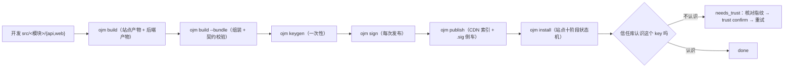

# 解决方案：开发、打包与发布全程指南

日期：2026-10-22 · 适用版本：ojm ≥ 0.2.22
配套参考：devkit 手册 [§11 方案包：打包与分发](../devkit/manual.md)（字段规范）、[§12 签名与信任](../devkit/manual.md)（信任链细节）。
本文是**过程视角**的一步不落 walkthrough；字段与错误码的完整口径以手册为准。

---

## 0. 一句话全景



信任链是硬 **fail-closed**：未签名、签错、key 不被信任的包一律拒装，没有逃生开关。

---

## 1. 开发解决方案模块

### 1.1 形态

一个解决方案 = 一个**自包含模块**：`src/<name>/api/`（后端，可选）+ `src/<name>/web/`（前端，可选），外加一份**方案级契约** `src/<name>/solution.yaml`。模块开发细节（handler 四红线、契约代码生成、provider 接管等）见 devkit 手册 §1–§6，此处只列发布路径相关的三件事。

### 1.2 三件事

1. **写契约** `src/<name>/solution.yaml`（推荐模块级位置；工程根 `solution.yaml` 为旧写法仍可）：
   - 身份段：`name` / `version` / `summary`；
   - `api` 段（纯前端方案可整段省略）：模块名、挂载前缀、`tables`（必须与 `api/src/schema.yaml` 表集一致）、`deps`、`anonymous_paths`；
   - `web` 段（纯后端方案可整段省略）：`entry` / `css` / `integrity`；
   - `routes`：可由 web 侧 `entry.ts` 的路由 handle 自动派生（单一真源），手工书写仅在未迁移方案兼容；
   - 文件名刻意**不叫 `manifest.yaml`、也绝不放进 `<模块>/api/`**：oj 按 `manifest.yaml` 枚举后端模块，两条枚举必须互不干扰（手册 §1.2）。
2. **登记前端**：`web.config.ts` 的 `modules` 数组加上模块（否则 `ojm build` 不产出该模块的站点产物，打包会报「缺少本方案的站点产物」）。
3. **确认双语**：web 侧 `locales/zh-CN.json` 与 `en-US.json` 齐备（打包期 fail-fast 校验）。

### 1.3 开发期命令

```bash
pnpm dev          # devServer + oj 后端；src/<name>/api 保存即热更
pnpm typecheck    # 前端工程
pnpm typecheck:api
pnpm new          # = ojm new <name>：脚手架内再生成一份用户方案骨架（多方案并存）
```

---

## 2. 构建与打包

```bash
ojm build               # ① 站点产物 web/dist/modules/<name>/… + 后端产物 api/dist/<name>-<ver>/
ojm build --bundle      # ② 组装全部用户方案 dist/<name>-<version>.tgz（确定性打包：同源同字节，sha256 打印在日志里）
ojm build --bundle crm  # 只打 src/crm/ 这一份（--bundle=crm 等价）
```

要点（细节见手册 §11.1）：

- `--bundle` **只组装、不重跑构建**——必须先 ① 后 ②。
- **多方案**：一份脚手架可有多份用户方案（`pnpm new` 逐个生成，各自 `src/<name>/solution.yaml`）；
  无参 `--bundle` 全部打包、逐个校验独立出包；**框架自带方案自动排除**（名单 `src/.ojm-builtin.json`，
  逐条日志注明「框架自带，跳过」）。两段式：全部校验通过才开始写盘，任一失败 dist/ 零增量。
- 打包即校验，坏清单出不了包：契约字段/类型白名单/保留名、表集对照、双语齐备，全部 fail-fast 并全量列出违规项。
- **方案包只带自己的模块**：`web/dist/modules/` 里的脚手架模板模块（home/login/…）属宿主面，不会也不该入包——安装器会把包内模块整树覆盖进目标站。
- **私钥形态文件禁入包**（`*.pem` / `*.key` / `*.p12` / `*.pfx` / `.env` 系 / `id_ed25519` / `id_rsa` 等，打包自检红线）：私钥入包 = 信任根基烧毁。

---

## 3. 签名与私钥保存（重点）

### 3.1 为什么必须签

方案的安装信任建立在 **Ed25519 detached 签名 + 站点信任库**之上。未签名包直接被拒（`sig_missing`），**没有任何「先装了再说」的开关**。签名不是构建副产品：`ojm build --bundle` 只出包，签名是你作为发布方的显式动作。

### 3.2 密钥对：一次性生成

```bash
ojm keygen --id <publisher>.<key-name>
# 例：ojm keygen --id acme.release-2026
```

- **key_id 命名空间**：`<publisher>.<id>` 全小写、至少两段（禁裸通用名如 `mykey`）——它会被写进 `.sig` 并在安装侧做命名空间校验（违约报 `sig_key` 拒装）。
- **落点**：缺省 `~/.ojm/keys/<id>/`，私钥 `private.pem`（权限 0600）+ 公钥 `public.hex`。
- **`--out` 指进工程树必须 `--yes` 显式确认**——私钥入仓 = 泄露。正常情况下永远不需要这么做。

### 3.3 私钥保存纪律（逐条照做）

| 纪律 | 原因 |
|---|---|
| 私钥只活在 `~/.ojm/keys/<id>/`，**永不出这个目录** | 唯一受管位置；换机/重装时重新生成新 key_id 并走信任流程（见 3.5 轮换） |
| **绝不提交进任何仓库**、绝不写进方案包（打包自检会拦，但别依赖最后一道闸） | 公钥可以到处分发，私钥泄露 = 任何人都能以你的身份发包 |
| CI 里签名：用临时密钥对，发布后即吊销；或经 CI secret 注入并只在内存停留 | 长期私钥不落 CI 工件/缓存 |
| 备份只备份目录本身（加密盘/密码管理器），备份里同样视为机密 | 恢复时校验权限仍为 0600 |
| 一台开发机可有多把 key（按项目/环境分 `<key-name>`），但**一次发布固定一把** | `.sig` 记录 key_id，安装侧按 key_id 查信任库 |

### 3.4 每次发布：签名

```bash
ojm sign dist/<name>-<version>.tgz --id acme.release-2026 --check
```

- 产物 = 同目录 `<tgz>.sig`（detached 侧车）；`ojm install` 上传 tgz 时会**自动探测**同目录 `.sig` 随包上传。
- `--check` 离线自检（用对应公钥验一遍）——不必等安装失败才发现签错。
- 签了再改包 = 签名作废：重打包必须重签（tgz 确定性打包，同源同字节时旧签名仍有效，但惯例是出包即签）。

### 3.5 key 轮换

信任库**首次绑定不可改**：轮换 = 生成新 key_id、用它签新版包、站点 `ojm trust add` 登记新公钥、旧 key `ojm trust revoke`（吊销只阻断新装/升级，不动已装方案）。

---

## 4. 发布

### 4.1 file 源（直传，最简单）

```bash
ojm install dist/<name>-<version>.tgz \
  --url http://<站点> --user admin --pass …
```

适合内网/单站交付。`.sig` 同目录自动随包上传。

### 4.2 CDN 源（多站点分发）

发布目录约定三个文件：`bundles.yaml`（版本清单）、`manifests.yaml`（聚合清单）、分发包 `<name>-<version>.tgz`（+ `.sig`）。

```bash
ojm publish <发布目录>     # 索引重算（确定性 stringify）+ detached 签名（.sig 侧车）+ 写回
```

- CDN 推送与本地写回走同一发布面；发布方 key 与 `ojm sign` 同身份体系（`~/.ojm/keys`）。
- 索引有防投毒规范（`versions[].file` 必须逐字 `<name>-<version>.tgz`、下载段立即比对 size、恒 `no-cache`），详见手册 §11.2。
- 站点侧消费：`ojm install <name>[@version]`，从 CDN 拉 Form B 索引再拉包。

### 4.3 发布前 checklist

- [ ] `ojm build` + `ojm build --bundle` 均通过，sha256 记录进发布单；
- [ ] `ojm sign … --check` 通过，`.sig` 与 tgz 同目录；
- [ ] 版本号已升（方案契约 `version` 与文件名一致）；
- [ ] CDN 发布已跑 `ojm publish`（索引与侧车同步）；
- [ ] 新 key 首次发布：提前把公钥指纹交给运维，避免安装卡在 needs_trust。

---

## 5. 安装与信任（运维侧）

```bash
ojm install <file.tgz | name[@version]> --url <站点> --user admin --pass …
ojm trust ls                     # 列已信任 key（含 sha256 指纹）
ojm trust confirm --task <id>    # needs_trust 待确认 key 入库，然后重跑 install
ojm trust add <key_id> <pubhex>  # 直接登记（预信任）
ojm trust revoke <key_id>        # 吊销
```

- 十阶段状态机（下载 → 验签 → 解包 → 迁移 → …→ 冒烟），失败语义三种：`failed`（锁前段，清场重跑）/ `partial`（锁后段，部分生效）/ `needs_trust`（第五终态，非成功）。
- **TOFU（首次使用即信任）**：信任库不认识的 key，安装停在 `needs_trust` 并展示公钥指纹——**与发布方逐字核对指纹后** `trust confirm` 入库，重跑同一安装续跑。
- 核对指纹的可靠通道：当面/电话/已建立的加密聊天，**不要**用包的同一 CDN 页面上的指纹（那正是攻击者能篡改的地方）。
- 第一方方案走模板内置公钥 bootstrap（首装免 TOFU）；模板内只有公钥，私钥只活在发行人 `~/.ojm/keys/`。

---

## 6. 常见失败速查

| 症状 | 原因 | 药方 |
|---|---|---|
| `sig_missing` 拒装 | 没签或 `.sig` 没随包 | `ojm sign --check` 后确认 `.sig` 与 tgz 同目录再装 |
| `tampered` 拒装 | 签完又动过包，或传输损坏 | 重打包重签；核对 sha256 |
| `sig_key` 拒装 | key_id 不是 `<publisher>.<id>` 全小写两段式 | 换合规 key_id 重新 keygen |
| `needs_trust` 终态 | 站点第一次见这个 key | 逐字核对指纹 → `trust confirm --task <id>` → 重跑 install |
| 打包报「缺少本方案的站点产物」 | `web.config.ts` 没登记模块，或没先 `ojm build` | 登记后重跑构建再打包 |
| 打包报「缺少 bundle 级契约」 | 没有 `solution.yaml`（工程根或 `src/<模块>/`） | 补契约（§1.2） |
| `ojm publish` 后站点装不到新版 | 索引没重算/没推上去 | 重跑 `ojm publish <发布目录>` 并确认 CDN 上三文件同步 |
