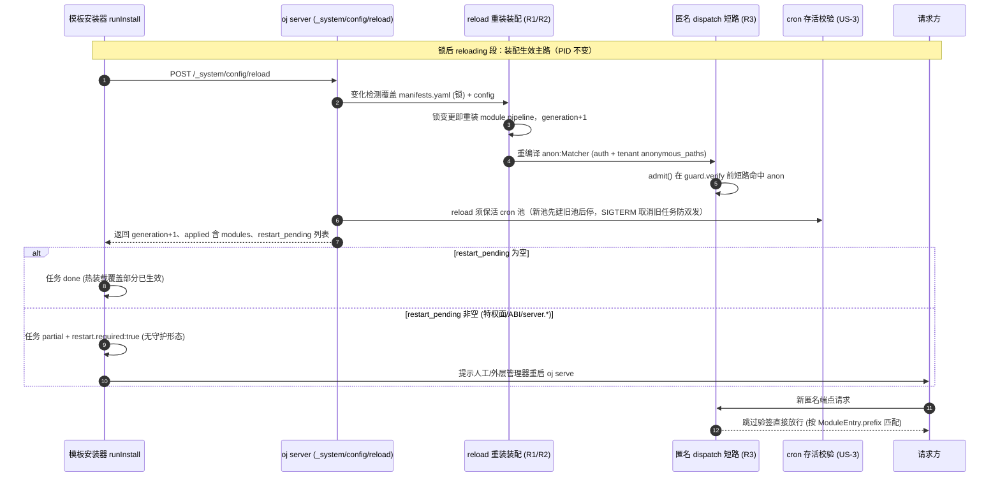
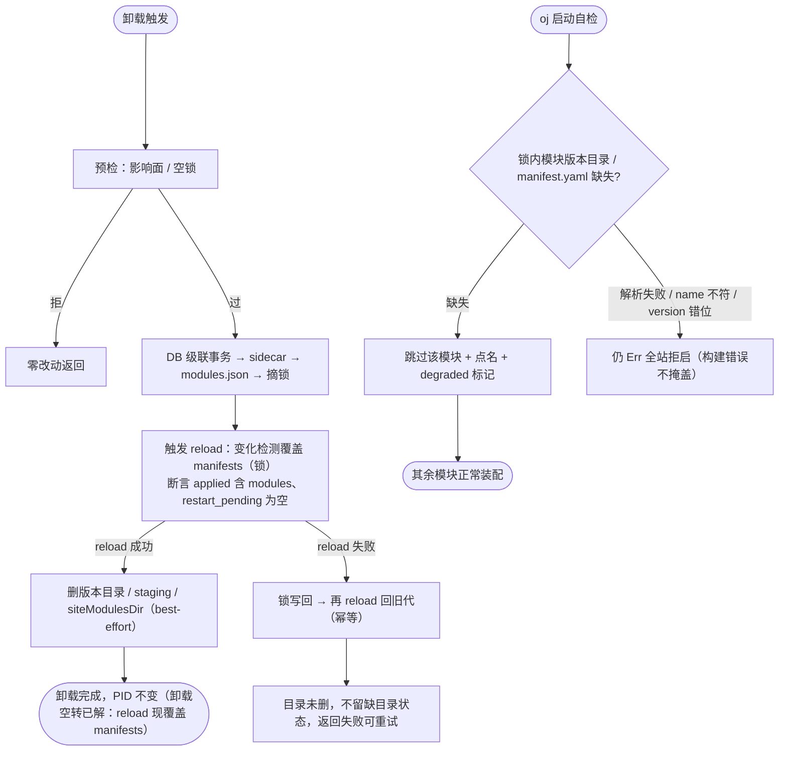

# 上游 PR 提案：解决方案免重启生效（oj Rust 侧支持）

> 状态：**待提交上游**（本仓 `oj-module` 为只读分析，上游 `oj` 改动由本提案描述，由人工提交）。
> 关联本仓方案：`docs/plans/20261105-hot-apply-final.md`（定稿）、`docs/plans/20261105-hot-apply-phased-plan.md`（分期与本仓已落地 Phase 1–4）。
> 本提案对应本仓计划书中的上游依赖 **US-1 ~ US-4**。**简化原则**：热装配 = 装/卸后调用一次「正确的 `_system/config/reload`」，不再引入独立的换代身份 / 每代 anon 表机制。

## 0. 背景

`oj` 是单进程常驻服务。当前从市场安装/卸载解决方案后要求重启进程。本仓已完成模板侧的安装/卸载/补偿/门禁编排，但「装/卸真正生效」只能由 `oj` 自身（Rust 侧）实现。原方案拆成 US-1（换代身份）/US-2（每代 anon 表）两个独立机制；经复核，二者本质都是「`_system/config/reload` 没有把 `manifests.yaml`（锁）驱动的装配纳入重装范围」这一单一缺陷的两面——因此**折叠为一个正确的 reload**，方案更内聚、更易验证。

## 1. 核心思路：热装配 = 一次正确的 reload

装/卸两路径改写的资产不同：

- **安装**：同时改 `config.yaml`（追加 anon、bump `ojm_install_seq`）+ `manifests.yaml`（锁加条目）。
- **卸载**：**只改 `manifests.yaml`（摘锁），`config.yaml` 一字不动**。

> **锁在哪（务必对齐）**：`manifests.yaml` 不是 dev 树 `src/`、也不是前端树 `dist/web`，而是 **`oj serve` 的 served 布局 `dist/api/manifests.yaml`**——这是 server 装配模块的真源。build 期 `migrate.ts` 把 `src/<name>/{api,web}` 物化进 `dist/api` 与 `dist/web`，并写出这份锁（oj 以「目录含 `manifests.yaml`」判 `is_release`）；版本目录 `dist/api/<name>-<ver>/`、`versions.json` 同根。`config.yaml` 在 jail 根（vars `ojm_install_seq` 自增），前端产物在另根 `dist/web/modules` + `dist/web/modules.json`。安装/卸载在部署后**运行时**改的正是 served 树里这份锁。

若 reload 的变化检测只看 `config.yaml`，卸载时 `config` 未变 → `unchanged=true` → 不重装装配 → 模块仍挂载（**卸载空转**）。故方案核心只有一条：

> **`_system/config/reload` 必须同时以 served 布局的 `manifests.yaml`（`dist/api/manifests.yaml`，oj 装配真源）为变化检测与重装对象，并据此重装 module pipeline + 重编译 anon 表；cron 不被 reload 拆掉。**（注意：扫描的是 `oj serve` 实际读取的 served 形态，不是 `src/` 或 build 中间产物——否则运行时改锁 reload 仍读旧，卸载空转无解。）

满足此条后，安装/卸载只需在落盘后调用一次 reload，绝大多数场景 PID 不变、亚秒级生效。

## 2. 上游需落实的改动

### 2.1 reload 覆盖 manifests 装配（原 US-1 实质）

- **锁的物理位置（与 §1 对齐）**：reload 必须重扫的是 `oj serve` 实际读取的 served 布局 **`dist/api/manifests.yaml`**（版本目录 `dist/api/<name>-<ver>/`、`versions.json` 同根），不是 dev `src/` 也不是前端 `dist/web/modules`。装/卸在运行时改的正是这份 served 锁，故只有扫描 served 形态才能感知变化；扫错路径则 reload 永远读旧锁，「卸载空转」无解。
- **变化检测短路是唯一缺口（核心改动小）**：`do_reload` → `App::from_config` 本就会重读 `manifests.yaml` 重建路由表，故「路由重装」几乎免费；真正缺口在变化检测——sha 只算 `config.yaml`，卸载只改锁 → `unchanged=true` → 根本走不到装配。安装今天其实能装上（config 被改），但 `applied` 报的是 config 段名而非模块名 → 模板侧 `reloadAndAssert` 必败。故核心改动 = sha 纳入锁文件 + 锁 diff 进 `applied`（见 §2.7 双符号格式）。
- **暗礁一：StableState.modules / SchemaRegistry 冻结（提案原低估的工作量）**：Backend 复用路径下，`modules` map（`ModuleCtx`：http.module、deps 守卫、db 绑定重定向）与 `SchemaRegistry`（表白名单，SQL 红线的来源）都是启动期冻结的 `Arc`。只重建路由表会让热装模块「路由通但上下文全丢」——deps 守卫不设防、表白名单没它的表。修法：将这两个字段收进**单一 `ArcSwap<AssemblyState>`**（modules + schema 打包），每代原子换表，复用现有装配函数按新锁重建；**不要对两字段各做一次 swap**（否则在途请求可能在两次 swap 之间读到「新 modules + 旧 schema」，对刚装模块的表做白名单外 SQL）。不重建 Backend、不二次 init 插件、不触 `Arc::get_mut` 红线；deps 守卫与 db 重定向随 `AssemblyState` 同步失效/重定向，uninstall 后依赖方须同步失活。
- 每次 reload 重建 `AppState.pipeline` 时从 manifests 重装 module 集合；`applied` 须按 §2.7 双符号格式报告本次变化模块（`+name@ver` / `-name@ver`），供模板侧 `reloadAndAssert` 分符号断言。
- `unchanged` 语义：manifests 或 config 任一变化即 `unchanged=false`；*两者均未变*才 `true`（模板侧据此判 reload 真生效，见 §2.7 / §5）。
- 不引入额外 HTTP `scope` 参数（少一个对外契约面）。

### 2.2 reload 重编译匿名表（原 US-2 实质，路线 C）

- 每次 reload 重建 `pipeline` 时，由 `auth.anonymous_paths` + `tenant.anonymous_paths` **重编译** `anon:Matcher`（不依赖「每代单独存表」）。
- 匹配实现直接复用 serve 已有的同语义 `path_matches`（不另写一套匹配逻辑），仅把「matcher 源」从插件 init 期固化的 `OnceLock<Guard>` 改为每代重编译——**不动插件 ABI**（这正是提案选路线 C 而非改 anon 表的根本原因，也对应上游「oj-auth anon 表进程级冻结」暗礁二）。
- `admit()` 在 `guard.verify` **之前**短路：命中 `anon` 即跳过验签。
- 匹配按 `ModuleEntry.prefix` 计算（可与模块名不同、可多段），不按「首段 = 模块名」。
- 保留段黑名单：`_platform` / `_system` / `auth` / `_lifecycle` 下的新增匿名条目一律拒装（模板侧 preflight 已挡声明，上游 dispatch 亦须 honor，双保险）。
- 删除语义：运行期新增的匿名条目删除即立即失效（免重启）；启动期已在 config 的条目删除后 guard 静态表仍含，需重启才彻底撤销——其暴露面受「匿名只对已注册路由有效 + 卸载后路由已无」限制，故规则：**删免重启；但安装 preflight 必须拒绝「目标 prefix 在 config 中存在未被本次 manifest 声明的匿名条目」**（同 prefix 换装不静默继承，本仓 E8 已实现）。
- WS 匿名（P1）：每代把 anon 集合注入 `mirror_routes` + 建 `WsRegistry` 支持卸载主动 close；**P0 只承诺新连接按新代判定**，本 PR 不含 WS 主动断开（P1）。

### 2.3 capabilities 门禁（host 自报 reload 能力）

`ojInfo()` 增 `capabilities: string[]`，声明宿主 reload 已具备的能力子集，例如：

```json
{ "capabilities": ["reload.assemble_modules", "reload.anon_per_reload", "reload.cron_survives"] }
```

- 模板侧在 **preflight（锁之前、零痕迹）** 比对 `manifest.requiresCapabilities` 子集，缺失即 `failed(host_capability)`。
- 不放 market meta（那是模板版本，回答不了宿主能力）；不做反向门禁（老模板不可变，靠 oj 保持老语义）。
- 老 oj（无 `capabilities` 或不含 `reload.assemble_modules`）视为能力缺失 → 模板侧 fail-closed（声明了 requiresCapabilities 即拒），避免「静默卸载空转」。

### 2.4 cron 存活校验（US-3，先验证不重建）

**降级为验证优先**：现有 `do_reload` 已是「新池先建、旧池后停、SIGTERM flag 指针换代」，cron 大概率已随 reload 存活，**不急着改造**。但 US-3 不可省为空——它须作为**硬验收闸口**（见 §5 验收 7），证明 reload 后 cron 真活着，否则「装完 cron 生效」是假象。仅当验收 7 实测失守才进入重建路径。

重建路径（仅在验收 7 失守时启用，不默认实施）：cron 驱动改独立 OS 线程 + current_thread runtime（同 `TaskPool` worker），生命周期随进程而非随 reload 的临时 rt。

- **双红线（验收 7 须同时守住）**：① reload 触发后原 cron **仍触发**（约 5 分钟后）；② **不双发**——旧池 `SIGTERM` flag 须真取消旧任务，否则新旧池短暂并存会把同一任务 fire 两次。
- 若需重建：旧池停机加超时（保 N-1 代，超时记 warn），避免卡死 worker 挂死整次 reload；commit 与 `current_sha` / tasking 落定顺序调整为「tasking 就绪 → commit → current_sha」，消除 SIGTERM 停不到新池的窗口。

> 此条与「是否调用 reload」正交：无论 reload 怎么实现，只要它重建事件循环/cron 池，cron 就会静默停摆**或双发**。故 US-3 不能折叠进 reload，必须单列为验收闸口。

### 2.5 启动自检降级（US-4，不可省边界）

- 锁内版本目录 / `manifest.yaml` **缺失** → 跳过该模块 + 点名 + `/_system/config` 标 degraded（不再全站拒启）。
- `manifest.yaml` **解析失败 / name 不符 / version 错位** → 仍 `Err`（构建错误不掩盖）。

> 与 reload 无关，是启动自检。卸载「reload 失败 → 锁写回 → 再 reload 回旧代」的编排本仓已落地（Phase 4），其运行时成立前提正是 §2.1 的「reload 覆盖 manifests」。

### 2.6 restart_pending → partial + 换进程（P4，不可省边界）

reload 返回的 `restart_pending` 非空（触及特权面 / 插件 ABI / `server.*`）时，仍须如实标 `partial + restart.required:true`：

- **T1 无守护 / T3 外部管理器**：提示人工或外层 `Restart=always` 重启 `oj serve`。
- **T2 有壳 `oj supervise`**：worker 调 `POST /_system/restart` 自动换进程，续跑 smoke → done（纯壳 supervisor 为独立提案，不在本 PR）。

### 2.7 契约细节：applied 双符号格式 + unchanged 语义

（供模板侧 `reloadAndAssert` 与上游对齐，避免格式对不上导致验收假绿）

- `applied` 为变化模块列表，每条 **必须带 op 符号** 且可解析为 `(op, name, ver)`：
  - 安装生效：`+name@ver`
  - 卸载生效：`-name@ver`
- 模板侧 `reloadAndAssert` 据此**分符号断言**：安装期望集合含 `+name@ver`；卸载期望集合含 `-name@ver`；两者都要求 `applied` **真包含该条目**，而非泛泛「`applied ⊇ modules`」字符串包含。
- `unchanged` 语义：`manifests` 或 `config` 任一变化即 `false`；*两者均未变*才 `true`。要求 `unchanged===false` 仅在我们「刚做了确有变更的安装/卸载」时成立；纯 no-op reload 应允许 `unchanged=true` 且 `applied` 为空（模板不得据此误判失败）。
- 此契约是「卸载空转」回归的唯一拦截点，无论实现走原方案还是本简化方案都必须保留。

## 3. 三轨形态与判定（不变）

| 轨 | 形态 | 安装结果 |
|---|---|---|
| **T1 无守护** | `oj serve` / `--daemon` | 热装载照常；restart_pending 非空 → 任务 `partial + restart.required` |
| **T2 有壳** | `oj supervise` | 调 `_system/restart` 自动换进程，续跑 smoke，`done` |
| **T3 外部管理器** | systemd/k8s/nssm 托管 `oj serve` | 同 T1；外层 `Restart=always` 时人工/外层重启后生效 |

判定只有一处：`reload` 返回 `restart_pending` 非空 → 走换进程；空 → `done`。T1/T2 差异只体现在端点两种响应（202 / 409），安装器不自己探测有没有壳。

## 4. 范围与排除

- **本 PR 包含**：`_system/config/reload` 覆盖 manifests 装配（§2.1，含暗礁一 ArcSwap）+ 重编译 anon（§2.2）+ `ojInfo().capabilities`（§2.3）+ cron 存活校验（§2.4，先验证不重建）+ 启动降级（§2.5）+ applied/unchanged 契约（§2.7）。
- **本 PR 不含**：P4 纯壳 `oj supervise`（换进程路径，独立提案）；WS 主动断开（P1）；seed 随装（P3）；cron 随装（后续项）。
- **不做**：文件监听驱动重扫；全量 seed 重放；补跑空窗内错过 cron 触发；反向兼容门禁（新 oj + 老模板靠 oj 保持老语义）。

## 5. 联调验收（本仓 → 上游）

本仓已为每项预留 stub 单测（以 `reload`/`fsp`/`db` 注入模拟上游行为），上游发版后在真机复测：

| 上游项 | 真机复测验收 | 本仓已落桩 |
|---|---|---|
| §2.1 reload 覆盖 manifests | 验收 1（generation+1）、3（卸载顺序真源，解卸载空转）、16（capabilities 缺失写锁前失败生效） | preflight 门禁读端 + `reloadAndAssert`（§2.7：`unchanged===false` 且 `applied` 含 `+name@ver`/`-name@ver`） |
| §2.2 reload 重编译 anon | 验收 2（匿名 200 真生效） | 无守护 partial 判定已就位 |
| §2.4 cron 存活校验 | 验收 7（reload 后原 cron 仍触发 + 不双发：旧池 SIGTERM 须取消旧任务） | — |
| §2.5 启动降级 | 验收 5（缺目录跳过、启动降级） | uninstall reload 失败回滚编排 |

> 关键安全网：`reloadAndAssert` 按 §2.7 **双符号**断言 `unchanged===false` 且 `applied` 含 `+name@ver`（装）/ `-name@ver`（卸），是把「reload 是否真的重装了模块」变成可观测、可 fail 的契约——无论采用原方案还是本简化方案都必须保留，它是「卸载空转」回归的唯一拦截点。

> 提交上游后，本仓计划书「US-1~US-4 阻塞跟踪」状态可更新为「已提交 PR #xxx」，真机复测通过后再标记验收项绿。

## 6. 交互调用与重启流程图（mermaid）

> 绝大多数是**热装配主路**（PID 不变、亚秒级生效）；只有涉及特权面 / ABI / `server.*` 的少数变更才走**换进程**（P4 纯壳 supervisor）。原 US-1/US-2 已折叠为「一次正确的 `_system/config/reload`」节点，US-3/US-4 与 restart_pending 路径为不可省边界。

### 6.1 安装热装配交互时序图（免重启主路）



> 前置门禁：模板侧 preflight 比对 `manifest.requiresCapabilities` 与 `ojInfo().capabilities`，缺 `reload.assemble_modules` 即写锁前 `failed(host_capability)`（§2.3），不碰锁/库表/清单。

### 6.2 重启判定与换进程流程图（少数特例）

```mermaid
flowchart TD
    START([reload 返回 restart_pending 非空]) --> Q{运行形态?}
    Q -->|T1 无守护 / T3 外部管理器| P[任务标 partial + restart.required:true]
    P --> P1[人工或外层 Restart=always 重启 oj serve]
    P1 --> BOOT[新进程启动]
    Q -->|T2 有壳 oj supervise| R[worker 调 POST /_system/restart]
    R --> S[worker 优雅退出:<br/>停 cron → 停 accept → 等在途请求（上限 30s）]
    S --> X[exit 78]
    X --> SP[父进程 spawn 新 worker<br/>boot.seq+1 经 env 下发]
    SP --> BOOT
    BOOT --> D{模块版本目录 / manifest.yaml 缺失? (US-4)}
    D -->|缺失| SKIP[跳过该模块 + 点名 + /_system/config 标 degraded<br/>不全站拒启]
    D -->|解析失败 / name 不符 / version 错位| ERR[仍 Err fail-fast（构建错误不掩盖）]
    SKIP --> READY[新 worker ready（专用 fd JSON）<br/>（boot, generation）单调]
    ERR --> READY
    READY --> DONE[新代生效，续跑 smoke → done]
```

### 6.3 卸载顺序与启动降级（US-4 收口）



> 图 6.2 / 6.3 中「reload 失败锁写回」「摘锁即掉挂载」的运行时成立前提，正是 §2.1（reload 覆盖 manifests 重装装配）与 §2.5（启动降级）。本仓 `uninstall.ts` 已实现上述编排，上游落位 §2.1 后「摘锁即生效」才在真机成立。
