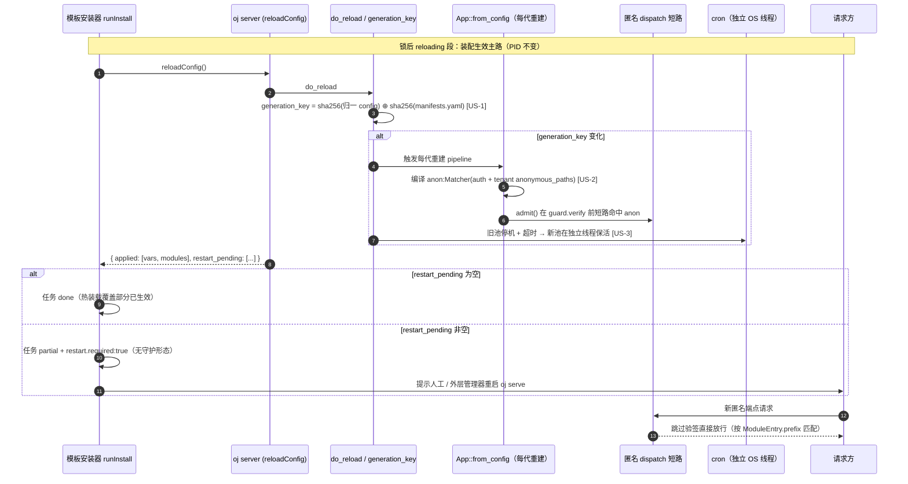
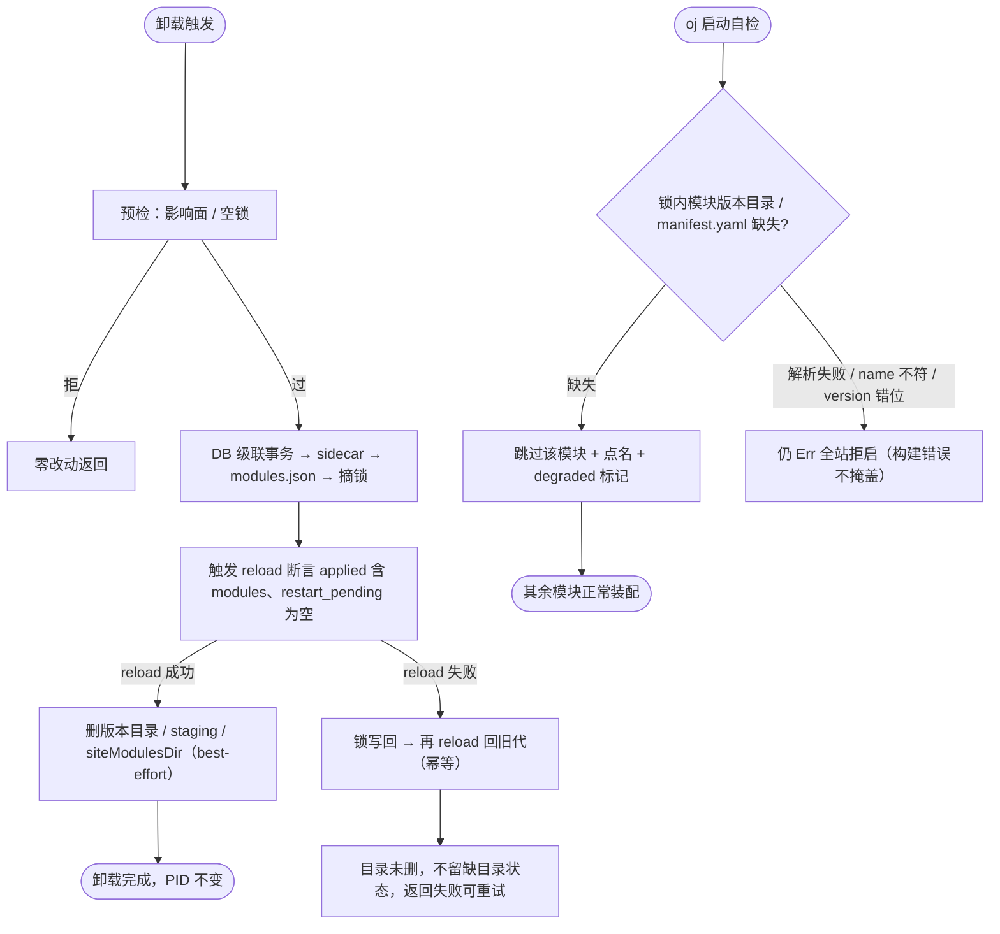

# 上游 PR 提案：解决方案免重启生效（oj Rust 侧支持）

> 状态：**待提交上游**（本仓 `oj-module` 为只读分析，上游 `oj` 改动由本提案描述，由人工提交）。
> 关联本仓方案：`docs/plans/20261105-hot-apply-final.md`（定稿）、`docs/plans/20261105-hot-apply-phased-plan.md`（分期与本仓已落地 Phase 1–4）。
> 本提案对应本仓计划书中的上游依赖 **US-1 ~ US-4**。本仓模板侧编排已就绪（`tests/lifecycle` 全绿 571/571），但热装配真正生效依赖本提案在 `oj` 落地。

## 0. 背景

`oj` 是单进程常驻服务。当前从市场安装/卸载解决方案后要求重启进程。本仓已完成模板侧的安装/卸载/补偿/门禁编排，但以下四件事只能由 `oj` 自身（Rust 侧）实现，模板侧无法替代：

- 锁（manifests.yaml）变化真正触发装配（换代身份）。
- 匿名路由按「代」即时生效（每代 anon 表 + dispatch 短路）。
- cron 在 reload 后不静默停摆（独立 OS 线程）。
- 启动期缺模块目录时不致全站拒启（自检降级）。

验收目标见定稿方案 §5：验收 1/2/5/7 实际生效依赖本提案；验收 3/4/6/15/16 本仓已覆盖（其中 16 的「断言生效」仍待本提案落地 `ojInfo().capabilities`）。

## 1. US-1 换代身份（§3.1）+ capabilities 字段（§3.6）

### 1.1 换代身份

`do_reload` 的幂等键从 `sha(config)` 扩为：

```
generation_key = sha256(归一 config 文档) ⊕ sha256(dist/api/manifests.yaml 原文)
```

- 锁（manifests.yaml）变化即产生新 `generation_key`，卸载摘锁后自动触发装配 → 解决「卸载空转」（定稿 §3.1）。
- `diff_configs` 返回新增 `modules` 段：锁增删按 `+name@ver` / `-name@ver` 计入 `applied`。
- 不引入 HTTP `scope` 参数（少一个对外契约面）。
- `reloadConfig` 响应 `applied` 须在锁变更时含 `modules`（模板侧 `reloadAndAssert` 以 `applied` 含 `modules` 做终态断言；缺省期望 `["vars"]` 不变）。

### 1.2 `ojInfo().capabilities`（§3.6 门禁前提）

`ojInfo()` 增 `capabilities: string[]` 字段，声明宿主已具备的能力子集，例如：

```json
{ "capabilities": ["reload.api", "reload.modules_in_key", "anon.per_generation"] }
```

- 模板侧在 **preflight（锁之前、零痕迹）** 比对 `manifest.requiresCapabilities` 子集，缺失即 `failed(host_capability)`。
- 不放 market meta（那是模板版本，回答不了宿主能力）；不做反向门禁（老模板不可变，靠 oj 保持老语义）。
- 老 oj（无 `capabilities` 字段）视为 `[]` → 模板侧 fail-closed（声明了 requiresCapabilities 即拒）。

**验收**：验收 16（host_capability 写锁前失败，断言生效）、验收 1（generation+1）。

## 2. US-2 匿名表随代（§3.2，路线 C）

走「每代 anon 表 + dispatch 短路」，否决重建守卫 / Router 标记方案。

- `App::from_config` 每代重建 `AppState.pipeline`，在 `Pipeline` 内置 `anon: Matcher`，由 `auth.anonymous_paths` + `tenant.anonymous_paths` 共同编译。
- `admit()` 在 `guard.verify` **之前**短路：命中 `anon` 即跳过验签。
- 匹配按 `ModuleEntry.prefix` 计算（可与模块名不同、可多段），**不按「首段 = 模块名」**。
- 保留段黑名单：`_platform` / `_system` / `auth` / `_lifecycle` 下的新增匿名条目一律拒装（模板侧 preflight 已挡声明，上游 dispatch 侧亦须 honor，双保险）。
- 删除语义：运行期新增的匿名条目删除即立即失效（免重启）；启动期已在 config 的条目删除后 guard 静态表仍含，需重启才彻底撤销——其暴露面受「匿名只对已注册路由有效 + 卸载后路由已无」限制，故规则：**删免重启；但安装 preflight 必须拒绝「目标 prefix 在 config 中存在未被本次 manifest 声明的匿名条目」**（同 prefix 换装不静默继承，本仓 E8 已实现）。
- WS 匿名（P1）：每代把 anon 集合注入 `mirror_routes` + 建 `WsRegistry` 支持卸载主动 close；**P0 只承诺新连接按新代判定**，本 PR 不含 WS 主动断开（P1）。

**验收**：验收 2（声明匿名端点装完 200，实际生效）。

## 3. US-3 cron 存活（§3.3）

cron 驱动改独立 OS 线程 + current_thread runtime（同 `TaskPool` worker），生命周期随进程而非随 reload 的临时 rt——否则「装完 cron 生效」是假的。

- 旧池停机加超时（保 N-1 代，超时记 warn），避免卡死 worker 挂死整次 reload。
- commit 与 `current_sha` / tasking 落定顺序调整为「tasking 就绪 → commit → current_sha」，消除 SIGTERM 停不到新池的窗口。

**验收**：验收 7（reload 触发 5 分钟后原 cron 任务仍被触发）。

## 4. US-4 启动自检降级（§3.4）

**先失去可达性，再失去文件，且 reload 必须成功后才删盘**：

1. 预检（影响面 / 空锁）→ 拒则零改动。
2. DB 级联事务 → sidecar → `modules.json` → **摘锁**。
3. 触发 `reload` → 断言 `applied` 含 `modules`、`restart_pending` 为空。
4. reload 成功后才删版本目录 / staging / `siteModulesDir`（best-effort，失败只 warn，锁是真相）。
5. reload 失败 → 锁写回 → 再 reload 回旧代（幂等）；目录未删，不留缺目录状态。

**启动自检降级**：锁内版本目录 / `manifest.yaml` **缺失** → 跳过该模块 + 点名 + `/_system/config` 标 degraded（不再全站拒启）；`manifest.yaml` **解析失败 / name 不符 / version 错位** → 仍 `Err`（构建错误不掩盖）。

> 注：本仓 `uninstall.ts` 已实现上述「先失可达性再失文件 + reload 失败锁写回」的编排与 fail-closed 回滚（Phase 4 已落地，reload 面经注入接线，dev/test 无 server 回落 no-op）。本提案要点是 `oj` 的 `reloadConfig` 在锁变更时**真正按 manifests 摘要重装配**（即 US-1 的 `generation_key` 驱动），使「摘锁即掉挂载」在运行时成立。

**验收**：验收 5（缺目录跳过、启动降级），验收 3 卸载顺序真源。

## 5. 范围与排除

- **本 PR 不含**：P4 纯壳 `oj supervise`（换进程路径，独立提案）；WS 主动断开（P1）；seed 随装（P3）；cron 随装（后续项）。
- **不做**：文件监听驱动重扫；全量 seed 重放；补跑空窗内错过 cron 触发；反向兼容门禁（新 oj + 老模板靠 oj 保持老语义）。

## 6. 联调验收（本仓 → 上游）

本仓已为每项预留 stub 单测（以 `reload`/`fsp`/`db` 注入模拟上游行为），上游发版后在真机复测：

| 上游项 | 真机复测验收 | 本仓已落桩 |
|---|---|---|
| US-1 | 验收 1（generation+1）、16（capabilities 缺失写锁前失败生效） | preflight 门禁读端 + reloadAndAssert `modules` 断言 |
| US-2 | 验收 2（匿名 200 真生效） | 无守护 partial 判定已就位 |
| US-3 | 验收 7（cron reload 后仍触发） | — |
| US-4 | 验收 5（启动降级）、3（卸载顺序） | uninstall reload 失败回滚编排 |

> 提交上游后，本仓计划书「US-1~US-4 阻塞跟踪」状态可更新为「已提交 PR #xxx」，真机复测通过后再标记验收项绿。

## 7. 交互调用与重启流程图（mermaid）

> 绝大多数是**热装配主路**（PID 不变、亚秒级生效）；只有涉及特权面 / ABI / `server.*` 的少数变更才走**换进程**（P4 纯壳 supervisor）。两图分别对应这两条路径，并标注本提案 US-1~US-4 的上游触点。

### 7.1 安装热装配交互时序图（免重启主路）



### 7.2 重启判定与换进程流程图（少数特例）

```mermaid
flowchart TD
    START([reloadConfig 返回 restart_pending 非空]) --> Q{运行形态?}
    Q -->|T1 无守护 / T3 外部管理器| P[任务标 partial + restart.required:true]
    P --> P1[人工或外层 Restart=always 重启 oj serve]
    P1 --> BOOT[新进程启动]
    Q -->|T2 有壳 oj supervise| R[worker 调 POST /_system/restart]
    R --> S[worker 优雅退出:<br/>停 cron → 停 accept → 等在途请求（上限 30s）]
    S --> X[exit 78]
    X --> SP[父进程 spawn 新 worker<br/>boot.seq+1 经 env 下发]
    SP --> BOOT
    BOOT --> D{模块版本目录 / manifest.yaml 缺失? [US-4]}
    D -->|缺失| SKIP[跳过该模块 + 点名 + /_system/config 标 degraded<br/>不全站拒启]
    D -->|解析失败 / name 不符 / version 错位| ERR[仍 Err fail-fast（构建错误不掩盖）]
    SKIP --> READY[新 worker ready（专用 fd JSON）<br/>（boot, generation）单调]
    ERR --> READY
    READY --> DONE[新代生效，续跑 smoke → done]
```

### 7.3 卸载顺序与启动降级（US-4 收口）



> 图 7.2 / 7.3 中「reload 失败锁写回」「摘锁即掉挂载」的运行时成立前提，正是本提案 US-1（generation_key 驱动 do_reload 真正按 manifests 摘要重装配）与 US-4（启动降级）。本仓 `uninstall.ts` 已实现上述编排，上游落位后「摘锁即生效」才在真机成立。
