# registry 侧 CLI 子命令：离线包产出、吊销清单签名、已装清单

本文覆盖 0.3.3 新增/扩展的三条子命令，重点讲**判定顺序**与**边界**（谁验自洽、谁验信任、
失败时留下什么），因为这些才是排障时真正要看的东西。命令的历史动机见 `CHANGELOG.md`，
registry 侧的协议与不变式见下游 `oj-registry` 的 `docs/registry-dev-manual.md`。

| 命令 | 形态 | 一句话 |
|---|---|---|
| `ojm registry export` | 新增 | 从 registry 读面拉一个 `ojm registry import` 能直接吃的离线包 |
| `ojm registry sign --revocations` | 扩展（同一子命令加模式） | 签 `revocations:<seq>:<sha256(正文)>`，产出吊销签名回传体 |
| `ojm list` | 新增 | 列站点已装方案（版本 / 启用态 / 可升级 / 签名可信） |

---

## 0. 三条命令在链路里的位置

三条命令分属三个人群，互不依赖，只共享同一套「读面 / 站点 API」：

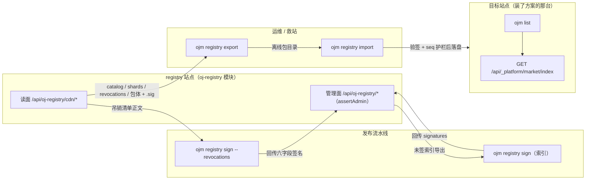

三条命令的信任边界各不相同，混用会出「验了等于没验」的假安全感：

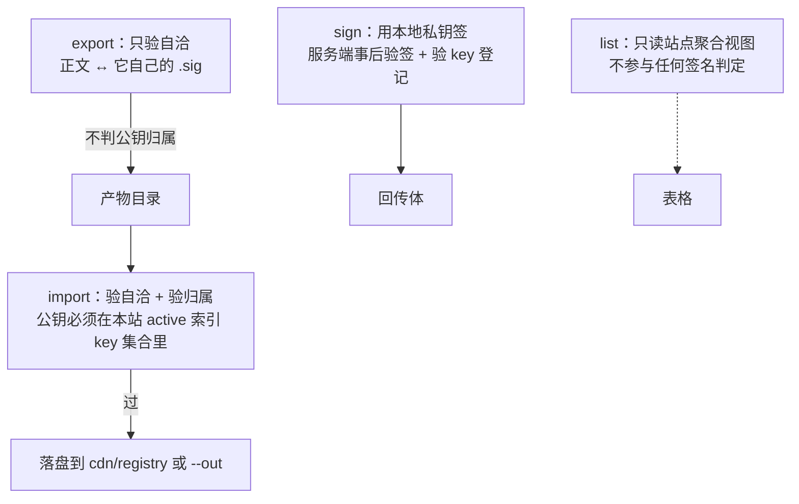

> 为什么 export 不判归属：它手上没有本站信任库。拿**源自己给的公钥**去验**源自己给的签名**，
> 攻击者换一对钥匙就全过。信任判定只能发生在有本地信任库的一侧（`import` 与安装侧）。

---

## 1. `ojm registry export`

```
ojm registry export --site-url <registry 站点地址> [--out <目录>] [--dry-run] [--json]
```

### 1.1 时序：先把索引层拉齐并验完，再决定要不要下包体

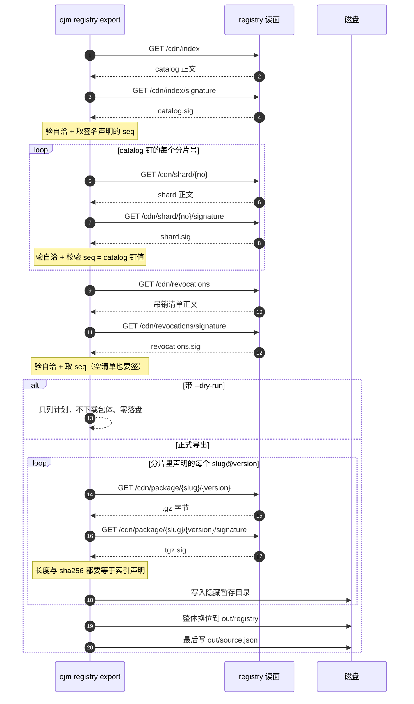

### 1.2 判定顺序与失败码

顺序是刻意的：**索引层全部验完之前，一个包体都不下载**。索引半代/半份时下载包体纯属浪费流量，
而索引问题恰恰是「正在重建」时最常见的状态。

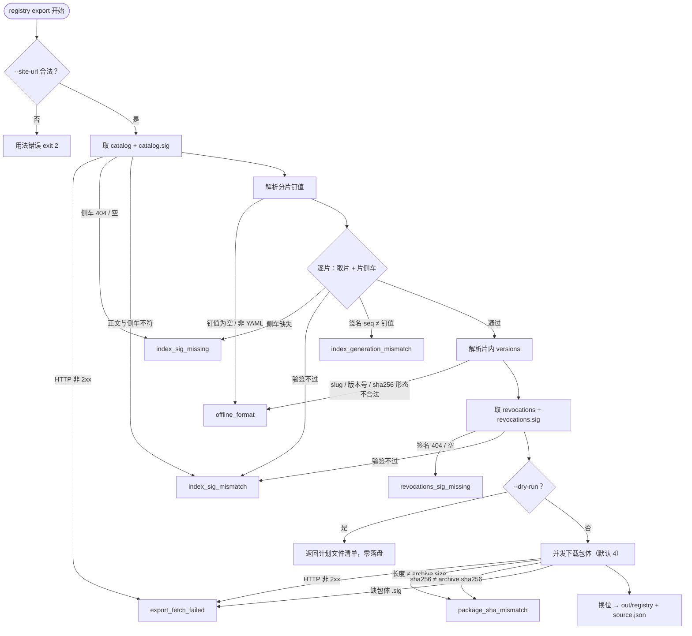

各码的含义与处置：

| 码 | 含义 | 处置 |
|---|---|---|
| `export_fetch_failed` | 读面取不到（非 2xx / 网络 / 缺包体侧车） | 查站点地址、索引是否已生成、网络与证书 |
| `index_sig_missing` | index/shard 的 `.sig` 缺失或空 | 站点还没签名，或静态载体没同时拷 `.sig` |
| `index_sig_mismatch` | 正文与侧车不符（含坏 JSON、alg/base64/seq 形态错） | 源正在重建或内容被改，重试/排查源 |
| `index_generation_mismatch` | 分片签名代次 ≠ catalog 钉值 | 源正在重建索引，等稳定后重跑（拿到的是半代产物） |
| `revocations_sig_missing` | 吊销清单没签过名 | 先走 `POST /revocations/signature` 签一次 |
| `offline_format` | 索引结构破损（钉值空、缺 solutions、slug/版本越界） | 源数据坏了；结构性错误，别重试 |
| `package_sha_mismatch` | 包体长度或摘要与索引不符 | 下载截断/串包/内容被替换；多半重试可解，持续则查源 |

### 1.3 产物结构与「不留半份包」

产物必须与 `ojm registry import` 的读取形态逐字节对齐，否则会出现「导出的包自己导不进去」：

```text
<out>/
├── source.json                     # {origin, exported_at, catalog_seq, revocation_seq, shards, packages}
└── registry/
    ├── catalog.yaml
    ├── catalog.yaml.sig
    ├── shards/
    │   ├── 1.yaml
    │   └── 1.yaml.sig
    ├── revocations.yaml
    ├── revocations.yaml.sig
    ├── <slug>-<version>.tgz        # 平铺；文件名按 slug/version 构造，不采信 archive.file
    └── <slug>-<version>.tgz.sig
```

`source.json` 的 `origin` 是 import 给吊销 seq 账本分桶的键；没有它 import 会退化成
`offline:<绝对目录>`，目录一挪账本就跟丢。

落盘用「暂存目录 + 整体换位」，中途失败不会在 `out/registry/` 留下半份：

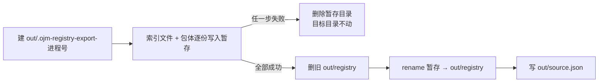

---

## 2. `ojm registry sign --revocations`

```
ojm registry sign <revocations.yaml> --revocations --id <index.key> [--key <pem>] [--out <file>] [--json]
```

索引签名与吊销签名共用一个子命令，靠 `--revocations` 切模式；信封里用 `data.kind`
（`index` / `revocations`）区分，CI 不用猜。

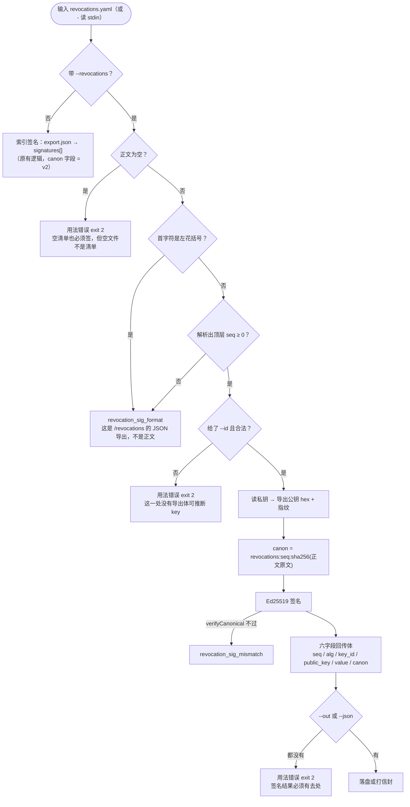

两个容易踩的点，代码里都做了明确拒绝或说明：

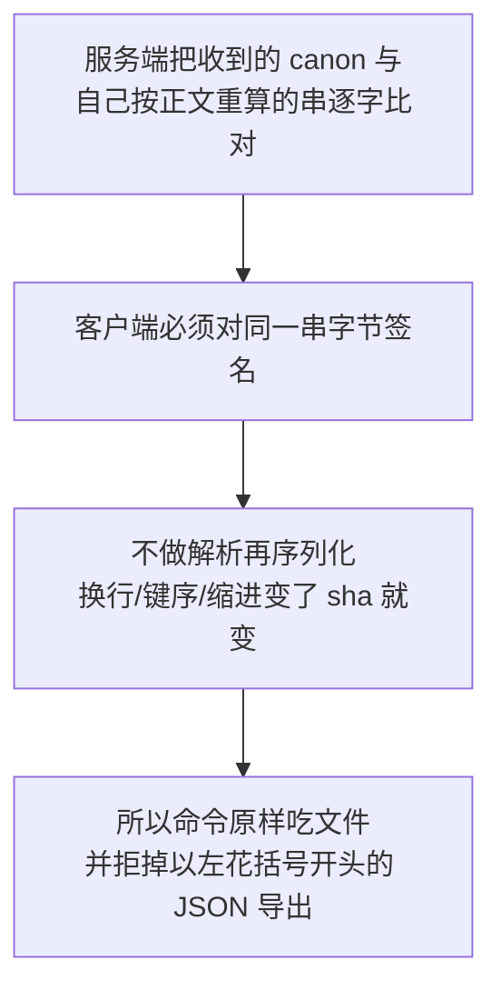

| 码 | 含义 |
|---|---|
| `revocation_sig_format` | 输入不是正文（JSON 导出）、没有合法 `seq` |
| `revocation_sig_mismatch` | 签完自检不过（PEM 不是 Ed25519 / 公私钥口径不一致） |

正文从哪里来：`ojm registry export` 产出的 `registry/revocations.yaml`，或直接
`GET /api/oj-registry/cdn/revocations` 的响应体。**不要**用 `GET /revocations`（管理端点，
返回 JSON 结构，服务端重算的 sha 会不同）。

---

## 3. `ojm list`

```
ojm list [--site-url <u>] [--user <u>] [--pass <p>] [--all] [--json]
```

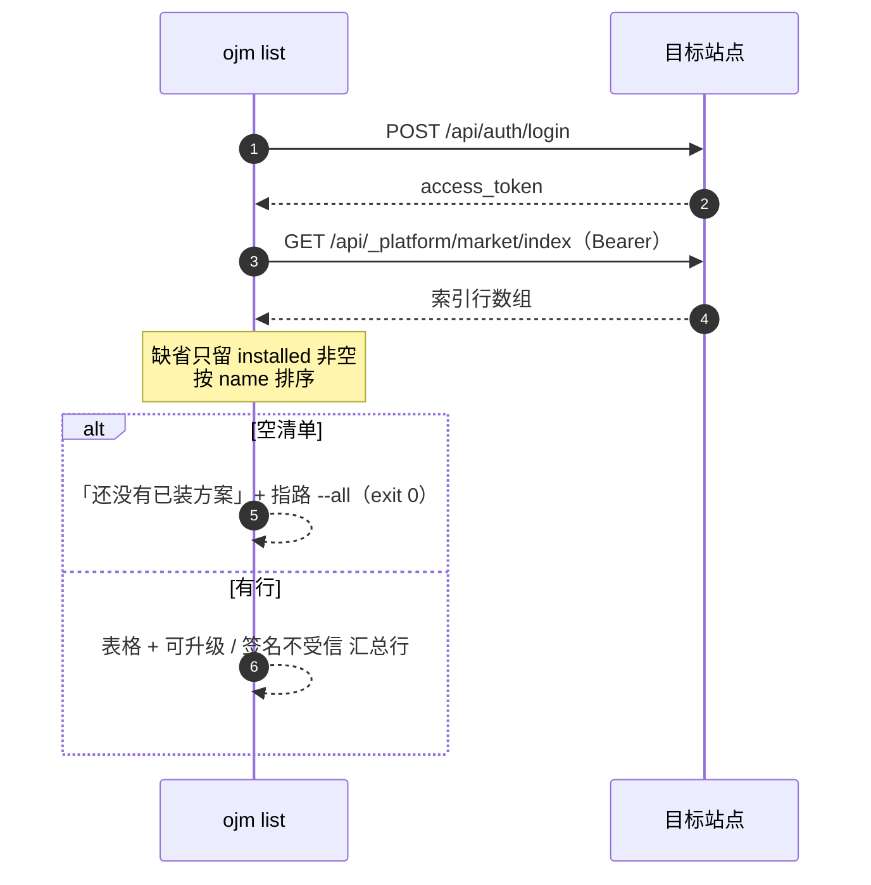

每列的口径都不是 CLI 现算的，而是站点聚合好的：

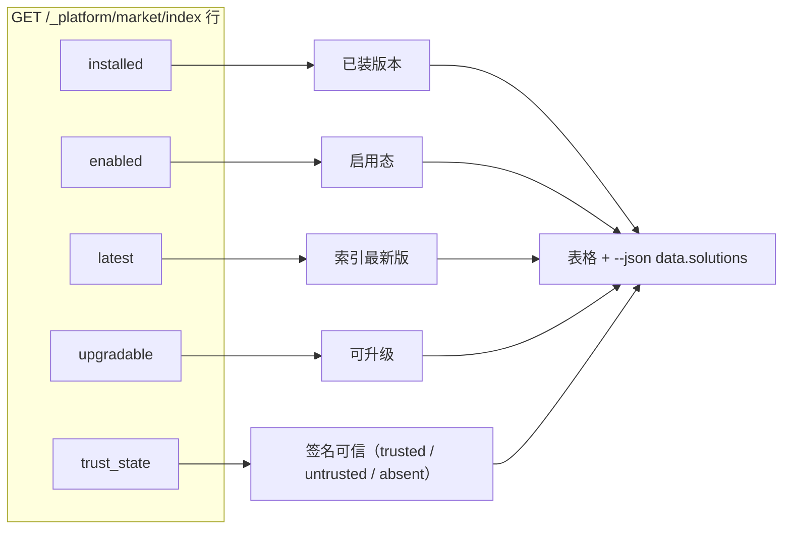

输出形态（表格为 ASCII 对齐，`-` 表示该列对这批数据不适用）：

```text
[ojm] 站点 http://127.0.0.1:9778：已装 2 个方案
NAME             INSTALLED  ENABLED  LATEST  UPGRADABLE  TRUST
acme-demo        2.0.0      no       2.0.0   no          untrusted
demo-solution    0.1.0      yes      0.1.2   yes         trusted
[ojm] 可升级：demo-solution（ojm install <name> 装最新版）
[ojm] 签名不受信：acme-demo（先 ojm trust add 确认发布方公钥）
```

`--all` 连未安装的索引行一起列（`installed` 显示 `-`），用于「这台机器上能装什么」。
清单为空仍是成功（exit 0）：没装东西不是错误。

---

## 4. 退出码与信封（三条命令统一）

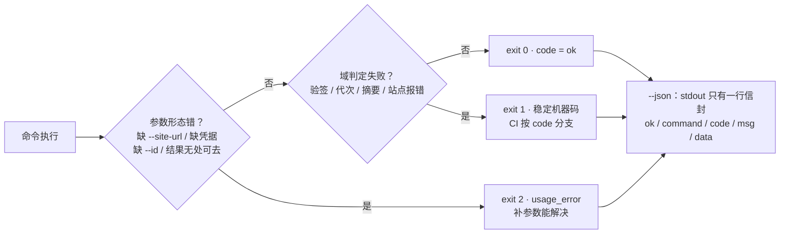

`--json` 下 stdout 只有一行 JSON，人话一律走 stderr——`JSON.parse(stdout)` 永远成立。
信封的 `command` 是 `registry export` / `registry sign` / `list`，`data` 形状见各节；
`registry sign` 用 `data.kind` 区分索引与吊销两种产出。

---

## 5. 三个常见组合

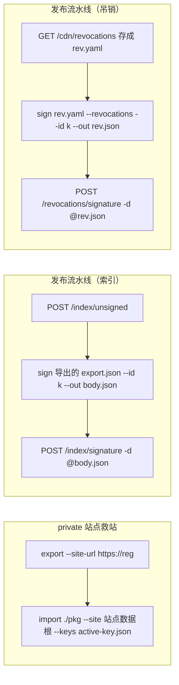

- 救站链：`export` → 拷到内网 → `import`。全程只有 export 那一步触网。
- 索引链与吊销链都遵循同一条纪律：**私钥不进服务端**，服务端只做验签与落库。
- `list` 不在这两条链上，它是升级前/卸载前的确认动作。
