# registry 相关 CLI 子命令：全链路流程

本文覆盖 `ojm` 里与 registry（方案仓库）相关的全部子命令：**作者发版**（`keygen` / `sign` /
`publish` / `registry sign` / `registry sign --revocations`）、**消费安装**（`install` / `list` /
`view` / `trust` / `enable` / `disable` / `uninstall`）、**运维救站**（`registry export` /
`registry import`）。

重点讲**判定顺序**与**边界**（谁验自洽、谁验信任、失败时留下什么），因为这些才是排障时要看的东西。
协议与不变式见下游 `oj-registry` 的 `docs/registry-dev-manual.md`；本文只讲命令面。

---

## 0. 命令全景

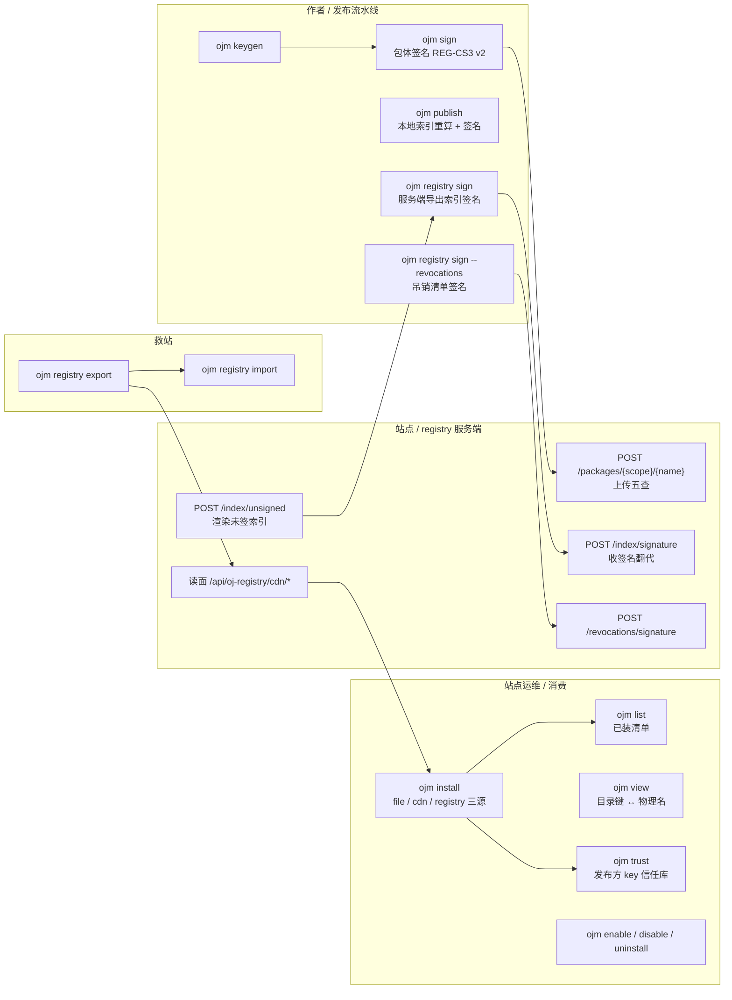

三条链的信任边界各不相同，混用会出「验了等于没验」的假安全感：

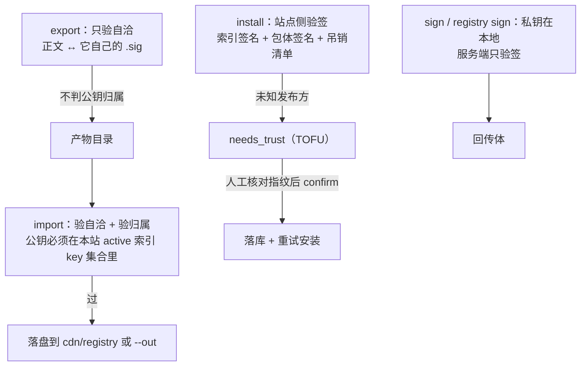

> export 不判归属的原因：它手上没有本站信任库。拿**源自己给的公钥**去验**源自己给的签名**，
> 攻击者换一对钥匙就全过。信任判定只能发生在有本地信任库的一侧（`import` 与安装侧）。

---

## 1. 作者发版链

### 1.1 全流程

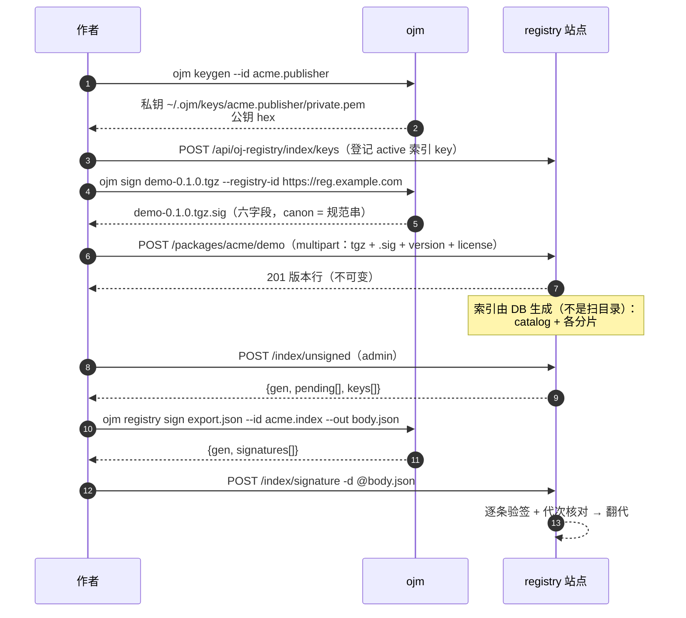

### 1.2 `ojm keygen` / `ojm sign`

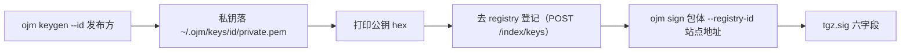

包体签名规范串是 **REG-CS3 v2**：`<registry_id>:<slug>@<version>:<sha256(tgz)>`。

- `registry_id` 必须是**目标站点的 `canonical_origin`**，否则上传时服务端 `registry_id_mismatch`；
  它的作用是让「A 仓库签的包」不能拿到 B 仓库的 CDN 上装。
- `slug` 是物理名（`acme-demo`），不是目录键（`@acme/demo`）。
- `--registry-id` 是必填项（0.3.1 起接线）：漏了等于签不出合法规范串。

### 1.3 上传五查（`POST /packages/{scope}/{name}`）

服务端按固定顺序判决，**顺序本身就是设计**：越便宜的闸越靠前，超限时一个字节都不读。

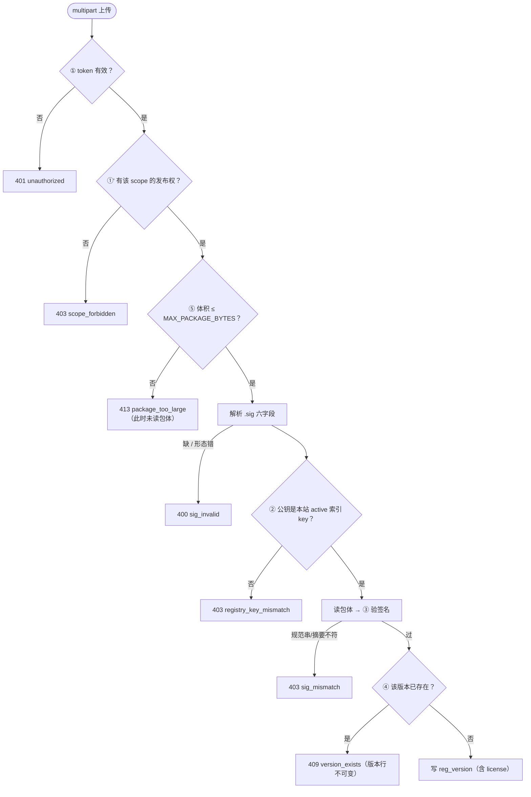

要点：

- **版本行不可变**：只有 yank 能改 `state`/`yanked_*`，重发同版本一律 409（不做覆盖，避免索引与包体漂移）。
- 体积闸前置的原因：413 要在「还没读包体」时给出，否则大文件已经把进程打满才拒绝。
- `license` 是可选文段（`^[A-Za-z0-9.+ -]{1,64}$`），格式错 `license_invalid`；未声明不落字段。

### 1.4 索引生成与 `ojm registry sign`

索引**不由 CLI 渲染**：DB 是唯一真相（blob 无常驻目录，扫目录重建在共享存储上不成立）。所以链路切成两半——
服务端渲染并导出未签正文，CI 侧签名，再回传：

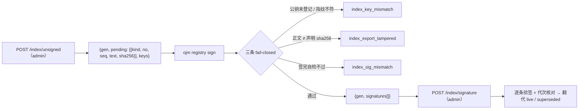

- 这一代没有待签文件时命令是**幂等**的：不碰私钥，产出空 `signatures`（CI 重跑不会因为机器上没 key 变红）。
- 沿用旧分片按导出给的旧代次签（`seq < gen`），不会自作主张签成新代次。
- 服务端只有 verify，没有任何签名原语——私钥永远不进服务端。

### 1.5 `ojm publish`：本地索引目录的重算 + 签名

`ojm publish` **不负责上传**，它与 `registry sign` 是两件事：

| | `ojm publish <dir>` | `ojm registry sign <export.json>` |
|---|---|---|
| 输入 | 本地索引目录（`catalog.yaml` + `shards/<n>.yaml`） | 服务端导出的未签正文 |
| 做什么 | 重算规范化正文（消弭格式漂移）→ 盖代次/时效 → 签 catalog + 各分片 → 原子写回 | 只签名，不改正文 |
| 谁产生索引 | 本地（`ojm market build-index` 扫 `cdn/*.tgz`） | 服务端（DB 渲染） |
| 典型场景 | 市场 CDN 目录、补签本地索引、离线站点 | registry 服务的索引 |

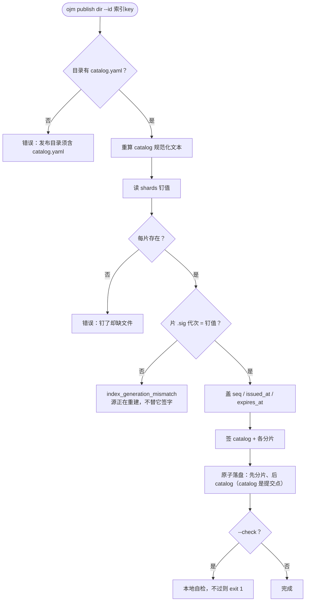

### 1.6 吊销链

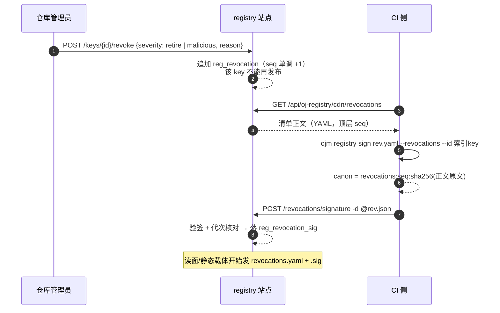

- `severity` 两档：`retire` 只挡**新装**；`malicious` 同样挡新装，并让已装端在信任核对里强告警
  （**不自动卸载**，裁决权留给人）。
- 清单**每变一次 seq +1**，安装端记录每源最大 seq，回退或同代替换都拒（`revocations_not_monotonic`）。
- 空清单也必须签（seq=0）：把「没签」当「没吊销」是 v2.1 漏掉的绕过。

---

## 2. 消费安装链（`ojm install`）

### 2.1 三源分流

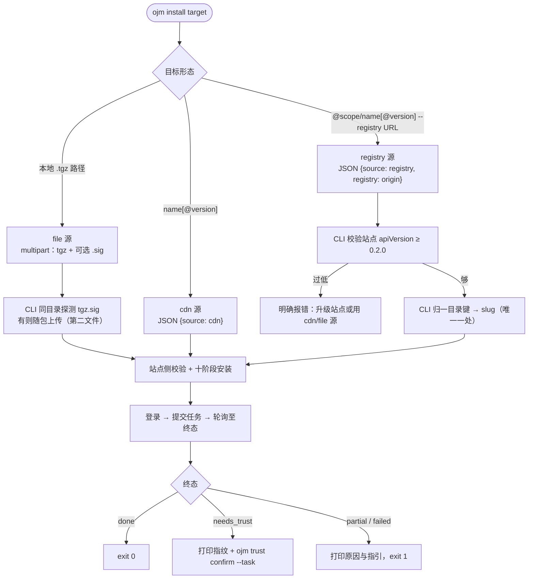

注意分工：

- **归一（`@scope/name` → `slug`）只在 CLI 做一次**。服务端收到含 `@` 或 `/` 的名字直接
  `invalid_physical_name`，防止绕过 CLI 传两种形态造成物理名/目录键混淆。
- **白名单在服务端**：`config.yaml` 的 `vars["oj-registry.allowlist"]`，缺省空 = 不信任任何外部源。
  CLI 的 `--registry` 只是传值，可被绕过，所以服务端必须再校一次。

### 2.2 registry 源的站点侧判定顺序

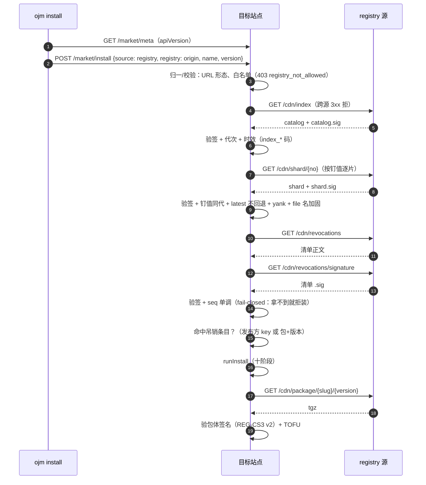

顺序上的三个「先」值得记住：

1. **索引全绿才解析版本**：catalog 与分片任一份验签/代次/时效不过，直接 502，不猜版本。
2. **版本确定后才查吊销**：包不存在就没必要查清单（少一次失败面）；包存在则必须查。
3. **吊销不可达即拒装**：`revocations_unreachable` / `revocations_sig_missing` /
   `revocations_sig_mismatch` / `revocations_not_monotonic` 四个码各自独立，绝不降级成「没有黑名单」。

### 2.3 十阶段安装与验签分流

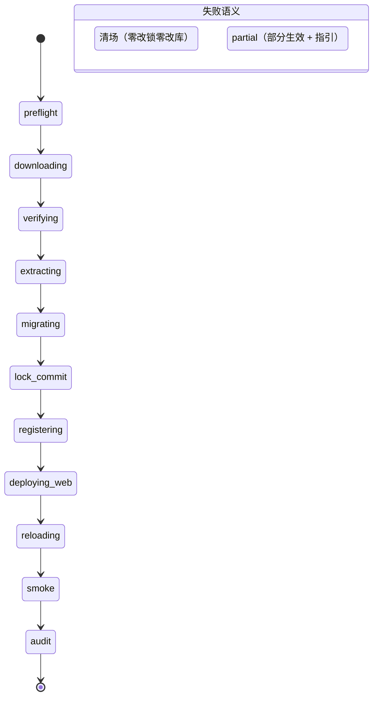

`verifying` 段是签名判定集中地，六码分流（CLI 侧按 `hintKey` 渲染人话）：

| 码 | 含义 | 处置 |
|---|---|---|
| `sig_missing` | 包体缺 `.sig` | 发布方没签，或上传时没带第二文件 |
| `sig_format` | 六字段形态错（alg/base64/seq） | 签名文件坏了，重签 |
| `sig_alg` | 算法不是 Ed25519 | 用了别的钥匙体系 |
| `sig_key` | 签名公钥与信任库登记的不一致 | 换过钥匙，需核对 |
| `tampered` | 正文与签名不符（含规范串 registry_id 不符） | 包被改过，或签给了别的站点 |
| `unknown_key` | 公钥不在信任库 | 走 TOFU（下面第五节） |

### 2.4 TOFU：未知发布方

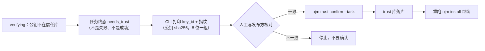

- 指纹口径统一为 **sha256(公钥 32 字节)**；按 hex 文本算会让同一把钥匙在 `ojm keygen`、
  站点信任库、registry 吊销清单三处显示三个值，吊销清单会静默失效。
- 首装可通过第一方 bootstrap key 免 TOFU；运维显式吊销的 key 不会被重新播种覆盖。

---

## 3. 运维救站链（`registry export` / `import`）

### 3.1 `ojm registry export`

```
ojm registry export --site-url <registry 站点地址> [--out <目录>] [--dry-run] [--json]
```

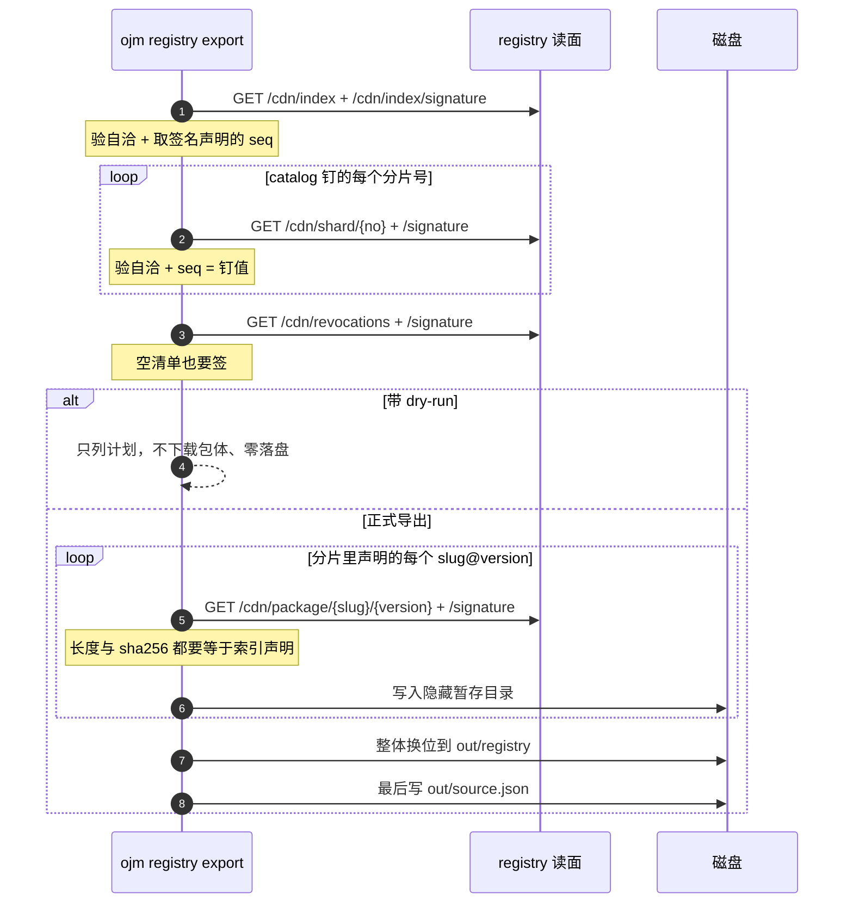

判定顺序（**索引层全部验完之前，一个包体都不下载**）：


| 码 | 含义 | 处置 |
|---|---|---|
| `export_fetch_failed` | 读面取不到（非 2xx / 网络 / 缺包体侧车） | 查站点地址、索引是否已生成、网络与证书 |
| `index_sig_missing` | index/shard 的 `.sig` 缺失或空 | 站点还没签名，或静态载体没同时拷 `.sig` |
| `index_sig_mismatch` | 正文与侧车不符（含坏 JSON、alg/base64/seq 形态错） | 源正在重建或内容被改，重试/排查源 |
| `index_generation_mismatch` | 分片签名代次 ≠ catalog 钉值 | 源正在重建索引，等稳定后重跑 |
| `revocations_sig_missing` | 吊销清单没签过名 | 先走 `POST /revocations/signature` 签一次 |
| `offline_format` | 索引结构破损（钉值空、缺 solutions、slug/版本越界） | 源数据坏了；结构性错误，别重试 |
| `package_sha_mismatch` | 包体长度或摘要与索引不符 | 下载截断/串包/内容被替换；持续则查源 |

产物必须与 `ojm registry import` 的读取形态逐字节对齐：

```text
<out>/
├── source.json                     # {origin, exported_at, catalog_seq, revocation_seq, shards, packages}
└── registry/
    ├── catalog.yaml
    ├── catalog.yaml.sig
    ├── shards/
    │   ├── 1.yaml
    │   └── 1.yaml.sig
    ├── revocations.yaml
    ├── revocations.yaml.sig
    ├── <slug>-<version>.tgz        # 平铺；文件名按 slug/version 构造，不采信 archive.file
    └── <slug>-<version>.tgz.sig
```

`source.json` 的 `origin` 是 import 给吊销 seq 账本分桶的键；没有它 import 退化成
`offline:<绝对目录>`，目录一挪账本就跟丢。落盘用「暂存 + 整体换位」，中途失败不在目标目录留半份。

### 3.2 `ojm registry import`

```
ojm registry import <dir> [--site <站点数据根>] [--out <目标目录>] [--keys <active-index-key.json>] [--dry-run] [--json]
```

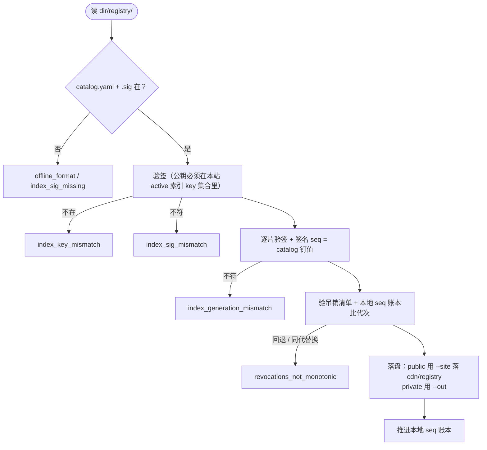

- 全程**不触网**：源已经挂了才需要这条命令，它只读本地文件、验签、落盘。
- 信任源是本地账本：`--keys` > `~/.ojm/registry/<origin>/index-keys.json`；取不到活跃 key 即
  fail-closed（`index_key_mismatch`）——没法离线判定「这把钥匙是不是 registry 的」就不能导。
- `--registry` 是**账本源标识**（多源各记各的 seq），不是仓库地址；缺省取 `source.json` 的 `origin`。

---

## 4. 查询与生命周期面

### 4.1 `ojm list`

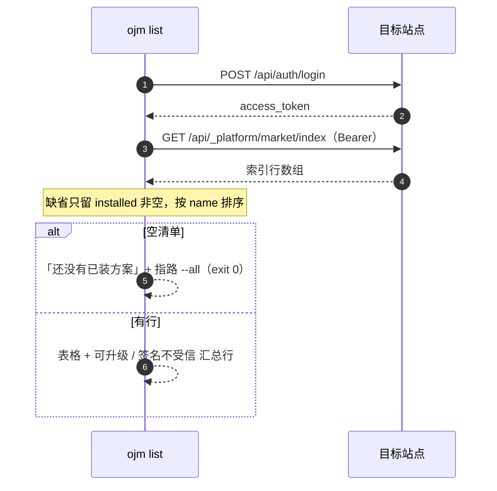

每列都取自站点聚合行，不在 CLI 现算：

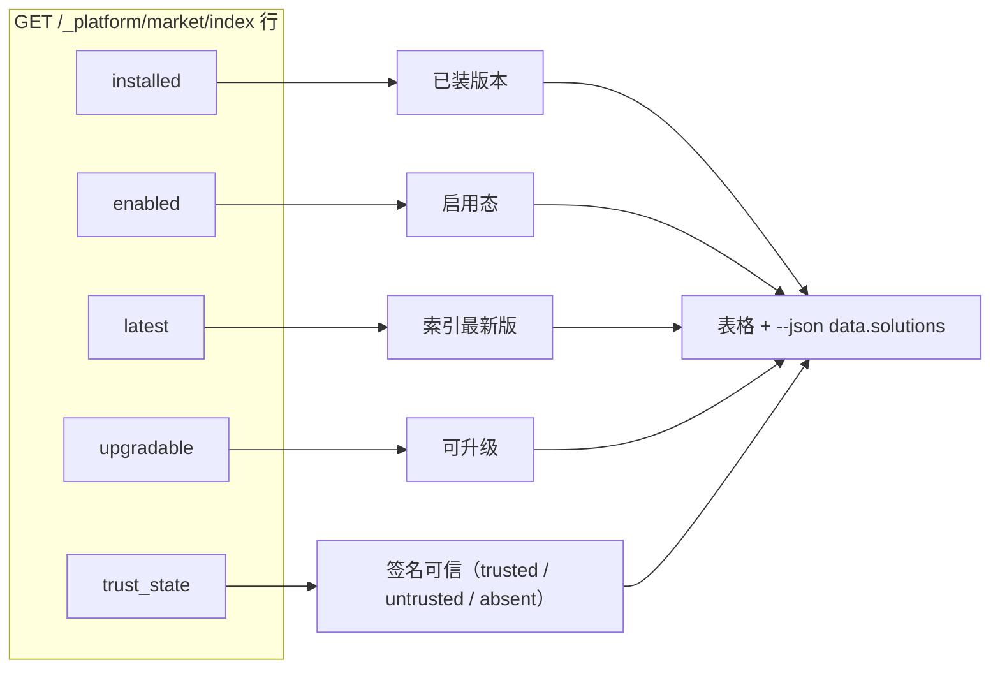

`--all` 连未安装的行一起列（`installed` 显示 `-`）。清单为空仍是 exit 0：没装东西不是错误。

### 4.2 `ojm view`

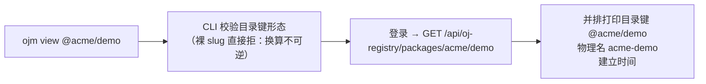

换算不可逆（`acme-x-demo` 可能来自 `@acme-x/demo` 或 `@acme/x-demo`），所以命令只接受目录键，不接受裸 slug。

### 4.3 `ojm trust`

| 子命令 | 作用 | 端点 |
|---|---|---|
| `ojm trust ls` | 列信任库（含 `.bak` 回落提示） | `GET /api/_platform/market/trust` |
| `ojm trust add <key_id> <pubkey_hex>` | 手工登记发布方公钥（首次绑定不可改，撞绑定 409） | `POST /market/trust/key` |
| `ojm trust revoke <key_id>` | 吊销信任库条目 | `DELETE /market/trust/key` |
| `ojm trust confirm --task <id>` | TOFU 确认（从任务记录重取公钥复算指纹） | `POST /market/trust` |

**这里管的是「发布方包体签名 key」**，不是 registry 的索引签名 key。索引 key 登记走
`POST /api/oj-registry/index/keys`（admin），CLI 目前没有对应命令——建站/换钥匙时按运维手册用 HTTP 登记。

### 4.4 `ojm enable` / `disable` / `uninstall`

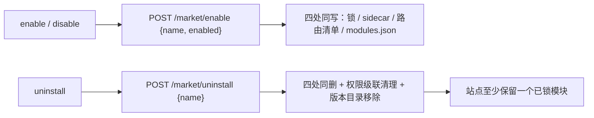

两者都不涉及仓库源：包已经在站点上，来源不影响删除范围，所以 `uninstall` 明确**不接** `--registry`
（给了即 exit 2 并说明原因）。

---

## 5. 退出码与信封


`--json` 下 stdout 只有一行 JSON，人话一律走 stderr——`JSON.parse(stdout)` 永远成立。
信封的 `command` 是命令名（`install` / `list` / `registry export` / `registry sign` …），
`registry sign` 用 `data.kind`（`index` / `revocations`）区分两种产出。

`ojm install` 的终态另有语义层次：

| status | 退出码 | 含义 |
|---|---|---|
| `done` | 0 | 装完并冒烟通过 |
| `needs_trust` | 1 | 未知发布方，等人工 TOFU 确认（不是失败，但**没装完**） |
| `partial` | 1 | 锁后阶段失败，部分生效（包已落、注册/热更/冒烟未过） |
| `failed` | 1 | 锁前阶段失败，已清场 |

---

## 6. 四个常见组合

```mermaid
flowchart LR
    subgraph A["private 站点救站"]
        A1["export --site-url https://reg"] --> A2["import ./pkg --site 站点数据根 --keys active-key.json"]
    end
    subgraph B["发版（包体）"]
        B1["keygen"] --> B2["sign tgz --registry-id 站点"] --> B3["POST /packages（multipart tgz + .sig）"]
    end
    subgraph C["发版（索引 / 吊销）"]
        C1["POST /index/unsigned"] --> C2["registry sign"] --> C3["POST /index/signature"]
        C4["GET /cdn/revocations"] --> C5["registry sign --revocations"] --> C6["POST /revocations/signature"]
    end
    subgraph D["升级前确认"]
        D1["list --all"] --> D2{"可升级 / 签名不受信？"}
        D2 -->|"可升级"| D3["install name"]
        D2 -->|"不受信"| D4["trust add / trust confirm"]
    end
```

- 救站链：`export` → 拷到内网 → `import`。全程只有 export 那一步触网。
- 包体链与索引链都遵循同一条纪律：**私钥不进服务端**，服务端只做验签与落库。
- `list` 不在任何签名链上，它是升级前/卸载前的确认动作。
