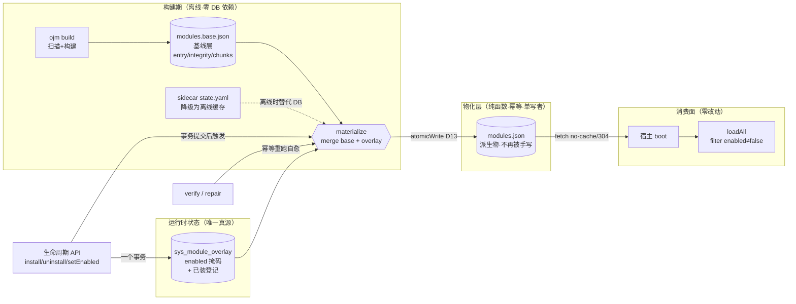
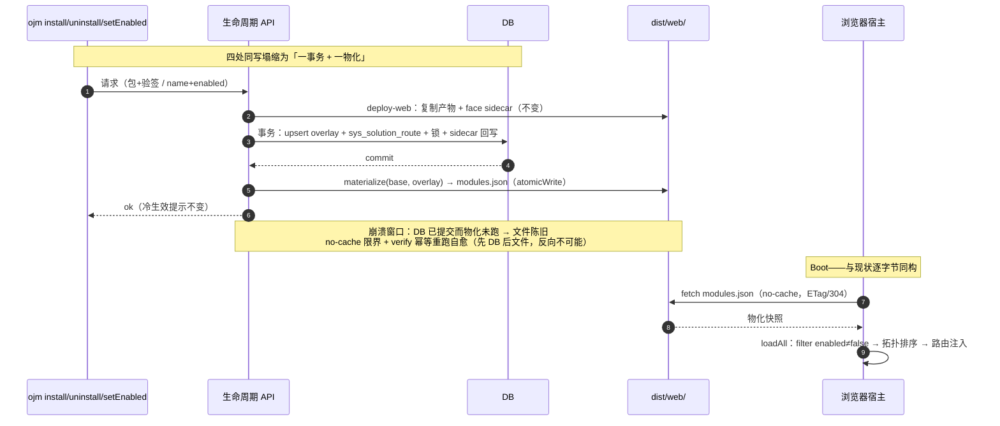
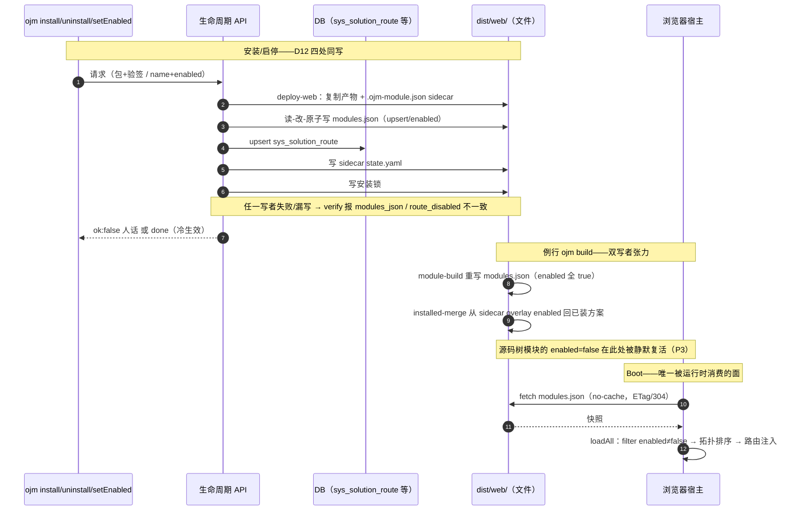
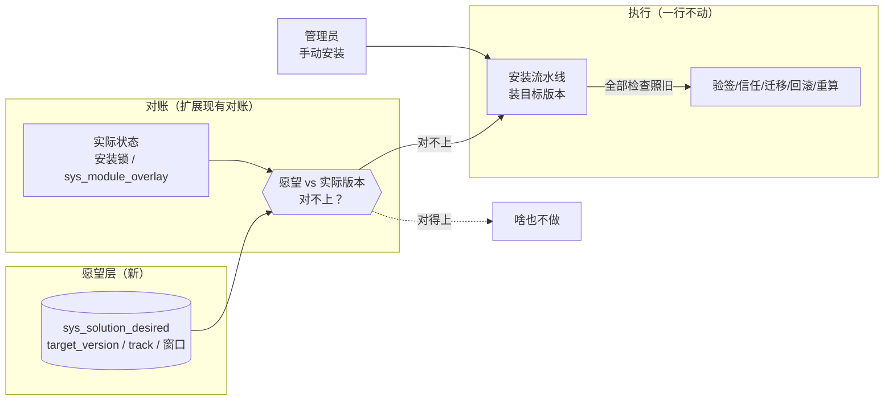

# modules.json 改造方案与评审（大白话版）

- 日期：2026-11-20 11:06（初稿）→ 12:20（评审版）→ 2026-11-21（人话整理版）
- 状态：**评审通过（有条件）**，待按 §6.5 的 A1-A6 行动项开工
- 一句话概括：**把「模块启停状态只存数据库一份」，文件清单变成自动算出来的结果，浏览器和部署流程什么都不用改。**

> 阅读说明：全文先说人话，括号里挂技术定位（文件:行号），方便落地时查代码。编号与图表沿用评审版，交叉引用不断链。

## 1. 这件事是关于什么的

### 1.1 `modules.json` 用处

大家口头说的「modules.json」其实是**同一份清单的两种形态**，取决于你在哪种工程布局里：

| 形态 | 文件在哪 | 谁写 | 谁读 |
|---|---|---|---|
| 本仓库自己开发时（dev） | 根目录 `manifest.json`（指向源码） | 人手维护 | 前端启动时代码直接 import（`packages/runtime/src/index.tsx:83`） |
| 本仓库构建后（prod） | `build/module-manifest.json`（指向编译产物） | `scripts/build-modules.ts:100` 自动生成 | 浏览器启动时去下载（`index.tsx:91`） |
| 正式站点（**这是主线**） | `<dist>/modules.json` | 命令行工具 `ojm build` 生成（`packages/cli/src/build/module-build.ts:413`） | 预编译好的网站外壳启动时下载（`packages/cli/shell/src/host.tsx:321`），然后按需加载各模块 |

### 1.2 这份清单现在在干五件事

1. **网站开门的菜单名单**。浏览器打开网站第一件事就是下载它，上面列着：有哪些模块、开关状态、每个模块的 JS 文件地址。看完名单才决定加载什么、显示什么菜单。**只看一次**——装完新模块要刷新页面才出现，这是有意设计，不是 bug。
2. **防篡改的保险锁**。清单里每个文件带一个指纹（sha384），浏览器加载时会核对指纹，文件被人改过就拒绝执行。
3. **安装/启停时要同时更新的四个账本之一**。装一个新方案（或停用某个模块）时，系统要同步改四个地方：安装锁、sidecar 小档案、数据库里的路由表、还有这份 modules.json。任何一处没写成功，四处就对不上账。
4. **对账对象**。系统自带巡检，专门查「四个账本是不是一致」——而且**真的查到不一致过**（不是理论风险）。
5. **构建产物，但同时被两拨人写**。平时跑 `ojm build` 会重写它；安装器装新方案时也要改写它。两拨人写同一个文件，就得靠一个补丁机制来回打补丁（2026-11-07 就出过事故：例行构建把已装的市场模块菜单冲没了）。

## 2. 为什么要改：四个具体的疼

| 编号 | 疼在哪 | 实锤 | 后果 |
|---|---|---|---|
| P1 | **一个状态记四份账**。模块启停这么点事，要同时写锁、sidecar、数据库路由表、modules.json 四个地方 | 巡检真的报过「账对不上」 | 回滚逻辑复杂、运维要靠人修 |
| P2 | **两拨人抢写一个文件**。构建器和安装器都手写 modules.json | 11-07 市场菜单消失事故 | 每次例行构建都可能冲掉现场状态 |
| P3 | **停用无处安放**（RED 用例已实锤，2026-11-21）。源码树模块（home/system 这些）想停用：setEnabled 直接拒绝（「未安装」）；绕过它写 sidecar 同名记录，下次构建触发「双轨同名红线」硬失败；就算停用标记只写在 modules.json 里，下次构建也被整个重写复活——停用状态没有合法的状态源承载 | `installer.ts:1249` 拒绝 + `installed-merge.ts:194` 红线 + `module-build.ts:402` 重写 | 管理员想关关不掉；关了的也会悄悄开 |
| P4 | **查无对证**。谁在什么时候启停了哪个模块，没有任何记录 | — | 出问题只能猜 |

## 3. 被否掉的路线：让整个清单进数据库（留档）

曾经评估过「干脆别要文件了，浏览器直接从数据库读清单」——**否决**。三个硬伤：

| 否决理由 | 人话解释 |
|---|---|
| 跨宿主契约破坏 | 这份文件已经被两种服务器（Node 的 oj 工具和 Rust 的 oj serve）当作「静态文件」消费。改成读数据库 = 两边都要改、两个仓库要协调发版 |
| 保险锁失效 | 防篡改指纹如果存在数据库里，浏览器拿到的指纹就是数据库查询结果——数据库被人写脏了，保险锁就形同虚设 |
| 网站开门依赖数据库 | 现在网站门脸（静态文件）挂在 CDN 上，数据库挂了网站还能开。改成直读数据库，数据库一挂全站起不来；而且开门时用户还没登录，清单接口还得允许匿名访问 |

**附带的发现（机会，不是本方案的依赖）**：
- Rust 服务器对未带指纹的文件（含 modules.json）策略是「每次都要重新确认」（no-cache），对带指纹的文件是「永久缓存」——这正好配合我们的「文件是算出来的快照」思路；
- 如果将来要「不同租户看不同模块」，正路是在 Rust 服务器层做内容替换（那里已有成熟先例），浏览器拿到的仍然是静态文件，不用碰本方案；
- Rust 那边**一行代码都不用改**。

## 4. 主推方案：状态进数据库，文件变成「算出来的结果」

### 4.1 一句话

> modules.json 不再靠人（靠四个写者）手写，而是由一个「计算函数」自动算出：**构建产物（基线）+ 数据库里的启停状态（叠加层）= 最终清单**。算多少遍结果都一样（幂等），算错了重算一遍就好（可自愈）。

关键分寸：**哪些东西能进数据库？只有「启停状态」和「装了哪些方案」这种运行时状态**。文件的地址、指纹这些构建信息**永远不碰数据库**——保险锁的信任根不动。

### 4.2 为什么敢这么改：代码里已经这么干了两处

1. **读的人早就不在乎状态从哪来**。浏览器加载时本来就是「先按名单过滤掉停用的，再加载剩下的」（`module-loader/index.ts:199`）——它只认「名单+停用掩码」，掩码是文件给的、还是数据库给的，它无所谓。
2. **写的人已经有「合并」这套做法**。现在的 `mergeInstalledModules`（`installed-merge.ts:207`）干的就是「构建名单 + sidecar 档案 → 合成最终清单」。我们要做的只是把「叠加上去的资料」从 sidecar 小档案换成数据库。

### 4.3 三个角色，各管各的

| 角色 | 装什么 | 存哪 | 谁写 | 铁律 |
|---|---|---|---|---|
| **基线**：构建出来的事实 | 文件地址、指纹、分块、版本 | `modules.base.json`（新文件，跟构建产物放一起） | `ojm build`（离线就能跑） | **永远不碰数据库**——保险锁的信任根，必须和硬盘上的文件同生同死 |
| **叠加层**：运行时状态 | 每个模块的**版本 + 启停开关**、装了哪些方案（名字/来源）+ **递增序号 + 谁操作的/什么时候** | `sys_module_overlay`（新数据库表） | 生命周期 API（一次事务写完） | 启停状态**只存这一份**；**同一模块任何时刻最多一个版本是启用态**（数据库部分唯一索引强制：`UNIQUE(name) WHERE enabled=true`），窄窄的一层 |
| **计算器**：把前两者合成最终清单 | merge(基线, 叠加层) → modules.json | 文件快照 | 生命周期 API（同一时间只有它在写） | 纯计算、可反复重跑 = 坏了能自己修好 |

### 4.4 数据流长这样

### 4.5 装东西/启停时发生什么（改造后）

人话：以前装个东西要**依次手写四本账**，任何一本写失败就烂尾；现在改成**数据库里一次事务写完，然后由计算器重新算出最终清单**。浏览器那边完全无感。

### 4.6 哪些地方要动、哪些不动

| 地方 | 动多少 |
|---|---|
| 网站外壳启动加载（Node/Rust 两种服务器） | **一行不动**——还是下载静态 modules.json |
| `ojm build`（平时构建） | 基线改写到 `modules.base.json`；不再往清单里写死「启用」；P3 的复活 bug 顺手消失 |
| `deploy-web`（安装时部署文件） | 不再「读-改-写 modules.json」，只复制文件；**打包红线（C2-31，禁止方案包里带清单）的盯防目标从 modules.json 改成 modules.base.json** |
| `setEnabled`（启停） | 从「写四个地方」变成「写一个事务 + 触发重算」 |
| `uninstall`（卸载） | **（评审补漏）** `uninstall.ts:356-402` 有一处独立改 modules.json 的代码，同样要改成「删数据库行 + 重算」 |
| `compensate`（失败回滚） | 清单回滚那段删掉（回滚 = 数据库事务回滚 + 重算一遍） |
| `verify`（巡检） | 「清单不一致」这类告警收窄成「清单算晚了」；**默认只看不修，加 `--repair` 参数才动手修** |
| 数据迁移 | **三路来源都要搬**（评审修正）：① 安装锁 → 已装方案名单；② sidecar → 已装方案的启停；③ **老 modules.json 里的「停用」标记 → 数据库（内建模块的停用状态只留在这里，漏了这路 = 升级当晚所有被停用的内建模块悄悄复活）**。sidecar 降级为「断网时的备用资料」，保留一个版本周期 |
| Rust 那边（oj serve） | **一行不动**；验收脚本保留「modules.json 必须 no-cache」的检查，给 base 文件加同样一条 |

### 4.7 几条铁律（都是评审时四方拍出来的）

- **先写库，后算文件**。顺序反了会出现「文件宣称了一个数据库里没有的状态」，绝不允许。
- **一个模块同时只能启用一个版本**（本次新增需求）：表里每行记 (模块名, 版本, 启用态)，数据库用部分唯一索引强制「同一模块名最多一行启用」；**升级/降级 = 同一个事务里把新版本行置启用、旧版本行置停用（原子换版）**，绝不出现两个版本同为启用的中间态。重算函数读到违反不变量的数据（理论上不可能，如手工改库）时**报错拒绝产出**，不许自己挑一个——静默挑一个就是 P3 复活 bug 的数据库版。
- **版本怎么对上文件**：启用行里的版本号用于定位 `<dist>/modules/<name>/<version>/` 产物目录；行在、目录不在 = 「方案文件缺失」告警（沿用现有对无 face 条目 warn 不并入的语义）；行不在、基线里有 = 按基线默认启用（builtin 常态）。
- **崩溃自愈要主动，别等人巡检**。生命周期 API 每收到一个请求，先顺手检查一下「文件是不是比数据库旧」，旧了就重算一遍（反正重算不要钱）。这就是自愈——不用等人来跑命令。
- **断网构建怎么办**：平时 `ojm build` 不连数据库，靠 sidecar 备用资料来算。为防止备用资料过期坑人：数据库表带**递增序号**，备用资料上写着它是第几号时算的；**对不上号就拒绝覆盖、报警**（fail-stale），绝不用过期货硬算。
- **本期只支持一种部署形态：单机或共享硬盘**。多台服务器各拿各的文件这种部署（文件在镜像里），这套方案不管——那是另一个设计，别按字面意思直接多机部署。
- **要有观测**：每次重算记一条日志（谁触发的、算前算后的指纹、晚了多久），超时就报警；重试有上限，不是无限试。
- **审计做到哪算哪（本期边界）**：谁在什么时候改了启停，记进数据库（操作人/时间/旧值→新值），重算函数是唯一写点，顺手就记了。**但不做查询页面**，要查只能查数据库。
- **指纹逐字节传递，一个数都不许改**：重算函数对文件地址/指纹只许原样搬运，配一条自动测试盯着（输出 = 输入来源的实值）。
- `modules.base.json` 声明为「只有构建能写」，加只读检查，和红线改名在同一个改动里落地。
- **装完刷新页面才生效**，这个体验不变。

## 5. 本期不做的（写清楚防止范围蔓延）

- **热生效**（不刷新页面就装卸模块）：那是另一个量级的工程，等有真实需求再说；
- **不同租户看不同模块**：走 Rust 服务器层做替换，不碰现在这套；
- 叠加层的「读」就做成一个函数（读数据库 or 读 sidecar 备用），不搞接口层级——本期之后数据库是唯一真源，备用资料只是断网时的缓存。

## 6. 评审记录

> 2026-11-20，四方**各自独立**评审（互不串供），全部意见已消化进正文。总评：**方向四方一致叫好，没人反对；都说了「补完几处设计再动手」，正文 §4 已按意见修正。**

### 6.1 架构师 —— 有条件通过

**夸的**：否决「全量数据库化」的三条理由站得住；「构建信息永不进数据库」写成了明规则而不是暗约定；对崩溃窗口的分析诚实，没藏着掖着。

**挑的（重要的）**：
- **（高）「合并就是纯计算」说早了**。现有代码 `mergeInstalledModules` 里面偷偷干着写文件的活儿（`installed-merge.ts:135` 附近），不是纯函数。得先把它改干净（输入输出明明白白、不碰文件系统），再换数据源。
- **（高）断网时的「数据库优先」一句话带过了最难的问题**。备用资料写失败了、又赶上断网构建，就会拿旧开关状态覆盖新状态——停用复活，P2/P3 换个马甲回来。解法：数据库带递增序号，备用资料对不上号就拒绝计算并报警。
- （中）数据库里有「孤儿行」（模块没了、行还在）怎么办：行留着备查，计算时警告，不进清单；指纹必须逐字节搬运，配自动测试；base 文件本身是新的防篡改面，要加只读检查。
- （低）数据库表要不要区分站点（单站就写明假设）；巡检默认只看不修。

### 6.2 工程师 —— 需补充设计（没有阻断项）

**夸的**：方向有现成代码撑着，不是纸上谈兵；「先写库后算文件」比现在的失败组合少一个量级；指纹红线画得准。

**挑的（重要的）**：
- **（高）§4.6 漏了卸载**。`uninstall.ts:356-402` 还有一处独立改 modules.json 的代码，忘了列——已补。
- **（高）迁移搬家来源写错了**（实锤）。内建模块的「停用」只存在于老 modules.json 本身，sidecar 里那份记录因为没有配套文件会被合并步骤丢弃——所以搬家必须三路走，漏了第三路，升级当晚所有被停用的内建模块悄悄复活。已改。
- **（高）巡检的自动修复和新语义打架**。现在的自动修复是靠匹配告警文字来触发的，告警语义一变，这块得重设计；而且现有 141 条测试里有一大批断言的是「四处同写」的错误提示文字，这些文字一改，测试要跟着改一大片——工作量要乘上这个系数。
- （中）崩溃窗口加个保险：**API 每收一个请求先顺手对一次账**（已采纳）；数据库表还没给出建表语句和几条仲裁规则（内建模块升版本后旧开关还作不作数？——答案：作数，开关按名字走，版本以构建为准）；「单写者」说法与现状不符（现在启停根本不拿锁，是文件层面谁后写谁赢），论证改成「数据库是真源、文件最终一致」。

**工作量估计**：改 12-14 个文件；新增 18-25 条测试，改 30-45 条现有测试（主要是错误提示文字改名）。

### 6.3 运维 —— 需补运维设计

**夸的**：「先写库后算文件」让崩溃只有单向（文件可能旧、真相永不被污染），教科书级做法；保险锁边界没退化；自愈把人工介入面收窄了。

**挑的（重要的）**：
- **（高）多台服务器怎么办，全文没论证**。「单写者+本地文件」只解决同一台机器上的抢写，不解决「算出来的结果怎么到其他机器」。如果文件是打在镜像里的，多台机器负载均衡时用户就会「有时新有时旧」——最难查的故障。处置：写明本期只支持单机/共享硬盘，加开机自检（发现「数据库比文件新」就告警）；真多机分发另立项。
- **（高）P4（查无对证）并没有被解决**。状态进了数据库 ≠ 能查账，全文没有审计设计。处置：重算函数是天然的记账点，顺手记（谁/干嘛/旧值→新值），成本极低。
- （中）新旧版本混着跑的过渡期会打架：新代码算出来的文件被旧代码当作手改又写一遍。处置：数据库加表但不删旧机制（expand/contract），回滚剧本写清楚；自愈全程要有指标和日志，不然「自愈」就是「悄悄漂移」。
- （低）硬盘只读/重算反复崩时别无限重试，要上限+报警；CDN 可能给清单加「过期先用着」的缓存策略，引入秒级旧名单窗口，验收要加探针；断网仲裁要用序号不能看时钟（防对时回拨）。

### 6.4 产品经理 —— 值得做

**用户价值**：① **配过的东西保持配过的样子**（11-07 事故 + 停用复活，都是信任修复，用户不用懂数据库）；② 坏了能自己好，恢复从「人工排查」变成「跑一条命令」；③ 例行构建不再冲掉客户现场的配置。

**挑的**：
- （中）「算晚了」不能靠人想起才去修——API 自己顺手修（与工程师建议殊途同归，已合并成一条）。
- （中）审计别吹过头：本期只记进数据库，不做查询页面，PRD 里写清楚，不然上线后会被说「承诺了审计却没给」。
- （低）验收时确认「装完刷新页面生效」的提示还在；base 文件要给站长一句「别手改」的说明。

**建议本期做**：叠加表+重算+单写者 / 三路搬家 / 巡检收窄+自愈 / P3 复活回归测试。**本期不做**：热生效 / 审计页面 / 租户差异化 / sidecar 提前删。

### 6.5 评审结论与行动清单

**结论：有条件通过。** 所有高优意见已改进正文（先改纯函数、三路搬家、补卸载、自愈改主动、断网拒用旧账、写明单机假设、审计边界）。没有阻断项；多机分发是**明确不做**而不是忘了。

| 编号 | 干什么 | 谁提的 | 状态 |
|---|---|---|---|
| A1 | 先把合并函数改成真·纯函数（不碰文件系统），sidecar 的写动作挪到调用方；「读」只做成一个函数 | 架构师+工程师 | 待办（开工第一项） |
| A2 | 数据库建表：**(模块名, 版本, 启用态) + 部分唯一索引 `UNIQUE(name) WHERE enabled=true`（单模块单启用版本，硬约束）** + 递增序号/来源/方案档案引用/**谁操作的+时间+旧值→新值** + 仲裁规则（内建升版后开关按名字仍作数、原子换版事务；方案文件缺失时怎么办；内外重名报错沿用现有语义） | 架构师+工程师 | 待办 |
| A3 | **三路搬家**脚本 + 「新表已建、老代码还在」混合期行为定义 | 工程师 | 待办 |
| A4 | API 请求先顺手对账自愈 + 巡检默认只读/--repair 才修 + 自动修复重设计 + 受影响的测试盘点 | 四方共识 | 待办 |
| A5 | 写明单机/共享硬盘假设 + 开机滞后自检 + 重算日志/指标/报警 + 回滚剧本（加表不删旧机制） | 运维+架构师 | 待办 |
| A6 | **P3 复活 bug 先写一条必红的测试**（构建→停用→再构建→断言仍停用；现在的代码必红），作为改造的第一个验收 | 工程师+PM | 待办（开工第一件事） |

## 7. 问题记录（反常识备忘）

| 分类 | 问题 |
|---|---|
| 反常识 | 同一个清单在两种布局里名字不一样（`module-manifest.json` vs `modules.json`），本仓库开发时 dev 和 prod 还是两个不同文件，新人必晕 |
| 反常规 | vite 会把 PWA 的 `public/manifest.json` 覆盖同名文件导致网站起不来——靠起奇怪的名字躲着它，没有机制性解决 |
| 反常识 | 「manifest」一词三个意思（浏览器清单 / Rust 那边的构建版本锁 / PWA 清单），三个仓库交界处撞名高发 |
| 反常识 | 内建模块停用后会被下次构建悄悄复活（P3）——「状态错放在了会被重写的文件里」。本方案从根上消灭这类问题。2026-11-21 RED 用例实锤并修正认知：**停用源码树模块当前体系无路可走**——setEnabled 直接拒（「未安装」installer.ts:1249）；强行写 sidecar 同名记录则触发「双轨同名红线」硬失败（installed-merge.ts:194，经 restoreInstalledFaces 从版本目录重物化 face）。P3 定性从「静默复活」修正为「机制性无处安放」 |
| 反常规 | **Phase 2 交付物自漏对账门禁**：sys_module_overlay 三方言迁移 + 运行时读写都齐了，却没人把它声明进 schema.yaml（oj SQL 构造器的列白名单）与 config.yaml tenant.shared_allow——是 cli 侧的 C2-12c parity 测试和租户定性测试在 Phase 3 联调时拦下来的，不是人查出来的。「加表」在 oj 体系是三处同步（迁移/schema.yaml/shared_allow），漏一处要到对账测试才现形 |
| 反常识 | **同一纯函数两套语义是有意分叉**：materialize 在运行面（templates/site-materialize.ts）与构建面（cli/installed-merge.ts）互为双生复制，红线语义不同——构建面基线是源码树清单（同名即双轨红线，fail-fast）；运行面基线是已合并清单（face 行必须原位替换/追加，否则重装/升级无处安放）。DRY 的有意违反，报错文案逐字钉防双边漂移 |
| 反常识 | oj 构造器没有 db.tx：「一个事务写 overlay + 物化」落地为顺序补偿步骤 + 部分唯一索引兜底（先停后启，最坏残留零启用）+ 幂等原语（补偿可安全重试），一致性靠 verify/catch-up 对账收敛而非事务隔离 |

## 8. 验证记录（2026-11-20，测试 + 真机双轨）

| # | 验什么 | 怎么验的 | 结果 |
|---|---|---|---|
| 1 | 清单字段透传、静态服务、地址归一 | 仓库单元测试 × 4 个文件 | ✅ 18/18 |
| 2 | Rust 服务器对 modules.json 永远「重新确认」、指纹文件永久缓存 | oj 0.1.138 真机起服务 + curl | ✅ 与代码、文档完全一致 |
| 3 | 重新确认真的生效（304 省流量） | 带指纹的条件请求 | ✅ 304 |
| 4 | 构建产物清单的指纹和硬盘上的文件实测一致 | `tests/cli/cli-build.test.ts`（真跑构建） | ✅ 30/30 |
| 5 | 安装/原子写/回滚/四处同写的语义 | 站点模板测试：installer / compensate / atomic-state / deploy-smoke | ✅ 141/141 |
| 6 | 真实产物的字段构成 | 站点模板 `dist/web/modules.json` 实物 | ✅ 与代码产出结构一致 |
| 7 | 本仓库自己的生产清单 | `pnpm build:modules` 实跑 | ✅ 9 个模块 |
| 8 | 用仓库里未发布的新版工具跑旧工程 | oj-wiki-solution 实跑 | ⚠️ 被「版本对齐门禁」连拦两级——正好证明「构建必须离线」这个切分是对的 |

**没跑的**：全链路 e2e 演练——141 条测试已覆盖同等语义，e2e 要独占服务实例，性价比低。

## 9. 附录

### 9.1 改造前长什么样（留档对比）

### 9.2 图表校验

全部 mermaid 图都用 mermaid v11 的官方解析器机器校验过（脚本 `/tmp/ojm-verify/check-mermaid.mjs`）。踩过一个坑：subgraph 标题直接带中文括号会报词法错误，必须写成 `subgraph 编号["标题"]`。

## 10. 关联评估：市场里的「升级/降级」能不能也走数据库配置表（2026-11-20）

### 10.1 现状（已查证）

- **升级、降级、回滚其实是一条流水线**：都是调 `POST /api/oj-market/install`，告诉它装哪个名字哪个版本（`api.ts:463`）。升级=装新版；回滚=装历史版（历史版本头由账本提供）。安装包来自市场 CDN 或本地上传。
- **「对账即服务」已经存在**：打开市场页面就会顺带对一次账（`api.ts:356`）——自动修复状态不一致。我们要加的「版本对账」就是往这个现成的模式里再加一路。
- 审计早就覆盖安装/启停/卸载/**升级/回滚**。

### 10.2 结论

**可以，但数据库表的定位只能是「愿望清单 + 对账触发」，替代不了安装流水线。** 升降级的实质是「下载安装包→验签→跑数据库迁移→部署→失败回滚」的一长串动作（带断点续跑、取消、记账），数据库表装不下这些；它装得下的是**「我希望它是什么版本」**。

| 层 | 干什么 | 载体 |
|---|---|---|
| 愿望层（新） | 名字 → 目标版本 / 更新策略(手动/锁定/追最新) / 维护窗口 / 自动升级开关 | `sys_solution_desired` 配置表——只写愿望，不产生任何动作 |
| 对账层（扩展现有） | 比对「愿望版本」vs「实际版本」，对不上 → 触发安装 | 复用「对账即服务」，加一路版本比对 |
| 执行层（一行不动） | 下载/验签/信任检查/迁移备份/回滚/重算 | 现有安装流水线全权负责，检查一道不减 |

和主方案的关系：主方案的表记「现在是什么」，这张表记「应该是什么」——**两张表是姊妹，各管一层**。指纹还是不进任何表。衔接点：升降级在主方案表里的形态就是 §4.7 的**原子换版**（同一事务内置新停旧），市场安装流水线跑完后顺带落这一笔，两个方案自然咬合。

### 10.3 红线

- 自动升级**默认关**；开了也照样走全部检查；「追最新」策略的版本号还是去市场 CDN 查，表里不缓存安装包；
- 失败了保持旧版 + 报警（安装流水线本来就是这个语义：没装成就当没装）；
- 自动对账触发要和手动安装互斥（复用现有任务锁）；
- 第三方方案不允许用这个声明接口（既有规矩沿用）。

### 10.4 建议怎么落地（要立项的话）

1. **先做只读版**：愿望表只记录「锁定/期望版本」，市场页显示「实际 vs 期望」差异，升级还是人来点——没有任何自动动作，零风险；
2. **再做半自动**：差异处一键收敛（就是带预检的安装快捷入口）；
3. **最后才开自动**（限定维护窗口 + 重试上限 + 报警）。每一步只是前一步多个开关，不新造机制。

## 11. 任务状态与总结

| 任务 | 状态 | 说明 |
|---|---|---|
| 调研 modules.json 是干嘛的 | ✅ 完成 | §1 |
| 「全量数据库化」评估并否决 | ✅ 完成 | §3（留档可追溯） |
| overlay 方案设计 + 过程图 | ✅ 完成 | §4（主推） |
| 双轨验证（189 条测试 + Rust 服务器真机） | ✅ 完成 | §8 |
| **四方评审** | ✅ 完成（**有条件通过**） | §6；正文已按意见修正 5 处（纯函数先重构 / 三路搬家 / 补卸载 / 自愈改主动 / 断网拒用旧账+单机假设） |
| 关联评估：市场升降级走配置表 | ✅ 完成 | §10（可行，定位=愿望清单+对账触发） |
| A1-A6 行动项落地 | 📋 已拆分阶段计划，待开工 | §6.5；实施计划见 `docs/plans/20261121-2040-modules-json-overlay-implementation-plan.md`（Phase 0-5，合计约 9 人日；开工第一件事 = A6/P0 必红用例） |
| 写 BDD 用例 + 实现 | 📋 用例已随阶段计划编制 | 计划文档各阶段附 BDD 用例（单启用硬约束/原子换版/三路搬家/崩溃自愈/巡检只读/fail-stale/透传不变量）；实现预计改 12-14 个文件、新增 18-25 条测试、更新 30-45 条现有测试 |

- 关键过程：查代码摸清现状 → 否决「全量数据库化」→ 发现代码里已有两处同类做法 → 方案定型 → 189 条测试 + Rust 服务器真机验证 → 图表机器校验 → 四方独立评审 → 按意见修正正文。
- 各阶段耗时：调研 35min → 验证 30min → 方案设计 20min → 文档整理 15min → 组织评审+汇总 25min → 关联评估 20min → 人话整理 20min。
