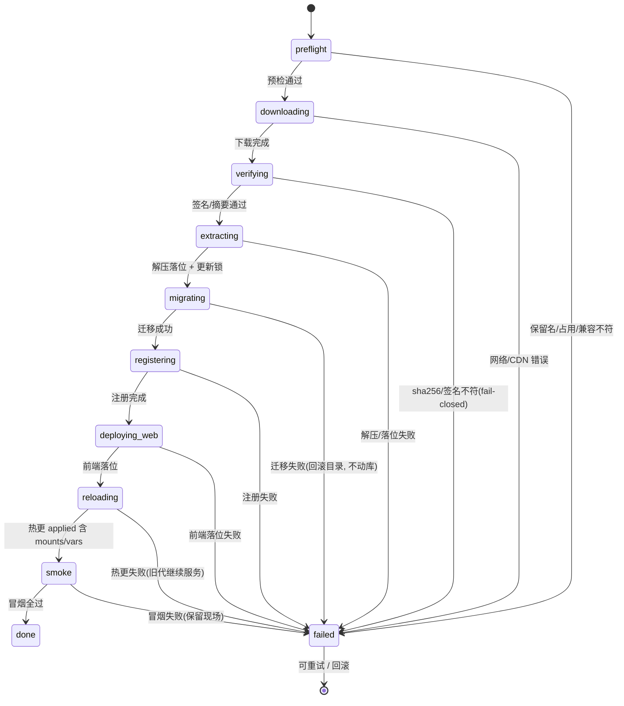

# 解决方案市场与框架化 PRD

> 状态：草案（待评审） · 日期：2026-10-15 · 范围：`oj-module`（本仓）
> 参照原型：`../oj-wiki/`（**只读**，不改动）
> 本文只出方案，不含实现。

---

## 0. 一句话目标

把 `ojm init` 从「脚手架生成器」升级为「**自带账户体系、设置中心、审计日志、可扩展登录、解决方案市场**的应用框架」，并把 `ojm build` 从「产出站点」扩展为「同时产出可分发的**解决方案 bundle**」，使第三方业务模块能以 `.tgz + manifest.yaml` 的形态发布到 CDN，被任意一套框架运行时**在线安装、热加载、可回滚**。

---

## 1. 术语表（全文统一）

| 术语 | 含义 | 备注 |
|---|---|---|
| **解决方案（Solution）** | 对外分发的业务模块包 = `.tgz` 归档 + `manifest.yaml` 元信息 | **原「业务模块 / 模块插件」统一改称「解决方案」** |
| **解决方案市场（Solution Marketplace）** | 框架内置页面：以卡片展示 CDN 上可安装的解决方案，并提供安装按钮 | 菜单名、后端模块名 `market` |
| **bundle** | 一个解决方案的发布归档 `<name>-<version>.tgz`，内含 api 产物 + web 产物 + `manifest.yaml` | |
| **共享根（modules root）** | 后端所有 release 模块（框架内置 + 已安装解决方案）共居的目录，含一份 `manifests.yaml` 版本锁 | 建议 `api/modules/` |
| **装载源（Solution Source）** | 把内容填进共享根的策略：`local`（本地）/ `cdn`（从 CDN 拉取）。**运行时两者完全等效** | 见 §5.5 |
| **框架设置 / 业务设置** | 系统设置页的两个层级：内置 `framework` 组 + 每个已安装解决方案自带的组 | |
| **prefix** | 每个解决方案的统一前缀，默认 = 业务名：后端 `/api/<name>`、前端 `/<name>`，前面还可能附加其他 base 地址，解决方便必须采用相对路径进行开发与验证 | 见 §5.8 |
| **角色 / 权限点** | 框架统一 RBAC：角色（`sys_role`）+ 权限点（`sys_permission`），解决方案在 manifest 中声明；**框架统一管理 RBAC 数据并提供 hook（`assertPermission` 等），业务逻辑由解决方案自管**（已消除"框架执行 vs 自管"张力）。角色层级：`superadmin`（安全敏感项）> `admin` > `<name>.admin`（模块超集） | 见 §5.9、设计文档 `202610160908-rbac-auth-design.md` |
| **宿主 / shell** | `@oj-module/runtime` + `packages/cli/shell-dist`，浏览器端 fetch `modules.json` 加载模块 | 既有概念 |
| **oj** | Rust 后端运行时（`~/.local/bin/oj`，本机 v0.1.74；playground-oj 钉 v0.1.69） | **外部项目，只读** |

> **命名纪律**：用户可见文案（菜单、页面标题、CLI 输出、文档）一律用「解决方案 / 解决方案市场」；代码标识符仍用英文 `solution` / `market`（不使用 `plugin` / `module-market`）。

---

## 2. 现状盘点（本仓 + 参照原型）

### 2.1 本仓既有能力

| 能力 | 位置 | 现状 |
|---|---|---|
| CLI 命令表 | `packages/cli/src/index.ts:33-111` | `init / dev / build / preview / api / info / vendor / merge` + 5 个 oj 透传。**无 `create`、无 `install`、无 `publish`** |
| `ojm init` 模板 | `packages/cli/templates/`（60 文件） | 已含 `api/`（前后端一体）、dev 证书、devkit skill 分发、JWT 密封 |
| `ojm build` | `packages/cli/src/build.ts:479` | `oj build`（后端 → `api/dist/<mod>-<ver>/` + `.tgz` + `manifests.yaml`）＋ 前端（→ `web/dist/modules/<name>/<ver>/entry.js` + `modules.json`），再全站合并 shell |
| 前端模块定义 | `packages/runtime/src/module-loader/define-module.ts:12` | `defineModule({name, version, routes, i18n, lifecycle, peerRuntime})` |
| 前端加载 | `packages/cli/shell/src/host.tsx:93-198` | fetch `modules.json` → `loadAll` → `getRoutes()` 注入路由树 |
| 产物完整性 | `packages/cli/src/build.ts:309-326,643-680` | 每 chunk `sha384`，写入 `modules.json.chunks[].integrity` |
| 路由分类 | — | **不存在** admin/settings/main 分类字段；只有 `handle.layout` / `handle.order` / `handle.hideInMenu` / `config.requiredRoles`（`packages/core/src/router/types.ts:10-25`、`packages/core/src/types.ts:55-62`） |
| 模块注册原语 | `packages/core/src/types.ts:28-52` | `register.{store, apiPrefix, authProvider, systemApi, notificationsApi, uploadApi, layout, menu, ...}`。**无 settings 注册入口** |
| 演示模块 | `templates/web/src/demo/`、`templates/api/src/demo/`、`templates/web.config.ts:15-19`、`apps/playground-oj/api/src/demo` | 待清理 |
| 系统页骨架 | `web/system/entry.ts:13`（根仓 App 链） | `handle.roles:["admin"]` 门仍在；**阶段 C 已落六页**（user/dept/role/menu/oplog/settings，`feat/rbac-frontend` 分支），`handle.permissions` 已用 `permission:button:*` 码（验证时点 2026-10-16，原「页面是 stub」描述已过时） |

### 2.2 参照原型 `oj-wiki` 可移植资产

| 能力 | 位置 | 可移植性 | 说明 |
|---|---|---|---|
| 用户表 | `api/src/_platform/schema.yaml:4-14` + `migrations/0001..0006` | ★★★★★ | `users(id, username UNIQUE, password_hash, roles JSON, avatar_base64, email, is_forbidden, must_change)` |
| 用户管理 API | `api/src/wiki/system/api.ts:364-377` + `_shared/service/users.ts` | ★★★★☆ | `/system/user/{create,roles,password,forbidden}`；含唯一约束竞态兜底、自助保护 |
| 判权 | `api/src/wiki/_shared/service/space-guard.ts:93-95` | ★★★★☆ | `assertGlobalAdmin` 单一出口（DIP 纪律，值得照搬） |
| 操作日志 | `api/src/wiki/system/_shared/service/oplog.ts:9-74` + `migrations/0008__system.sql:4-14` | ★★★★★ | `mw_log`；`auditOp` fire-and-forget + 脱敏红线 + 「多取一条判 truncated」 |
| LDAP | `api/src/wiki/account/api.ts:10-75` + `_shared/ldap.ts:1-14` | ★★★★★ | **依赖 `axis("ldap")` 原生插件**；实机已确认 `bin/plugins/aarch64-apple-darwin/libldap.dylib` 在 `oj-module` 与 `oj-wiki` 两侧均已随 `ojm vendor` 落地 → 可直移 |
| 系统设置 | `api/src/wiki/system/_shared/service/config.ts:1-61` | ★★★☆☆ | **纯 KV 三列**（`key/value/update_time`），无 group/type/label；加一个键要改 4 处。**本次须升级** |
| 「模块注册自己的设置」 | — | ☆ | **wiki 不存在此机制**，是本 PRD 的新增设计点 |

### 2.3 六条必须继承的硬纪律（来自 wiki 血泪注释）

1. **判权单一出口**：service 不自己判权，统一 `assertSystemAdmin`。
2. **`is_forbidden` 闭环三处**：`auth/login`、`ldap-login`、SSO —— 签发 token 前必查，漏一处 = 禁号可登。
3. **唯一约束竞态兜底**：预查 + insert 之间必有竞态，捕获 `/unique|constraint/i` 后回查复用，**不叠行**。
4. **外来号占位 hash**：LDAP/SSO 建号写 `password_hash = "!ldap"`（非法 bcrypt，恒 verify false），用户名带来源前缀 `ldap:<uid>` —— **低信任来源不得接管本地号**。
5. **审计不反噬业务**：`auditOp` 内部 try/catch 只 `log.warn`，挂在**成功分支末尾**。
6. **脱敏红线**：重置口令的 `detail` 只含目标 id，绝不含口令本体，且由单测钉死。

---

## 3. 可行性实测结论（本 PRD 的地基）

以下 8 条均在本次调研中用真实 `oj` 二进制（v0.1.74）实测验证，非文档推断。

| # | 结论 | 证据 |
|---|---|---|
| **E1** | `mounts:` 支持**多条 api 挂载**（前缀必须互异）；**模块名在全部 api 挂载间必须全局唯一** | 同前缀重复 → `mounts[i]: duplicate …`；跨挂载重名 → `module "auth" declared in multiple places (…/src/auth and …/dist/auth-0.1.0) — module names must be unique across api mounts` |
| **E2** | 一条挂载可 dev（`.ts` 源码）另一条可 release（`.js` 产物）**同时生效**；release 判定 = 挂载根含 `manifests.yaml` | 实测 `- prefix:/api, api:src`（dev/ts）＋ `- prefix:/ext, api:dist`（release/js）并存，路由均注册成功 |
| **E3** | `server.reload_api: true` 后 `POST {base}/_system/config`（**空 body**）触发热更；**`mounts` 落在 `applied`（本代即生效）**，不在 `restart_pending` | 返回 `{"code":0,"data":{"generation":1,"applied":["mounts"],"restart_pending":[],"kept_listener":[]}}`；旧代继续服务，失败回滚完整 |
| **E4** | **热更触发源是 config 文件的归一化 sha256**：加注释/空白 **不触发**（返回 `unchanged`）；必须有语义变更 | 实测仅改注释 → `{"msg":"unchanged","generation":0}` |
| **E5** | **无需新增 mount**：把新模块目录放进**已挂载的共享根**、更新该根的 `manifests.yaml` 锁、再触发一次语义性 config 变更 → 热更后新模块路由**即时 200** | 实测：锁加 `newmod: 0.1.0` + `vars.gen` 1→2 + `POST _system/config` → `/m/newmod/hello` 由 404 变 200，全程未重启 |
| **E6** | `auth.anonymous_paths` 是**挂载前缀相对**的：写 `/extmod/hello` 放行 `/m/extmod/hello`；写 `/m/extmod/hello`（含前缀）**不放行** | 实测对照 |
| **E7** | ~~oj JS 全局 **无 tar/gzip/zip 解压、无 YAML 读写**~~；有 `fetch(url)`、`fs.writeFile`、`axis(name)` 泛型插件轴 | `global.d.ts:239-250`（FsApi 仅 9 个方法）、`:656-658`（`axis`）。**⚠️ 本条基于 oj 0.1.74，已于 v0.1.75/0.1.76 过期**：解压改由 `exec.run` + 系统 tar 承担、YAML 由 `yaml.parse/stringify` 承担——见 §5.4 清单与 `docs/prd/solution/202610161500-oj-bin-feature-requests-pr.md` 的重新评估 |
| **E8** | release 模式路由**只认 `routes.js`**，目录镜像路由不存在；`routes.js` 的 `pattern` 含模块名段、无首斜杠、不含 base | `api-manual.md:3246`；实测 `dist/web-0.1.0/routes.js` = `{method:"get", pattern:"web/hello", file:"hello/api.js"}` |

### 3.1 由 E1–E8 推导出的三条硬约束

- **约束 A｜挂载形态只能选「单一共享根」**：因 E1 的模块名全局唯一 + 现有前端 `apiPrefix` 契约（`packages/runtime/src/utils/request/index.ts:21` 全局 `prefixUrl = VITE_API_BASE_URL`；模块 `ctx.register.apiPrefix("/wiki")` 是**相对该 base** 的，`packages/runtime/src/utils/request/scoped.ts:20-58`），一旦给已安装解决方案另起前缀（如 `/mod`），生成 client 里硬编码的 `/wiki` 前缀就会拼成 `/api/mod/wiki` 而 404。
  → **所有后端模块统一挂在 `/api`，路由恒为 `/api/<模块名>/...`**。
- **约束 B｜安装必须「先迁移、后热更」**：热更路径强制 `migrate verify`-only（`api-manual.md:2762` 段），带迁移的解决方案必须先由 `oj migrate -d <共享根>` 落库，再触发热更，否则装配失败（旧代继续服务，不会破坏在跑实例）。
- **约束 C｜热更需要一把「语义计数器」**：因 E4，安装器写 config 时必须改一个**真实段**。建议 `vars.ojm_solutions_gen: <n>` 自增（`vars` 属 `applied`，本代即生效，且语义无害）。

---

## 4. 需求一：脚手架升级为框架

### 4.1 清理 demo / 演示模块

| # | 动作 | 位置 |
|---|---|---|
| 1 | 删 `templates/web/src/demo/`（含 `entry.ts`、`pages/index.tsx`、`locales/`） | `packages/cli/templates/` |
| 2 | 删 `templates/api/src/demo/`（含 `manifest.yaml`、`api.ts`、`migrations/`、`schema.yaml`、`seed.sql`） | 同上 |
| 3 | 从 `templates/web.config.ts` 删 `demo` 条目（`:18-22`） | 同上 |
| 4 | 删 `apps/playground-oj/{web/src/demo, api/src/demo}` 及 `web.config.ts` 的 demo 条目 | dogfooding 靶场同步 |
| 5 | 清理孤儿生成物 `templates/web/src/{auth,notifications,web}/__client/`（**无任何 entry.ts 消费**，全仓仅 `notification/entry.ts:5` 用自家 `__client`） | 同上 |
| 6 | 校验：`home` 须为 `web.config.ts` 首个模块（`templates/web.config.ts:10-14`，`/` → `/home` 重定向依赖此顺序） | 测试钉死 |

**验收**：`ojm init` 新工程 `pnpm typecheck` 零错、`ojm build` 通过、`ojm info` 模块清单不含 demo。

### 4.2 账号管理

后端新增框架级模块 **`_platform/system`**（与 wiki 的 `wiki/system` 对齐，但下沉为框架内建模组，表名去 `mw_` 前缀）。

**路由（全部 `/api/system/...`，`assertSystemAdmin` 判权）**

| 方法 | 路径 | 说明 |
|---|---|---|
| GET | `/system/users` | 列表：`username` LIKE + offset/limit（limit 静默钳 200） |
| POST | `/system/user/create` | 新建账号，返回新 id |
| POST | `/system/user/roles` | 设置角色 |
| POST | `/system/user/password` | 重置口令 |
| POST | `/system/user/forbidden` | 禁用 / 启用 |

**数据模型**：沿用 `_platform.users`（`schema.yaml:4-14`），新增 2 列（迁移 `0007__add_users_source_and_display_name.sql`）：

| 列 | 类型 | 说明 |
|---|---|---|
| `source` | text NOT NULL DEFAULT `'local'` | `local` / `ldap` / `sso:<provider>`；**外来号用户名带来源前缀**（`ldap:<uid>`） |
| `display_name` | text | 展示名（LDAP `cn` 映射预留） |

**角色模型（修正 wiki 的缺陷）**：wiki 前端声明 `["admin","editor","viewer"]` 但**后端只认 `"admin"`**（`admin-users.tsx:19` vs `space-guard.ts:31`）。本次收敛为：

- 后端常量单一真相 `ROLES = ["superadmin", "admin", "editor", "viewer"]`，`assertSystemAdmin` 认 `admin` + `superadmin`；`superadmin` 独占安全敏感项（admin/superadmin 成员资格、卸载解决方案、`market_cdn_url`/信任公钥等市场安全设置、全量审计）；保护红线：禁止对最后一个 superadmin 降级/禁用，只有 superadmin 能改 superadmin。`editor/viewer` 供**页面级门**与后续业务判权使用，不再是装饰。
- 前端 `ALL_ROLES` 从 `@oj-module/runtime` 或系统契约导入，禁止硬编码。

**必须继承的语义**（wiki `users.ts`）：
- 建号：口令 ≥ 6 位 → 预查 → insert → `/unique|constraint/i` 兜底 400；默认 `must_change=1`（首登强制改密，签发限权 token 仅改密端点可用）；**拒绝 `^(ldap|sso):` 前缀用户名**（防抢占外来号命名空间，JIT 撞 UNIQUE 回查复用会登进带角色的手工号）
- `roles`：禁止撤销自己的 admin
- `forbidden`：禁止禁用自己
- 四处写端点结束前 `auditOp(...)`
- 登录链 `auth/login`：**先验口令后查 `is_forbidden`**（号不存在/口令错/禁用统一 401，不泄露账号状态，D14）；LDAP 路径因 JIT 建号无法避免先查号，接受此枚举面并注明

**前端页面**：`web/system/pages/user/`（现有 stub 位置，`web/system/entry.ts:14-35` 已有 `handle.roles:["admin"]` 门）；antd `Table` + `Modal` + `Form`（不用 ProTable，与 wiki `admin-users.tsx` 同构）。纯函数 `roleLabel` / `canOperate` 导出供单测。

**通讯录（D9，M3 轻量）**：users 即通讯录，不建独立表。框架提供 `GET /api/_platform/contacts?keyword=&offset=&limit=`（登录即可，limit 钳 200）与后端共享 service `searchContacts(keyword)`，供解决方案开发选人/提及/指派业务；返回不含 avatar/roles，默认排除 is_forbidden=1。外部联系人/组织架构需求出现时，以 `user_profile` 扩展表（1:1）演进。详见设计文档 `202610160908-rbac-auth-design.md` §4B。

### 4.3 系统设置（分组 + 解决方案注册）

**这是 wiki 没有、需要新建的机制。**

**表 `sys_setting`（新）**

| 列 | 说明 |
|---|---|
| `key` PK | 全局唯一，约定 `<module>.<name>`（框架内置用 `framework.*`） |
| `module` | 归属：`framework` \| `<solution-name>` |
| `group` | 分组键（默认 = `module`），用于设置页分 Card 渲染 |
| `type` | `string` \| `bool` \| `int` \| `json` \| `secret` \| `select`（**终结 wiki 靠 `_open` 后缀猜类型的约定**） |
| `value` | 文本（bool 存 `"1"`/`"0"`） |
| `default_value` | 默认值 |
| `label_key` | i18n key |
| `options` | `select` 的候选（JSON） |
| `secret` | 是否敏感（列表接口返回 `******`，不回真实值） |
| `update_time` | |

**注册机制（两条路径）**

1. **安装期声明式**：解决方案的 `manifest.yaml` 声明 `settings:{group,title,items:[...]}` → 安装器 upsert 进 `sys_setting`（默认值行），卸载时按 `module` 删除。
2. **运行期命令式**（前端侧）：`ctx.register.settings({group, items})` —— 新增到 `ModuleContext.register`（`packages/core/src/types.ts:28-52`、`packages/runtime/src/module-loader/types.ts`），供 shell 内已加载模块补充设置项。
   > 取舍：**M3 先只做路径 1**（安装期声明，确定性高、可审计）；路径 2 列为 M5 可选，避免过早抽象。

**白名单演进**：`CONFIG_KEYS` 常量白名单 → 改为「`sys_setting` 已注册键的并集」。新增配置项**不再需要改 4 处**（wiki 的痛点）。

**设置页 UI**：`web/system/pages/settings/`，按 `group` 渲染 antd `Card`；`framework` 组固定排首位，标题「框架设置」；已安装解决方案各自一个 Card。按 `type` 选控件（`bool`→Switch、`select`→Select、其余→Input）。

**首个框架设置项**：`framework.site_title`（页面 title）—— 需求明确要求；消费点 = shell `index.html` 的 `<title>`，经 `htmlTransform` 钩子注入（`templates/web.config.ts` 的 `htmlTransform` 扩展点，见 `packages/cli/src/config.ts:24`。注：扩展点已在 config schema 就绪，但模板 `web.config.ts` 当前未启用该字段——`site_title` 落地时需随模板新增 `html-transform.ts`）。

**新增 `framework.market_cdn_url`**：解决方案市场的 CDN 基址（§5.3）。

### 4.4 操作日志

**表 `sys_oplog`**（字段严格对齐需求：时间 / 账号 / 操作 / 模块 / 模块对象 / 详情）

| 列 | 对应需求字段 | 说明 |
|---|---|---|
| `id` PK | | |
| `create_time` | **时间** | Unix 秒，索引 `(create_time, id)` |
| `user_id` | | |
| `username` | **账号** | 按 `user_id` 回查的快照（JWT claims 只有 `sub`/`roles`）；失败回落 `"system"` |
| `action` | **操作** | `user.create` / `config.update` / `solution.install` … |
| `module` | **模块** | ⭐ **wiki `mw_log` 没有的字段**：`framework` \| `<solution-name>` |
| version | 模块版本 |  |
| `target` | **模块对象** | 用户 id、配置键、解决方案名 |
| `detail` | **详情** | 调用方给定的纯文本；**绝不记口令/token** |
| `level` | | 默认 6（info） |

**写入**：照搬 wiki `oplog.ts` 的双函数形态 —— `recordOp`（会抛）+ `auditOp`（fire-and-forget，内部 try/catch 只 `log.warn`，挂在成功分支末尾）。

**首批接入点（8 + 6）**：账号管理 4 个（create/roles/password/forbidden）、配置更新 1 个、~~通讯录 3 个~~（**已取消**：D9 定 users 即通讯录，无独立通讯录写操作）→ **角色管理 3 个**（`role.create` / `role.bindings.update` / `role.delete`，安全敏感必须留痕）→ 解决方案生命周期 3 个：`solution.install` / `solution.uninstall` / `solution.toggle`。

**查询**：`GET /system/logs`，`action` 精确 + `username` LIKE + `module` 过滤，倒序，**多取一条判 truncated**（limit 钳 200）；LIKE 参数统一 `%`/`_` 转义 + `ESCAPE`。**判权（D13）**：admin 可查全量（排障需要）；审计导出与留存/防篡改设置归 superadmin（D6/D11）。**403 判权失败审计按 (user_id, code) 分钟窗口去重聚合**（首条 + 计数），防脚本化请求洪泛淹没审计表。

**单测钉子**（照搬 `api/tests/system-oplog.spec.ts:60-69`）：重置口令 detail 不含口令本体；`DROP TABLE sys_oplog` 后管理操作仍成功且 warn 一次。

### 4.5 LDAP 登录（框架可选登录方式）

**可行性：高。** `libldap.dylib` 已随 `ojm vendor` 落进工程 `bin/plugins/aarch64-apple-darwin/`（本仓 `apps/playground-oj` 与 `oj-wiki` 均确认存在），JS 侧通过 `axis("ldap")` 调用。

**流程**（完整移植 `api/src/wiki/account/api.ts:10-75`）：

```
① 读 sys_setting: ldap_open == false → 400「LDAP 未启用」
② 校验 username/password 非空
③ 读 ldap_base_dn（空 → 400）
④ 读映射：uid_attr(默认 uid) / email_attr(默认 mail)
⑤ axis("ldap").search(base, { filter:`(${uidAttr}=${esc(username)})`, attrs:[uidAttr,emailAttr] })
     throw → 502「ldap upstream failed」；length !== 1 → 401（0 条不存在、多条不猜）
⑥ axis("ldap").bind(entries[0].dn, password)
     throw → 502；false → 401
⑦ JIT find-or-create：username = `ldap:<uid>`，password_hash = `"!ldap"`
     撞 UNIQUE → 回查复用（竞态兜底）；**新号零角色**，需 admin 事后分配（组→角色映射列演进方向）
⑧ is_forbidden === 1 → 403
⑨ issueTokens(...)  —— 与 auth/login 同一签发出口
```

**红线**：`esc()` **必须**先转义 `* ( ) \ NUL` → `\hh`（RFC 4515；`axis("ldap")` 的 filter 无参数绑定，见 `_shared/ldap.ts:1-14`）。

**限速（M3 必须）**：`auth/login` 与 `ldap-login` 按 (IP, username) 双维度限速 + 指数 backoff，连续失败阈值后临时封禁并审计。⚠️ 无限速时攻击者可借 LDAP lockout policy **批量锁死域账号**（可用性攻击）。

**配置项：两段式（沿用 wiki 的关键设计）**

| 段 | 存放 | 理由 | 生效方式 |
|---|---|---|---|
| **连接段**：`url` / `bind_dn` / `bind_pw` / `timeout_ms` / `start_tls` / `tls_skip_verify` | `config.yaml` 顶层 `ldap:` | oj 插件**严格解析该段，未知键启动 fail-fast**，不能塞应用键 | 属 `restart_pending`，**改了要重启** |
| **应用映射段**：`ldap_open` / `ldap_base_dn` / `ldap_uid_attr` / `ldap_email_attr` | `sys_setting`（`module=framework, group=ldap`） | 需求要求「在框架设置增加 ldap 的设置」 | DB 即时生效 |

**设置页处理**：映射段可编辑；连接段**只读展示**当前 `config.yaml` 的 `ldap:` 状态（是否配置、url 主机部分脱敏）+ 提供可复制的 YAML 片段与「需重启生效」提示。**不允许从设置页回写 config.yaml** —— 写挂了会启动 fail-fast，属高风险面。

**前端**：登录页**标签切换登录方式**（账号密码 / LDAP / 未来 SSO）——`GET /system/login-methods`（**匿名**）返回可用方式列表驱动标签渲染；未启用 LDAP 时不出现对应标签；默认标签为账号密码。
⚠️ **实测约束 E6**：`anonymous_paths` 是挂载前缀相对的，安装器/框架必须写 `/system/login-methods` 与 `/system/ldap-login`，**不要写 `/api/...`**。

### 4.6 解决方案市场（UI）

- 路由 `/market`，`handle.layout:"container"`、`order` 排在系统之后、`handle.roles:["admin"]`。
- 卡片列表：封面/图标、名称、标题、版本、作者、描述、大小、更新时间、状态徽标（`可安装` / `已安装` / `有更新` / `已禁用`）、**信任徽标**（已签名且信任公钥已知 = 可信；未签名 / 未知发布者 = 警示，P1）。
- 数据来源：框架后端 `GET /market/index` → 读 CDN `bundles.yaml` + `manifests.yaml`（§5.3），**同名只展示最高版本**，与本地已安装版本比对出状态。
- 操作：安装 / 更新 / 禁用 / 启用（**admin**）；卸载（**superadmin 独占**，D6/D11，前端按角色显隐按钮）——卸载列为 M7（见 R4）。
- 安装按钮触发 `POST /market/install {name, version}` → 返回任务 id → 前端轮询 `GET /market/task/:id`（下载+解压+迁移是秒级~十秒级，需进度反馈）。

---

## 5. 需求二：构建、分发与安装

### 5.1 `ojm build --bundle`

新增旗标 **`--bundle`**（默认关闭，保持现有「产出全站」行为不变）。

```bash
ojm build --bundle          # 产物：dist/<name>-<version>.tgz + dist/manifest.yaml
ojm build                   # 现状不变：web/dist 全站 + api/dist
```

**流程**：

1. 读 `web.config.ts`（`src/config.ts:37-54`）→ 定位目标模块（单模块工程取唯一条目；多模块需 `--module <name>`，与根仓 `scripts/build-modules.ts:59` 的 `--module` 对齐）
2. **后端**：`oj build -d api/src/<mod> -o <tmp>/api --no-minify` —— ⚠️ `--no-minify` 必须保留（`src/build.ts:498-504`，oj 的 swc minify 已知会压坏产物）
3. **前端**：复用现有单模块构建（`src/build.ts:549-641`），保留 `codeSplitting:false` 与 `sha384` integrity
4. 组装 `manifest.yaml`（§5.2）
5. 打 `dist/<name>-<version>.tgz`（**确定性**：固定 mtime/顺序，同输入字节一致，与 oj 的 `.tgz` 惯例一致）
6. 输出 `sha256` 并打印

**产物目录（tgz 内部）**：

```
manifest.yaml                       # bundle 元信息（§5.2）
api/                                # release 态后端产物
├── manifests.yaml                  # {<module>: <version>} 锁
└── <module>-<version>/{manifest.yaml, routes.js, schema.yaml, seed.sql, migrations/, **/api.js}
web/                                # 前端产物
└── modules/<name>/<version>/{entry.js, *.css}
```

> **与现有 `modules.json` 的关系**：bundle 的 `web/` 只放该模块自己的产物；`modules.json` 条目由**安装器**在目标站点上 upsert，不由 bundle 携带（避免覆盖宿主已有模块清单）。

### 5.2 `manifest.yaml` 契约（bundle 级）

> 与 oj 的模块级 `manifest.yaml`（`name/version/tables/deps`）**不同层**：bundle manifest 是**分发与安装**的元信息，安装后 oj 仍读模块自己的 `manifest.yaml`。

```yaml
# ---- 身份 ----
name: wiki                      # 解决方案唯一名；同时 = 后端模块名（须全局唯一，约束 A）
version: 0.2.0                  # semver
title: 知识库                    # 市场卡片标题
summary: 空间 + 文档 + 版本对比
description: |                  # 卡片正文
  …
icon: https://…/wiki.svg        # 可选
author: only-js
license: MIT
homepage: https://…
keywords: [wiki, docs]

# ---- 兼容性 ----
peerRuntime: ">=0.1.21"         # @oj-module/runtime（既有字段，安装期校验）
peerOj: ">=0.1.58"              # oj mounts 语法的最低版本
peerFramework: ">=0.2.0"        # 框架版本（本 PRD 引入后的框架版本号）

# ---- prefix（§5.8：默认 = 业务名，可覆盖）----
api:
  module: wiki                  # 与 name 一致；后端模块名（全局唯一）
  prefix: /api/wiki             # 默认 "/api/<name>"，可覆盖；安装期做占用检测
  tables: [space, document, mw_log, mw_config]   # 来自 schema.yaml，安装前冲突检测
  deps: { _platform: "^0.1.0" }
  anonymous:                    # ⚠️ 挂载前缀相对（约束 E6），安装器原样并入 config.yaml
    - wiki/share/link-access   # 非登录类匿名端点示例；⚠️ 登录语义端点（*/login、*-login、token 签发）拒装（R8/D11，安装器校验红线）

web:
  route_prefix: /wiki           # 默认 "/<name>"
  entry: modules/wiki/0.2.0/entry.js
  integrity: sha384-…
  css: [modules/wiki/0.2.0/oj-wiki.css]

# ---- 统一 RBAC（§5.9）----
permissions:
  - { code: wiki.space.create, title_key: wiki:perm.spaceCreate }
  - { code: wiki.doc.create,  title_key: wiki:perm.docCreate }
roles:
  - { name: wiki.admin,  title_key: wiki:role.admin,  permissions: [wiki.space.create, wiki.doc.create] }
  - { name: wiki.editor, title_key: wiki:role.editor, permissions: [wiki.doc.create] }

# ---- 路由分类（安装器据此注册菜单/路由）----
routes:
  - category: main      # main | admin | settings | personal | hidden
    path: /wiki
    order: 30
    title_key: wiki:menu.wiki
  - category: admin
    path: /admin/wiki
    order: 130

# ---- 业务设置分组（注册到系统设置，§4.3）----
settings:
  group: wiki
  title_key: wiki:setting.group
  items:
    - key: wiki.default_space
      type: string
      default: ""
      label_key: wiki:setting.defaultSpace
    - key: wiki.auto_follow_open
      type: bool
      default: "0"
      label_key: wiki:setting.autoFollow

# ---- 分发与签名（§5.7）----
archive:
  file: wiki-0.2.0.tgz
  sha256: 3f9a…                 # tgz 整体摘要
  size: 1234567
  signature:
    alg: Ed25519
    key_id: only-js-official-2026
    value: MEUCIQ…              # base64，对规范串 "<name>@<version>:<sha256>" 的签名
```

**路由分类落地方式**：后端安装器把 `routes[]` 写入新增表 `sys_solution_route`（`name, version, category, path, order, title_key, enabled`）；前端宿主在 `getRoutes()` 之后按 `category` 归并 —— `main` 进主菜单、`admin` 进管理菜单、`settings` 在系统设置页追加分组入口、`personal` 进个人中心、`hidden` 不入菜单（与既有 `handle.hideInMenu` 语义一致）。
> 注意：模块自带的 `routes`（`defineModule.routes`）仍是**前端路由的唯一事实来源**；`manifest.routes` 只负责**分类与菜单归属**，不重复声明路由。二者 `path` 不一致时安装器告警但不阻断。

### 5.3 CDN 与 `bundles.yaml`

**框架设置新增**：`framework.market_cdn_url`（默认留空 = 市场不可用，卡片区显示「未配置市场地址」）。

**CDN 目录布局**（静态文件服务即可，无后端）：

```
{cdn}/
├── bundles.yaml       # 索引：每个解决方案的最高版本 + 版本条目
├── manifests.yaml     # 聚合数组：所有 (name,version) 的 manifest 内容
├── wiki-0.2.0.tgz
├── wiki-0.1.9.tgz
└── crm-1.3.0.tgz
```

**`bundles.yaml`**

```yaml
generated_at: 2026-10-15T12:00:00Z
cdn: https://cdn.example.com/oj-solutions/
solutions:
  - name: wiki
    latest: 0.2.0
    versions:
      - { version: 0.2.0, file: wiki-0.2.0.tgz, sha256: 3f9a…, size: 1234567, published_at: 2026-10-15T12:00:00Z }
      - { version: 0.1.9, file: wiki-0.1.9.tgz, sha256: 91ab…, size: 1100000, published_at: 2026-09-01T10:00:00Z }
```

**`manifests.yaml`（聚合数组）**：所有已发布 bundle 的 manifest 直接拼成数组，市场卡片渲染**只读这一个文件**；`bundles.yaml` 负责版本/文件/校验信息。**同名只展示最高版本**（`bundles.yaml` 的 `latest` 给出，`manifests.yaml` 里按 `name+version` 精确取）。

**发布方**：`ojm publish`（M5，本 PRD 只定义契约，不设计鉴权）→ 上传 tgz + 重算两个 yaml。契约先行，发布工具后置。

### 5.4 安装流程

**执行主体决策**：用户选定「**扩展 oj 的功能**」。即安装器是 **oj 后端模块 `_platform/market`**；
最初按 E7 记录为「oj 无归档解压能力」，**该缺口已由 oj v0.1.75 补齐**——`exec.run`（系统 tar）+
`platform:` 特权段，且配置自热更内部 API（`server.reloadConfig`）与验签（`crypto.verifyEd25519`）
同批落地。据此分两阶段：

| 阶段 | 执行主体 | 依赖 |
|---|---|---|
| **M4（落地）** | oj 后端 `_platform/market` 编排 + **`ojm install` Node 进程执行落盘** | 后端通过 loopback 回调框架自带的 Node 管理端点（`ojm serve` 包裹层），或运维手动执行 |
| **M6（收敛）** | oj 后端原生完成 | 解压 = `exec.run` + tar 三步范式（scenarios 场景 34）；热更 = `server.reloadConfig()`；验签 = `crypto.verifyEd25519`；迁移 = `exec.run oj migrate --format json`（**无内建 `migrate.run`**） |

> **oj 侧能力诉求清单（对外依赖，需提给 oj-bin）** — 状态复核于 oj **0.1.76**（2026-10-17，本机 `oj exec -e` 实测）
> - **OJ-1** 归档解压 → ✅ **已落地（v0.1.75）**：形态为 `exec.run(["tar","-xzf",…])` +
>   `platform.exec` argv 白名单，配 scenarios 场景 34 的三步安全落位（非内建 `fs.untarGz`）。
> - **OJ-2** 配置自热更内部触发 → ✅ **已落地（v0.1.75）**：`server.reloadConfig()`，
>   限 `platform.modules` 特权模块，与 `POST {base}/_system/config` 同一 executor 与串行锁。
> - **OJ-3**（可选）YAML 读取 → ✅ **已落地（v0.1.75）**：`yaml.parse(text)`（**异步，须 `await`**）
>   与 `yaml.stringify`（禁用于 config.yaml 回写，会丢注释/空白）。
> - **OJ-4** 非对称验签 → ✅ **已落地（v0.1.75）**：`crypto.verifyEd25519(pub, msg, sigB64): boolean`
>   （同步；格式错抛错、验签不过返回 `false`）。原文「oj 无非对称能力 → 验签必须 Node 侧做」
>   **已过期**：M4 统一在 Node 侧验签改为实现选择，不再是能力约束。
> - **OJ-5**（远期）远程 mount → ❌ **未变**：`mounts[].api` 仍只认本地目录。
> - **OJ-6** 迁移执行内部化 → ⚠️ **无内建 API**：无 `migrate.run` 全局；官方绕行 =
>   `exec.run(["oj","migrate","-c",cfg,"--format","json","-d",dir,mod])` + 判 exit code
>   （scenarios 场景 35 步骤 7）。已从阻塞项降级为可选优化。
> - **OJ-8**（新增，P1）Windows 外部命令缺失的报错契约 → ❌ **终裁未采纳（2026-10-17）**：Windows exec 模板显式写 `cmd /c`；见下方 §5.6.3 说明。
>
> 编号说明：`OJ-7` = 表级写守卫（**仍未落地，oj 0.1.76 复核**），独立成文，见
> [`docs/prd/202610170016-oj-table-write-guard-requirement.md`](../202610170016-oj-table-write-guard-requirement.md)。

**安装状态机**（M4 实现，M6 复用）：在 PRD 原 7 阶段基础上细化 —— 预检前置、注册/前端落位拆分、新增**安装期冒烟**，共 10 阶段。图例见设计文档 `202610161300-solution-lifecycle-registration-design.md` §10.3。



**步骤**（按「安全顺序」重排，错序会拒启，见约束 B）：

1. **预检**：`GET {cdn}/bundles.yaml` 解析目标 `(name, version)`（未指定取 `latest`）+ 兼容性门禁（`peerRuntime`/`peerOj`/`peerFramework` 不满足→拒绝给可读原因）+ 重名/保留名门禁（约束 A / §5.8.2）。
2. **下载 + 校验**：`GET {cdn}/<file>` → 校验 `sha256`，再 Ed25519 验签（§5.7，fail-closed；任何一步失败**不落盘、不改锁、不触发热更**）。
3. **解压**：解压到 `<共享根>/.staging/<name>-<version>/` → **原子 rename** 到 `<共享根>/<name>-<version>/`。
4. **更新锁**：合并 `<共享根>/manifests.yaml`：upsert `<module>: <version>`（同版本重装 = no-op）。
5. **迁移**：`oj migrate -c api/config.yaml -d <共享根>`（**约束 B：必须在注册与热更前**）。
6. **注册**：`sys_setting` upsert `settings.items`（默认行，§4.3）；`sys_solution_route` 写入 `routes[]`（§5.2）；RBAC `sys_role`/`sys_permission`（强制 `<name>.` 前缀）+ 初始 `sys_role_permission`（insert-if-absent，§5.9）。
7. **前端落位**：前端产物拷入站点 `web/dist/modules/<name>/<version>/`；`modules.json` upsert 条目（含 `integrity`/`css`/`chunks`/`enabled`，**不随 bundle 携带**）。
8. **配置**：`config.yaml`：`anonymous_paths` 并入（`api.anonymous`，挂载前缀相对，E6）；`vars.ojm_solutions_gen` 自增（**约束 C 的语义计数器**）。
9. **热更**：`POST {base}/_system/config`（空 body）→ 校验 `applied` 含 `mounts`/`vars` 且无 `restart_pending`。
10. **安装期冒烟**：见 §5.4.1，全过才标记成功。
11. `auditOp("solution.install", name, ...)`；前端提示刷新页面。

> **注册内容汇总**（落点与时机，详见设计文档 §4）：

| # | 注册项 | 落点 | 时机 |
|---|---|---|---|
| 1 | 后端模块 | 共享根 `manifests.yaml` + 物理目录 | 步骤 4 |
| 2 | 路由分类 | `sys_solution_route` | 步骤 6 |
| 3 | 业务设置 | `sys_setting` | 步骤 6 |
| 4 | RBAC | `sys_role`/`sys_permission`/`sys_role_permission` | 步骤 6 |
| 5 | 前端入口 | 站点 `modules.json` | 步骤 7 |
| 6 | 前端路由 | `entry.js` `defineModule.routes`（运行时事实） | 宿主 `getRoutes()` |
| 7 | 前端 i18n | `entry.js` `defineModule.i18n` → 宿主命名空间 `<name>`（含菜单分组标签） | 宿主加载 entry |
| 8 | 匿名路径 | `config.yaml anonymous_paths` | 步骤 8 |
| 9 | 兼容性 | `peerRuntime`/`peerOj`/`peerFramework` | 步骤 1 门禁 |

### 5.4.1 安装期验证（双轨）

PRD 原 §5.7 只覆盖**包级签名/摘要校验**（静态、安装前）；此处补齐**运行时验证**，确保「装完即真的可用」。详细规格见设计文档 §7。

- **安装期自动冒烟**（步骤 10，装完即跑，失败→保留现场可重试，不静默成功）：① 后端 `GET /api/<name>/health` 或首个非匿名路由断言 200；② 前端 `modules.json` 条目 `integrity` == 本地计算 `sha384`（Node 侧可算）；③ **前端 entry 可加载**由宿主 error boundary 在用户首次进入时兜底捕获——`entry.js` 是浏览器 ESM（含 React/antd），Node 侧无法 `import()`，故该项**不进 Node 冒烟**，异常经前端日志 / 按需深度校验可见，**不阻塞安装**；④ DB 注册行数**包含**全部 manifest 声明（`sys_solution_route`/`sys_setting`/`sys_role`/`sys_permission`）——升级场景允许 `deprecated` 残留，故用「包含」而非「相等」。
- **按需深度校验**（管理员在解决方案市场/系统页触发，输出报告）：路由可达性 / RBAC 完整性（含 `deprecated` 不静默生效）/ 设置项完整性 / 迁移账本一致性（`oj migrate verify`）/ i18n 覆盖（manifest 引用的 `title_key`/`label_key` 在命名空间 `<name>` 有值）。

> 开放问题 Q-A：冒烟的 `health` 端点是否**强制**解决方案提供？暂定「不强制，缺省用首个非匿名路由兜底」，待评审确认。

### 5.4.2 安装页面与进度展示（Web UI）

市场卡片（§4.6）安装/更新按钮触发 `POST /market/install {name, version}` → 返回 `task_id` → 前端打开**安装进度抽屉**，轮询 `GET /market/task/:id`（每 ~800ms，下载+解压+迁移为秒级~十秒级，需进度反馈）。步骤条按 10 阶段渲染（antd `Steps`），每项状态由 `stage`/`status` 推导（`wait`/`process`/`finish`/`error`），配整体 `progress` 进度条与 `message` 详情日志。后端任务模型：

```ts
type InstallStage = "preflight"|"downloading"|"verifying"|"extracting"|"migrating"
  |"registering"|"deploying_web"|"reloading"|"smoke"|"done"
type SolutionInstallTask = {
  id: string; name: string; version: string
  status: "running"|"done"|"failed"; stage: InstallStage; progress: number
  message: string; error?: { reason: string; retryable: boolean }
  startedAt: number; finishedAt?: number
}
```

> **任务状态落点（M4 工程要点，E3）**：安装任务由 Node 侧 `ojm install` 执行，而 `GET /market/task/:id` 由 oj 运行时（`_platform/market`）提供——二者跨进程。M4 下任务状态须落**共享介质**（建议写入共享根 `.install-tasks/<id>.json`，或借 `ojm serve` 包裹层内存态），保证 oj 侧轮询可读；M6 后端原生化后内化。

> **登录端点拒装是纵深防御而非主防线（S1）**：安装器按 `api.anonymous` / 路由 path 模式（`*/login`、`*-login`、token 签发）拒装，只是 belt-and-suspenders；**真正保证是 D3——`issueTokens` 钩子不向解决方案暴露**，解决方案在运行期拿不到签发能力，`/api/wiki/session` 之类也无法自签 token。名称匹配可被绕过，故不可作为唯一控制依赖。

失败处理：抽屉切错误态展示 `error.reason`（**可读中文 + 可操作指引**，如「签名校验失败：公钥未知，请先在框架设置配置信任公钥」，P2）；`retryable` 时显示「重试」按钮（重发 `POST`，同版本幂等，§5.4 步骤幂等规则）；重试前先清理 `.staging` 与（若已 rename）版本目录 / 恢复 `manifests.yaml` 原锁，保证可重入。详细 UI 流程图见设计文档 §10.4。

**禁用 / 启用**（Q3 已定：**保留目录 + 标记禁用**，B3）：`modules.json` 条目 `enabled:false`（宿主已支持，`packages/core/src/module-loader/index.ts:150`）+ `sys_solution_route.enabled=false`；后端**保留目录**但 `manifests.yaml` 条目标记 `enabled=false`（不移除），不挂载、前端跳过。非破坏、随时可恢复。磁盘采用**多版本目录共存**：`<共享根>/<name>-<version>/` 天然幂等，重复安装同版本 no-op。

**回滚 / 降级**：`manifests.yaml` 锁指回旧版本目录即生效（多版本共存使回滚零成本）；因 oj 迁移无 down 迁移，若目标版本 `migrations` 与当前存在差异，安装器**强告警并要求二次确认**，禁止静默降级（§5.6.5 / R12）。

---

### 5.5 装载源：本地共享根 与 CDN 远程加载

**核心主张：共享根是唯一的运行时事实来源；CDN 只是"如何把内容填进共享根"的策略。因此两者运行时完全等效。**

### 5.5.1 为什么后端不能"真远程"

oj 的 `mounts[].api` 只能是**本地目录**（E2/E8：挂载根须含 `manifests.yaml`，装配期校验目录存在）。没有 URL mount。
→ **后端产物的"远程加载"= 拉取到共享根后再挂载**，oj 侧无感知。真正的零落盘远端装载需 **OJ-5**
（oj 0.1.76 复核：仍无 URL mount，维持远期）。

### 5.5.2 三种装载策略（运行时等效，只差填充方式）

| 策略 | 后端产物 | 前端产物 | 适用 |
|---|---|---|---|
| **`download`（默认）** | 拉 tgz → 解压落共享根 | 落站点 `web/dist/modules/` | 常规安装；离线可重放 |
| **`cache-on-demand`** | 同上，但推迟到首次"启用"时才拉 | 同上 | 市场浏览不落盘，减少无效下载 |
| **`remote-web`** | 同 `download`（必落盘） | **不落盘**：`modules.json` 条目直接指向 `{cdn}/.../entry.js` | 前端产物频繁更新；磁盘受限环境 |

三者共享同一 mount（`/api`）、同一 `manifests.yaml`、同一路由形态（`/api/<name>/...`），**运行时无差别**。

### 5.5.3 `remote-web` 的细节

- `modules.json` 条目新增可选 `url` 字段（绝对 CDN 地址）；有 `url` 时宿主直接 `import(url)`，不走本地路径。
- 共享依赖仍走宿主 importmap（`scripts/inject-importmap.ts` 已注入），**远程 entry 不会被打包进自己的 react/antd**。
- **完整性**：动态 `import()` 无法携带 SRI。补偿手段 —— 装载前先 `fetch` 该 URL 计算 `sha384` 与 manifest 比对，**比对通过才写入 `modules.json`**（一次校验，之后信任）。
- **可用性风险**：CDN 不可达 = 模块整体不可用（本地模式则不受影响）。故 `remote-web` 仅作可选策略，**默认 `download`**（见 R10）。
- 需要 CDN 侧 CORS：`Access-Control-Allow-Origin` 需放行宿主站点域名。

### 5.5.4 共享根的缓存语义

共享根即 **CDN 的内容寻址缓存**：`<root>/modules/<name>-<version>/` 命名天然幂等，重复安装同一版本是 no-op。
缓存清理策略（M7）：按 `manifests.yaml` 未引用的版本目录做 GC，保留最近 N 个版本以便回滚。

---

### 5.6 安装期的数据库迁移

**这是安装流程里最容易出错、且不可逆的一步。**

### 5.6.1 迁移产物从哪来

bundle 的 `api/<module>-<version>/` 内自带：
- `schema.yaml` —— 表声明（启动时自动**安全前向收敛**：缺表 CREATE、缺可空列 ALTER ADD、缺索引 CREATE INDEX）
- `migrations/<seq:04>__<desc>[.sqlite|.mysql|.postgres].sql` —— 无法安全推导的变更
- `seed.sql` —— 幂等 INSERT，每次启动重放（**不归迁移**）

### 5.6.2 顺序（错一步会导致服务拒启）

```
 1  预检   —— 表冲突 / 兼容 / 保留名检测（约束 A / §5.8.2）→ 拒绝，零副作用
 2  下载   —— sha256 + 签名验证（§5.7），不过即终止，不落盘
 3  解压   —— <root>/modules/.staging/<name>-<version>/ → 原子 rename
 4  更新锁 —— <root>/modules/manifests.yaml upsert <module>: <version>
 5  ★迁移  —— oj migrate -c api/config.yaml -d <root>/modules（约束 B：先于注册与热更）
 6  注册   —— sys_setting / sys_role / sys_permission / sys_role_permission / sys_solution_route
 7  前端   —— 产物落位 + modules.json upsert
 8  配置   —— anonymous_paths 并入 + vars.ojm_solutions_gen++
 9  热更   —— POST {base}/_system/config
10  冒烟   —— 安装期自动冒烟（§5.4.1）
11  审计   —— auditOp("solution.install", …)
```

**第 5 步必须早于第 9 步**：热更路径强制 `migrate verify`-only（约束 B）；而 release 模式 `migrate_on_start` 默认 `verify`，账本落后会**拒启**。
→ 若先改锁后迁移，热更时 `verify` 失败返回 400（旧代继续服务，不会炸）；若此时进程重启，则**直接拒启**。顺序不可交换。

### 5.6.3 谁来执行迁移

`oj migrate` 是 **CLI 子命令**；oj 的 JS isolate 本身**无子进程能力**（E7 同源），
v0.1.75 起由 `platform.exec` 授权的 `exec.run` 补上（无 shell，白名单 argv 模板）。
→ **M4：Node 侧 `ojm install` 调用 `bin/oj migrate`**；~~**M6：待 OJ-6 就位后后端内部化**~~
→ 见下方复核。

> **复核（2026-10-17，oj 0.1.76）**：OJ-6 的**内建 `migrate.run` 全局并未落地**，但 v0.1.75 的
> `exec.run` 已给出等价绕行（`oj` 首 token 特判解析为 `current_exe()`，与 serve 进程同版本）：
> ```bash
> oj migrate -c <config.yaml> --format json -d <共享根> <name>-<version>
> # stdout 一行 {"results":[{"module":"…","ok":true|false,"error":"…"}], "error": null}
> # 成败真源 = 退出码：任一模块失败时 json 仍可解析，但 results[].ok=false 且进程退非 0
> ```
> 故 M6「后端内部化」不再受 oj 能力阻塞，仅剩子进程开销与 exit-code 契约摩擦（~~可选再提 OJ-6~~ **OJ-6 已终裁不采纳（2026-10-17）——exec 子进程即设计意图，摩擦为长期接受项**）。
> ⚠️ **Windows 前置**：`oj` 是特判不依赖 PATH，但同批的 **`tar` 模板依赖**（子进程 env 清空、不继承 PATH）。
> Windows 请用 **Git Bash**（`C:\Program Files\Git\git-bash.exe`）执行，或把
> `C:\Program Files\Git\usr\bin`（GNU `tar` / `zip` / `unzip`）加入 PATH；且 Windows 自带的是
> `System32\tar.exe`（**bsdtar**，与 GNU tar 参数有差异，别直接照抄 GNU 模板）。
> 缺失时的**报错契约**见 **OJ-8**（`docs/prd/solution/202610161500-oj-bin-feature-requests-pr.md` PR-7）。

```bash
bin/oj migrate -c api/config.yaml -d <root>/modules          # default 库
bin/oj migrate -c api/config.yaml -d <root>/modules --db <n> # 多库逐库
bin/oj migrate -c api/config.yaml -d <root>/modules --module <name>  # 模块绑不同库时逐组合
```

### 5.6.4 失败与回滚

| 阶段 | 失败处理 |
|---|---|
| 1 预检冲突 | 拒绝安装，零副作用 |
| 2 校验失败 | 拒绝安装，零副作用（不落盘） |
| 5 迁移失败 | **回滚**：删除版本目录 + 恢复 `manifests.yaml` 原锁；**不动数据库**（oj 迁移是前向的，无自动 down） |
| 10 热更失败 | 旧代继续服务，保留现场可重试；绝不停机 |

**数据库备份**：sqlite 可在第 6 步前自动 copy 一份 `db.sqlite.bak-<ts>`；mysql/pg **不自动备份**，安装前 UI 强制提示"请先自行备份"并需勾选确认。

### 5.6.5 降级/回滚的 schema 兼容性（红线）

oj 迁移**无 down 迁移**。回滚 = 把锁指回旧版本目录，但旧版本若依赖已被新迁移删除/改名的列 → 运行期崩。
→ manifest 可声明 `downgrade.min_version`；未声明时安装器对"目标版本 migrations 与当前版本存在差异"的情况**强告警并要求二次确认**。
**禁止静默降级。**

---

### 5.7 包签名验证

### 5.7.1 威胁模型

CDN 视为**不可信通道**。攻击者能做到：替换 tgz、替换 `bundles.yaml`、中间人投毒、伪造新版本。
攻击者做不到：拿到发布者私钥（离线保存）。

### 5.7.2 签名对象与层级

| 层 | 对象 | 防什么 | 是否必需 |
|---|---|---|---|
| **包签名（主）** | 规范串 `"<name>@<version>:<sha256>"` | 单包替换、投毒 | **必需** |
| **索引签名（加固）** | `bundles.yaml` 规范化文本 | 整站索引篡改、版本隐藏 | 可选（M7） |

> 为什么签 manifest 里的 `sha256` 而不是直接签 tgz 字节：manifest 可被单独分发/镜像，且签名与归档解耦，便于 CDN 侧 re-host。

### 5.7.3 算法与字段

**Ed25519**（Node `crypto.verify` 原生支持；密钥 32 字节、无 ASN.1 解析坑；比 RS256 更适合离线发布密钥）。

```yaml
archive:
  signature:
    alg: Ed25519
    key_id: only-js-official-2026
    value: MEUCIQ…     # base64( sig over "<name>@<version>:<sha256>" )
```

### 5.7.4 信任配置

- **存放**：config.yaml（**推荐**）或 `sys_setting` 的 `framework.market_trusted_keys`。
  ⚠️ 存 DB 有鸡生蛋问题 —— DB 被篡改即可注入信任公钥。**生产建议写 config.yaml**。
- 格式：`[{ key_id, alg, public_key }]`
- **fail-closed**：未配置任何信任公钥 → **默认拒绝安装**，页面提示"未配置市场信任公钥"。

### 5.7.5 验证流程（fail-closed）

```
1 计算 tgz 的 sha256，与 manifest.archive.sha256 比对 → 不符即终止
2 构造规范串 "<name>@<version>:<sha256>"
3 按 key_id 查信任公钥 → 查不到即终止（unknown publisher）
4 crypto.verify(alg, pubkey, 规范串, sig) → 失败即终止
5 全部通过才进入解压
```
任何一步失败：**不落盘、不改锁、不触发热更**，并写一条 `solution.install` 失败审计（含 reason）。

### 5.7.6 TOFU（首次信任）

首次遇到未知 `key_id` 时，市场 UI 弹出公钥**指纹**（`sha256(pubkey)` 的 hex，分组显示）供管理员人工核对，确认后写入信任列表并在审计留痕。**不做"静默信任第一个来源"**。

### 5.7.7 执行者

~~**oj 无验签能力**~~（原实测基于 oj 0.1.74：`global.d.ts:562-571` 的 `crypto` 仅 `sha256Hex`/`randomHex`/
`getRandomValues`/`aesGcm*`；`jwt.verify` 只验自家 token）→ **已于 v0.1.75 补齐**：`crypto.verifyEd25519`
（同步返回 boolean；格式错抛错、验签不过返回 `false`）。注意 `crypto.sha256Hex` 同批**行为变更**：
非 string/二进制入参由 `String()` 强转改为抛 TypeError，老调用需自查。
→ **M4 由 Node 侧 `ojm install` 验签**（sha256 部分 oj 后端也能做，但统一在 Node 侧更简洁）；
**M6 不再依赖 OJ-4**，可直接后端验签（`scenarios.md` 场景 35 步骤 3）。

---

### 5.8 统一 prefix 约定

### 5.8.1 默认值

| 维度 | 默认 | 示例 |
|---|---|---|
| 后端 API | `/api/<name>` | `/api/wiki/**` |
| 前端路由 | `/<name>` | `/wiki/**` |
| 后端模块名 | `<name>` | routes.js 的 `pattern` 首段 |

`name` 即解决方案名，**一处命名贯穿三处** —— 这也是"单一共享根"（约束 A）能成立的前提：mount 前缀恒为 `/api`，模块名段即业务名。即解决方案的英文名。开发过程中应该保证 perfix 的可替换性，而不应该采用绝对路径。

### 5.8.2 覆盖与冲突

manifest 可显式覆盖 `api.prefix` / `web.route_prefix`（多模块工程或历史迁移场景）。

安装期检测：
- **保留名**：`_platform` / `system` / `auth` / `market` / `framework` / `health` / `plugins` / `_system` —— **禁止被解决方案占用**（`_system` 是 oj 平台保留前缀；`{base}/health`、`/plugins`、`/blob/{key}` 是内建路由）。
- **占用检测**：目标 prefix 已被已装解决方案或框架内建模块占用 → 拒绝安装并给出占用者。
- 生成 client 的 `API_PREFIX`（codegen 契约）必须与 `api.prefix` 一致，否则前端请求会被 scoped guard 拦（`packages/runtime/src/utils/request/scoped.ts:20-58`）。

### 5.8.3 与 LDAP 匿名路径的联动

`api.anonymous` 声明的是**挂载前缀相对**路径（约束 E6）。若 prefix 非默认，安装器须按 `api.prefix` 减去 `/api` 得到模块段，再拼接。默认情形下即 `<name>/<path>`。

---

### 5.9 统一角色与用户管理（RBAC）

### 5.9.1 为什么必须框架统一

wiki 的缺陷：前端声明 `["admin","editor","viewer"]`，后端**只认 `"admin"`**（`admin-users.tsx:19` vs `space-guard.ts:31`）——后两个角色是装饰。
oj 侧**没有 per-route 授权声明**（鉴权是全局 Bearer 守卫 + `anonymous_paths` 二值），所以 RBAC 只能框架自建。

### 5.9.2 数据模型

| 表 | 主键 | 说明 |
|---|---|---|
| `sys_role` | `name` | `module`（`framework` \| `<solution>` \| `custom`）、`title`、`description`、`builtin`、`deprecated` |
| `sys_permission` | `code` | 权限点；`module` 归属、`deprecated` |
| `sys_role_permission` | `(role_name, permission_code)` | 角色 → 权限点 |
| `sys_user_role` | `(user_id, role_name)` | **权威源** |

**`users.roles` JSON 列的处置**（D10 修订）：JSON 列无法建索引、无法反查 → **M3 改为 `sys_user_role` 表作唯一权威源**；判权实时查 DB + 进程内缓存（写时失效）= **撤销即强退**；JWT 只载 `sub` 不载 roles（前端体验层角色来自用户资料接口）；**`users.roles` 缓存列取消**（原 Q9 保留方案撤销），签发时一次 JOIN 直查，消灭双写分裂。

### 5.9.3 解决方案如何声明

manifest 的 `permissions` / `roles`（§5.2）→ 安装时按 `module=<name>` upsert；卸载时按 `module` 级联清理 `sys_role_permission` 与 `sys_user_role` 中该 module 的角色绑定。

### 5.9.4 判权

- **框架单一出口**：`assertPermission(code)`，与 `assertSystemAdmin` 同纪律（§2.3-1）。
- **superadmin 专属出口（D11）**：`assertSuperAdmin()` 只认 superadmin（DB 实时查）；成员资格管理、卸载解决方案、市场安全设置、审计导出**不得建模为权限点**——物理上不存在于 `sys_permission`，杜绝 custom 角色绑定绕过边界。
- 超集链（自动推导，零配置）：`superadmin`/`admin` 恒通过一切 code；`<name>.admin` 恒通过 `module=<name>` 的 code（按 code 首段推导）；最后才是 `sys_role_permission` 精确命中。
- handler 侧：`await assertPermission("wiki.doc.create")`。
- 前端：`handle.roles` / `config.requiredRoles`（`packages/core/src/types.ts:55-62`）复用；菜单按角色过滤。
- 路由级：`sys_solution_route` 增加 `required_permission` 列，安装器从 manifest 带入。

### 5.9.5 用户管理页的联动

角色下拉来自 `sys_role`，按 `module` 分组展示（框架角色 / 各解决方案角色）；分配即写 `sys_user_role` 并同步 `users.roles` 缓存。
**卸载解决方案时**：若仍有用户持有其角色 → 提示并列出人数，需管理员确认清理。

**运行期新建角色（框架能力，D8）**：角色管理页允许 admin 从**已注册权限点的并集**中勾选绑定、新建自定义角色（`module='custom'`，可跨模块，名称禁止与保留名及 `<name>.` 前缀冲突）。权限点来源仍 manifest-only——Q10 不变，解决方案无任何建角色/注册权限点接口。声明角色的绑定也允许管理员调整（升级不覆写，见 §5.9.6）。

### 5.9.6 升级稳定性（减法唯一出口 = 卸载）

安装器对 `sys_role` / `sys_permission` 的 upsert **只做加法 + 元数据覆盖**：新增插入、展示字段覆盖；声明消失的行**标 `deprecated` 保留**（已有绑定继续生效，判决不突变）；重命名 code 视为删除+新增（旧行 deprecated + 新行插入），安装器强告警需重新分配。

**卸载时级联清理** `sys_role_permission` / `sys_user_role` 中该 module 的绑定——权限残留比数据残留危险，不受 Q4「业务表不删」保护。

---

## 6. 可行性评估与风险

### 6.1 总体结论

| 需求项 | 可行性 | 主要依据 | 主要风险 |
|---|---|---|---|
| 清理 demo | ★★★★★ | 纯删减 | 低 |
| 账号管理 | ★★★★★ | wiki 有完整可抄实现；`users` 表已在 `_platform` | 角色模型需从"只认 admin"收敛 |
| 系统设置分组 + 注册 | ★★★★☆ | 数据模型需新建（wiki 的 KV 三列不够） | 新增机制，无参照；注册时机（安装期 vs 运行期）需取舍 |
| 操作日志 | ★★★★★ | wiki 实现零框架耦合 | 低 |
| LDAP 登录 | ★★★★★ | `libldap.dylib` 已随 oj 分发（实测确认） | 连接段改配置需重启；filter 注入红线 |
| 解决方案市场 UI | ★★★★☆ | 纯前端 + 一个后端索引接口 | CDN 可用性、版本对比 |
| `ojm build --bundle` | ★★★★☆ | 后端 `.tgz` 与前端单文件产物均已存在，只差组装 + manifest | 确定性 tgz 需固定 mtime/顺序 |
| CDN 分发 | ★★★★★ | 静态文件即可 | 不可用性/投毒由签名兜底（R5） |
| 在线安装 + 热加载 | ★★★☆☆ | **E2–E5 实测全通**，路径已验证 | ~~oj 无解压能力（E7）~~ → v0.1.75 `exec.run` + tar 三步范式已覆盖；**残余：Windows 缺 `tar` → OJ-8**；迁移须先于热更（约束 B） |
| CDN 远程加载（与共享根等效） | ★★★★☆ | **后端必然落盘**（oj 无 URL mount），等效靠"共享根 = CDN 缓存"实现；**前端远程 import 可行** | 动态 import 无 SRI；CORS；CDN 不可达即不可用（R10） |
| 安装期数据库迁移 | ★★★☆☆ | `oj migrate -d <共享根>` 路径明确，账本按 module 区分 | 顺序敏感（错序会拒启）、**无 down 迁移**不可逆（R12）；~~需 Node 侧执行（OJ-6）~~ → M6 可用 `exec.run oj migrate --format json` 绕行，内建化降级为可选 |
| 包签名验证 | ★★★★☆ | Ed25519 验签成熟；CDN 视为不可信的假设清晰 | ~~oj 无验签能力（OJ-4）~~ → v0.1.75 `crypto.verifyEd25519` 已就位（注意 `sha256Hex` 同批行为变更）；信任公钥存放有鸡生蛋问题（R13） |
| 统一 prefix（默认业务名） | ★★★★★ | 单一共享根下天然成立；三处命名统一 | 保留名占用检测；codegen 的 `API_PREFIX` 须与之一致 |
| 统一角色与用户管理 | ★★★★☆ | 表模型清晰；oj 无 per-route 授权故必须自建 | `users.roles` JSON → 关系表迁移（R11）；oj 守卫仍只认 JWT claims，角色须同步进 claims |

### 6.2 风险矩阵

| ID | 风险 | 影响 | 缓解 |
|---|---|---|---|
| **R1** | ~~oj 无 tar/gzip 解压（E7）→ 后端无法自完成安装~~ | ~~高~~ **已消解** | ✅ **oj v0.1.75 已落地 `exec.run`（系统 tar）+ `platform:` 特权段**（见 OJ-1）。M4 先用 Node 侧 `ojm install` 落地，M6 切换；两阶段共用同一状态机与 manifest 契约。**残余风险**：Windows / 精简镜像宿主可能没有 `tar`，且失败报错不可操作 → 另立 **OJ-8**（待提） |
| **R2** | 热更强制 `migrate verify`-only，带迁移的解决方案装配失败 | 中 | 安装流程强制「先 `oj migrate` 再热更」（约束 B）；失败时旧代继续服务，保留现场可重试 |
| **R3** | 热更触发需语义变更（E4），易被实现者忽略导致"装了没生效" | 中 | 用 `vars.ojm_solutions_gen` 自增作为**唯一**触发手段并写进安装器；加单测：注释变更不触发、计数器变更触发 |
| **R4** | 卸载/回滚会触及数据（表、迁移账本）不可逆 | 高 | **回滚已纳入安装/升级流程（M5）**：多版本目录共存 + 锁指回旧版本目录，零成本、非破坏；schema 差异仍受 R12 约束（禁止静默降级，§5.4 回滚）。**卸载仍推迟到 M7**：superadmin 独占、双维度级联清理 RBAC 绑定（`sys_user_role`/`sys_role_permission`）、业务表保留不删（Q4），数据不可逆风险以显式提示 + 二次确认兜住 |
| **R5** | CDN 不可信 → 供应链投毒（伪造/替换 bundle） | 高 | **Ed25519 包签名 + fail-closed 验签（§5.7）**；sha256 强制校验；TOFU 指纹人工确认；CDN 强制 HTTPS。~~**验签必须 Node 侧做**（oj 无非对称能力，OJ-4）~~ → **oj v0.1.75 已有 `crypto.verifyEd25519`，能力约束解除**；M4 统一在 Node 侧验签属实现选择 |
| **R6** | 前端共享依赖版本漂移：`checkSharedVersions`（`src/build.ts:545`）要求与宿主**严格相等** | 中 | bundle 的 manifest 记录 `versions.json` 指纹；安装时校验 `peerRuntime`，不符拒绝并提示"需框架升级" |
| **R7** | `packages/core` 与 `packages/runtime` 两套 module-loader 并行，core 零消费者 | 中 | 本 PRD 的新机制（settings 注册等）**只落在 runtime**（有消费者）；core 的取舍单列议题，不阻塞本次 |
| **R8** | 已安装解决方案的 `is_forbidden`/登录闭环：外来模块可能自己签发 token | 中 | 令牌签发收口到框架 `_platform/auth`；已安装模块**不得**自带 login 端点，仅可经 `anonymous` 白名单声明扩展登录 |
| **R9** | 构建耗时无埋点（现状），bundle 构建 SLA 未知 | 低 | M4 加耗时埋点后再定 |
| **R10** | `remote-web` 模式下 CDN 不可达 = 模块整体不可用，且动态 `import()` 无法带 SRI | 中 | **默认用 `download`**，`remote-web` 仅可选；装载前一次性 `fetch` 校验 `sha384`；要求 CDN 配 CORS；市场页标注该模块的装载模式 |
| **R11** | RBAC 从 `users.roles` JSON 列迁到 `sys_user_role` 表，涉及既有数据迁移 | 中 | **D10 已定：移除 `users.roles` 缓存列**，判权改 DB 实时查（`sys_user_role` + `sys_role_permission` 权威源）+ 进程内短 TTL 缓存、写时失效；JWT 只载 `sub`、roles 走用户资料接口，消灭双写分裂与越权窗口（§5.9.2） |
| **R12** | 迁移不可逆（oj 无 down 迁移），降级可能崩 | 高 | 安装前强制备份提示（sqlite 自动）；`downgrade.min_version` 声明；**禁止静默降级**（§5.6.5） |
| **R13** | 信任公钥若存 DB，DB 被篡改即可注入信任（鸡生蛋） | 中 | 生产建议写 config.yaml；存 DB 时额外校验公钥指纹与首次记录一致 |
| **R14** | 安装期冒烟漏判/误判：装完实际不可用却通过，或健康端点缺省导致误失败 | 中 | 冒烟取多维度（后端 200 / 前端 `integrity`==sha384 / `entry.js` 可 `import` / DB 注册行数 == manifest），不依赖单一端点；健康端点暂不强求（Q12），缺省用首个非匿名路由兜底；失败一律保留现场不静默成功，另提供按需深度校验（§5.4.1）兜底 |

---

## 7. 分阶段实施计划

| 阶段 | 内容 | 产出 / 验收 |
|---|---|---|
| **M1** | 清理 demo + 孤儿 `__client`；`web.config.ts` 首模块顺序测试钉死 | `ojm init` 新工程 typecheck + build + info 通过且无 demo |
| **M2** | 框架后端地基：`_platform/system` 骨架 + 五表（`sys_setting` / `sys_oplog` / `sys_solution_route` / `sys_role` / `sys_permission` / `sys_role_permission` / `sys_user_role`）+ 迁移 + seed；`assertSystemAdmin` / `assertPermission` 两个单一出口 | 三方言冒烟通过；判权/审计/脱敏单测 |
| **M3** | 账号管理（4 接口 + 前端页，角色下拉来自 `sys_role`）+ **统一 RBAC**（§5.9，含 `users.roles` → `sys_user_role` 迁移）+ 操作日志（8+3 接入点 + 前端页）+ 系统设置分组（`framework.site_title` 生效于页面 title） | 四页面可用；title 设置改变浏览器标签；`editor/viewer` 成为真实可用角色 |
| **M4** | LDAP 登录（移植 + esc 红线 + 两段式配置 + 登录方式发现端点） | 用 `libldap.dylib` 跑通一次真实 bind；未配置时登录页不显示入口 |
| **M5** | `ojm build --bundle` + manifest.yaml 契约 + `ojm install` + 共享根 + **迁移链路**（§5.6）+ 热更安装（Node 侧） | **端到端验收**：本地起 CDN 目录 → 市场安装 wiki → 不重启即出现菜单与路由；带迁移的模块装得上且服务不拒启 |
| **M6** | **包签名验证**（§5.7，Ed25519 + fail-closed + TOFU）+ 解决方案市场 UI（卡片 + 状态 + 安装按钮 + 任务进度）+ CDN 设置项 | 未签名的包**装不上**；签名不符**不落盘**；卡片只显示最高版本 |
| **M7**（后置） | CDN 远程装载 `remote-web`（§5.5）、`ojm publish`、卸载/回滚、运行期 `ctx.register.settings`、oj 原生安装/验签/迁移能力切换 | 仅 `remote-web` 仍依赖 **OJ-5**（远程 URL mount，未就位）；其余各项已随 oj v0.1.75 具备条件，可提前排期 |

---

## 8. 开放问题

| ID | 问题 | 备选项 |
|---|---|---|
| **Q1** | 框架内置模块是否也走共享根 release 形态？ | (a) **双形态并存**（选定）：框架运行时走 release 共享根，`ojm dev` 保留 dev/ts 给模块开发者；(b) 全 release；(c) 全 dev |
| **Q2** | 已安装解决方案的前端产物放哪？ | (a) 拷入宿主站点 `web/dist/modules/`（与 shell 链一致，推荐）；(b) 独立目录 + web mount（多一层前缀） |
| **Q3** | 禁用语义：后端是移除 `manifests.yaml` 条目还是加 `enabled` 标记？ | **已定（B3）：保留目录 + 标记禁用**——`manifests.yaml` 条目标 `enabled=false`（不移除），`sys_solution_route.enabled=false`，`modules.json` 条目标 `enabled=false`；非破坏、随时可恢复。见 §5.4 禁用/启用 |
| **Q4** | 卸载是否删表？ | 倾向**不删**（数据不可逆），只摘路由与前端，提示运维手工处理，可构建清理工具，辅助手工处理 |
| **Q5** | `sys_setting` 的键是否强制 `<module>.<name>` 前缀？ | 强制可避免跨模块撞键；建议强制 |
| **Q6** | 市场是否需要「官方/第三方」分级与来源白名单？ | 现有宿主已有 `assertTrustedModules`（`shell/src/host.tsx:120`）来源白名单概念，可复用到市场 |
| **Q7** | 默认装载策略是否就是 `download`？`remote-web` 是否值得做？ | 建议默认 `download`；`remote-web` 依赖 CORS 且牺牲可用性，收益有限，可推迟到 M7 或砍掉 |
| **Q8** | 信任公钥存放位置最终定 config.yaml 还是 `sys_setting`？ | 安全性上 config.yaml 更优（R13），可用性上 DB 更好配。建议**两者都支持，默认 config.yaml** |
| **Q9** | ~~`users.roles` JSON 列是保留为缓存还是彻底移除？~~（**D10 已定**：彻底移除——判权 DB 实时查 = 撤销即强退，签发一次 JOIN 直查，无双写） | 原倾向保留只读缓存；评审后采纳移除（消灭双写分裂与越权窗口） |
| **Q10** | 权限点粒度：是否允许解决方案在运行期动态注册权限点（非 manifest 声明）？ | 倾向**只允许 manifest 声明**（安装期确定、可审计），运行期注册推迟 |
| **Q11** | 账号批量导入（CSV）与角色复制？ | 企业高频需求，M3 明确**暂不做**，登记管理预期；后续版本立项（见设计文档 §6 演进备注） |
| **Q12** | 安装期冒烟的 `health` 端点是否**强制**解决方案提供？ | 暂定「不强制，缺省用首个非匿名路由兜底」；若定为强制则统一契约（§5.4.1） |

---

## 9. 附：关键文件索引

**本仓**
- `packages/cli/src/index.ts`（命令表）· `src/init.ts`（脚手架）· `src/build.ts`（构建）· `src/shared-deps.ts`（共享依赖单一真相）· `src/oj-config.ts`（mounts 读取）
- `packages/cli/templates/web.config.ts` · `templates/api/config.yaml` · `templates/api/src/_platform/`
- `packages/cli/shell/src/host.tsx`（shell 加载时序）· `packages/cli/src/static-handler.ts`（htmlTransform）
- `packages/core/src/types.ts`（ModuleContext.register）· `packages/core/src/module-loader/index.ts`（loadAll / getRoutes）
- `packages/runtime/src/utils/request/scoped.ts`（apiPrefix 收敛）· `src/utils/request/index.ts:21`（全局 base）
- `web/system/entry.ts`（系统页路由骨架）

**参照原型（只读）**
- `../oj-wiki/api/src/_platform/schema.yaml`（users 表）
- `../oj-wiki/api/src/wiki/system/api.ts` + `_shared/service/{users,config,oplog}.ts`
- `../oj-wiki/api/src/wiki/account/api.ts` + `_shared/ldap.ts`（LDAP）
- `../oj-wiki/api/src/wiki/_shared/service/space-guard.ts`（判权单一出口）
- `../oj-wiki/api/config.yaml:99-105`（ldap 连接段模板）
- `../oj-wiki/web/src/wiki/pages/admin-{users,configs,logs}.tsx`（前端页）

**外部文档（只读）**
- `~/.local/share/oj/devkit/api-manual.md` §mounts(2699) §release 加载(3246) §reload_api(2762) §ldap(至 1452，其后为 kv/redis)
