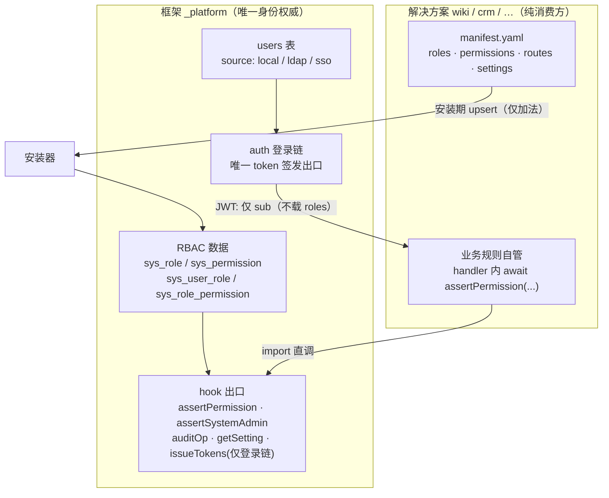
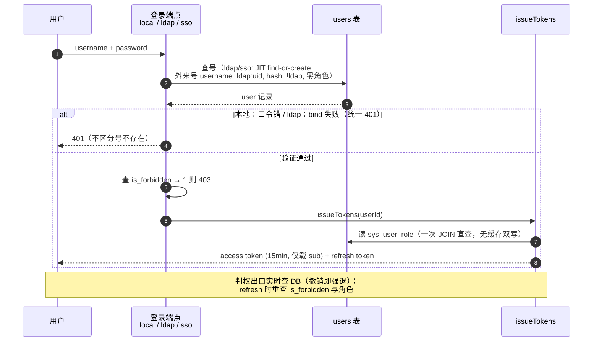
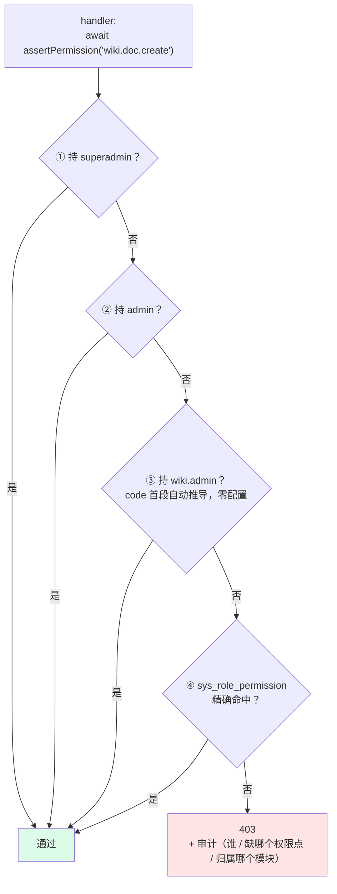
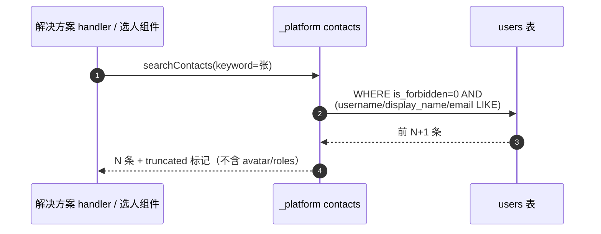
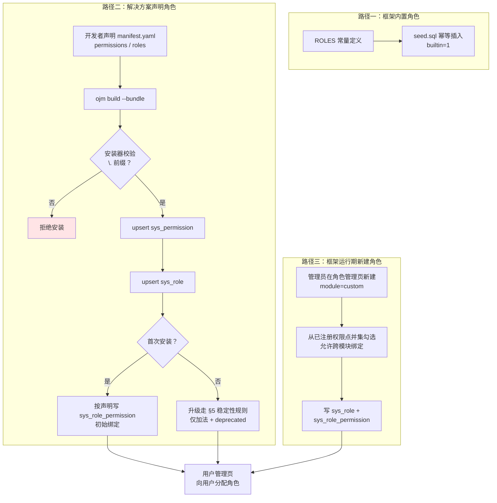
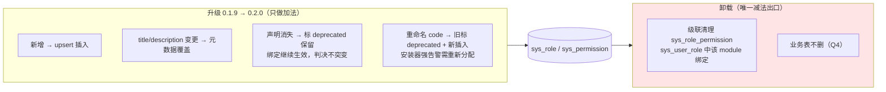

# 登录 / 账号 / 角色 / 解决方案 关系设计

> 状态：已定稿（讨论产出） · 日期：2026-10-16 · 上游：`202610152345-solution-marketplace-framework-prd.md`
> 本文档为 PRD 的补充设计，消除术语表「角色/权限点」条目的张力（框架执行 vs 解决方案自管），并新增 superadmin 层级与升级稳定性规则。

---

## 1. 决策记录（讨论结论）

| # | 议题 | 结论 |
|---|---|---|
| D1 | 判权归属 | **框架统一管理 RBAC 数据 + 提供 hook；业务逻辑由解决方案自管**。框架代码不随解决方案数量增长（机制数据驱动，非规则库） |
| D2 | 权限数据升级 | 安装器 upsert **只做加法 + 元数据覆盖，绝不做减法**；声明消失标 `deprecated` 保留；减法唯一出口 = 卸载 |
| D3 | 扩展登录 | 签发出口 `issueTokens` **仅框架登录链内部调用**；扩展登录方式（LDAP/SSO）框架内置，不开放给解决方案（M3） |
| D4 | 命名空间 | 解决方案角色名/权限点 code **强制 `<name>.` 前缀**，安装期校验拒绝不合规 manifest；框架角色保持裸名 |
| D5 | 超集规则 | 自动超集：`superadmin`/`admin` 通过一切 code；`<name>.admin` 通过 `module=<name>` 的 code（code 首段自动推导，零配置） |
| D6 | 角色层级 | 新增 `superadmin`：**安全敏感项全归 superadmin**（admin/superadmin 成员资格、卸载解决方案、`market_cdn_url`/信任公钥等市场安全设置、全量审计） |
| D7 | token 吊销 | access token 短 TTL（15min）+ refresh 时重查 `is_forbidden`/角色；per-request 守卫留 M5 可选 |
| D8 | 新建角色归属 | **新建角色只能在框架角色管理页**，由框架（管理员）决定绑定哪些权限点（`module='custom'`，可跨模块）；权限点来源仍 manifest-only，解决方案无任何建角色接口 |
| D9 | 账号与通讯录 | M3 轻量：**users 即通讯录**，不建独立 contacts 表；框架提供 `searchContacts` 共享 service + `GET /contacts` 只读接口（登录即可，limit 钳 200），solutions 可开发选人/提及业务；不含 avatar/roles，禁用用户默认不出目录；外部联系人需求出现时以 `user_profile` 扩展表演进 |
| D10 | 判权数据源 | **DB 实时查 + 进程内缓存（撤销即强退）**：`assertPermission`/`assertSuperAdmin` 以 `sys_user_role` + `sys_role_permission` 为权威源；进程内短 TTL 缓存（秒级）提高性能，**写路径同步失效缓存**——分配/角色管理/卸载级联/紧急吊销即时使相关 key 失效，撤销下一次请求即生效；TTL 仅作兜底防脏读常驻。JWT 只载 `sub`（身份）不载 roles；**`users.roles` 缓存列取消**（Q9 原方案撤销），签发时一次 JOIN 直查，消灭双写分裂 |
| D11 | superadmin 专属出口 | 新增 `assertSuperAdmin()`（只认 superadmin，DB 实时查）；D6 专属操作（成员资格管理、卸载解决方案、市场安全设置、审计导出）**不得建模为权限点**——物理上不存在于 `sys_permission`，进不了路径三绑定并集，杜绝「admin 建 custom 角色绑专属 code 绕过边界」 |
| D12 | 首个 superadmin | **seed 默认账号**（superadmin，须同步落实 must_change 首登改密闭环）；无其他默认账号 |
| D13 | 审计可见性 | admin 可查全部操作日志（排障需要）；superadmin 独占审计导出与留存/防篡改设置 |
| D14 | 登录顺序 | 本地登录**先验口令后查 `is_forbidden`**（号不存在/口令错/禁用统一 401，不泄露账号状态）；LDAP 路径因 JIT 建号无法避免先查号，接受此枚举面并注明 |

---

## 2. 职权模型：谁拥有什么

- **账号**：框架全局唯一所有（`users` 表，`source` 标记 local/ldap/sso）。解决方案**零账号表、零建号权**——JIT 外来号（`ldap:<uid>`、`password_hash="!ldap"`）也由框架登录链创建。
- **登录**：唯一签发链在 `_platform/auth`（本地 + LDAP + 未来 SSO 三入口），签发前必查 `is_forbidden`（§2.3-2 三处闭环）。
- **角色**：两级命名空间——框架角色裸名（`superadmin`/`admin`/`editor`/`viewer`），解决方案角色强制 `<name>.` 前缀。
- **解决方案**：纯消费方。handler 内自管业务规则，门由框架把守。



---

## 3. 登录签发时序

三入口共用同一签发链。**本地登录先验口令后查禁用**（D14）：号不存在 / 口令错 / 已禁用统一 401，不泄露账号状态；LDAP 路径因 JIT 建号无法避免先查号，接受此枚举面并注明。

**首个 superadmin 来源（D12）**：框架 seed 默认 `superadmin` 账号，`must_change=1`，首登强制改密后方可使用；无其他默认账号。

**JIT 外来号落地零角色**：`ldap:<uid>` 新号默认无任何角色，需 admin 事后分配；LDAP 组→角色映射列入演进方向（M3 不做，避免集成商预期错位）。

**登录限速（M3 必须）**：`auth/login` 与 `ldap-login` 按 (IP, username) 双维度限速 + 指数 backoff；连续失败阈值后临时封禁并审计。⚠️ 无限速时攻击者可借 LDAP lockout policy 批量锁死域账号（可用性攻击，比爆破更疼）。



### 3.1 refresh token 设计（评审修复：原为空白）

| 项 | 设计 |
|---|---|
| 形态 | 不透明随机串（**非 JWT**），DB 存 SHA-256 哈希 |
| TTL | 绝对 30 天 + 滑动窗口；每次 refresh **轮换作旧** |
| 重放检测 | 同一旧串二次出现 = 盗用信号 → 该用户全部 refresh 记录吊销 + 审计 |
| 吊销联动 | `is_forbidden=1` 或重置口令 → 级联删除该用户全部 refresh 记录 |
| access token | JWT 仅载 `sub`，15min TTL（泄露兜底）；**roles 不进 claims**——授权由判权出口实时查库 |

---

## 4. 角色层级与职权边界

| 层级 | 角色 | 职权 |
|---|---|---|
| 平台 | `superadmin` | 一切 + admin/superadmin 成员资格、卸载解决方案、`market_cdn_url`/信任公钥等市场安全设置、全量审计 |
| 系统 | `admin` | 日常账号管理（editor/viewer/`<name>.*` 分配）、安装/禁用解决方案、框架设置（非安全项） |
| 页面 | `editor` / `viewer` | 按 `handle.roles` 进页面（体验层，非安全层） |
| 模块 | `<name>.admin` 等 | manifest 声明的模块内权限点 |

**判权出口（数据源 = DB 权威源 + 进程内缓存，D10）**：`assertPermission(code)` 以 `sys_user_role` + `sys_role_permission` 实时判定，配**进程内短 TTL 缓存（秒级）**提升性能；**所有 RBAC 写路径同步失效缓存**（用户管理页分配、角色管理页绑定调整、卸载级联、紧急吊销），故**授权撤销下一次请求即生效（撤销即强退）**，TTL 仅兜底。JWT 只承载身份（`sub`），roles 不进 claims（前端体验层角色来自登录后用户资料接口）。单查询实现：JS 侧切好 code 首段作为参数传入（防三方言 `||`/`CONCAT` 分叉），无 N+1。判权出口顺带校验 `is_forbidden=1` 即拒——禁用即时生效，无需 per-request 中间件。

```ts
assertPermission(code)  // 通过条件任一命中（DB 权威源 + 进程内缓存）：
  // 1. superadmin  2. admin  3. <name>.admin（code 首段推导）  4. sys_role_permission 精确命中

assertSuperAdmin()       // D11：只认 superadmin，DB 实时查
assertSystemAdmin()      // = admin + superadmin
```

**superadmin 专属出口（D11，安全评审 P0 修复）**：D6 四类操作（成员资格管理、卸载解决方案、`market_cdn_url`/信任公钥等市场安全设置、审计导出）**只能挂 `assertSuperAdmin()`**，且**不得建模为权限点**——这些 code 不存在于 `sys_permission`，物理上进不了路径三的绑定并集，杜绝「admin 建 custom 角色绑专属 code 绕过边界」。

**保护红线**：
- 禁止对**最后一个 superadmin** 降级/禁用（防自锁死）；
- 只有 superadmin 能改 superadmin；
- 禁止撤销自己的 admin（wiki 继承）。



---

## 4A. 新增角色的流程

**权限点只有两个来源**（不变）：框架内置 `framework.*` + 解决方案 manifest 声明 `<name>.*`（Q10 维持：运行期注册权限点仍禁止）。
**角色有三个来源**；「新建角色」是框架能力——**只能在框架角色管理页创建，由框架（管理员）决定该角色绑定哪些权限点**：

**路径一：框架内置角色（seed）**
`ROLES` 常量（`superadmin`/`admin`/`editor`/`viewer`）+ `seed.sql` 幂等插入（`builtin=1`）。随框架版本演进，**不开放运行期创建/删除**。

**路径二：解决方案声明角色（manifest）**
开发者在自己工程的 `manifest.yaml` 声明 `permissions` / `roles` → `ojm build --bundle` 打进 bundle → 安装器校验 `<name>.` 前缀 → upsert `sys_permission` / `sys_role` → **首次安装**按声明写 `sys_role_permission` 初始绑定（管理员后续改动不被覆盖，升级见 §5）→ 管理员在用户管理页分配。

**路径三：框架运行期新建角色（角色管理页）**
管理员在框架角色管理页新建角色（`module='custom'`，**机器名强制 `custom.<slug>`**，展示名入 `title`——避免中文主键的改名迁移，并堵住与框架未来 builtin 角色撞名的窗口）→ 从**已注册权限点的并集**中勾选绑定（允许跨模块，如同时绑 `wiki.doc.create` 与 `crm.contact.create`；**superadmin 专属操作不建模为权限点，天然不在并集中**，D11）→ 写 `sys_role` + `sys_role_permission` → 在用户管理页分配。删除仅当无用户持有。

**初始绑定规则（insert-if-absent，工程评审修复）**：`sys_role_permission` 按「**角色行不存在才写其声明绑定**」——角色行已存在（升级场景）永不覆写绑定。同时覆盖 AC1-14（新角色拿到声明绑定）与 AC1-15（既有角色上管理员的调整不被升级覆盖），消除「首次安装 vs 升级」的判定歧义。

**账号生命周期（产品评审修复：首登改密闭环）**：
- 建号（含 seed superadmin）默认 `must_change=1`，口令 ≥ 6 位；初始口令一次性生成，由管理员线下交付（M3 无邮件通道）；
- 首登验证口令成功后若 `must_change=1` → 签发**限权 token**（仅改密端点可用），强制改密成功后才换发正式 token；
- 自助改密端点：本人 + 旧口令校验；改密级联删除该用户全部 refresh 记录（§3.1）；
- 建号接口**拒绝 `^(ldap|sso):` 前缀用户名**（防抢占外来号命名空间：JIT 撞 UNIQUE 回查复用时会登进这个带角色的手工号）。

边界：
- 声明角色（路径二）的绑定**也允许**管理员在角色管理页调整（AC1-15 已钉：升级不覆写管理员调整）；
- `superadmin`/`admin` 为隐式超集，**不出现在绑定编辑中**；`editor`/`viewer` 仅作页面门角色，**同样不出现**（堵住给 viewer 绑权限点的配置事故通道）；builtin 角色不可删除；
- 新建角色入口只此一处，解决方案无任何建角色接口。

### 4A.1 多解决方案角色冲突的处置（命名空间隔离）

冲突靠两层设计解决：**`<name>.` 前缀 = 天然命名空间**（撞名唯一可能是两解决方案同名，而 name 全局唯一由约束 A + 安装重名门禁保证）+ **DB 主键兜底**（`sys_role.name` / `sys_permission.code` 为 PK）。

| 场景 | 处置 |
|---|---|
| wiki 与 crm 各自声明 `<name>.admin` | 无冲突，两行共存（module 各归其主） |
| bundle 声明裸名 `admin` / code 无前缀 | 安装器前缀校验拒绝，不落盘（AC1-11/17） |
| 重名解决方案（伪造 `wiki` 0.3.0） | 重名门禁拒绝——防冒充，非防撞角色 |
| 同解决方案升级声明变化 | 非冲突，走 §5 稳定性规则（deprecated / 加法-only） |
| custom 角色起名 `wiki.admin` | 拒绝：`<name>.` 前缀属 solutions 命名空间 |
| A 想用 B 的权限点（wiki 要求 `crm.contact.create`） | 判权只查 code，跨模块绑定经路径三（custom 角色）天然支持；但 A 的 manifest **不得声明 B 命名空间的权限点**，安装器校验拒绝 |

两条钉死的细则：
1. **判权推导锚定 `manifest.name`，不锚定 `api.prefix`**——即使 §5.8.2 覆盖 prefix，权限点/角色的前缀仍 = `name` = 后端模块名，推导不失配。
2. **声明权 = 命名空间所有权**——安装器只能 upsert `module=<name>` 的行，物理上碰不到其他解决方案的行（框架统一管理数据、解决方案自管业务在存储层的落地）。

---

## 4B. 账号与通讯录（D9：M3 轻量，users 即通讯录）

**账号 ≠ 通讯录，但 M3 共享一张表**：账号管"谁能进系统"（口令/source/is_forbidden），通讯录是"人员目录"读模型，业务消费方为解决方案（审批选人、@提及、工单指派）。M3 不建独立 contacts 表——外部联系人/组织架构需求出现时，再以 `user_profile` 扩展表演进（1:1），届时本文档补路径四。

**查询接口**（`_platform` 模块，前后端共用形态）：

| 接口 | 权限 | 说明 |
|---|---|---|
| `searchContacts(keyword)` 共享 service | 后端 solutions import 直调（同 isolate） | 返回 id/username/display_name；**不含 email/avatar/roles**（防低权账号拖走全员邮箱喂钓鱼，安全评审 P2）；默认排除 is_forbidden=1 |
| `GET /api/_platform/contacts?keyword=&offset=&limit=` | 登录即可（不挂权限点） | 前端选人组件用；**keyword 最小长度 2**；username/display_name/email LIKE（`%`/`_` 转义 + `ESCAPE`）；**列表不含 email**；limit 静默钳 200，多取一条判 truncated；接口级限速 |
| `GET /api/_platform/contacts/:id` | 登录即可 | 单条详情，含 email 与 avatar_base64（avatar 写入端硬上限 100KB + 解码后尺寸/格式校验，防表膨胀与带宽放大） |

**边界**：
- 读操作**不记审计**（查询量大，审计无意义）；账号管理 4 个写端点的审计已覆盖资料变更（wiki「通讯录 3 个审计点」随独立通讯录表一并取消，PRD §4.4 同步）；
- 角色信息**不出通讯录接口**——solutions 需要"谁持有某角色"走 H9（admin 域），不在人员目录泄露；
- 禁用用户默认不出现在目录（业务选人天然排除已禁用账号）；
- 查询纪律：keyword 最小长度 2、长度上限 64；`%`/`_` 转义 + `ESCAPE`（与「limit 钳 200 / 多取一条判 truncated」并列的通用查询纪律，适用于全部 LIKE 接口含 `/system/users`、`/system/logs`）；
- **框架 API 双前缀划分**：`/api/system/*` = 管理域（`assertSystemAdmin` 判权）；`/api/_platform/*` = 平台共享服务域（登录即可 / solutions 直调）。框架新端点按此归类；
- 可选（M3 末尾）：runtime 提供 `ContactSelect` 选人组件，封装上述接口供 solutions 复用。



### 4B.1 演进方向（备注：后期如何补充信息）

M3 的「users 即通讯录」是**最小可用内核**，按三层后挂演进，每层均不破坏已有解决方案的选人代码：

**第一层：扩展表 `user_profile`（1:1，按需出现）**——部门/职位/手机等业务字段：

```
users（不变，核心）              user_profile（演进时新建）
├── id（PK，被业务引用）    1:1  ├── user_id（PK/FK）
├── username                     ├── department（部门）
├── display_name                 ├── title（职位）
├── email                        ├── phone（手机）
├── avatar_base64                └── …（**仅框架通用字段**；
└── is_forbidden …                   解决方案特有资料字段放解决方案自有表
                                     （user_id FK），遵循 §4A.1 命名空间纪律）
```

- 用 1:1 扩展表而非给 users 加列：users 列稳定利于登录链/JWT 缓存/审计；扩展列可空，避免核心表一堆 NULL；敏感列（phone）将来按列控可见性，不动核心表。
- 接入：`searchContacts` 按 `?include=department,phone` 才 JOIN 取（默认不取，体积纪律同 avatar）；`GET /contacts` 响应加字段（向后兼容）；资料编辑入口 = 用户管理页增「资料」区或个人中心自维护（`personal` 路由分类的天然落点）。

**第二层：字段级可见性与自维护**——敏感列（phone/email）可见范围配置化；个人中心开放用户自改资料（写口新增第 5 个：个人资料自维护，限本人）。

**第三层：无账号联系人 `contact` 独立表**——外部人员/只读同事纳入目录：与 users 并集查询，独立维护入口，合并去重逻辑。此层最重，确需时再立项，D9 不展开。

---



---

## 5. 升级稳定性规则（减法唯一出口 = 卸载）

| 变动类型 | 安装器行为 | 判决影响 |
|---|---|---|
| 新增 permission/role | upsert 插入 | 无影响（无人持有新角色） |
| 修改 title/description | upsert 覆盖 | 无影响（判决只看 name/code） |
| 声明消失 | 行保留标 `deprecated`（**`deprecated` 列入 `sys_role`/`sys_permission` 表结构**）；角色编辑下拉**过滤**，**已绑定视图保留展示并标灰**（禁止新增绑定） | 已有绑定继续生效，判决不突变 |
| 重命名 code | 视为删除+新增：旧 code 走 deprecated 规则，新 code 全新；安装器**强告警**（N 个权限点需重新分配） | 判决不静默变 |

**`deprecated` 双向过滤（工程评审修复，方向相反必须显式钉死）**：判权链**不过滤** deprecated（持有者继续通过）；管理 UI **过滤** deprecated（下拉不出现）。禁止在判权 SQL 里顺手加 `WHERE deprecated=0`——那会直接破坏「升级判决不突变」。

**紧急吊销出口（安全评审修复）**：「减法唯一出口 = 卸载」不等于无法单独吊销——superadmin 可在角色管理页**手动摘除** deprecated 权限点的绑定（只减不增），作为单个权限点出安全问题时的应急通道；摘除即时生效（D10 缓存失效）并留审计。

**卸载时的级联清理**（与 Q4「业务表不删」并存）：删除**两个维度**的绑定——① role 属该 module 的（`sys_user_role` 中该 module 角色行 + `sys_role_permission` 中该 module 角色行）；② **permission_code 属该 module 的（含 custom 角色上的绑定）**。漏掉维度②会让 custom 角色残留绑定在**重装该解决方案时静默复活旧授权**。custom 角色本体保留（可能只剩空绑定）。



---

## 6. 框架 hook 清单

| # | Hook | 形态 | 数据归属 | 典型用途 |
|---|---|---|---|---|
| H1 | `assertPermission(code)` | `_platform` 共享 service，import 直调 | `sys_user_role` / `sys_role_permission` | handler 级判权（唯一出口） |
| H2 | `assertSystemAdmin()` | 同上 | 框架角色（admin + superadmin） | 管理类端点 |
| H2b | `assertSuperAdmin()` | 同上 | 只认 superadmin（DB 实时查） | D6 安全敏感项：成员资格、卸载、市场安全设置、审计导出 |
| H3 | `issueTokens(userId)` | `_platform/auth` 内部出口，**不对外暴露**，仅登录链可调 | `users` / JWT | 框架收口（R8） |
| H4 | `auditOp(action, target, detail)` | 共享 service，fire-and-forget | `sys_oplog` | 解决方案记自己的审计 |
| H5 | 登录扩展协议 | manifest `api.anonymous` 白名单 + 框架内置实现（M3 不开放回调） | 框架 `users` | LDAP/SSO |
| H6 | 设置读写 | manifest `settings` 声明（安装期）+ `getSetting(key)` 读 API | `sys_setting` | 业务配置；写仅限框架设置页 |
| H7 | 路由/菜单分类 | manifest `routes[].category` → `sys_solution_route` | 框架表 | 菜单归属，前端宿主归并 |
| H8 | 角色/权限点声明 | manifest `permissions`/`roles` → 安装期 upsert（仅加法） | `sys_role` / `sys_permission` | 见 §5 |
| H9a | 本人角色查询 | `getMyRoles()`（登录即可） | 只读 | solutions 给当前用户渲染角色徽标 |
| H9b | 角色持有者枚举 | `listRoleHolders(roleName)` | **admin 域**（assertSystemAdmin） | 管理端排障、卸载前统计持有人数 |
| H10 | 前端路由门 | `handle.roles` / `config.requiredRoles`（既有）；角色数据来自登录后用户资料接口（非 JWT claims，D10） | 前端静态 + 用户资料 | 页面级入口拦截（体验层） |
| H11 | 角色管理 | 角色管理页 API（框架内置模块提供） | `sys_role` / `sys_role_permission` | 新建/编辑绑定/删除自定义角色（§4A 路径三） |
| H12 | 通讯录查询 | `searchContacts(keyword)` 共享 service + `GET /contacts` 只读接口 | `users`（读模型） | 解决方案选人/提及业务（§4B） |

**写操作只有五个合法入口**：用户管理页（框架）、角色管理页（框架，H11）、安装器（manifest 声明）、handler 内经 H1 判权后的业务写、**本人自助改密/资料（限本人，§4A 账号生命周期）**。**禁止运行期注册权限点**（Q10，manifest-only 是审计与稳定性的地基）。

**演进备注（评审登记，M3 不做）**：
- 权限诊断/「以某用户视角查看」排障工具（admin 高频排障刚需）；
- LDAP 组→角色映射（JIT 零角色断点的根治）；
- 账号批量导入（CSV）、角色复制——企业高频，明确暂不做，登记管理预期；
- 后端 AC 测试形态：后端逻辑抽成接受 db 句柄的纯函数 + oj 侧测试框架跑 AC；动工前先 spike 验证该形态能跑通 sqlite，否则 25 条 AC1 大部分落成手工验收。

---

## 7. 对 PRD 的修订点（已同步回改）

| 位置 | 修订 |
|---|---|
| §1 术语表「角色/权限点」 | 删除「解决方案内的 role+权限点由模块自己管理」张力句，改为「框架统一管理 RBAC 数据并提供 hook，业务逻辑由解决方案自管」 |
| §4.2 角色模型 | `ROLES` 常量增加 `superadmin`；新增层级与职权边界（本文档 §4） |
| §5.9 | 增加 D2 升级稳定性规则（deprecated 保留 / 卸载级联清理）；§5.9.4 超集规则扩展为四级判权链；§5.9.2 `sys_role.module` 增 `custom` 取值；§5.9.5 增 D8 运行期新建角色（框架角色管理页，权限点并集勾选） |
| §4.2 / §4.4 | 增 D9 通讯录（users 即目录 + `GET /contacts` 只读接口）；§4.4 取消「通讯录 3 个审计接入点」 |
| §4.2 / §4.5 / §4.6 | 建号拒绝 `^(ldap|sso):` 前缀 + 默认 `must_change=1`；登录链调序（先验口令后查禁用，统一 401）+ 登录限速；§4.6 卸载操作归 superadmin（D6/D11 对齐，前端显隐） |
| §5.2 | manifest 示例 `api.anonymous` 改非登录端点；增安装器校验红线：登录语义端点（`*/login`、`*-login`、token 签发）拒装（R8） |
| §5.9.2 / Q9 | `sys_role`/`sys_permission` 增 `deprecated` 列；**`users.roles` 缓存列取消**（D10：判权 DB 权威源 + 进程内缓存，签发一次 JOIN 直查） |
| §5.9.4 | 增 `assertSuperAdmin()` 出口（D11：专属操作不建模为权限点） |
| §4.4 | 审计接入点补「角色管理 3 个」（`role.create` / `role.bindings.update` / `role.delete`）；403 判权失败审计按 (user_id, code) 时间窗口去重聚合，防洪泛 |

---

## 8. 验收标准（BDD）

### 8.1 功能点一：框架统一 RBAC 与角色层级（§2 / §4 / §6）

**背景**：框架已安装解决方案 `wiki`（声明 `wiki.admin`、`wiki.editor`、`permissions: [wiki.doc.create, wiki.space.create]`），存在用户 alice（superadmin）、bob（admin）、carol（wiki.admin）、dave（wiki.editor）、eve（viewer）。

| # | 场景 | 给定 | 当 | 那么 |
|---|---|---|---|---|
| AC1-1 | 平台超集 | alice 持有 superadmin，未绑定任何权限点 | `assertPermission("wiki.doc.create")` | 通过 |
| AC1-2 | 系统超集 | bob 持有 admin，未绑定任何权限点 | `assertPermission("wiki.doc.create")` | 通过 |
| AC1-3 | 模块超集（自动推导） | carol 仅持有 wiki.admin | `assertPermission("wiki.doc.create")` | 通过（零配置推导） |
| AC1-4 | 模块超集不外溢 | carol 仅持有 wiki.admin | `assertPermission("crm.contact.create")` | 403，审计归属 module=crm |
| AC1-5 | 精确命中 | dave 持有 wiki.editor，绑定 `wiki.doc.create` | `assertPermission("wiki.doc.create")` | 通过 |
| AC1-6 | 无权限 | eve 持有 viewer，无任何绑定 | `assertPermission("wiki.doc.create")` | 403，审计含用户/权限点/模块 |
| AC1-7 | admin 管日常 | bob 登录用户管理页，给 frank 分配 `wiki.editor` | 提交分配 | 成功，写 `sys_user_role`（唯一权威源，无缓存双写，D10）；frank 下一次请求即生效（撤销同理，即强退） |
| AC1-8 | admin 不碰成员资格 | bob 尝试给 frank 分配 `admin` 或 `superadmin` | 提交分配 | 403，提示需 superadmin |
| AC1-9 | superadmin 独占安全项（D11） | bob（admin），甚至持有「绑满全部已注册权限点」custom 角色的傀儡账号 | 访问卸载解决方案 / `market_cdn_url` / 信任公钥 / 审计导出 | 全部 403——专属操作不建模为权限点，custom 角色绑定再全也无入口 |
| AC1-10 | 最后 superadmin 保护 | alice（唯一 superadmin）在角色管理页移除自己的 superadmin 角色（唯一可达路径：禁用自己被「禁止操作自己」拦截） | 提交 | 400，提示禁止撤销最后一个 superadmin |
| AC1-11 | 前缀强约束 | 某 bundle manifest 声明裸名角色 `admin` 或 code `doc.create` | 安装 | 拒绝，报「角色/权限点必须 `<name>.` 前缀」 |
| AC1-12 | 登录闭环 | 用户 `ldap:uid=x` 已 is_forbidden=1 | 经 LDAP 登录（bind 成功） | 403 禁用，**不签发 token** |
| AC1-13 | 吊销收口（D10：撤销即强退） | carol 被禁用 / 被撤 wiki.admin，持未过期 access token | 任意后续请求 / 调 refresh | 判权出口实时查 DB + 缓存写时失效，下一次请求即 403（无需等 15min 过期）；refresh 拒绝且该用户 refresh 记录已级联删除 |
| AC1-14 | 新角色上市 | wiki bundle 声明 `wiki.guest` 角色 + `wiki.doc.read` 权限点 | 首次安装 | `sys_permission`/`sys_role` upsert；insert-if-absent 写声明绑定；用户管理页角色下拉出现「wiki.guest」可分配 |
| AC1-15 | 升级不覆写管理员调整 | 0.1.9 首次安装后管理员手动从 wiki.editor 撤掉 `wiki.doc.create` 绑定 | 升级到 0.2.0（manifest 仍声明该绑定） | 管理员调整保留，不被声明覆盖（insert-if-absent：角色行已存在，声明绑定永不覆写） |
| AC1-16 | 框架新建角色入口 | admin 在角色管理页新建角色：机器名 `custom.reviewer`、展示名「内容审核员」（module=custom） | 勾选绑定 `wiki.doc.create` + `crm.contact.create`（跨模块） | 写入 `sys_role` + `sys_role_permission`；用户管理页可向用户分配该角色；用户获得两个模块的对应权限 |
| AC1-17 | 建角色名称冲突 | admin 新建角色命名为 `admin` / `wiki.admin` / 无 `custom.` 前缀的裸名 | 提交 | 拒绝：`admin` 为保留名、`wiki.admin` 属 solutions 命名空间、custom 角色机器名强制 `custom.<slug>` |
| AC1-18 | 声明角色的绑定可调整 | admin 编辑 wiki.editor 的绑定（声明角色） | 增删权限点 | 成功写 `sys_role_permission`；不影响 manifest 声明本身，升级不覆写（AC1-15） |
| AC1-19 | 超集/页面门角色不可编辑绑定 | admin 打开 superadmin / admin / editor / viewer 的绑定编辑 | 查看 | 均无绑定编辑入口（superadmin/admin 隐式超集，editor/viewer 仅页面门）；builtin 角色无删除按钮 |
| AC1-20 | 占用中的角色禁删 | 「内容审核员」已分配给 3 个用户 | 删除该角色 | 拒绝，列出持有者人数；清空分配后才可删 |
| AC1-21 | 解决方案无建角色接口 | 已安装 wiki 的后端任意端点 | 调用建角色/注册权限点接口 | 不存在该接口；无任何运行期注册权限点通道（Q10） |
| AC1-22 | 通讯录登录可读 | 任意登录用户（eve/viewer 亦可） | `GET /contacts?keyword=张` | 200 返回匹配人员的 id/username/display_name；无 email/avatar/roles 字段；keyword <2 字符 → 400 |
| AC1-23 | 禁用用户不出目录 | carol 已 is_forbidden=1 | `GET /contacts`（无 keyword 全量） | 结果不含 carol；admin 在用户管理页仍可见（管理域与目录分离） |
| AC1-24 | limit 钳制与截断标记 | 目录有 300 人 | `GET /contacts?limit=500` | 静默钳 200；多取一条判 truncated=true |
| AC1-25 | 后端直调共享 service | wiki handler 内 `searchContacts("张")` | 调用 | 同 isolate import 直调，无 HTTP 往返；返回字段与 AC1-22 一致 |
| AC1-26 | 登录限速 | 同一 (IP, username) 连续失败 6 次 | 第 7 次登录尝试 | 429 + 指数 backoff；写一条审计 |
| AC1-27 | seed 超管首登改密 | 全新部署首次以 seed superadmin 登录（must_change=1） | 验证初始口令成功 | 仅签发限权 token（改密端点可用）；改密成功才换发正式 token |
| AC1-28 | RBAC 写审计 | admin 新建角色 / 改绑定 / 删角色 | 三个操作 | 各写一条 sys_oplog（`role.create` / `role.bindings.update` / `role.delete`，module=framework） |
| AC1-29 | 403 审计去重 | 脚本循环 1000 次无权限请求 | 判权失败 | sys_oplog 按 (user_id, code) 分钟窗口聚合（首条 + 计数），不逐条落表 |
| AC1-30 | deprecated 紧急吊销 | `wiki.doc.create` 已 deprecated，dave 持有 | superadmin 在角色管理页手动摘除其绑定 | 绑定删除，dave 下一次请求即 403（缓存写时失效）；审计留痕 |

### 8.2 功能点二：权限数据升级稳定性（§5）

**背景**：wiki 0.1.9 已安装，管理员曾手动调整绑定：carol 持 wiki.admin，dave 经 `sys_role_permission` 精确命中 `wiki.doc.create`（非经角色）。

| # | 场景 | 给定 | 当 | 那么 |
|---|---|---|---|---|
| AC2-1 | 新增声明 | 0.2.0 manifest 新增 `wiki.comment.create` | 升级安装 | upsert 插入新行；既有绑定与判决不变 |
| AC2-2 | 元数据覆盖 | 0.2.0 将 `wiki.editor` 的 title 改为「编辑者（新版）」 | 升级安装 | title 覆盖；dave 经 editor 的判决不变 |
| AC2-3 | 声明消失 deprecated | 0.2.0 manifest 删除 `wiki.space.create` | 升级安装 | 行保留标 deprecated：角色编辑下拉**过滤**、已绑定视图**保留并标灰**（禁止新增绑定）；持有者继续通过（判权链不过滤 deprecated），判决不突变 |
| AC2-4 | 重命名告警 | 0.2.0 将 `wiki.doc.create` 改名 `wiki.doc.write` | 升级安装 | 旧 code 标 deprecated（原绑定继续生效），新 code 插入；安装器强告警「1 个权限点已变更，需重新分配」 |
| AC2-5 | 升级零减法 | 上述升级完成后查 `sys_role_permission` / `sys_user_role` | 比对升级前 | 无任何行被删除 |
| AC2-6 | 卸载级联清理 | 「内容审核员」（custom）绑了 `wiki.doc.create`；卸载 wiki（仍有 2 用户持 wiki 角色） | 确认卸载 | 双维度删除：wiki 角色行及其全部绑定 + permission_code 属 wiki 的绑定（含 custom 角色上的）全部清除；custom 角色本体保留（空绑定）；**重装 wiki 不复活旧授权** |
| AC2-7 | 卸载不删业务表 | 卸载 wiki | 卸载完成 | wiki 业务表（space/document 等）保留，提示运维手工处理（Q4） |

---

## 9. 评审记录（2026-10-16）

四位专家并行评审（产品 / 架构 / 工程 / 安全），原始发现 36 条（去重后约 30 项），全部处置完毕：

| 严重度 | 发现 | 处置 |
|---|---|---|
| P0 | superadmin 无专属断言出口（安全/架构） | D11：新增 `assertSuperAdmin()`；专属操作不建模为权限点，物理上进不了绑定并集 |
| P0 | 判权数据源未定义（工程/安全） | D10：DB 权威源 + 进程内缓存（写时失效），撤销即强退；`users.roles` 缓存列取消（Q9 撤销） |
| P0 | manifest 示例自破签发收口（架构） | PRD §5.2 示例改非登录端点 + 安装器登录语义端点拒装红线 |
| P0 | JWT/refresh 契约空白（工程/安全） | §3.1 refresh token 完整设计（不透明串/哈希存储/30d/轮换/reuse 检测/级联吊销） |
| P1 | 首登改密闭环断裂、首个 superadmin 无来源（产品） | §4A 账号生命周期；D12 seed 默认账号 + must_change |
| P1 | `deprecated` 列缺失 / 双向过滤 / insert-if-absent / 卸载维度 / RBAC 写无审计 / H9 语义矛盾 / 登录无限速 / 通讯录 email 导出（工程/安全/架构） | 分别钉死于 §4A / §5 / §6 / §8 |
| P2 | 约 15 项（命名、查询纪律、审计去重、avatar 上限、来源前缀抢占、双前缀原则、演进登记等） | 全部采纳，见各节 |

**反常识记录**（评审中发现的设计陷阱，实现时重点防）：
1. 「减法唯一出口 = 卸载」≠ 无法紧急吊销——deprecated 手动摘绑定补上应急通道（安全 S10）。
2. admin 超集 + 权限点建模会让 custom 角色成为 superadmin 边界的绕过通道——专属操作必须**物理上不存在于** `sys_permission`（安全 S1）。
3. 判权 SQL 顺手加 `WHERE deprecated=0` 会破坏「升级判决不突变」——双向过滤方向必须显式钉死（工程 E2）。
4. 卸载级联漏 `permission_code` 维度 → custom 角色残留绑定在重装解决方案时**静默复活旧授权**（工程 E4）。
5. 先查禁用后验口令泄露账号枚举状态——本地登录先验口令（统一 401），LDAP 因 JIT 无法避免则接受并注明（安全 S8 / D14）。

### 9.1 阶段 0 spike 结论（S0，2026-10-16 0958–1002，耗时约 5 分钟）

**测试形态成立（工程评审 E10 关闭）**，沿用 oj-wiki 先例并落进模板：

- **形态**：vitest（Node 22 内建 `node:sqlite` 内存库）+ `tests/fixture.ts` 重放 `api/src/*/migrations/*.sql` **真实迁移**建表——夹具与迁移不可能漂移；service 经 `globalThis.db`（`query/exec/tx/dialect`，与 oj 运行时注入同面）访问，**业务代码零改动即可被测**；
- **事务能力确认**：运行时 `db.tx(fn)` 面存在（BEGIN/COMMIT/ROLLBACK 包裹回调），夹具镜像同面并实测往返（提交持久化/回滚不留痕）——D10 缓存写时失效与 §5 级联删除的事务策略可行；
- **DDD 落点**：判权领域核心抽为纯函数 `decideAccess(roles, bindings, code)`（`src/_platform/_shared/service/guard.ts`），IO 留应用层；AC1-1~6 判定矩阵 8 断言 + 夹具冒烟 3 断言全绿（`packages/cli/templates/api/tests/guard.spec.ts`）；
- **反常识记录**：Node 22 `globalThis.crypto`（WebCrypto）为只读，夹具无法在其上补 `sha256Hex`——oj 增补的 crypto 面（sha256Hex/md5Hex）属运行时私有，Node 侧按用例需要再单独 stub，**不可假设 `g.crypto ?? {}` 可写**。

### 9.2 阶段 A 实现期发现（2026-10-16 1014–1032，feat/rbac-backend，065c7d2c..572fe2c3）

实现期被 BDD 测试钉出的偏差与反常识（评审两轮未检出，重申「先写用例」的价值）：

1. **is_forbidden / email 列全篇引用而迁移未落**（A1 遗漏，A3/A7 实现期补迁移 0006/0007）——设计文档与 PRD 多节引用两列，A1 建表任务只落了 source/display_name/must_change；两轮专家评审 + 计划评审均未对照「引用列 vs 迁移列」。教训：AC 评审增加一道「设计引用的每列 ∈ 某迁移 DDL」机械核对。
2. **`http.user` 是可变全局，异步队列执行时再读会被后续请求覆盖**（A4 实测踩中：三个同步 auditDeny 全部记成最后一个用户）——调用入口必须同步捕获 uid 再入队。同类陷阱适用于一切 fire-and-forget 审计/日志路径。
3. **403 审计「首条 + 计数」在并发下产生多首条，破坏 AC1-29 语义**——「查窗口→落首条→更新计数」须原子，进程内以串行队列收敛（deny 频率低，吞吐不敏感；ponytail 上限已注释）。
4. **LIKE 转义的三方言最小公倍是 `ESCAPE '!'`**：sqlite 默认无转义符、mysql 默认 `\`、pg 默认无——统一显式 `escape '!'` + 元字符前加 `!`，`LIMIT ? OFFSET ?` 则三方言参数化通吃（A5 已钉进 query.ts 注释）。
5. **「mysql/pg 冒烟」仓库内无执行器**（oj 运行时属机外二进制）：方言变体盲写不可验证，违反「代码不带检查即未完成」——按 §8 风险表口径移交 CI 三方言冒烟任务，阶段 A DoD 此条降级为「sqlite 全绿 + 方言差异已枚举」。
