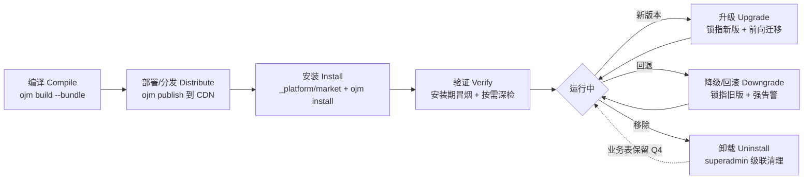
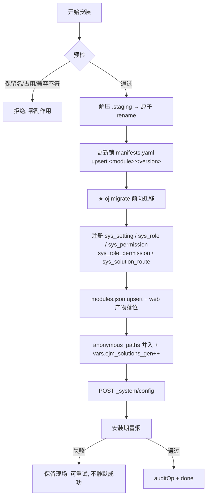
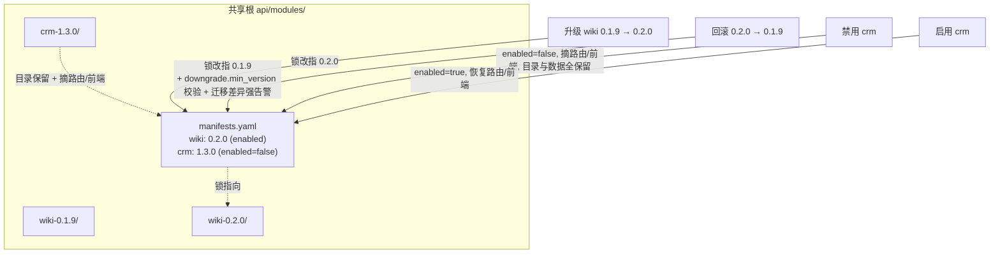
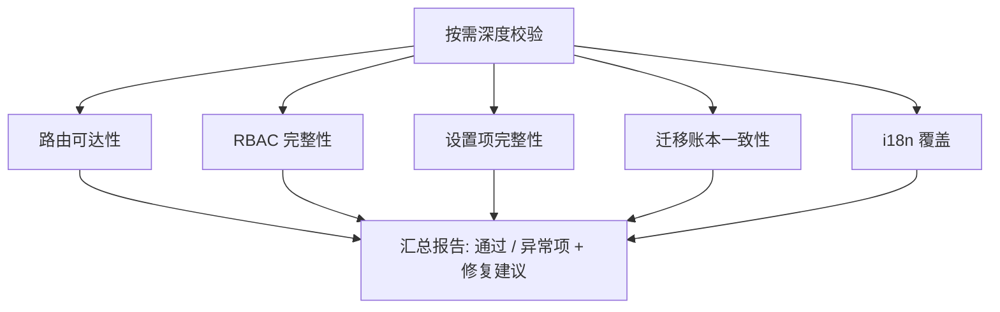
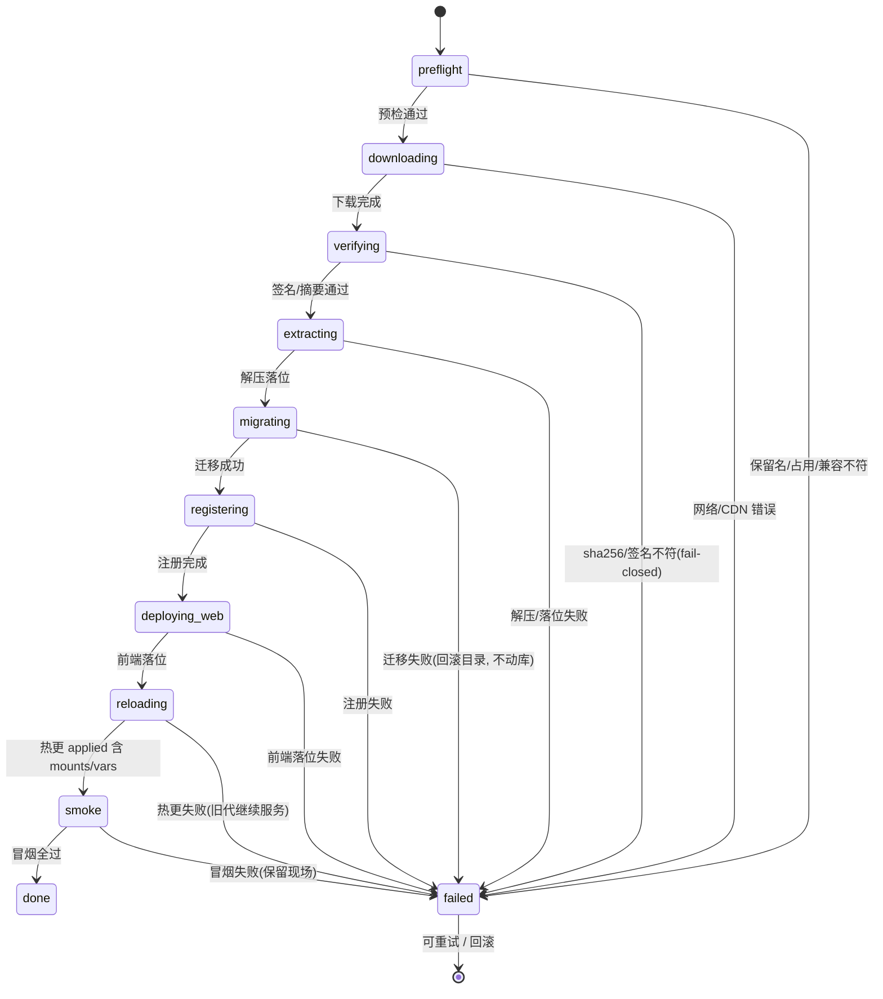

# 解决方案生命周期与框架注册设计

> 状态：草案（脑暴产出，待评审） · 日期：2026-10-16 · 范围：`oj-module`（本仓）
> 上游：`202610152345-solution-marketplace-framework-prd.md`（`§5` 编译/分发/安装/升级/降级）、`202610160908-rbac-auth-design.md`（RBAC 注册与卸载级联）、`202610160952-rbac-implementation-plan.md`（实现阶段）
> 本文是上述三份文档的**生命周期综合与注册清单补充**：把分散在 PRD §5 与各设计文档的「编译 / 安装 / 部署 / 验证 / 升级 / 降级 / 卸载」与「向框架注册的内容」收拢成一份可执行口径，并补齐 PRD 空白的**验证**环节与**前端 i18n 注册握手**。本文只出方案，不含实现。

---

## 0. 决策记录（脑暴结论）

| # | 议题 | 结论 | 来源 |
|---|---|---|---|
| B1 | 验证覆盖度 | **安装期自动冒烟 + 按需深度校验**双轨 | 脑暴 Q1 |
| B2 | 前端 i18n 注册 | `entry.js` 导出 `defineModule.i18n`，宿主按命名空间 `&lt;name&gt;` 并入；**同时覆盖菜单分组标签**（常规/管理/设置/个人中心） | 脑暴 Q2 |
| B3 | 磁盘版本模型与禁用 | **多版本目录共存 + 标记禁用**；回滚＝锁指回旧版本目录（须 `downgrade.min_version` 相符且迁移无差异，否则强告警） | 脑暴 Q3 |
| B4 | 「部署」口径 | 本文把**部署＝作者侧分发到 CDN**（`ojm publish`），与**安装＝运维侧装到运行中的框架**分开；二者对应 PRD §5.3 与 §5.4 两个独立流程 | 本文界定 |

---

## 1. 六阶段生命周期总览

| 阶段 | 主体 | 关键动作 | 对应文档 |
|---|---|---|---|
| **编译** Compile | `ojm build --bundle` | 后端 `oj build --no-minify` + 前端单模块产物 → 组装 `manifest.yaml` + 打**确定性 tgz**（固定 mtime/顺序/权限） + 打印 sha256 | PRD §5.1 / §5.2 |
| **部署/分发** Distribute | `ojm publish`（M7） | 上传 tgz 到 CDN，重算 `bundles.yaml`(索引) + `manifests.yaml`(聚合数组)；可选索引签名 | PRD §5.3 |
| **安装** Install | `_platform/market` + Node `ojm install` | 下载→签名/sha256 校验→解压 staging→原子 rename→迁移(先于热更)→注册→`vars.ojm_solutions_gen++`→`POST _system/config`→**安装期冒烟** | PRD §5.4 / §5.6 / 约束 B/C |
| **验证** Verify | 安装器（自动）+ 管理员（按需） | 安装期冒烟 + 按需深度一致性检查（§7） | 本文新定（B1） |
| **升级** Upgrade | 同 Install（更高 version） | 多版本目录共存，锁指向新版；前向迁移自动应用；旧版目录保留以便回滚 | PRD §5.6 |
| **降级/回滚** Downgrade | 同 Install（更低 version） | 锁指回旧版目录；须 `downgrade.min_version` 相符且迁移无差异，否则**强告警**；无 down 迁移故禁止静默降级 | PRD §5.6.5 / R12 |
| **卸载** Uninstall | superadmin 独占 | 级联清理 RBAC 双维度绑定 + 摘路由/前端；**业务表不删**（Q4） | PRD §5.9.6 / D6 |



**周期性关系**：升级/降级都在「安装」同一套状态机上跑（仅 version 参数不同），共享同一 manifest 契约与注册顺序；卸载是唯一减法出口（§8）。

---

## 2. 安装流程时序

安装器（M4 由 Node 侧 `ojm install` 编排，M6 收敛到 oj 原生）按以下时序落地，任何校验失败**不落盘、不改锁、不触发热更**（§5.7.5 fail-closed）。

```mermaid
sequenceDiagram
    participant U as 管理员
    participant M as _platform/market
    participant N as ojm install (Node)
    participant CDN as CDN
    participant FS as 共享根 / 站点
    participant OJ as oj 运行时
    participant DB as 数据库

    U->>M: POST /market/install {name, version}
    M->>N: 触发 Node 进程(loopback / 运维手动)
    N->>CDN: GET bundles.yaml + &lt;file&gt;.tgz
    N->>N: 解析目标版本 + 兼容性门禁(peerRuntime/peerOj/peerFramework)
    N->>N: sha256 比对 + Ed25519 验签(fail-closed)
    N->>FS: 解压 .staging/&lt;name&gt;-&lt;version&gt;/ → 原子 rename
    N->>DB: oj migrate -d &lt;共享根&gt;（★先于热更，约束 B）
    N->>DB: upsert sys_setting / sys_role / sys_permission / sys_role_permission / sys_solution_route
    N->>FS: modules.json upsert + web 产物落位
    N->>OJ: 改 config.yaml(anonymous_paths 并入 + vars.ojm_solutions_gen++)
    N->>OJ: POST {base}/_system/config（空 body 触发热更）
    OJ-->>N: applied 含 mounts/vars，无 restart_pending
    N->>N: 安装期冒烟(health / integrity / 注册一致性)
    N->>DB: auditOp(solution.install, name, ...)
    N-->>U: 任务完成 + 提示刷新页面
```

> 关键点：热更触发依赖 E4 的「语义计数器」`vars.ojm_solutions_gen` 自增（约束 C），保证「装了即生效」；迁移必须在热更前完成（约束 B），否则 release 模式 `migrate verify` 会拒启。

---

## 3. 注册顺序与幂等性

注册必须按**安全顺序**进行，错序会拒启（约束 B）。同版本重装为 **no-op**（锁已含该 `<module>:<version>` 即跳过迁移/注册）；不同版本共存互不影响。



---

## 4. 需要向框架注册的内容（统一清单）

| # | 注册项 | 落点 | 时机 | 幂等 / 校验 |
|---|---|---|---|---|
| 1 | 后端模块 | 共享根 `manifests.yaml`(`<module>:<version>`) + 物理目录 | 安装 | 同名同版本 = no-op；重名 / 保留名(`_platform`/`system`/`auth`/`market`/`framework`/`health`/`plugins`/`_system`)拒装 |
| 2 | 路由分类 | `sys_solution_route`(category/path/order/title_key/required_permission/enabled) | 安装 | 路径与 `defineModule.routes` 不一致→告警不阻断 |
| 3 | 业务设置 | `sys_setting`(`module=<name>`, group, items) | 安装期声明式（路径 1） | upsert 默认行；卸载按 module 删 |
| 4 | RBAC | `sys_role`/`sys_permission`(`module=<name>`, 强制 `<name>.` 前缀) + 初始 `sys_role_permission`(insert-if-absent) | 安装 | 仅加法 + 元数据覆盖；声明消失标 `deprecated` |
| 5 | 前端入口 | 站点 `modules.json`(name/entry/integrity/css/chunks/enabled/peerRuntime) | 安装器 upsert（**不随 bundle 携带**） | 避免覆盖宿主已有模块清单 |
| 6 | 前端路由 | `entry.js` 的 `defineModule.routes`（运行时唯一事实） | 宿主 `getRoutes()` | category 由 #2 按 path 归并 |
| 7 | 前端 i18n | `entry.js` 的 `defineModule.i18n` 并入宿主命名空间 `&lt;name&gt;` | 宿主加载 entry 时 | **覆盖菜单分组标签**（常规/管理/设置/个人中心） |
| 8 | 匿名路径 | `config.yaml anonymous_paths`（挂载前缀相对） | 安装 | 含登录语义端点(`*/login`、`*-login`、token 签发)拒装（R8） |
| 9 | 兼容性 | `peerRuntime`/`peerOj`/`peerFramework` | 安装门禁 | 不满足→拒绝并给可读原因 |

> 注册项 #5 的「不随 bundle 携带」是 PRD §5.1 的硬约束：bundle 的 `web/` 只放该模块自己的产物，`modules.json` 条目由**安装器**在目标站点上 upsert，避免覆盖宿主已有模块清单。

---

## 5. 版本与禁用模型（B3）

磁盘采用**多版本目录共存**：`<共享根>/<name>-<version>/` 天然幂等，重复安装同一版本是 no-op；`manifests.yaml` 锁只记录「当前生效版本 + enabled 标记」。



**禁用（Q3 结论）**：保留目录与数据，仅 `manifests.yaml` 条目 `enabled=false` + `sys_solution_route.enabled=false` + `modules.json` 条目 `enabled=false`；后端路由经锁标记不挂载，前端宿主按 `enabled` 跳过。非破坏、随时可恢复。

**回滚（§5.6.5 / R12）**：锁指回旧版本目录即生效；因 oj 迁移无 down 迁移，若目标版本 `migrations` 与当前存在差异，安装器**强告警并要求二次确认**，禁止静默降级。多版本目录共存使回滚零成本（无需快照）。

> **版本 GC（A2）**：多版本目录共存必然带来磁盘增长，需配套清理策略——按 `manifests.yaml` 未引用的版本目录做 GC，保留最近 N 个版本以便回滚（默认 N=3，可配置），详见 PRD §5.5.4（M7）。GC 不得删除当前生效版本与最近 N 个版本，且须与回滚/降级操作互斥。

---

## 6. 前端注册握手：i18n 与路由分类（B2）

已安装解决方案的前端不依赖 bundle 携带 `modules.json`，而是由**安装器 upsert** 后，宿主在加载链路中完成两件事：(a) 从 `entry.js` 取运行时路由；(b) 按 `sys_solution_route.category` 归并菜单归属；(c) 并入 i18n。

```mermaid
flowchart TD
    H[宿主 shell 启动] --> F[fetch modules.json]
    F --> L[动态 import(entry.js)]
    L --> D[defineModule.routes → getRoutes() 注入路由树]
    L --> I[defineModule.i18n → 并入宿主命名空间 &lt;name&gt;]
    D --> M{按 path 归并 sys_solution_route.category}
    M -->|main| MN[常规主菜单]
    M -->|admin| AD[管理菜单]
    M -->|settings| ST[系统设置页追加分组]
    M -->|personal| PE[个人中心]
    M -->|hidden| HD[不入菜单]
    I --> T[菜单/设置/RBAC 标题 title_key / label_key 解析]
    ST -. 设置页 Card 来自 .-> SYS[sys_setting group]

> **路由双源一致性（A1）**：前端路由来自 `entry.js`（`defineModule.routes`），分类/菜单归属来自 `sys_solution_route`，二者靠 `path` 归并。安装器须做**安装期 path 一致性校验**：`manifest.routes[].path` 与 `entry.js` 实际路由 path 集合比对，不一致时**默认告警（warn），可配置升级为阻断（fail）**——避免运行时菜单错归或分类丢失。PRD §5.2 原「告警不阻断」据此收敛为可配的硬校验。
```

**i18n 覆盖到菜单分组**：`defineModule.i18n` 提供的文案须包含 `manifest.routes[].title_key` 与 `sys_setting.label_key` 的本地化，使宿主在渲染「常规主菜单 / 管理菜单 / 系统设置分组」时能解析出方案自己的标题。安装期深检（§7）会校验这些 key 在命名空间 `&lt;name&gt;` 下有值。

---

## 7. 验证细则（B1，本文新定）

PRD §5 已覆盖安装期的**包签名 / sha256 校验**，但缺少「装完后方案是否真的可用」的运行时验证。补齐为双轨：

### 7.1 安装期自动冒烟（装完即跑，失败→保留现场可重试，不静默成功）

```mermaid
flowchart TD
    V[安装期冒烟] --> A1[后端: GET /api/&lt;name&gt;/health 或首个非匿名路由 → 断言 200]
    V --> A2[前端: modules.json 条目 integrity == 本地计算 sha384(Node 侧可算)]
    V --> A3[前端 entry 加载: 由宿主 error boundary 兜底(浏览器侧, 非 Node import); 异常经按需深检可见, 不阻塞安装]
    V --> A4[注册一致性: DB 中声明行全部存在(sys_solution_route/sys_setting/sys_role/sys_permission); 升级允许 deprecated 残留, 用包含非相等]
    A1 --> OK[冒烟全过 → 进入 done]
    A2 --> OK
    A3 --> OK
    A4 --> OK
    A1 -. 任一失败 .-> RB[保留现场, 记录原因, 不标记成功]
```

> 关于「health 端点是否强制」：默认用首个非匿名路由兜底（避免给解决方案强加契约）；若 manifest 声明 `health` 端点则优先打该端点。待评审确认是否**强制**要求解决方案提供 health。

### 7.2 按需深度校验（管理员在解决方案市场 / 系统页触发，输出报告）

| 检查项 | 内容 |
|---|---|
| 路由可达性 | 逐条 `sys_solution_route` 打 200/401/403，是否符合 `required_permission` 预期 |
| RBAC 完整性 | 声明权限点全部存在于 `sys_permission`；初始绑定齐全；`deprecated` 不静默生效（判权链不过滤 deprecated） |
| 设置项完整性 | `manifest.settings.items` 全部落地 `sys_setting` |
| 迁移账本一致性 | `migrations` 全部已应用，无落后（与 `oj migrate verify` 对齐） |
| i18n 覆盖 | manifest 引用的 `title_key` / `label_key` 在宿主 i18n 命名空间 `&lt;name&gt;` 有值 |



---

## 8. RBAC 注册与卸载级联（§5.9 / D2 / D11）

解决方案的权限点 / 角色在安装期 upsert（仅加法），卸载是唯一减法出口，且须**双维度级联清理**以防重装静默复活旧授权（PRD §5.9.6 / 设计文档 §5）。

```mermaid
flowchart TD
    MF[manifest.permissions / roles] -->|安装 upsert 仅加法 + 元数据覆盖| SR[sys_role / sys_permission<br/>module=&lt;name&gt;, 强制 &lt;name&gt;. 前缀]
    SR -->|首次安装 insert-if-absent| RP[sys_role_permission 初始绑定]
    SR -->|声明消失| DEP[标 deprecated 保留, 绑定继续生效]

    subgraph UN["卸载(唯一减法出口, superadmin 独占)"]
        C1[级联删 sys_user_role 中该 module 角色行]
        C2[级联删 sys_role_permission 中<br/>① 该 module 角色行<br/>② permission_code 属该 module 的绑定(含 custom 角色上的)]
        C3[业务表不删(Q4), 提示运维手工处理]
    end
    SR -->|superadmin 触发| UN
```

> 维度②是关键防线：若只删角色行而漏掉 `permission_code` 维度的绑定，custom 角色上的旧授权会在**重装该解决方案时静默复活**（PRD R/工程 E4）。卸载不删业务表（Q4），数据不可逆风险交由运维。

---

## 9. 对外依赖与开放问题

### 9.1 对外依赖（oj-bin，本仓只读）

| 编号 | 能力 | 用途 | 阶段 |
|---|---|---|---|
| OJ-1 | 归档解压 `fs.untar` / `axis("archive")` | 后端自完成安装 | M6 |
| OJ-2 | 配置自热更内部触发 | 免 loopback Bearer 绕行 | M6 |
| OJ-4 | 非对称验签 `crypto.verify` | 包签名校验（当前 Node 侧做） | M6 |
| OJ-6 | 迁移执行内部化 | 后端触发本进程迁移 | M6 |

### 9.2 开放问题（待评审）

| ID | 问题 | 备选项 |
|---|---|---|
| Q-A | 安装期冒烟的 `health` 端点是否**强制**解决方案提供？ | (a) 强制（统一契约）；(b) 可选，缺省用首个非匿名路由兜底（本文暂定 b） |
| Q-B | 解决方案是否需要注册**公共静态资源**（图标/封面图）？当前 manifest 有 `icon` URL 字段，但若图片随 bundle 分发，落点与 i18n 同理需宿主承接 | 建议走 CDN/绝对 URL，不进注册清单 |
| Q-C | 是否需要注册 **webhook / 定时任务**？ | 当前范围不含；列入 M7 后置议题 |
| Q-D | 确定性 tgz 的实现手段 | **已定**：用 Node `tar`/`tar-stream` 打包，固定 `mtime`（纪元 0 或取自版本号的可复现值）、文件按字典序排序、权限规范化（0644 文件 / 0755 目录）、不写 owner/group；保证同输入字节一致，与 oj 的 `.tgz` 惯例对齐（PRD §5.1 步骤 5） |

---

## 10. 安装页面（Web UI）

为支持「web 页面的安装」，在**解决方案市场页**（`/market`，PRD §4.6，admin 可见）提供安装入口与全流程进度反馈。安装是**异步任务**：后端 `_platform/market` 编排、`ojm install` Node 进程执行落盘（M4），前端不阻塞，靠轮询拿进度。

### 10.1 触发入口

市场卡片（PRD §4.6）在安装/更新按钮上发起 `POST /market/install {name, version}` → 返回 `task_id` → 前端打开**安装进度抽屉/弹窗**，轮询 `GET /market/task/:id`。下载+解压+迁移为秒级~十秒级，必须进度反馈（PRD §4.6 明确要求）。

### 10.2 后端任务模型

```ts
type InstallStage =
  | "preflight"      // 预检：保留名 / 占用 / 兼容
  | "downloading"    // 下载 bundles.yaml + tgz
  | "verifying"      // sha256 + Ed25519 验签
  | "extracting"     // 解压 staging → 原子 rename
  | "migrating"      // oj migrate（先于热更）
  | "registering"    // sys_setting / sys_role / sys_permission / sys_role_permission / sys_solution_route
  | "deploying_web"  // modules.json upsert + web 产物落位
  | "reloading"      // 改 config + POST _system/config
  | "smoke"          // 安装期冒烟（§7.1）
  | "done"

type SolutionInstallTask = {
  id: string
  name: string
  version: string
  status: "running" | "done" | "failed"
  stage: InstallStage
  progress: number          // 0-100（整体进度）
  message: string           // 当前阶段可读描述
  error?: { reason: string; retryable: boolean }
  startedAt: number
  finishedAt?: number
}
```

### 10.3 安装状态机



### 10.4 前端进度展示

采用 **antd `Steps` 步骤条 + 详情日志区**：步骤条按 `InstallStage` 顺序渲染，每项状态由 `stage`/`status` 推导（`wait`/`process`/`finish`/`error`）；右侧/下方实时显示 `message` 与整体 `progress` 进度条。每 ~800ms 轮询一次，直到 `status != "running"`。

```mermaid
flowchart TD
    C[市场卡片 安装按钮] --> P[POST /market/install]
    P --> T[打开安装进度抽屉]
    T --> POLL[轮询 GET /market/task/:id 每 800ms]
    POLL --> STEP[Steps 步骤条: 10 阶段状态]
    POLL --> BAR[进度条: task.progress]
    POLL --> LOG[详情日志: task.message]
    POLL -->|status=running| POLL
    POLL -->|status=done| OK[安装完成, 提示刷新页面]
    POLL -->|status=failed| ERR[展示 error.reason]
    ERR -->|retryable| RETRY[重试按钮 → 重新 POST(同版本幂等)]
```

> **任务状态落点（M4 工程要点，E3）**：安装任务由 Node 侧 `ojm install` 执行，而 `GET /market/task/:id` 由 oj 运行时（`_platform/market`）提供——二者跨进程。M4 下任务状态须落**共享介质**（建议写入共享根 `.install-tasks/<id>.json`，或借 `ojm serve` 包裹层内存态），保证 oj 侧轮询可读；M6 后端原生化后内化。

> **登录端点拒装是纵深防御而非主防线（S1）**：安装器按 `api.anonymous` / 路由 path 模式（`*/login`、`*-login`、token 签发）拒装只是 belt-and-suspenders；**真正保证是 D3——`issueTokens` 钩子不向解决方案暴露**，解决方案运行期拿不到签发能力。名称匹配可被 `/api/wiki/session` 之类绕过，不可作为唯一控制依赖。

### 10.5 阶段明细与进度语义

| 阶段 | 步骤条标签 | 进度语义 | 失败处理 |
|---|---|---|---|
| preflight | 预检 | 瞬时（无百分比） | 拒绝，零副作用 |
| downloading | 下载 | 按已接收字节 / 总大小估算；CDN 返回 Content-Length 时显示真百分比 | 终止，不落盘 |
| verifying | 校验 | 瞬时（计算 + 验签） | fail-closed，不落盘 |
| extracting | 解压 | 瞬时（本地） | 删 `.staging`，不改锁 |
| migrating | 迁移 | 按迁移序号 / 总数估算 | 回滚版本目录，不动数据库 |
| registering | 注册 | 按注册项 #1~#4 计数 | 保留现场 |
| deploying_web | 前端落位 | 瞬时 | 保留现场 |
| reloading | 热更 | 瞬时（POST _system/config） | 旧代继续服务，可重试 |
| smoke | 冒烟 | 按 §7.1 四项计数 | 保留现场，不标记成功 |
| done | 完成 | 100% | 提示刷新 |

> 进度百分比：`downloading`/`migrating`/`registering`/`smoke` 可给出真实子进度；其余阶段为「进行中（indeterminate）」。整体 `progress` 由「已完成阶段数 / 总阶段数」粗算即可，精确百分比仅在有客观分母的阶段给出。

### 10.6 失败与重试

- 任何阶段失败：抽屉切到错误态，展示 `error.reason`（**可读中文 + 可操作指引**，如「签名校验失败：公钥未知，请先在框架设置配置信任公钥」或「兼容性不符：需要 peerFramework >=0.2.0，当前 0.1.9」，P2），不静默成功。
- `error.retryable == true`：显示「重试」按钮，重新 `POST /market/install`（同版本幂等，见 §3 幂等规则）。
- 已部分落盘的阶段（如 `extracting` 后失败）：重试前安装器先清理 `.staging` 与（若已 rename）版本目录 / 恢复 `manifests.yaml` 原锁（对齐 §5.6.4 回滚），保证可重入。

---

## 11. 图例索引

| 图 | 位置 | 说明 |
|---|---|---|
| 生命周期总览 | §1 | 六阶段 + 卸载的流转关系 |
| 安装时序 | §2 | 下载→校验→迁移→注册→热更→冒烟→审计 |
| 注册顺序 | §3 | 安全顺序 + 幂等 + 失败保留现场 |
| 版本与禁用 | §5 | 多版本共存 + 标记禁用 + 回滚 |
| 前端注册握手 | §6 | i18n 并入 + 路由分类归并 |
| 安装期冒烟 | §7.1 | 四项自动校验 |
| 按需深度校验 | §7.2 | 五项管理端检查 |
| RBAC 注册与卸载 | §8 | 加法注册 + 双维度级联清理 |
| 安装状态机 | §10.3 | 10 阶段流转 + 失败出口 |
| 前端进度展示 | §10.4 | 步骤条 + 轮询 + 重试 |
