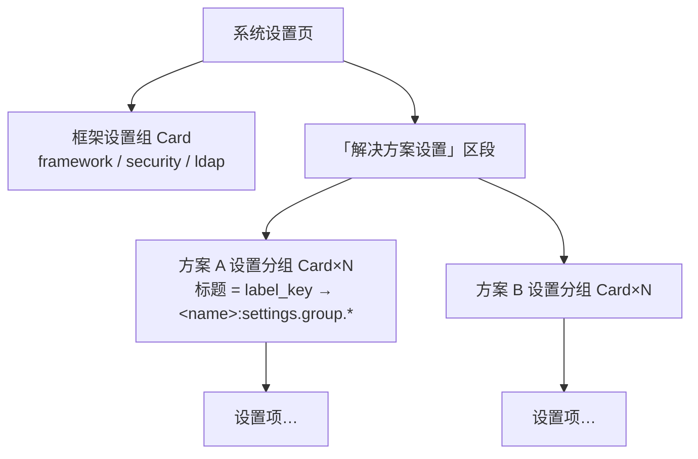
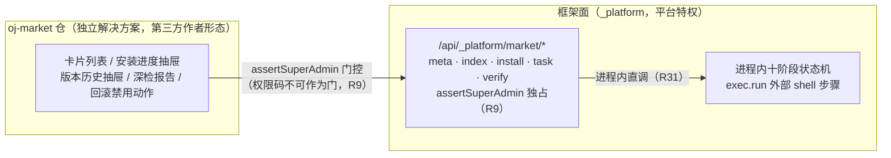

# 解决方案全生命周期管理 · 实施设计（市场即样例）

> 状态：**专家评审修订版 v3**（五方评审 40 条发现 → 30 项处置闭环，见 §10；v3 = 用户裁定**执行器换轨 oj 原生**——废弃 Node 安装进程，见 R31）· 日期：2026-10-17 · 范围：`oj-module`（本仓）
> 设计基线：[`202610161300-solution-lifecycle-registration-design.md`](202610161300-solution-lifecycle-registration-design.md)（六阶段生命周期 / 十阶段安装状态机 / 注册清单 / 验证双轨——本文**继承不翻案**；两处实质修订经 §10-R2/R5 标注，P0 回写基线）
> 上游文档：[`202610152345-solution-marketplace-framework-prd.md`](202610152345-solution-marketplace-framework-prd.md)（M5/M6/M7）、[`202610160908-rbac-auth-design.md`](202610160908-rbac-auth-design.md)、[`20261016-solution-module-rbac-isolation-design.md`](../20261016-solution-module-rbac-isolation-design.md)
> 本文定位：把生命周期设计落成**可实施口径**——落点核对（现状 × 缺口）、脑暴与评审修订决策、上下游提需流程、分期任务骨架与验收。细任务表由实施计划文档另文承接。

---

## 0. 决策记录

继承 lifecycle 设计文档 B1–B4（验证双轨 / i18n 握手 / 多版本共存 / 部署≠安装），本次脑暴新增（v2 修订以 ✏️ 标注）：

| # | 议题 | 结论 |
|---|---|---|
| D1 | 分期策略 | **方案 A：契约先行、三期推进**——P0 契约与需求周 → P1（=M5）打包安装闭环 → P2（=M6）签名+市场+深检 → P3（=M7）减法与分发。安装状态机一次成型，各期只是加参数 |
| D2 | 验收载体 | **市场即样例，且独立成仓**：`../oj-market`（与 oj-bin/oj-wiki 平级的独立项目）一个产物身兼两职——市场功能本体 + 第一方样例方案（契约面完整示范）。开发形态完全对齐**第三方作者**：独立仓 + ojm 工具链 + 依赖已发布的 `@oj-module/*` 包（仓内不建 `apps/market`）。P1 端到端契约全覆盖用**测试夹具合成 tgz**（CI 可重复）；`oj-wiki` 为首个真实第三方接入样证（经接入指南，不阻塞本方案） |
| D3 | 共享根挂载 | 目标形态：**单 mount 指向共享根 `api/modules/`**，安装器（`_platform` 特权模块，FS 改动经 `exec.run` 外部 shell 步骤）仅在首次接入时改写一次 `config.yaml`（文本级锚点 surgical edit，禁 `yaml.stringify` 回写——OJ-3 红线；一次性注入集含：mount 行、`server.reload_api: true`；v3 起 `platform.exec` 模板不再需要——无外部安装进程）。⚠️ **C1 spike 首位裁决项**（R6）：oj 拒绝同类 api 前缀重复挂载、**空锁直接拒启**（`lock.is_empty → Err`）——共享根无法作为第二 `/api` 挂载共存，唯一自洽形态待实测裁决（候选：共享根即站点唯一 `/api` 树，安装器改写既有挂载指向，框架模块与方案共居同一锁，并处理 `oj build` save_lock 与安装器的锁互斥）；加密态 config.yaml 拒装并给可读报错 |
| D4 | 菜单模型 | `sys_solution_route.category` 收敛为三值：`main \| admin \| hidden`。**设置内容三层嵌套**：系统设置页 → 「解决方案设置」区段 → 各方案设置分组（Card）→ 设置项。`personal` 类别移除。菜单分组标签（常规/管理）由框架 i18n 承担，方案只出页面标题（`menu.*`）与设置组标签（`settings.group.*`） |
| D5 | 市场架构 | **编排留框架面**：安装编排 / 任务模型 / 索引聚合 / 深检后端归 `_platform`（`/api/_platform/market/*`，需平台特权：`exec.run`、共享根 FS、`reloadConfig`）；**市场展示页为解决方案**（独立仓 `../oj-market`）。✏️ v2（R9）：**编排端点 `assertSuperAdmin` 独占**（exec.run/FS/reloadConfig 特权过重，比照卸载级；admin 超集链恒通过一切权限码，权限码门控不成立），且 **`market` 恢复保留名**（撤销 v1 移出决定——任意第三方取名 `market` 可自 declare `market.*` 抢注）。市场页内 `market.view/verify` 权限码仅作前端显隐（初始绑定 admin+superadmin）；`market.install` 权限码废弃 |
| D6 | 引导顺序 | 安装器**常驻 `_platform`**（随框架模板分发，装完框架即具备安装能力）；`ojm install` 为**瘦客户端**（登录 → 触发编排端点 → 流式展示进度，零安装逻辑）；P2 先 CLI 装 market 本身，此后一切安装/升级走市场 UI；市场自升级走 CLI（页面刷新即得新版）。market 未安装时框架管理区提供**占位引导卡**（说明需运维执行 `ojm install` + 文档入口，R26）；persona 分工（运维 CLI 引导 → admin UI 接管）写入部署手册 |
| D7 | CDN 本体与配置源、缓存契约 | **CDN 本体**：P1–P3 用 **oj web 静态挂载**承担——分发源=任意 oj 工程 `mounts` 加一行 `web:` 指向**独立分发目录**（严禁指向 `api/modules/` 或其父级，R13）；真实 CDN 后置。✏️ v2（R15）**缓存头契约**：`bundles.yaml`/`manifests.yaml` 必须 `Cache-Control: no-cache`（防缓存层钉死旧索引装到旧版本），tgz 内容寻址可长缓存——写入 T11 验收与 publish 手册。**配置源**：P1 CLI 读项目 `config.yaml` 的 `ojm` 段（`ojm.market.cdn`）；P2 起市场方案 sys_setting 组可改、`_platform` 编排时经参数下发安装进程，config.yaml 为默认回退 |
| D8 | CLI 命令面最小铺开 | P1：`ojm build --bundle`、`ojm install`（升级/降级 = 同命令不同 version）、`ojm enable/disable`（sidecar 状态 + 三处 enabled 同写，T9 状态机参数化的 CLI 出口）；P3：`ojm uninstall`；GC 内建进 install。不一次铺满 |
| D9 | 提需纪律 | 上下游缺口一律**文档化提需**（PR 格式 → 提交上游/落下游承接点 → 状态跟踪 → 方案内标注阻塞关系），绕行仅限上游官方认可的绕行（如 `exec.run` tar 三步范式），不私自 hack |
| D10 | 注册写入唯一通道（v3 换轨简化） | 执行器即 `_platform` 特权模块（oj isolate 内，`db` 全局可用）：注册写入经 `solution-perms.ts` 唯一出口**进程内直接调用**，auditOp 原生落库——v2 的「Node→loopback 注册端点」整条作废。特权模块同时是 OJ-7 表级写守卫的**结构性豁免面**（写入 §6.2）。触发面鉴权不变：编排端点 superadmin 独占（D5） |
| D11 | 失败语义三分（v2 新增，R4/R2） | ① **锁写入前失败**（preflight→extracting→migrating）：清场重跑（删 staging、恢复目录），零副作用；② **锁写入后失败**（registering→smoke）：方案已生效或部分生效，报「已生效/部分生效，待修复」+ 禁用/回滚指引，**重试须显式重跑注册**（同版本 no-op 跳过问题不复存在于注册段）；③ **降级/回滚/启用（锁指向切换）前**：必须对目标版本目录复验 manifest sha256（P2 起含验签），失败拒切（R11）。配合 R2：**迁移成功后才落锁**（推翻 lifecycle §3「先落锁后迁移」顺序，P0 回写基线），状态机入口加「锁↔迁移账本对账自愈」（不一致自动回指旧版并隔离新目录）；迁移失败**保持锁指新版**（账本去重保证重试幂等），回滚目录前校验目标版本 max seq ≥ 账本 head，否则禁止回滚转人工 |
| D12 | 锁格式与状态 sidecar（v2 新增，R5） | 共享根 `manifests.yaml` **严格保持 oj 原生扁平格式**（`name: version` 字符串表——嵌套结构/额外键会解析失败拒启）；`enabled`/时间戳/GC 元数据落安装器自有 sidecar `.solutions/state.yaml`。禁用 = **从锁中摘除条目**（目录保留，oj 按锁逐条装配，摘除即不挂载）+ sidecar 记录 + `sys_solution_route.enabled=false` + `modules.json.enabled=false`；锁改写前备份原锁（`.bak`）恢复用例入验收 |
| D13 | 状态文件原子性（v2 新增，R19） | `modules.json`/`manifests.yaml`/`state.yaml`/任务文件全部**同目录 tmp+rename 原子替换**（`.lock` 只互斥写者，防不了读者见半截 JSON）；T6 验收加「写入期间并发 fetch 不见半截」用例 |

---

## 1. 注册清单落点核对（lifecycle §4 九项 × 现状）

| # | 注册项 | 落点 | 现状（2026-10-17） | 缺口 → 承接期 |
|---|---|---|---|---|
| 1 | 后端模块 | 共享根 `api/modules/`（`<name>-<version>/` 目录 + **oj 原生扁平锁**（D12）+ `.solutions/state.yaml` sidecar） | ❌ 无共享根 | 安装器建目录/写锁/lockfile 互斥 → **P1**；单 mount 自洽形态 C1 裁决（R6） |
| 2 | 路由分类 | `sys_solution_route`（category ∈ main/admin/hidden） | ✅ 表已建（RBAC M2） | `_platform` 注册 service（经 D10 特权端点）+ 前端归并查询端点 → **P1** |
| 3 | 业务设置 | `sys_setting`（`module=<name>`） | ✅ 表已建；⚠️ `listSettings` 仅按 group 聚合、**无 module 维度**，组标题硬编码 `system:` 命名空间（R20） | settings service 改造（按 module 分组 + 组级 label_key）→ **P1**；系统设置页三层嵌套渲染+保存语义 → **P1** |
| 4 | RBAC | `sys_role`/`sys_permission`/`sys_role_permission` | ✅ 表+规则已建，`solution-perms.ts` 唯一出口（isolate 内可调，v3 进程内直调） | 注册写入接入状态机 → **P1**；卸载双维度级联（单事务+统一失效出口，R12）→ **P3** |
| 5 | 前端入口 | 站点 `modules.json` | ✅ shell 宿主已消费（`enabled`/`css`/`integrity`/`peerRuntime` 全透传） | 安装器 upsert（D13 tmp+rename 原子替换；entry 路径 POSIX 分隔符序列化，R30）→ **P1** |
| 6 | 前端路由 | `entry.js` `defineModule.routes` | ✅ loader 已支持（运行时唯一事实源） | 无缺口 |
| 7 | 前端 i18n | `defineModule.i18n` → 命名空间 `<name>` | ✅ `loadAll` 已并入 | 仅定 key 契约（D4），无结构缺口 |
| 8 | 匿名路径 | `config.yaml` anonymous 段 | ✅ 模板已有该段 | 安装器**文本锚点改写**（R18）+ 预检强制条目收敛在本方案 `<name>/` 段内（`_system`/`_platform` 段禁止并入，R8）+ 登录端点拒装（R8/S1 纵深防御，主防线 = `issueTokens` 不暴露）→ **P1** |
| 9 | 兼容性 | `peerRuntime`/`peerOj`/`peerFramework` | ⚠️ loader 已有 peerRuntime 校验，`versions.json` 宿主真源 | 安装预检门禁（可读拒绝原因）→ **P1**；市场编排契约版本握手 `peerPlatform`（R23）→ **P2** |

**预检白名单（R7，安全）**：name `^[a-z][a-z0-9-]*$`、version `^[0-9A-Za-z.+-]+$`；归一化后复验落位路径在共享根/web 产物根内（rename 前 realpath 断言）；settings key 与 `title_key`/`label_key` 命名空间必须属于本方案（`moduleOf(key)===name`，防污染 `framework.*`/`system.*`，R24），fail-fast。

---

## 2. 目录、状态模型与执行器

```text
<项目>/api/modules/            # 共享根（挂载形态 C1 裁决，D3）
├── manifests.yaml             # oj 原生扁平锁（name: version；坏锁=Err 拒启，改写前 .bak 备份）
├── .solutions/state.yaml      # 安装器 sidecar：enabled/时间戳/GC 元数据（D12）
├── .staging/                  # 解压暂存（原子 rename 的源；zip-slip 防护，R1）
├── .install-tasks/            # P2 任务状态文件（单写者=oj 进程；保留最近 N 条、超时判 failed、脱敏，R13/B9/R31）
├── .lock                      # 进程内互斥 + 防 oj build save_lock 并发（v3 单写者=oj 进程，R17/R31）
├── wiki-0.1.9/                # 旧版本目录（回滚保留）
└── wiki-0.2.0/                # 当前生效
```

**一个状态机、一个执行器**（v3 换轨 R31）：十阶段状态机唯一落在 **`_platform` 特权模块进程内**（isolate 逻辑 + `exec.run` 外部 shell 步骤：tar 解压、`oj migrate`、config 文本编辑），**顺序修订（D11/R2）：迁移成功后才落锁**；CLI 与市场页均为**瘦触发端**（触发 + 进度透传，零安装逻辑）：

| 期 | 执行器 | 进度出口 |
|---|---|---|
| P1–P3 | `_platform` 进程内状态机（长任务形态见 S1-7：oj tasks 轴 / 分段执行+状态文件续跑——请求作用域纪律禁止模块级可变状态承载进度） | 任务状态文件 + 进度查询端点（800ms 轮询） |

- **fail-closed 单一出口** + **终态审计**（R16）：install/upgrade/rollback/uninstall 含 task_id、from→to 版本、成败 reason，`auditOp` 进程内原生落库，CLI 与市场同口径（失败也审计）
- **入口对账自愈**（D11）：状态机启动先对账「锁 ↔ 迁移账本」，不一致自动回指旧版并隔离新目录
- **迁移前置备份**（R14）：sqlite copy `db.sqlite.bak-<ts>`（含清理策略）；mysql/pg 走市场 UI 勾选门禁 + 审计
- **解压防护**（R1，v3 tar 范式）：**list→validate→extract 三步**——`tar -tzf`（`-tvzf` 识别链接类型）先列成员 → isolate 内校验（归一化后必须落在 staging 内、拒绝对路径/`..`/symlink/hardlink）→ 再解压 + realpath 断言；恶意 tgz 必拒夹具用例入 CI
- **semver 比较器唯一实现**（R25）：含 prerelease 规则纯函数 + 用例；GC「最近 N」= state.yaml 安装时间序

---

## 3. 前端消费缺口（全量三处）与菜单/设置渲染模型

### 3.1 缺口 1 · 菜单分类归并（v2 修订：时机与渲染模型，R21）

- `_platform` 新增 `GET /api/_platform/solution-routes`（auth'd）→ `{path, category, order, title_key, enabled}[]`
- **裁决（R22）**：端点**不下发** `required_permission`，**前端不做权限级菜单过滤**（后端 403 硬执行）；该列仅供后端深检预期对比（直读 `sys_solution_route`）
- **归并时机**：归并结果落独立缓存 store，由 `setAccessStore` 统一消费；**token 就绪后强制重归并一次**（现状宿主链无 AuthGuard、菜单登记在登录前且 `alreadyRegistered` 跳过——首登会话会永久降级为无分类，必须补）；`hidden` 复用既有 `handle.hideInMenu` 过滤通路
- **分组渲染模型（R24/产品#3）**：侧边栏两分组标签（常规/管理）常驻、空组隐藏；框架项与方案项共用 `order` 序轴（框架项保留 100 间隔带，方案项从 200 起编），「装后菜单」示意图进实施计划
- **降级不阻断**：端点失败/未登录 → 按无分类渲染，路由照常
- 禁用真源：锁摘除（D12，装载层整棵不挂载）+ `sys_solution_route.enabled`（菜单层）+ `modules.json.enabled`，禁用动作三处同写

### 3.2 缺口 2 · i18n key 契约（D4）

| key | 用途 | 校验 |
|---|---|---|
| `<name>:menu.*` | 方案页面标题（既有惯例） | 深检查值 |
| `<name>:settings.group.<group>` | 系统设置页方案分组标题（对应 `sys_setting.label_key`） | 深检查值 |
| `lifecycle.stage.*` | 十阶段失败文案 key（R28）：reason + 可操作指引 + retryable 标注，双语携带 | T3 交付项 |

### 3.3 缺口 3 · hidden 过滤

`generateMenuItemsFromRoutes` 前按归并结果过滤 `hidden`（复用 `hideInMenu` 通路），路由可达不入菜单。

### 3.4 系统设置页三层嵌套（D4，v2 补保存语义 R20）



- 渲染数据来自 `sys_setting`（**前置：settings service 按 module 分组改造**，R20）；框架组在前、方案组按 module 名排序在后
- **保存语义**：现状单按钮串行提交全部组——改为**脏组增量提交**（仅提交有改动的组）+ 组级 success/error 聚合提示（部分失败不静默）
- **权限可见性**：方案组沿用组级可见性规则（对照 security 组 superadmin-only 先例）；`sys_setting` 键所有权由安装预检保证（R24）

---

## 4. 验证双轨落地

### 4.1 安装期冒烟（P1，状态机 smoke 阶段）

| 项 | 实现 | 备注 |
|---|---|---|
| 后端可达 | 优先 `manifest.health`；缺省打首个非匿名路由断言 200 | Q-A 拍板：**health 不强制**；v3 冒烟在 oj 进程内发起（凭证形态 S1-5：匿名 health / 进程内签发自检 token） |
| integrity | `modules.json` 条目 `integrity` == **安装器对验签通过后的包内容**计算的 sha384（R10） | 复用 shell preload 同算法 |
| entry 浏览器加载 | **不在安装器验**（Node import 必假绿） | error boundary 兜底 + 深检可见 |
| 注册一致性 | `sys_solution_route`/`sys_setting`/`sys_role`/`sys_permission` 声明行存在性（经 D10 端点查询） | 升级用「包含非相等」放行 deprecated |

任一失败：按 D11 失败语义三分处置（锁后失败 = 「已生效/部分生效」文案 + 禁用/回滚指引，不标记成功）。

### 4.2 按需深检（P2，市场页触发 → `POST /api/_platform/solutions/:name/verify`）

- **后端四项**：路由可达性 / RBAC 完整性 / 设置项完整性（manifest.settings.items ↔ 三层嵌套实际渲染行）/ 迁移账本（对齐 `oj migrate verify`）
- **i18n 覆盖前端执行**：浏览器 i18next 已并入命名空间直接查 key——不为检查再造 Node 侧 entry 解析
- 报告聚合：通过 / 异常项 + 修复建议

---

## 5. 市场即样例方案（D2 / D5 / D6）

### 5.1 架构切分（v2 修订：R9/R23/R29）



- 编排需要平台特权（`exec.run`、共享根 FS、`reloadConfig`），归 `_platform`；普通方案拿不到（RBAC 隔离红线）
- **端点门 = `assertSuperAdmin` + module=market 已安装启用双重校验**（R9：admin 超集链恒通过一切权限码，`market` 若移出保留名会被第三方抢注自 declare `market.*`——故 `market` **保持保留名**）
- **版本握手**（R23）：`GET /api/_platform/market/meta` 返回 `apiVersion`；market manifest 增 `peerPlatform` 范围预检校验；任务 JSON 加 `schemaVersion`
- **契约版本化意识**：market 方案新于站点 `_platform` 时失败形态 = 预检拒绝 + 可读升级指引
- **不可复制注记**（R29）：`oj-market` 独立仓天然对齐第三方作者视角；其代码对 `_platform` 编排调用处仍加显式「第一方专用」注记；devkit 手册增「市场编排面为第一方专用，第三方仅经 manifest/sys_setting 契约接入」

### 5.2 market 方案的契约覆盖面（作为样例的义务）

| 契约面 | market 的落地 |
|---|---|
| manifest 完整字段 | 身份 / 兼容（含 P2 起 `peerPlatform`）/ prefix=market / RBAC（`market.view/verify`）/ 路由分类 / 设置分组 / 签名指纹 / **changelog（R27，C2 契约增补字段）** |
| 迁移 | `market_history` 表（安装/卸载/回滚事件留痕，运维追溯）——真实功能而非演示桩 |
| 路由类别 | admin（市场主页）+ hidden（深检报告详情） |
| RBAC 声明 | `market.view` / `market.verify`（初始绑定 admin+superadmin；`market.install` 权限码废弃，R9） |
| 设置分组 | 展示偏好组（经三层嵌套进系统设置页） |
| i18n | `market:menu.*` + `market:settings.group.*` |
| health | 提供端点（样例示范推荐姿态） |

### 5.3 分期交付形态与引导链

| 期 | market 形态 |
|---|---|
| P1 | 最小可打包形态：build --bundle 可出 tgz → CLI 安装 → admin 菜单出卡片（只读索引）；**框架管理区占位引导卡**同步交付（R26） |
| P2 | 实装安装进度抽屉 / **版本历史抽屉（回滚目标 + 风险分级，R27）** / 回滚 / 禁用启用 / 深检报告；卡片双版本展示「已装 x.y.z → 可用 a.b.c」；market 自身卡片更新按钮改「经 CLI 升级」提示；**自身经 CLI 引导安装**，此后一切安装走市场 UI |
| P3 | 卸载动作（superadmin + 影响面预检展示受影响角色/用户数后二次确认，R12） |

P1 端到端的契约全覆盖（main/admin/hidden 三类、迁移、RBAC、settings、health）由**测试夹具合成 tgz** 承担（CI 可重复，不进产物）；`main` 类真实样本待 `oj-wiki` 接入验证（main 与 admin 共用归并通路，仅分组归属不同）。

---

## 6. 上下游需求与提需流程（D9）

### 6.1 流程四步（沿用 `202610161500-oj-bin-feature-requests-pr.md` 的 PR 格式）

1. **文档化**：需求落本仓 `docs/prd/`（编号/背景/诉求形态/验收标准/状态/降级路径）
2. **提交上游**：oj-bin 仓 issue/PR 引用需求文档编号
3. **状态跟踪**：随上游版本复核更新状态列（同 lifecycle §9.1 的 0.1.76 复核惯例）
4. **方案标注依赖**：任务表标注「阻塞/非阻塞」；绕行仅限上游官方认可绕行

### 6.2 上游需求（oj-bin）

| 编号 | 能力 | 期 | 动作 |
|---|---|---|---|
| **OJ-8** | Windows 缺 tar/外部命令的报错契约（Git Bash 提示） | P1 | **P0 正式提交**；非阻塞——macOS/Linux 先行验收，Windows 另有 R30 已知限制清单 |
| **OJ-6** | `migrate.run` 内化 | 可选优化 | v3 下 `exec.run ["oj","migrate",...]` 即**主路径**（状态机内 shell 步骤）；内化降级为可选优化，P0 仍提交评估 |
| **OJ-7** | 表级写守卫（方案间写隔离） | — | 已有独立需求文档，持续跟踪；**`_platform` 特权模块（D10）是其结构性豁免面，随 PR 一并注明**，非本期阻塞 |
| **OJ-9（新增）** | down 迁移支持 | P3 降级增强 | **P0 一并提交（低优）**；落地前 R12 红线不变：降级仅允许「迁移无差异」+ 强告警二次确认 + D11③ 切换前复验 |
| ~~OJ-5~~ | 远程 URL mount | — | **不提**（Q7 已裁决砍 remote-web，CDN 只做下载源） |

并发安全不提上游：v3 单写者 = oj 进程（进程内互斥 + `.lock` 防 `oj build` save_lock 并发，手工解除口径写入排障手册，R17/R31）；`reloadConfig` 串行锁不覆盖 config.yaml 文件写——config 改写走「读-校验-原子写」（`exec.run` shell 步骤）+ 以 reload 返回的 mounts/vars 实际生效值做终态断言（`unchanged` 视为失败，R18）。

### 6.3 下游需求（解决方案作者契约 → 承接点）

| 契约 | 承接点 | 期 |
|---|---|---|
| `manifest.yaml` 契约（身份/兼容/prefix/RBAC/路由分类/设置分组/签名指纹/**changelog**） | `ojm build --bundle` 强校验 fail-fast + 脚手架模板内置样例 + devkit 手册「打包与分发」章节 | P0 定稿 → P1 落地 |
| **name/version 白名单**（`^[a-z][a-z0-9-]*$` / `^[0-9A-Za-z.+-]+$`）与 settings/key 命名空间所有权（`moduleOf(key)===name`） | 安装预检 fail-fast（R7/R24） | P1 |
| 路由 path 双源一致（manifest.routes ↔ entry.js routes） | 安装期校验，默认 warn 可配 fail（A1 已定） | P1 |
| i18n key 契约（`menu.*` / `settings.group.*`） | 脚手架 locales 样例 + 深检按 key 验值 | P1 |
| health 端点可选 | `manifest.health` 可选字段 + 冒烟兜底 | P1 |
| 统一 prefix（默认业务名、保留名拒用——**含 market**） | codegen `API_PREFIX` 对齐 + 安装预检占用检测 | P1 |
| 登录端点禁令（R8/S1） | 预检拒装 + anonymous 条目限本方案段内 + 手册红线 | P1 |
| **失败文案 key 契约**（`lifecycle.stage.*` 双语） | 状态机文案模板（R28） | P1 |

### 6.4 依赖总账（v2 修订）

- **P1 无上游新依赖**：`exec.run` / `reloadConfig()` / `verifyEd25519`（均 isolate 内可用）已落地；D3 共享根形态、长任务形态（S1-7）、冒烟凭证属**仓内 P0/C1 定稿项**（不阻塞于上游）
- **P2 原生化切换软依赖 OJ-6**（未落地则继续官方绕行）
- **P3 down 迁移增强软依赖 OJ-9**（未落地则 R12 校验兜底）
- 所有「等待上游」的点都有可工作的降级路径——**等待不等于停工**

---

## 7. 分期任务骨架与验收口径

### 7.1 P0 · 契约与需求周（约 1–2 天，零生产代码）

| # | 任务 |
|---|---|
| C1 | 共享根裁决 spike（**首位，R6**）：单 mount 自洽形态（api 前缀重复/空锁拒启/save_lock 互斥实测）+ release 加载语义 + `exec.run` tar/下载范式复验（含 list→validate→extract）+ **长任务形态**（oj tasks 轴 vs 分段执行+状态文件续跑，S1-7）+ **冒烟凭证形态**（S1-5）+ `reload_api` 注入验证（R18）+ 锁↔账本对账与 M003/M004 拒启行为实测（R2） |
| C2 | `manifest.yaml` 契约定稿（PRD §5.2 为底 + D4 修订 + **changelog 字段（R27）+ name/version 白名单 + settings key 所有权（R24）**） |
| C3 | 开放问题拍板落档：Q-A health 不强制、GC 保留 N=3（时间序，R25）、菜单类别三值、**market.* 初始绑定（R9：view/verify → admin+superadmin）** |
| C4 | 上游需求：OJ-8/OJ-6 提交稿 + OJ-9 新增条目（含 D10 豁免面注记）→ 提交 oj-bin |
| C5 | 下游契约承接清单（devkit 手册「打包与分发」+「第一方特权面不可复制」（R29）+ persona 部署引导章节提纲） |
| C6 | **基线回写**：lifecycle 文档两处修订（§3 锁顺序→迁移后落锁；§5 禁用语义→锁摘除+sidecar）+ Q-A 拍板结果 |

### 7.2 P1 · 打包→安装闭环（=M5）

- T1 `ojm build --bundle`（manifest 强校验 + 确定性 tgz + sha256）
- T2 独立仓 `../oj-market` 最小可打包形态（脚手架对齐 `apps/playground-oj` 工程形态；依赖已发布 `@oj-module/*`，仓内不建 apps/market）+ 框架管理区占位引导卡（R26）
- T3 `_platform` 安装状态机（**迁移后落锁 + 入口对账自愈**（D11）；进程内互斥 + save_lock 并发防护（R17/R31）；staging 原子 rename + **zip-slip 防护（list→validate→extract 三步范式）+ 恶意 tgz 必拒夹具**（R1）；**semver 比较器纯函数**（R25）；**十阶段失败文案模板双语**（R28）；失败语义三分）
- T4 迁移链（`exec.run oj migrate`——v3 主路径，先于热更、**先于落锁**；**迁移前置备份**（R14）；迁移失败保持锁旧版/新版语义见 D11）
- T5 注册写入（**D10 进程内唯一出口**：#2/#3/#4 + auditOp 原生落库 + 注册一致性查询）
- T6 前端落位（modules.json **tmp+rename 原子 upsert + 并发 fetch 用例**（D13/R19）+ `web/dist/modules/` + integrity（验签后内容计算）+ **entry 路径 POSIX 序列化**（R30））
- T7 热更（anonymous_paths **文本锚点改写（`exec.run` shell 步骤）+ 段内收敛校验**（R8/R18）+ `vars.ojm_solutions_gen++` + `reloadConfig()` 进程内触发 + reload 终态断言）
- T8 安装期冒烟四项（凭证形态随 C1）
- T9 升级/降级/禁用/启用（同状态机参数化；**切换前目标版本复验**（D11③/R11）；禁用 = 锁摘除 + sidecar + 三处 enabled 同写）
- T10 前端消费（solution-routes 端点 + **独立归并 store + token 后重归并**（R21）+ 分组渲染模型 + hidden 过滤 + **settings service module 维度改造 + 三层嵌套渲染与脏组保存**（R20））
- T11 端到端（夹具 tgz 契约全覆盖 + market 本体；**CDN 缓存头验收**（R15）：索引 no-cache / tgz 长缓存）

**验收**：装得上（带迁移不拒启、**kill 任一阶段后重启可自愈或可恢复**（D11））、验得过（冒烟）、升得动、回得去（切换前复验）、不重启生效（reload 断言）——本地 oj 静态分发源全链 BDD 绿。

### 7.3 P2 · 签名+市场+深检（=M6）

Ed25519 fail-closed（`crypto.verifyEd25519` isolate 内可用）+ **TOFU（CLI 侧指纹交互确认 + 审计留痕，或 bootstrap 公钥随宿主分发免 TOFU——C4 随 OJ 提交定夺）** + 公钥轮换（双 key 过渡）/吊销语义（R10）· market 实装（进度抽屉 800ms 轮询 + **schemaVersion**（R23）/ 版本历史抽屉 / 回滚 / 禁用启用 / 深检报告 / 双版本卡片）· 深检端点+报告 · `_platform/market/meta` 版本握手 + `peerPlatform` 预检 · CLI 引导装 market 本身（D6，瘦客户端触发）· **任务状态治理落地**（保留 N 条/超时判 failed/脱敏；单写者=oj 进程，R13/R31）

**验收**：未签名装不上；签名不符不落盘；卡片双版本+changelog 可见；市场页全动作可用；market 自升级走 CLI 有指引。

### 7.4 P3 · 减法与分发（=M7）

`ojm publish` + 索引重算（no-cache 头）· 卸载（superadmin + **影响面预检展示受影响角色/用户数** + 二次确认 + **RBAC 双维度级联单事务 + `invalidateAllUsers` 统一失效出口**（R12，承接 rbac-isolation §8.3/8.4）+ 业务表保留 Q4）· GC 内建 install（N=3 时间序，与回滚互斥靠 `.lock` + 活性判定）· remote-web 不做（OJ-5 不提）

**验收**：卸载后重装不复活旧授权（双维度级联）；级联清理期间判权不可见半清理态；GC 不动当前与最近 N；publish 索引可被 install 消费且缓存头正确。

---

## 8. 流程纪律与文档产出物

- **分支**：每期一族 `feat/lifecycle-p<n>-*`，自集成分支切出；P1 开工首日确认 `feat/system-admin-web` 合并顺序定基线
- **方法**：BDD/TDD 先行（状态机/锁/确定性 tgz/注册幂等/zip-slip 防护/semver 比较器为纯函数主战场）；文档先行已满足（本文 + 后续实施计划）
- **跟踪**：实施计划文档任务表为唯一跟踪源（同 RBAC 计划惯例），状态+耗时就地更新，每期收尾写阶段小结
- **评审**：每期 typecheck + lint + test 全绿后一次全量 diff 集中评审再合并

| 文档 | 动作 |
|---|---|
| 本文 | v2 专家评审修订版（202610171138） |
| 实施计划文档 | P0 后经 writing-plans 产出（BDD 任务表） |
| `202610161500-oj-bin-feature-requests-pr.md` | 追加 OJ-9，推进 OJ-8/OJ-6 状态，补 D10 豁免面注记 |
| `202610161300-solution-lifecycle-registration-design.md` | C6 回写：§3 锁顺序修订 + §5 禁用语义修订 + Q-A 拍板 |

---

## 9. 余留确认点（P0 spike 清单，C1 汇总）

| ID | 待实测/待定 | 影响 |
|---|---|---|
| S1-1 | **共享根唯一自洽形态裁决**（api 前缀重复拒绝 / 空锁拒启 / 安装器改写既有挂载 vs 追加 / `oj build` save_lock 与安装器锁互斥）——**C1 已裁决（实测）：release 共享根形态自洽**——同类前缀重复启动即拒；单 api 挂载多模块合法且路由前缀来自各模块自声明；布局只能扁平 `<module>-<version>`；空锁拒启、缺锁翻 dev 模式报 name 失配；安装 = 写版本目录 → upsert 锁 → 改 config 任一语义值 → reload，无需改 mounts（详见 `202610171245-lifecycle-p0-spike-findings.md`） | D3 定稿；安装器改写 config 的方式与首装 bootstrap 流程 |
| S1-2 | `exec.run` tar 范式复验（场景 34）+ **list→validate→extract 三步范式**（`-tvzf` 识别链接类型）+ CDN 下载步骤形态（http 模块 vs `exec.run` curl）——**C1 已裁决（实测）：exec.run tar 可用**，`-tvzf` 首列辨 `l`/`h` 且解压忠实还原链接（三步为安全必需）；下载定稿 fetch→fs.writeFile（越界 NotCapable 实测） | P1 解压/下载路径 |
| S1-3 | 进程内互斥 + `.lock` 防 `oj build` save_lock 并发（v3 单写者=oj 进程，R31 简化）——**C1 已裁决（实测）：oj save_lock 原子（tmp+rename，728k 并发读零撕裂）但读-改-写无互斥**，`oj build` 会吞掉并发外部写（实测 erasure）⇒ 安装器写锁后必须读回校验+重试收敛；「单写者=oj 进程」假设作废 | 并发安全实现选型 |
| S1-4 | `oj-wiki` 接入指南的范围（第三方接入改造清单） | D2 后续动作，不阻塞三期 |
| S1-5 | 冒烟凭证形态（匿名 health / 进程内签发自检 token）+ `reload_api` 注入后 `POST /_system/config` 实测——**C1 已裁决（实测）：端点在 `{mount}/_system/config`，auth 段配置时需 Bearer（401 实测）**；unchanged/applied 双形态实测；JS `server.reloadConfig()` 同 executor、五键形状；`_system/health` 匿名可用（推荐冒烟探针）；anonymous_paths 热改属 restart_pending 不可热生效；manifest 无 health 字段 | T7/T8 实现 |
| S1-6 | 锁↔账本对账：M003/M004 拒启行为实测 + 对账自愈的回指规则——**C1 已裁决（实测）：M004/M003 均复现，exit 1、文案含下一步指引**；`oj migrate --format json` = stdout 单行 `{results:[{module,ok,applied,error?}]}`、逐模块 continue-and-collect、任一失败 exit 非 0；注意「账本超前」在 migrate 侧报 refinery missing-from-filesystem 而非 M003 | D11 状态机入口实现 |
| S1-7 | **长任务形态**：十阶段状态机在 isolate 内的承载（oj tasks 轴 / 分段执行+状态文件续跑；请求作用域纪律禁止模块级可变状态承载进度）——**C1 已裁决（实测）：oj tasks 轴不可用**（池化任务调 exec.run 报 `NotCapable: exec requires module ownership`，且 tasks 目录站点级仅首个 api 挂载树、市场模块无法携带）⇒ 定稿「分段执行 + 状态文件续跑」，长段用 route_timeouts 提额 + exec timeoutMs≤600s | 状态机骨架实现 |

---

## 10. 专家评审与修订记录（2026-10-17）

五方并行评审（工程/架构/运维/产品/安全，各自独立研读本文 v1、基线文档、oj-bin 0.1.76 源码与本仓代码），40 条原始发现去重为 30 项，全部处置如下（处置 = 已修订进本文 v2 / 列入 P0）：

| # | 来源 | 严重度 | 议题 | 处置 |
|---|---|---|---|---|
| R1 | 安全 | 阻塞 | tgz 解压 zip-slip/符号链接逃逸零防护 | **已修订**：T3 硬性要求（归一化落位/拒逃逸/realpath 断言）+ 恶意 tgz 夹具入 CI |
| R2 | 运维+工程 | 阻塞 | 改锁→迁移完成间崩溃 → 锁指新版账本落后 → M004 拒启全站不可用；迁移失败「回滚目录不动库」与 M003 拒启冲突 | **已修订**：D11 迁移成功后落锁 + 入口对账自愈 + 失败保持锁指新版 + 回滚前 seq 校验；lifecycle §3 顺序修订列入 C6 |
| R3 | 工程 | 阻塞 | P1 Node 执行器无 DB 通路（`solution-perms.ts` 依赖 isolate 全局），注册/冒烟凭证全断 | **已修订**：D10 唯一写通道 = `_platform` 特权注册端点（loopback+鉴权）；§6.4 改口；冒烟凭证列 S1-5 |
| R4 | 产品 | 阻塞 | 失败语义与「同版本重装 no-op」重试规则矛盾；smoke 失败时已生效却报失败 | **已修订**：D11 失败语义三分（锁前清场/锁后部分生效指引/切换前复验） |
| R5 | 架构 | 阻塞 | `manifests.yaml` 嵌套结构 oj 解析失败即拒启；enabled 不能进锁 | **已修订**：D12 锁保持 oj 原生扁平格式 + `.solutions/state.yaml` sidecar；禁用 = 锁摘除；lifecycle §5 修订列入 C6 |
| R6 | 架构 | 阻塞 | 单 mount 与 oj 约束矛盾：同类 api 前缀重复拒绝、空锁拒启 | **已修订**：D3 改为 C1 首位裁决项（候选形态与 save_lock 互斥写明）；S1-1 升级 |
| R7 | 安全 | 重要 | name/version 无字符白名单与大小写归一化，可注入目录/绕保留名 | **已修订**：§1 预检白名单 + realpath 断言 |
| R8 | 安全 | 重要 | anonymous_paths 并入未限本方案段，可匿名化他模块/框架段 | **已修订**：预检条目前缀 ∈ `<name>/`，`_system`/`_platform` 禁入 |
| R9 | 安全+架构+产品 | 重要 | 「市场未装端点天然关闭」不成立（admin 超集链恒通过）；market 移出保留名可被抢注自 declare `market.*` | **已修订**：D5 编排端点 `assertSuperAdmin` 独占 + `market` 恢复保留名 + `market.install` 权限码废弃 |
| R10 | 安全 | 重要 | CLI 引导安装无 TOFU 指纹确认（违反 PRD 禁静默信任）；key 轮换/双摘要职责缺字 | **已修订**：P2 补 CLI TOFU/轮换；integrity 必须由验签后内容计算 |
| R11 | 安全 | 重要 | 锁指向切换（降级/启用）无复验，直改锁可让未校验版本生效 | **已修订**：D11③ 切换前目标版本复验 |
| R12 | 安全 | 重要 | 卸载级联无单事务/统一失效出口；影响面未预检展示 | **已修订**：P3 单事务 + `invalidateAllUsers` + 影响面预检确认 |
| R13 | 安全+运维 | 重要 | `.install-tasks` 无治理；CDN `web:` mount 误指共享根即公开泄漏 | **已修订**：D7 分发目录隔离红线；任务文件保留 N 条/超时判 failed/脱敏 |
| R14 | 运维 | 重要 | 迁移前备份缺失 | **已修订**：T4 前置备份子步（sqlite copy / mysql-pg UI 勾选门禁+审计） |
| R15 | 运维 | 重要 | CDN 缓存头缺契约，缓存层钉死旧索引 | **已修订**：D7 缓存契约（索引 no-cache / tgz 长缓存）+ T11 验收 |
| R16 | 运维 | 重要 | 审计断链：CLI 路径无 auditOp，PRD「失败也审计」未承接 | **已修订**：终态审计入状态机单一出口，CLI 与市场同口径 |
| R17 | 运维 | 重要 | lockfile 无活性判定，crash 后永久阻塞 | **已修订**：pid+启动时间戳/过期接管/手工解除口径 |
| R18 | 运维+工程+架构 | 重要 | config.yaml 改写三缺口：`yaml.stringify` 禁用未承接、`reload_api` 缺省 false 端点不存在、`unchanged` 语义未定义；P2 触发机制（platform.exec 模板）未定 | **已修订**：D3 一次性注入集（mount/reload_api/platform.exec 模板）+ 文本锚点 surgical edit + reload 终态断言（unchanged=失败）+ 删除 ojm serve 备选 |
| R19 | 工程 | 重要 | 状态文件「原子 upsert」未定义写法，读者可见半截 JSON | **已修订**：D13 同目录 tmp+rename + 并发 fetch 用例 |
| R20 | 工程+产品 | 重要 | `listSettings` 无 module 维度、组标题硬编码；三层嵌套保存语义缺失（单按钮全量提交跨方案误写） | **已修订**：T10 settings service 改造 + 脏组增量提交 + 组级聚合反馈 + 组级权限规则 |
| R21 | 工程 | 重要 | 归并时机错位：菜单登记在登录前、登录后无重归并，首登永久降级 | **已修订**：§3.1 独立归并 store + token 就绪强制重归并 + hidden 复用 hideInMenu |
| R22 | 工程 | 重要 | solution-routes 端点漏 required_permission 承接 | **已修订**：裁决前端不做权限级菜单过滤（后端 403 硬执行），字段仅后端深检用 |
| R23 | 架构 | 重要 | 市场编排契约无版本握手；任务文件无 schemaVersion；peerFramework 无真源 | **已修订**：`/market/meta` apiVersion + `peerPlatform` 预检 + 任务 JSON schemaVersion |
| R24 | 架构 | 重要 | settings key 无所有权校验，可污染 framework.*（跨模块提权同类洞） | **已修订**：预检 `moduleOf(key)===name` fail-fast |
| R25 | 架构 | 重要 | 版本比较器未定（oj 白名单非 semver），字典序错排/「最近 N」语义缺失 | **已修订**：唯一 semver 比较器纯函数 + GC 时间序 |
| R26 | 产品 | 重要 | market 未装零引导；CLI 为永久唯一入口对非开发者管理员旅程断裂 | **已修订**：D6 占位引导卡 + persona 部署章节 |
| R27 | 产品 | 重要 | 卡片无版本对比/changelog/回滚版本面；market 自升级按钮行为未定义 | **已修订**：双版本卡片 + changelog 契约字段 + 版本历史抽屉 + 自升级 CLI 提示 |
| R28 | 产品 | 重要 | 十阶段失败文案契约不落任务、无 i18n | **已修订**：T3 文案模板交付项 + `lifecycle.stage.*` 双语 key 契约 |
| R29 | 产品 | 次要 | 「市场即样例」第一方特权消费面未标注，第三方照抄半失效 | **已修订**：样例代码注记 + devkit 手册章节（C5） |
| R30 | 运维 | 次要 | Windows：entry 路径反斜杠断加载；EPERM 删除语义未定义 | **已修订**：T6 POSIX 序列化 + EPERM 可读报错 |
| R31 | 用户裁定 | 架构 | 执行器废弃 Node 安装进程，换轨 **oj 原生**：状态机跑在 `_platform` 特权模块（isolate 内），文件系统重活经 `exec.run` 外部 shell 步骤 | **已换轨（v3）**：D3/D6/D10/§2/§5.1/§6.2/§7 相应改写；R3 的 loopback 通路、R18 的 platform.exec 模板、R17 的跨进程锁随之作废或简化；M4→M6 两阶段切换不复存在；新增 S1-7 长任务形态 spike |

**未修订的补充说明**：① P1 无签名阶段 CDN 与安装器同信任域（sha256 仅防传输损坏不防投毒）——P2 验签上线前不得用于不受控分发源，已隐含于 D7/P2 顺序；② `apps/playground-oj` 作为 market 工程模板（工程评审补充，非缺陷）已写入 D2。
