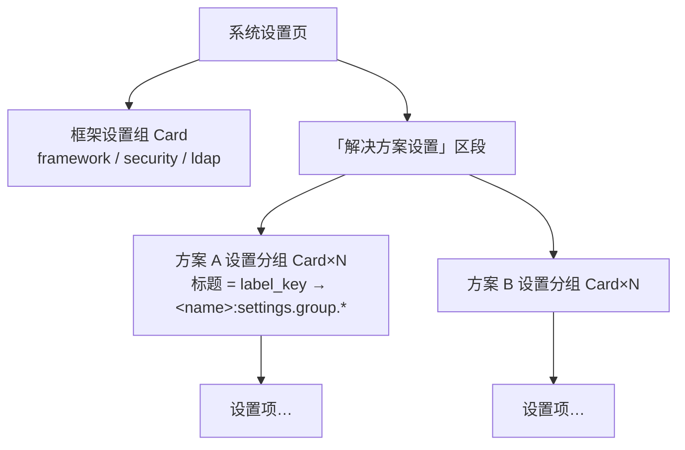

# 解决方案全生命周期管理 · 实施设计（市场即样例）

> 状态：脑暴定稿，待用户终审 · 日期：2026-10-17 · 范围：`oj-module`（本仓）
> 设计基线：[`202610161300-solution-lifecycle-registration-design.md`](202610161300-solution-lifecycle-registration-design.md)（六阶段生命周期 / 十阶段安装状态机 / 注册清单 / 验证双轨——本文**继承不翻案**）
> 上游文档：[`202610152345-solution-marketplace-framework-prd.md`](202610152345-solution-marketplace-framework-prd.md)（M5/M6/M7）、[`202610160908-rbac-auth-design.md`](202610160908-rbac-auth-design.md)、[`20261016-solution-module-rbac-isolation-design.md`](../20261016-solution-module-rbac-isolation-design.md)
> 本文定位：把生命周期设计落成**可实施口径**——落点核对（现状 × 缺口）、脑暴修订决策、上下游提需流程、分期任务骨架与验收。细任务表由实施计划文档另文承接。

---

## 0. 决策记录

继承 lifecycle 设计文档 B1–B4（验证双轨 / i18n 握手 / 多版本共存 / 部署≠安装），本次脑暴新增：

| # | 议题 | 结论 |
|---|---|---|
| D1 | 分期策略 | **方案 A：契约先行、三期推进**——P0 契约与需求周 → P1（=M5）打包安装闭环 → P2（=M6）签名+市场+深检 → P3（=M7）减法与分发。安装状态机一次成型，各期只是加参数 |
| D2 | 验收载体 | **市场即样例**：`apps/market` 一个产物身兼两职——市场功能本体 + 第一方样例方案（契约面完整示范）。取消独立 solution-demo；P1 端到端契约全覆盖用**测试夹具合成 tgz**（CI 可重复）；`oj-wiki` 为首个第三方接入样证（经接入指南，不阻塞本方案） |
| D3 | 共享根挂载 | **单 mount 指向共享根 `api/modules/`**。安装器仅在首次接入时改写一次 `config.yaml`（追加 mount 行），后续装/卸/升级不改 mounts；方案 API 前缀由各 bundle `manifest.yaml` 声明，靠 oj release 扫描语义生效 |
| D4 | 菜单模型 | `sys_solution_route.category` 收敛为三值：`main \| admin \| hidden`。**设置内容三层嵌套**：系统设置页 → 「解决方案设置」区段 → 各方案设置分组（Card）→ 设置项。`personal` 类别移除（框架个人中心已有，接入诉求出现再立项）。菜单分组标签（常规/管理）由框架 i18n 承担，方案只出页面标题（`menu.*`）与设置组标签（`settings.group.*`） |
| D5 | 市场架构 | **编排留框架面**：安装编排 / 任务模型 / 索引聚合 / 深检后端归 `_platform`（`/api/_platform/market/*`，需平台特权：`exec.run`、共享根 FS、`reloadConfig`）；**市场展示页为解决方案**（`apps/market`）。权限门 `market.*` 权限码由市场方案自己的 manifest 声明、随装注册——市场未装时端点对非 superadmin 天然关闭。P3 卸载仍 superadmin 独占（硬规则，不走权限码） |
| D6 | 引导顺序 | P1 的 `ojm install`（CLI）即引导安装器；P2 先 CLI 装 market 本身，此后一切安装/升级走市场 UI；市场自升级走 CLI（页面刷新即得新版） |
| D7 | CDN 配置源与 CDN 本体 | **CDN 本体**：P1–P3 用 **oj web 静态挂载**承担——分发源=任意 oj 工程 `mounts` 加一行 `web:` 指向 bundles 目录（`bundles.yaml`/`manifests.yaml`/tgz 全静态文件），真实 CDN 后置；安装器按 HTTP 拉取，换真 CDN 只改 base URL，协议零改动。**配置源**：P1 CLI 读项目 `config.yaml` 的 `ojm` 段（`ojm.market.cdn`）；P2 起市场方案 sys_setting 组可改、`_platform` 编排时经参数下发安装进程，config.yaml 为默认回退 |
| D8 | CLI 命令面最小铺开 | P1：`ojm build --bundle`、`ojm install`（升级/降级 = 同命令不同 version）、`ojm enable/disable`（锁字段 + 三处 enabled 同写，T9 状态机参数化的 CLI 出口）；P3：`ojm uninstall`；GC 内建进 install。不一次铺满 |
| D9 | 提需纪律 | 上下游缺口一律**文档化提需**（PR 格式 → 提交上游/落下游承接点 → 状态跟踪 → 方案内标注阻塞关系），绕行仅限上游官方认可的绕行（如 `exec.run` tar 三步范式），不私自 hack |

---

## 1. 注册清单落点核对（lifecycle §4 九项 × 现状）

| # | 注册项 | 落点 | 现状（2026-10-17） | 缺口 → 承接期 |
|---|---|---|---|---|
| 1 | 后端模块 | 共享根 `api/modules/`（`<name>-<version>/` 目录 + `manifests.yaml` 锁） | ❌ 无共享根 | 安装器建目录/写锁/lockfile 互斥 → **P1** |
| 2 | 路由分类 | `sys_solution_route`（category ∈ main/admin/hidden） | ✅ 表已建（RBAC M2） | `_platform` 注册 service + 前端归并查询端点 → **P1** |
| 3 | 业务设置 | `sys_setting`（`module=<name>`） | ✅ 表+设置页已建 | 安装期 upsert service → **P1**；系统设置页三层嵌套渲染 → **P1** |
| 4 | RBAC | `sys_role`/`sys_permission`/`sys_role_permission` | ✅ 表+规则已建，`solution-perms.ts` 唯一出口（E1 模拟器） | 模拟器出口转安装器真实调用 → **P1**；卸载双维度级联 → **P3** |
| 5 | 前端入口 | 站点 `modules.json` | ✅ shell 宿主已消费（`enabled`/`css`/`integrity`/`peerRuntime` 全透传） | 安装器读-改-写原子 upsert → **P1** |
| 6 | 前端路由 | `entry.js` `defineModule.routes` | ✅ loader 已支持（运行时唯一事实源） | 无缺口 |
| 7 | 前端 i18n | `defineModule.i18n` → 命名空间 `<name>` | ✅ `loadAll` 已并入 | 仅定 key 契约（D4），无结构缺口 |
| 8 | 匿名路径 | `config.yaml` anonymous 段 | ✅ 模板已有该段 | 安装器改写 + 登录端点拒装校验（R8/S1 纵深防御，主防线 = `issueTokens` 不暴露）→ **P1** |
| 9 | 兼容性 | `peerRuntime`/`peerOj`/`peerFramework` | ⚠️ loader 已有 peerRuntime 校验，`versions.json` 宿主真源 | 安装器 Node 侧预检门禁（可读拒绝原因）→ **P1** |

---

## 2. 目录、状态模型与执行器

```text
<项目>/api/modules/            # 共享根（config.yaml 单 mount 指向，D3）
├── manifests.yaml             # 锁：每方案 当前版本 + enabled + 时间戳
├── .staging/                  # 解压暂存（原子 rename 的源）
├── .install-tasks/            # P2 市场任务共享介质（跨进程，E3）
├── .lock                      # 安装器 lockfile（互斥装/卸/GC，Node 侧自持，不提上游需求）
├── wiki-0.1.9/                # 旧版本目录（回滚保留）
└── wiki-0.2.0/                # 当前生效
```

**一个状态机、三个执行器**：十阶段状态机（preflight → downloading → verifying → extracting → migrating → registering → deploying_web → reloading → smoke → done，详见 lifecycle §10.3）只实现一次：

| 期 | 执行器 | 进度出口 |
|---|---|---|
| P1 | CLI `ojm install`（Node 进程内） | stderr 阶段日志 |
| P2 | `_platform` 编排 + Node 进程执行 | `.install-tasks/<id>.json`，市场页 800ms 轮询 |
| P3 | 升级/降级/卸载 = 同状态机参数化（version / uninstall） | 同上 |

fail-closed（失败不落盘 / 不改锁 / 不触发热更）收敛为状态机**单一出口**，不散落各阶段分支。

---

## 3. 前端消费缺口（全量三处）与菜单/设置渲染模型

### 3.1 缺口 1 · 菜单分类归并

- `_platform` 新增 `GET /api/_platform/solution-routes`（auth'd）→ `{path, category, order, title_key, enabled}[]`
- `access` store 装配菜单前拉取，按 `path` 归并到 entry.js 路由：`category` 决定归属（main 常规 / admin 管理 / hidden 不入菜单），`order` 排序，`enabled=false` 不入菜单
- **降级不阻断**：端点失败/未登录 → 按无分类渲染，路由照常
- 禁用真源：`manifests.yaml.enabled`（装载层整棵跳过）+ `sys_solution_route.enabled`（菜单层），禁用动作两处同写

### 3.2 缺口 2 · i18n key 契约（D4）

| key | 用途 | 校验 |
|---|---|---|
| `<name>:menu.*` | 方案页面标题（既有惯例） | 深检查值 |
| `<name>:settings.group.<group>` | 系统设置页方案分组标题（对应 `sys_setting.label_key`） | 深检查值 |

菜单两级分组标签（常规/管理）由框架 i18n 承担，方案不参与（比 B2 原四组标签收敛）。

### 3.3 缺口 3 · hidden 过滤

`generateMenuItemsFromRoutes` 前按归并结果过滤 `hidden`，路由可达不入菜单。

### 3.4 系统设置页三层嵌套（D4）



渲染数据全部来自 `sys_setting`（`module` 维度已内建），框架组在前、方案组按 module 名排序在后。

---

## 4. 验证双轨落地

### 4.1 安装期冒烟（P1，状态机 smoke 阶段）

| 项 | 实现 | 备注 |
|---|---|---|
| 后端可达 | 优先 `manifest.health`；缺省打首个非匿名路由断言 200 | Q-A 拍板：**health 不强制**（C3 落档） |
| integrity | `modules.json` 条目 `integrity` == Node 侧 sha384 | 复用 shell preload 同算法 |
| entry 浏览器加载 | **不在安装器验**（Node import 必假绿） | error boundary 兜底 + 深检可见 |
| 注册一致性 | `sys_solution_route`/`sys_setting`/`sys_role`/`sys_permission` 声明行存在性 | 升级用「包含非相等」放行 deprecated |

任一失败：保留现场、记录原因、不标记成功，可重试（同版本幂等）。

### 4.2 按需深检（P2，市场页触发 → `POST /api/_platform/solutions/:name/verify`）

- **后端四项**：路由可达性 / RBAC 完整性 / 设置项完整性（manifest.settings.items ↔ 三层嵌套实际渲染行）/ 迁移账本（对齐 `oj migrate verify`）
- **i18n 覆盖前端执行**：浏览器 i18next 已并入命名空间直接查 key——不为检查再造 Node 侧 entry 解析（`readModuleDefinition` 的 bundle+import 留给构建期）
- 报告聚合：通过 / 异常项 + 修复建议

---

## 5. 市场即样例方案（D2 / D5 / D6）

### 5.1 架构切分


- 编排需要平台特权（`exec.run`、共享根 FS、`reloadConfig`），归 `_platform`；普通方案拿不到（RBAC 隔离红线）
- `market.*` 权限码随市场方案安装注册：未装时端点对非 superadmin 天然关闭，装完才可授权 admin
- 保留名清单调整：**`market` 移出保留名**（归第一方市场方案），保留 `_platform`/`_system`/`system`/`auth`/`framework`/`health`/`plugins`

### 5.2 market 方案的契约覆盖面（作为样例的义务）

| 契约面 | market 的落地 |
|---|---|
| manifest 完整字段 | 身份 / 兼容 / prefix=market / RBAC（`market.*`）/ 路由分类 / 设置分组 / 签名指纹 |
| 迁移 | `market_history` 表（安装/卸载/回滚事件留痕，运维追溯）——真实功能而非演示桩 |
| 路由类别 | admin（市场主页）+ hidden（深检报告详情） |
| RBAC 声明 | `market.view` / `market.install` / `market.verify` 等 |
| 设置分组 | 展示偏好组（经三层嵌套进系统设置页） |
| i18n | `market:menu.*` + `market:settings.group.*` |
| health | 提供端点（样例示范推荐姿态） |

### 5.3 分期交付形态与引导链

| 期 | market 形态 |
|---|---|
| P1 | 最小可打包形态：build --bundle 可出 tgz → CLI 安装 → admin 菜单出卡片（只读索引） |
| P2 | 实装安装进度抽屉 / 回滚 / 禁用启用 / 深检报告；**自身经 CLI 引导安装**，此后一切安装走市场 UI |
| P3 | 卸载动作（superadmin） |

P1 端到端的契约全覆盖（main/admin/hidden 三类、迁移、RBAC、settings、health）由**测试夹具合成 tgz** 承担（CI 可重复，不进产物）；`main` 类真实样本待 `oj-wiki` 接入验证（main 与 admin 共用归并通路，仅分组归属不同）。

---

## 6. 上下游需求与提需流程（D9）

### 6.1 流程四步（沿用 `202610161500-oj-bin-feature-requests-pr.md` 的 PR 格式）

1. **文档化**：需求落本仓 `docs/prd/`（编号/背景/诉求形态/验收标准/状态/降级路径）
2. **提交上游**：oj-bin 仓 issue/PR 引用需求文档编号
3. **状态跟踪**：随上游版本复核更新状态列（同 lifecycle §9.1 的 0.1.76 复核惯例）
4. **方案标注依赖**：任务表标注「阻塞/非阻塞」；绕行仅限上游官方认可绕行

### 6.2 上游需求（oj-bin）

| 编号 | 能力 | 期 | 动作 |
|---|---|---|---|
| **OJ-8** | Windows 缺 tar/外部命令的报错契约（Git Bash 提示） | P1 | **P0 正式提交**；非阻塞——macOS/Linux 先行验收，Windows 列已知限制 |
| **OJ-6** | `migrate.run` 内化 | P2 后端原生化 | **P0 转正评估提交**；落地前用官方绕行 `exec.run ["oj","migrate",...]`，非阻塞 |
| **OJ-7** | 表级写守卫（方案间写隔离） | — | 已有独立需求文档，持续跟踪，非本期阻塞 |
| **OJ-9（新增）** | down 迁移支持 | P3 降级增强 | **P0 一并提交（低优）**；落地前 R12 红线不变：降级仅允许「迁移无差异」+ 强告警二次确认 |
| ~~OJ-5~~ | 远程 URL mount | — | **不提**（Q7 已裁决砍 remote-web，CDN 只做下载源） |

并发安全不提上游：安装器 Node 侧 lockfile 自持（`.lock`），单站点单安装进程足够。

### 6.3 下游需求（解决方案作者契约 → 承接点）

| 契约 | 承接点 | 期 |
|---|---|---|
| `manifest.yaml` 契约（身份/兼容/prefix/RBAC/路由分类/设置分组/签名指纹） | `ojm build --bundle` 强校验 fail-fast + 脚手架模板内置样例 + devkit 手册「打包与分发」章节 | P0 定稿 → P1 落地 |
| 路由 path 双源一致（manifest.routes ↔ entry.js routes） | 安装期校验，默认 warn 可配 fail（A1 已定） | P1 |
| i18n key 契约（`menu.*` / `settings.group.*`） | 脚手架 locales 样例 + 深检按 key 验值 | P1 |
| health 端点可选 | `manifest.health` 可选字段 + 冒烟兜底 | P1 |
| 统一 prefix（默认业务名、保留名拒用） | codegen `API_PREFIX` 对齐 + 安装预检占用检测 | P1 |
| 登录端点禁令（R8/S1） | 预检拒装 + 手册红线 | P1 |

### 6.4 依赖总账

- **P1 零上游阻塞**：`exec.run` / `reloadConfig()` / `verifyEd25519` 均已在 oj 0.1.75+ 落地
- **P2 原生化切换软依赖 OJ-6**（未落地则继续官方绕行）
- **P3 down 迁移增强软依赖 OJ-9**（未落地则 R12 校验兜底）
- 所有「等待上游」的点都有可工作的降级路径——**等待不等于停工**

---

## 7. 分期任务骨架与验收口径

### 7.1 P0 · 契约与需求周（约 1 天，零生产代码）

| # | 任务 |
|---|---|
| C1 | 共享根 spike：oj 0.1.76 实测单 mount 多模块扫描 + release 加载语义 + `exec.run` tar 三步范式复验 + lockfile 行为 |
| C2 | `manifest.yaml` 契约定稿（PRD §5.2 为底 + D4 修订：category 三值、设置三层嵌套） |
| C3 | 开放问题拍板落档：Q-A health 不强制、GC 保留 N=3、菜单类别三值 |
| C4 | 上游需求：OJ-8/OJ-6 提交稿 + OJ-9 新增条目 → 提交 oj-bin |
| C5 | 下游契约承接清单（devkit 手册「打包与分发」章节提纲） |

### 7.2 P1 · 打包→安装闭环（=M5）

T1 `ojm build --bundle`（manifest 强校验 + 确定性 tgz：固定 mtime/字典序/权限规范化 + sha256）· T2 `apps/market` 最小可打包形态 · T3 `ojm install` 十阶段状态机（Node 执行器 + lockfile + staging 原子 rename）· T4 迁移链（`exec.run oj migrate`，先于热更）· T5 注册写入（#2/#3/#4 经 `solution-perms.ts` 唯一出口）· T6 前端落位（modules.json 原子 upsert + `web/dist/modules/` + integrity）· T7 热更（anonymous_paths 并入 + `vars.ojm_solutions_gen++`）· T8 冒烟四项 · T9 升级/降级/禁用/启用（同状态机参数化）· T10 前端消费（solution-routes 端点 + access 归并 + hidden 过滤 + 系统设置页三层嵌套）· T11 端到端（夹具 tgz 契约全覆盖 + market 本体）

**验收**：装得上（带迁移不拒启）、验得过（冒烟）、升得动、回得去、不重启生效——本地目录作 CDN 全链 BDD 绿。

### 7.3 P2 · 签名+市场+深检（=M6）

Ed25519 fail-closed + TOFU（公钥默认 config.yaml，R13）· market 实装（进度抽屉 800ms 轮询 / 回滚 / 禁用启用 / 深检报告）· 深检端点+报告 · 后端原生化切换（软依赖 OJ-6）· CLI 引导装 market 本身（D6）

**验收**：未签名装不上；签名不符不落盘；卡片只显最高版本；市场页全动作可用。

### 7.4 P3 · 减法与分发（=M7）

`ojm publish` + `bundles.yaml`/`manifests.yaml` 索引重算 · 卸载（superadmin + 二次确认 + RBAC 双维度级联 + 业务表保留 Q4）· GC 内建 install（N=3，与回滚互斥）· remote-web 不做（OJ-5 不提）

**验收**：卸载后重装不复活旧授权（双维度级联）；GC 不动当前与最近 N；publish 索引可被 install 消费。

---

## 8. 流程纪律与文档产出物

- **分支**：每期一族 `feat/lifecycle-p<n>-*`，自集成分支切出；P1 开工首日确认 `feat/system-admin-web` 合并顺序定基线
- **方法**：BDD/TDD 先行（状态机/锁/确定性 tgz/注册幂等为纯函数主战场）；文档先行已满足（本文 + 后续实施计划）
- **跟踪**：实施计划文档任务表为唯一跟踪源（同 RBAC 计划惯例），状态+耗时就地更新，每期收尾写阶段小结
- **评审**：每期 typecheck + lint + test 全绿后一次全量 diff 集中评审再合并

| 文档 | 动作 |
|---|---|
| 本文 | 新建（202610171138） |
| 实施计划文档 | P0 后经 writing-plans 产出（BDD 任务表） |
| `202610161500-oj-bin-feature-requests-pr.md` | 追加 OJ-9，推进 OJ-8/OJ-6 状态 |
| `202610161300-solution-lifecycle-registration-design.md` | 状态行 → 「已评审（经本文确认）」，Q-A 拍板结果回写 |

---

## 9. 余留确认点（P0 spike 清单）

| ID | 待实测/待定 | 影响 |
|---|---|---|
| S1-1 | 单 mount 共享根下 oj 对多模块目录的扫描与 release 加载语义（0.1.76 实测） | 安装器写锁/落位细节；不影响状态机 |
| S1-2 | `exec.run` tar 三步范式在当前 oj 版本复验（场景 34） | P1 迁移/解压路径 |
| S1-3 | Node lockfile 在共享根的行为（独占创建 / 崩溃残留清理） | `.lock` 实现选型 |
| S1-4 | `oj-wiki` 接入指南的范围（第三方接入需要的改造清单） | D2 的后续动作，不阻塞三期 |
