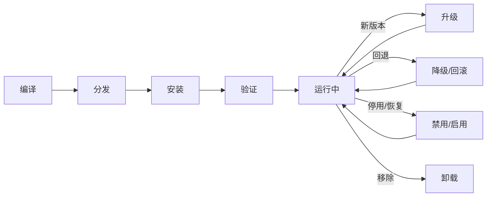
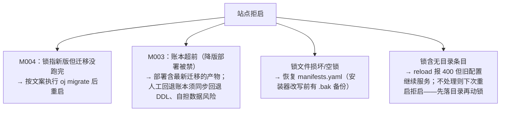

# 解决方案全生命周期 · 总览指南（开发者 / 运维 / 用户三视角）

> 状态：**P0/C7 交付物** · 日期：2026-10-17 · 分支：`feat/lifecycle-p0`
> 定位：**面向人的入口文档**——同一套生命周期，三类读者各取所需。细节一律指向源文档，本文不复制其内容；后续 devkit 手册与运维手册以本文为母本。
> 事实源：[实施设计 v3](202610171138-solution-lifecycle-implementation-design.md)（D/R 决策编号）· [注册清单基线](202610161300-solution-lifecycle-registration-design.md) · [manifest 契约](202610171254-lifecycle-manifest-contract.md)（C2-01~33）· [devkit 手册提纲](202610171333-lifecycle-devkit-manual-outline.md) · [P0 spike 实测](202610171245-lifecycle-p0-spike-findings.md)（S1-*）

**阅读路径**：

| 你是谁 | 读哪章 | 你将得到 |
|---|---|---|
| 解决方案作者（写代码的人） | [§1](#1-开发者视角解决方案作者) | 写什么文件、跑什么命令、哪些红线碰不得 |
| 运维（部署与维护的人） | [§2](#2-运维视角部署与维护者) | 怎么装、失败时先看哪、出事怎么救 |
| 管理员 / 普通用户（用系统的人） | [§3](#3-管理员用户视角用系统的人) | 页面上点什么、看到什么、能做什么 |
| 所有人 | [§4](#4-交付期标注现在能用什么) | 每个能力随哪一期落地，现在能用什么 |

---

## 0. 生命周期一页图

每个阶段一行话：

| 阶段 | 谁做 | 做什么 | 结果 |
|---|---|---|---|
| 编译 | 解决方案作者 | `ojm build --bundle` | 确定性 tgz + sha256（同输入两次打包字节一致） |
| 分发 | 作者 / 发布方 | 上传到分发源并维护索引（P1 手工维护；P3 起 `ojm publish`） | 分发源可被 `ojm install name@version` 消费 |
| 安装 | 运维（CLI）或 superadmin（市场页） | 十阶段状态机：预检→下载→校验→解压→迁移→落锁→注册→前端落位→热更→冒烟 | 方案即时生效，站点不重启 |
| 验证 | 安装器自动 + 管理员按需 | 安装期冒烟自动跑（声明 health 则优先探测该端点，缺省首个非匿名路由兜底）；深度校验由管理员在市场页触发 | 冒烟失败不标记成功；深检出报告 |
| 升级 / 降级 / 回滚 | 同安装 | 同一状态机、不同的 version 参数；切换前对目标版本复验 | 多版本目录共存，指向切换即生效，旧目录保留可回滚 |
| 禁用 / 启用 | superadmin | 从模块锁摘除/恢复条目 + 三处状态位同步 | 方案不再挂载，但目录与数据全保留，随时可恢复 |
| 卸载 | superadmin（P3 起） | 影响面预检 → 二次确认 → RBAC 双维度级联清理 | 权限与路由摘除；业务数据表不删 |

---

## 1. 开发者视角（解决方案作者）

旅程：写 manifest → 备目录 → 打包 → 本地装 → 发布 → 升级。详式内容在 devkit 手册（[章节提纲](202610171333-lifecycle-devkit-manual-outline.md)，正式章节 P1 撰写）；本节是速览 + 红线。

### 1.1 写 `manifest.yaml`

manifest 是构建器与安装器的**共同上游**，两端同规则 fail-fast。全部规则的唯一真源是[契约文档](202610171254-lifecycle-manifest-contract.md)（条款编号 C2-01~33，改规则先改契约），此处只列骨架：

| 块 | 要点 | 条款 |
|---|---|---|
| 身份 | name `^[a-z][a-z0-9-]{0,63}$` 且非保留名；version 禁 `+`/`_`/`..`；**changelog 必填**（市场卡片消费）；summary 单行非空（写入 oj 模块 desc） | C2-01/02/04/08 |
| 兼容 | `peerRuntime` P1 安装预检强制（对宿主 versions.json 比对）；peerOj/peerFramework/peerPlatform P1 仅声明，P2 起生效 | C2-09~11 |
| prefix | 一处命名贯穿三处：codegen `API_PREFIX`、路由自声明首段、`api.prefix` 三者一致；默认 `/api/<name>` | C2-12~14 |
| 匿名路径 | 每条首段必须 === 方案名（段内收敛）；命中 login/token/session/auth 等命名即拒装 | C2-26 |
| RBAC | 权限码强制 `<name>.` 前缀；角色引用的权限不得悬空 | C2-15/16 |
| 路由分类 | category 三值 `main \| admin \| hidden`；`order` 建议 ≥200（框架项保留 <200 带） | C2-17~21 |
| 设置分组 | `settings.groups[]` 多组；items key 所有权 `moduleOf(key) === name`，fail-fast | C2-22~24 |
| i18n | `<name>:menu.*` / `<name>:settings.group.*` / `<name>:perm.*` / `<name>:role.*`；zh-CN 与 en-US 必须携带全部被引 key | C2-25 |
| web/archive | `web.entry` 版本段必须 === version（POSIX 分隔符）；integrity sha384 构建器算、安装器重算比对；archive 分 Form A（tgz 内占位）/ Form B（分发索引真源） | C2-27~29 |

未列出的顶层键一律拒绝——拼写错了不会静默失效，会报可读错误。

### 1.2 目录布局与打包

- 工程源码布局：等 P1-15 脚手架（`../oj-market`）定稿后回填，勿自行发明。
- tgz 内布局：单根 `<name>-<version>/`，`api/<name>-<version>/` 放 `oj build` 产物原样，`web/modules/<name>/<version>/` 放 entry.js 与 css。
- `ojm build --bundle`：构建即校验（全量 C2 规则，报错逐条带编号），坏清单出不了包；产物确定性（固定 mtime/字典序/权限）——同输入两次打包 sha256 相等。
- 分层红线：bundle 级 manifest ≠ oj 模块级 manifest（后者仅 oj 原生七键，作者不手写）；bundle 字段混入模块级文件是禁手——oj 对未知键静默忽略，上游收紧解析即全量炸装（契约 §3 OJ-X）。

### 1.3 本地验证、升级与 changelog

- 本地装：`ojm install <file.tgz>`（P1-13 瘦客户端）装进本地站点走真实链路，冒烟通过、不重启出菜单即闭环（验收 AC-P1-1/2/3）。
- 读失败（三分法，[D11](202610171138-solution-lifecycle-implementation-design.md)）：锁写入前失败（预检→解压段）= 零副作用，改了重装即可；锁写入后失败（注册→冒烟段）= 方案已生效或部分生效，先按指引禁用或回滚，修复后显式重装；迁移失败 = 锁保持指向旧版，重试幂等。
- 升级 = 同命令更高 version；同名同版本重装 = no-op；降级受迁移差异校验约束（无差异才放行，R12）。
- 注册只加法 + 元数据覆盖：删声明不删数据，声明消失标 `deprecated`——「禁用 ≠ 卸载 ≠ 清除」三态分清。
- changelog 写用户可感知的变更，一条一事；别写「修复若干问题」。

### 1.4 红线速查

| 红线 | 规则 | 依据 |
|---|---|---|
| 保留名 | name 与 prefix 段不可用：`_platform` `system` `auth` `market` `framework` `health` `plugins` `_system` | C2-01/13/14 |
| settings key 所有权 | 键首段必须 === 方案名，禁染 `framework.*` / `system.*` | C2-23（R24） |
| 匿名段内收敛 | anonymous 条目首段必须 === 方案名，`_system`/`_platform` 天然禁入 | C2-26（R8） |
| 登录端点禁令 | login/logout/token/session/auth 等命名进匿名路径即拒装（纵深防御；主防线 = 签发能力不暴露给方案） | C2-26（R8/S1） |
| i18n 契约 | key 前缀 + 双语齐备，构建期缺 key 即报错 | C2-25 |
| `modules.json` 禁携 | tgz 任何位置不得携带——该文件由安装器在目标站点 upsert | C2-31 |
| 分发目录隔离 | 静态分发源的 `web:` mount 严禁指向 `api/modules/` 或其父级（会公开泄漏后端产物） | D7（R13） |

### 1.5 第一方特权面警告（不可复制）

市场页（`../oj-market`）是「市场即样例」的第一方样例，但它调用的 `/api/_platform/market/*` 编排端点是**第一方特权**：依赖 `exec.run`、共享根文件系统、配置热更——普通方案经 RBAC 隔离拿不到。端点门是 `assertSuperAdmin` 独占（R9），权限码不构成门。

误用的失效形态：第三方页面照抄编排调用，superadmin 登录下「看起来能用」，admin 一律 403——功能静默降级为仅超管可用，且你无法修复。正确接入面只有契约：manifest 声明（路由分类/权限/设置分组/匿名路径）+ i18n 命名空间。需要界面就声明 `admin`/`main` 路由，需要持久化就声明表与设置项——不直呼特权端点。

---

## 2. 运维视角（部署与维护者）

### 2.1 引导链：谁在什么时候用哪个入口

| 阶段 | 谁 | 入口 | 动作 |
|---|---|---|---|
| 首次接入（市场未装） | 运维 | CLI | `ojm install market` 引导装市场本身（P2 起）；P1 期间**一切方案安装都走 CLI** |
| 常态（市场已装） | superadmin（页面动作）；admin 可见可看 | 市场 UI | 安装/升级/回滚/禁用/深检全走市场页；编排端点 superadmin 独占（R9/D6） |
| 市场自身升级 | 运维 | CLI | 卡片按钮显示「经 CLI 升级」提示，装完刷新页面即得 |
| 卸载 | superadmin | 市场 UI（P3 起） | 影响面预检（受影响角色/用户数）→ 二次确认 |

CLI 是瘦客户端：登录 → 触发编排端点 → 流式展示进度，安装逻辑全在站点侧 `_platform` 特权模块内。

### 2.2 日常操作速查

| 动作 | 入口 | 前置条件 | 失败时表现 | 恢复路径 |
|---|---|---|---|---|
| 安装 / 升级 | CLI（P1）→ 市场页（P2 起） | 分发源可达；name/前缀未占用；兼容性满足 | 进度抽屉/终端停在失败阶段，给「原因 + 建议 + 是否可重试」 | 按失败三分处置（§2.3） |
| 降级 / 回滚 | 市场页（P2 起） | 目标版本目录在站内；迁移差异校验通过；切换前复验通过 | 复验失败拒切，现状不动 | 转人工（迁移有差异时禁止回滚） |
| 禁用 / 启用 | 市场页 / CLI | — | 非破坏操作 | 随时可逆：锁摘条目 + 三处状态位同写，目录与数据全保留 |
| 卸载 | 市场页（P3 起） | superadmin；影响面预检 + 二次确认 | 预检展示受影响角色/用户数 | 业务表不删；重装不复活旧授权（双维度级联） |

安装期冒烟的后端可达性探测：若方案 manifest 声明了 health（可选，契约 C2-33），优先打该端点；缺省用首个非匿名路由兜底。

### 2.3 失败语义三分（D11，人话版）

1. **前半程失败**（预检→下载→校验→解压→迁移）：站点什么都没被改，直接重试。
2. **后半程失败**（注册→前端落位→热更→冒烟）：方案已生效或部分生效。**不要盲目重装**——按页面指引先禁用或回滚恢复原状，修复后再装；重试需显式重跑。
3. **切换前复验**：升级/回滚真正切换指向之前，对目标版本目录再验一次（sha256，P2 起含验签）。验不过就拒绝切换，现状不受影响。

补充两条实测语义：迁移失败时**锁保持指向旧版**（站点可用），新版目录与暂存保留，重试因账本去重而幂等；升级窗口会先对数据库做备份（sqlite 落 `db.sqlite.bak-<时间戳>`；mysql/pg 走市场页勾选确认）。

### 2.4 故障恢复工具箱

**站点拒启（oj exit 1）按文案分流**：

**kill / 断电后**：状态机入口先对账「锁 ↔ 迁移账本」，不一致自动回指旧版并隔离新目录；kill 任一阶段后重启可自愈或可恢复（P1 验收口径）。

**与 `oj build` 并发**（spike S1-3 实测）：`oj build` 的读-改-写**没有互斥**，会吞掉并发写锁（实测发生过条目擦除）。安装器侧已加「写后读回校验 + 有界重试」；运维侧序约束：**安装/升级窗口避免并发跑 `oj build`**。最坏损失是一次安装未生效需重试，无损坏中间态。

**备份**：迁移前置备份是状态机的硬步骤，不是可选项。手工兜底时先备库再动手。

**GC（P3 起）**：旧版本目录自动清理保留最近 N=3 个，按**安装时间序**而非版本号序；当前生效版本永不清。回滚依赖旧目录还在站内——别手工去删版本目录。

### 2.5 Windows 已知限制（OJ-8 / R30）

- tar 依赖宿主 PATH：用 Git Bash 或把 `C:\Program Files\Git\usr\bin` 加入 PATH；缺失时等 OJ-8 报错契约落地前，报错可能不友好。
- 前端 entry 路径已强制 POSIX 分隔符序列化（R30）；目录删除遇 EPERM 给可读报错。
- 优先 macOS / Linux 验收，Windows 是已知限制清单而非阻塞项。

### 2.6 安全基线

- **P1 现实约束**：无签名阶段，分发源与站点同信任域——sha256 只防传输损坏、**不防投毒**。不要接不受控的分发源。
- **P2 起**：Ed25519 验签 fail-closed（未签名装不上、签名不符不落盘）+ TOFU 首次指纹确认 + 公钥轮换/吊销语义。
- **编排面**：`/api/_platform/market/*` superadmin 独占 + market 模块已装启用双重校验。
- **审计**：install/upgrade/rollback/uninstall 终态全量落审计（含 task_id、from→to 版本、失败原因）——**失败也审计**。

---

## 3. 管理员/用户视角（用系统的人）

本章只讲页面、按钮和提示，不涉及内部实现。

### 3.1 解决方案市场页

- 管理菜单里打开「解决方案市场」。每张卡片显示方案名称、简介和版本信息：**已安装哪个版本、有哪个新版本可更新**；点开「版本历史」可以看到每个版本更新了什么。
- 点「安装」或「更新」会弹出**进度抽屉**：步骤条依次显示进行到哪一步（从预检到完成共十步），全程几秒到几十秒。完成后提示**刷新页面**，新方案立刻可用——不需要重启系统。
- **失败时你会看到**：失败原因和建议做法的中文提示。如果标注「本次失败可重试」，会出现重试按钮，点它即可；不可重试的失败按提示联系运维。系统不会留下「半装好」的假象——要么装好，要么明确告诉你卡在哪一步、已生效的部分如何处理（先停用或退回旧版）。

### 3.2 菜单与设置

- 装好的方案出现在左侧菜单：普通功能进「**常规**」组，管理类功能进「**管理**」组；个别方案页面设计为不入菜单（仅从其他入口进入）。
- 方案的设置统一放在：**系统设置 → 「解决方案设置」区段 → 各方案的设置分组**。每个分组单独保存：只提交你改过的组，哪组保存成功、哪组失败都会分别提示，不会因一组出错影响其他组。

### 3.3 深度校验按钮

市场页的方案卡片提供「**深度校验**」按钮，对已安装的方案做五项检查：

1. 页面是否都能正常打开；
2. 权限配置是否完整；
3. 设置项是否齐全；
4. 数据库结构是否与方案对齐；
5. 界面文字是否翻译完整。

结果是一份**报告**：通过项与异常项，异常项附修复建议。看不懂就把报告原样转给运维。

### 3.4 谁能做什么

| 你是 | 能做什么 |
|---|---|
| 管理员 | 看到市场页与方案卡片、查看版本历史、触发深度校验、查看安装进度 |
| 超级管理员 | 上述全部 + 安装/更新/回滚/停用/卸载等会改动系统的操作 |

点按钮后提示无权限，说明该操作需要超级管理员账号——找超管操作即可。首次使用时若市场页未就绪，管理区会显示一张引导卡（「请运维执行 `ojm install market`」）——把这句话转给运维。

---

## 4. 交付期标注（现在能用什么）

**现状（2026-10-17，本文写作时）**：P0（契约与需求周）刚收官，产出为契约、设计、spike 裁决与文档；**P1 尚未开工**。下表 P1/P2/P3 能力均为设计口径，落地以各期验收为准——不要提前宣称可用。

| 能力 | 落地期 | 说明 |
|---|---|---|
| manifest 契约（C2-01~33）与双端测试夹具 | P0 定稿 → P1 落地 | 构建器与安装器同规则 |
| `ojm build --bundle` 确定性 tgz + sha256 | P1 | |
| `ojm install`（含升级/降级）与 `ojm enable/disable` | P1 | CLI 一切安装 |
| 安装期冒烟、菜单归组、三层设置嵌套、占位引导卡 | P1 | |
| Ed25519 签名 fail-closed + TOFU + 公钥轮换 | P2 | 未签名装不上 |
| 市场页全动作（进度抽屉/双版本卡片/版本历史/回滚/停用启用）+ 深检报告 | P2 | CLI 引导装 market 本身，此后日常走市场 UI |
| `ojm publish` + 索引重算（no-cache 头） | P3 | |
| 卸载（影响面预检 + RBAC 双维度级联） | P3 | |
| GC（保留 N=3，安装时间序，内建 install） | P3 | |

各期验收口径见[实施计划](202610171207-solution-lifecycle-implementation-plan.md)；本文的事实出处与文档间口径核查见任务报告 `task-C7-report.md`。
