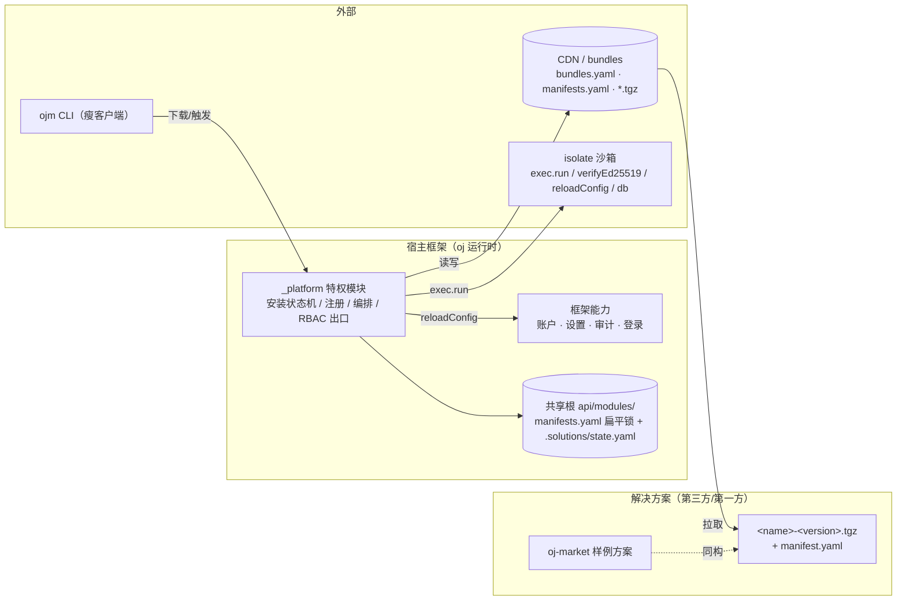
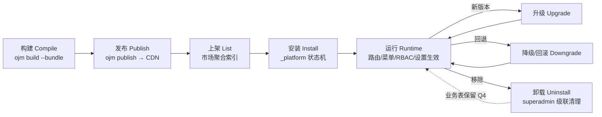
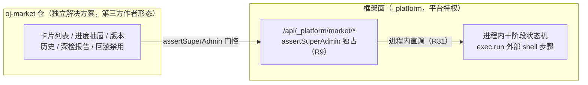
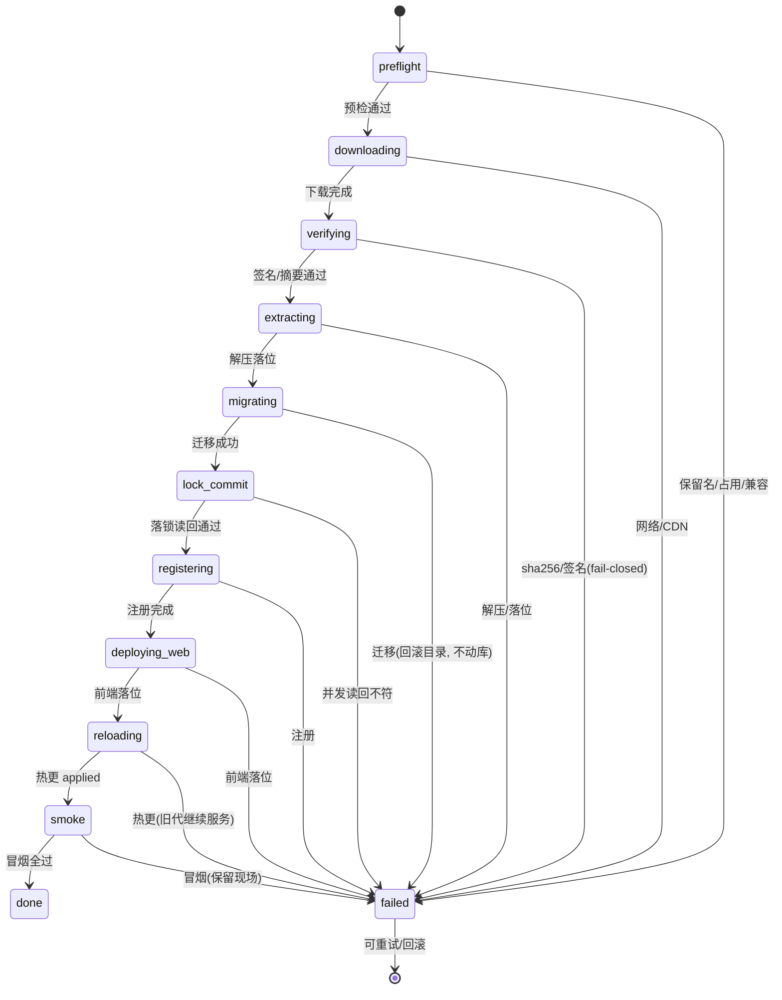
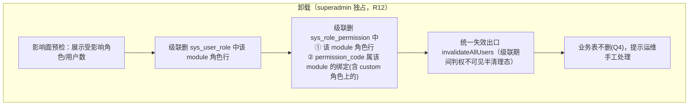

# 解决方案市场（Solution Marketplace）· 架构设计权威文档

> 读者：系统架构师 / 技术负责人。
> 范围：`oj-module`（本仓）`ojm` CLI + `oj` API 运行时的「解决方案（solution）」打包 / 发布 / 安装 / 运行 / 卸载能力。
> 本文档自包含——不读其他文档也能理解全貌。
> 权威真源层级（冲突以此为准）：**设计 v3（202610171138）> manifest 契约 v1.3（202610171254）> RBAC 设计（202610160908）> PRD（202610152345）> 早期 registration-design**。无法收口或需人工拍板者见 §15。
> 术语统一：解决方案=solution；清单=manifest.yaml；装载/挂载=mount；深检=deep-check；市场=marketplace；第一方=first-party（oj 原生能力，不可被解决方案复制）；TOFU=首次信任；isolate=oj 的 JS 沙箱运行时；bundles=CDN 上的发布清单；D1–D14 / R1–R31=设计决策与评审编号；P0–P4=实施阶段。

---

## 1. 定位与价值

### 1.1 解决什么问题

`oj` 是一个 Rust 后端运行时，原生只认「本地目录挂载的 release 模块」+ 一份 `manifests.yaml` 版本锁（`oj-module` 上游项目，只读）。本系统要做的事，是**把一套业务模块从「仓库内编译产物」升级为「可在 CDN 分发、被任意框架运行时在线安装、热加载、可回滚、可卸载」的独立解决方案包**。

核心价值：① **解耦发布与部署**——作者侧 `ojm build --bundle` 产出自包含 `.tgz`+`manifest.yaml` 分发到 CDN，运维侧 `ojm install` 或市场 UI 装进运行中的框架；② **框架即平台**——`ojm init` 脚手架升级为自带账户体系/设置中心/审计/可扩展登录/市场的应用框架；③ **第三方可扩展**——第三方以「独立仓 + ojm 工具链 + 依赖已发布 `@oj-module/*` 包」形态开发，经契约接入第一方能力而非复制。

### 1.2 与 oj / ojm 的关系

| 组件 | 角色 | 是否本仓 |
|---|---|---|
| `oj` | Rust 后端运行时，提供 isolate 沙箱、mount、`exec.run`、热更、迁移、验签原语 | 外部（只读） |
| `ojm` | Node CLI：脚手架 `init`、构建 `build`、**打包 `build --bundle`**、安装 `install`、卸载 `uninstall`、发布 `publish` | 本仓 `packages/cli` |
| 运行时 `_platform` | oj isolate 内的**特权框架模块**，承载安装状态机、注册写入、市场编排、RBAC 单一出口 | 本仓模板 |
| 市场（market） | 一个**第一方解决方案**，独立仓 `oj-market`，身兼「市场功能本体 + 样例方案」 | 独立仓 |
| `api/modules/` | **共享根**：框架内置 + 已装解决方案共居的目录，含扁平锁 `manifests.yaml` + sidecar `state.yaml` | 目标站点 |

关键事实：`oj` 的 mount 只能指向**本地目录**（无 URL mount，OJ-5 远期）。因此「远程装载」在运行时等价于「拉到共享根再挂载」——CDN 只是填充共享根的策略，运行时无差别（约束 A）。

### 1.3 在系统中的位置（组件上下文图）



---

## 2. 系统上下文与边界

### 2.1 边界与责任划分

| 边界方 | 能给 | 不能给 |
|---|---|---|
| 框架第一方 | 账户/登录/审计/RBAC hook、`exec.run`、共享根 FS、`reloadConfig`、热更 | 不应把签发 token、卸载、市场安全设置等暴露给解决方案 |
| 解决方案 | 声明式 manifest（路由分类/RBAC/设置/匿名路径/i18n/health）、业务 handler、迁移 | 自建登录端点、自管 RBAC 数据、跨模块污染命名空间、拿特权 fs |
| CDN | 静态分发 tgz + 索引 | 不可信通道（须签名 + fail-closed 验签） |
| oj 运行时 | mount、isolate 沙箱、迁移账本、热更 | URL mount（OJ-5 远期）、`migrate.run` 内建（OJ-6 未采纳） |

### 2.2 六条硬纪律（来自 oj-wiki 血泪注释，强制继承）

1. **判权单一出口**：service 不自己判权，统一 `assertSystemAdmin` / `assertPermission`。
2. **`is_forbidden` 闭环三处**：`auth/login`、`ldap-login`、SSO —— 签发 token 前必查，漏一处 = 禁号可登。
3. **唯一约束竞态兜底**：预查 + insert 之间必有竞态，捕获 `/unique|constraint/i` 后回查复用，不叠行。
4. **外来号占位 hash**：LDAP/SSO 建号写 `password_hash="!ldap"`，用户名带 `ldap:` 前缀，低信任来源不得接管本地号。
5. **审计不反噬业务**：`auditOp` 内部 try/catch 只 `log.warn`，挂在成功分支末尾。
6. **脱敏红线**：重置口令的 `detail` 只含目标 id，绝不含口令本体，单测钉死。

### 2.3 三条由可行性实测（E1–E8）推导的硬约束

- **约束 A｜单一共享根**：模块名在全部 api 挂载间必须全局唯一，且前端 `apiPrefix` 契约使另起前缀会拼错路由 → 所有后端模块统一挂 `/api`，路由恒为 `/api/<模块名>/...`。
- **约束 B｜先迁移、后热更**：热更路径强制 `migrate verify`-only；带迁移方案须先 `oj migrate` 落库再热更，否则装配失败（旧代继续服务，不炸）。
- **约束 C｜热更需要语义计数器**：热更触发源是 config 归一化 sha256（注释/空白变更不触发），故安装器写 config 须改真实段 —— `vars.ojm_solutions_gen` 自增。

---

## 3. 生命周期全景

六阶段（构建 → 发布 → 上架 → 安装 → 运行 → 卸载/迁移）端到端时序：



- **构建/发布/上架**属作者侧与分发侧；**安装/升级/降级/卸载**属运维侧，共用同一套安装状态机与 manifest 契约。
- **部署 ≠ 安装**（B4）：部署=作者分发到 CDN（`ojm publish`）；安装=运维装到运行中的框架。
- **卸载是唯一减法出口**：权限数据的减法（deprecated 标留、级联清理）只在卸载发生。

---

## 4. 解决方案包与 manifest 契约（自包含字段表）

### 4.1 分层与定位

- **bundle 级 `manifest.yaml`**（tgz 内）：分发与安装元信息，本文档定义。
- **oj 模块级 `manifest.yaml`**（`api/<name>-<version>/` 内）：oj 真实解析，仅 oj 原生七键（`name/desc/version/config/db/tables/deps`）。
- **红线**：bundle 字段不得混入模块级文件；模块级文件不得出现 `modules.json`（由安装器 upsert）。
- **演进方式**：append-only，新字段走 minor 增补；唯一明写例外 —— Form B `archive.signature.public_key` 在 P2 起必填（v1.3 裁定）。

### 4.2 身份区块

| 字段 | 类型 | 必填 | 校验要点 | 条款 |
|---|---|---|---|---|
| name | string | ✅ | `^[a-z][a-z0-9-]{0,63}$`；∉ 保留名（含 `market`，R9） | C2-01 |
| version | string | ✅ | `^[0-9A-Za-z.-]+$` 首尾非点、无 `..`、禁 `+`/`_`（oj 相容排除）；semver 优先比较 | C2-02 |
| title | string≤100 | ⬜ | 缺省=name | C2-03 |
| summary | string 1..200 | ✅ | 写模块级 `desc` | C2-04 |
| description | ≤2000 | ⬜ | 卡片正文 | C2-05 |
| icon/author/license/homepage/keywords | — | ⬜ | 见 C2-06/07 | C2-06/07 |
| **changelog** | string\|string[] | ✅ | R27 新增，市场版本对比展示 | C2-08 |

### 4.3 兼容区块（peer）

范围算子语法：`^(>=|<=|>|<|\^|=)?<version>`。P1 仅 `>=`/`^`/裸值强制；`<`/`<=` 构建期即拒。

| 字段 | 必填 | P1 执行点 | P2+ 执行点 | 条款 |
|---|---|---|---|---|
| peerRuntime | ⬜ | 安装预检强制（对宿主 versions.json） | 同 | C2-09 |
| peerOj | ⬜ | 仅语法 | 对 `oj --version` 强制 | C2-10 |
| peerFramework | ⬜ | 仅语法 | 对框架版本强制 | C2-10 |
| peerPlatform | ⬜ | 仅语法 | 对 `/api/_platform/market/meta` 的 `apiVersion` 握手（R23） | C2-11 |

### 4.4 prefix 区块（§5.8）

| 字段 | 必填 | 校验要点 | 条款 |
|---|---|---|---|
| api 段 | — | 纯前端方案可省 | C2-12 |
| api.module | ⬜ | 存在时必须 `=== name` | C2-12 |
| api.tables | ⬜ | 与 `schema.yaml` tables 逐一相等 | C2-12a |
| api.deps | ⬜ | 键匹配 name 正则或 `_platform`；值=范围算子 | C2-12b |
| **api.prefix** | ⬜ | 默认 `/api/<name>`；显式须 `^\/api\/[a-z][a-z0-9-]{0,63}$`，模块段 ∉ 保留名；占用检测 | C2-13 |
| web.route_prefix | ⬜ | 默认 `/<name>`；同上 | C2-14 |

### 4.5 匿名路径区块（api.anonymous，纵深防御）

| 字段 | 必填 | 校验要点 | 条款 |
|---|---|---|---|
| api.anonymous | ⬜ string[] | ① 挂载前缀相对语法；② **段内收敛**：首段必须 `=== <name>/`（`_system`/`_platform` 天然禁入，R8）；③ **登录端点禁令**：命中 `*/login`/`*-login`/`token`/`session`/`signin`/`signup`/`auth` 即拒装；④ 本 manifest 内唯一 | C2-26 |

> 登录端点拒装是**纵深防御**而非主防线（S1）：真正保证是 `_platform/auth` 的 `issueTokens` 不向解决方案暴露（R8/D3），名称匹配可被绕过。

### 4.6 RBAC 区块（§5.9）

| 字段 | 必填 | 校验要点 | 条款 |
|---|---|---|---|
| permissions[] | ⬜ | `code` 必填 `^<name>\.[a-z0-9_]+(\.[a-z0-9_]+)*$`（`framework.*`/`system.*`/`market.*` 等不可达）；`title_key` 必填；本 manifest 内唯一 | C2-15 |
| roles[] | ⬜ | `name` 必填 `^<name>\.[a-z0-9-]{1,64}$`；`title_key` 必填；`permissions[]` 须 ∈ permissions[].code（悬空引用双端拒绝）；本 manifest 内唯一 | C2-16 |

升级稳定性（非校验项）：注册 upsert 只加法 + 元数据覆盖，声明消失标 `deprecated`（P1-8 语义）。

### 4.7 路由分类区块（D4 三值）

| 字段 | 必填 | 校验要点 | 条款 |
|---|---|---|---|
| routes[] | ⬜ | `category` ∈ **`main \| admin \| hidden`**（PRD 五值 settings/personal 已废弃，B-3）；`path` 必填 `^\/[a-z][a-z0-9\-_]*(\/[a-z0-9\-_]+)*$`；`order` 必填 int（建议 ≥200，框架项保留 <200 间隔带）；`title_key`：main/admin 必填、hidden 可省；`required_permission` 可选，仅供深检比对，前端不做权限级菜单过滤（R22） | C2-17~21 |

### 4.8 设置分组区块（R20/R24）

| 字段 | 必填 | 校验要点 | 条款 |
|---|---|---|---|
| settings.groups[] | ⬜ | `group` 必填 `^[a-z][a-z0-9-]{0,63}$` 且唯一；`label_key` 必填 `^<name>:settings\.group\.[…]$` | C2-22 |
| items[].key | ✅ | `^<name>\.[a-z0-9_-]+(\.[a-z0-9_-]+)+$` 且 **`moduleOf(key)===name`**（R24 键所有权 fail-fast） | C2-23 |
| items[].type | ✅ | 枚举 `string\|bool\|int\|float\|enum\|text`（值恒以字符串存 `sys_setting.value`） | C2-24 |
| items[].default/options/secret/label_key | ⬜ | enum 必填 options；secret 掩码 `***` | C2-24 |

### 4.9 i18n key 契约（D4）

| key 模式 | 用途 | 条款 |
|---|---|---|
| `<name>:menu.*` | 页面标题 / 菜单 | C2-25 |
| `<name>:settings.group.*` | 设置分组标题 | C2-25 |
| `<name>:perm.*` / `:role.*` / `:settings.*` | 权限/角色/设置项 label | C2-25 |

`locales/zh-CN.json` 与 `en-US.json` 必须携带 manifest 引用的全部 key（双语齐备），缺失即构建 fail-fast。

### 4.10 web 产物与签名区块（§2.9 / §2.11）

| 字段 | 必填 | 校验要点 | 条款 |
|---|---|---|---|
| web.entry | web 段存在时 ✅ | `^modules\/<name>\/<version>\/[a-z0-9\-._\/]+\.js$`（版本段===version，POSIX 分隔符 R30） | C2-27 |
| web.css[] | ⬜ | 同 entry 语法 `.css$` | C2-27 |
| web.integrity | ⬜ | `^sha384-[A-Za-z0-9+/]{64}$`；构建器计算，安装器重算比对（R10） | C2-28 |
| archive.file | Form B ✅ | `^<name>-<version>\.tgz$` | C2-29 |
| archive.sha256 | Form B ✅ | `^[a-f0-9]{64}$` | C2-29 |
| archive.size | Form B ✅ | 正整数 | C2-29 |
| archive.signature | P2 起 Form B ✅ | `{alg:"Ed25519", key_id, public_key:hex64, value:base64}`；**public_key v1.3 起必填** | C2-29/34/35 |

**archive 两形态**：Form A（tgz 内 manifest，禁带 sha256/signature 自引用）；Form B（CDN 聚合真源，全字段）；detached 侧车 `<name>-<version>.tgz.sig`（v1.3 补裁，file 源与 CDN 源同一信任模型）。

### 4.11 health 区块（D14/Q-A）

| 字段 | 必填 | 校验要点 |
|---|---|---|
| health | ⬜ | 值匹配 C2-17 path 语法且 ∈ routes[]；**不强制**——缺省冒烟打首个非匿名路由兜底 |

### 4.12 签名与信任（P2，§2.11）

- 规范串（逐字）：`<name>@<version>:<sha256>`（`canon` 恒 `"v1"`）。
- detached `.sig` 字段：`alg`(恒 Ed25519) / `key_id`(`<publisher>.<id>` 全小写) / `public_key`(hex64 必填) / `value`(标准 base64) / `canon`。
- 编码约束：`value` 仅标准 base64，`public_key` 仅 32 字节 raw hex；格式错抛错→`sig_format`，验签 false→`tampered`。
- **TOFU 三态**（C2-38）：`trusted`(在信任库且公钥一致) / `unknown`(不在库→任务停 `needs_trust` 第五终态+展示指纹) / `rejected`(确认被拒/公钥不一致)。
- **吊销**（C2-39）：从信任库移除 `key_id`，只阻断新装/升级，不动已装方案。
- **切换前复验**（C2-40）：升级/回滚/降级=完整验签；enable（同版本恢复）放行+显著告警+审计+深检标 `untrusted`。

### 4.13 市场索引扩展与深检报告（C2-41/42）

`GET /api/_platform/market/index` 的 IndexRow 增补：`available[]`（可下载版本）、`changelog`（透传）、`trust_state`(`trusted`/`untrusted`/`absent`)、`publisher`（= `key_id` 的 `<publisher>` 段）；`operator` 不挂 IndexRow（回落 `market_history`）。

深检 `POST /api/_platform/solutions/verify?name=`（admin 域）返回 `VerifyReport={ok, checks[], advise[]}`；item 结构：`id`(routes/rbac/settings/ledger/i18n/trust) / `severity`(error/warn/info) / `subject`(差异主体，永不含设置值) / `advise_key`(双语可行动 key)。报告落 `.solutions/verify-reports/` 时间序保留 N=10。

---

## 5. 构建与打包

`ojm build --bundle`（`--bundle` 默认关，保持现状全站产出）：

1. 读 `web.config.ts` 定位目标模块（多模块需 `--module`）。
2. 后端：`oj build -d api/src/<mod> -o <tmp>/api --no-minify`（minify 已知压坏产物）。
3. 前端：复用单模块构建，保留 `sha384` integrity。
4. 组装 `manifest.yaml`。
5. 打**确定性 tgz**（固定 mtime=0、成员字典序、权限 0644/0755、无 owner——同输入两次字节一致，P1-11 验收）。
6. 输出 sha256 并打印。

**integrity（sha384）计算与回填**：构建器对 entry 产物计算 `sha384-<base64>` 写入 `web.integrity`（C2-28）。

**签名（Ed25519）**：P2 起 `ojm sign` 写 detached 侧车 `<name>-<version>.tgz.sig`，规范串 `<name>@<version>:<sha256>`，私钥离线保存不出仓。

**tgz 内布局**（C2-30/31/32）：单根 `<name>-<version>/` → 含 `manifest.yaml` + `api/<name>-<version>/`(oj 模块，七键) + `web/modules/<name>/<version>/`。tgz 不含 `modules.json`。

---

## 6. 发布与上架

### 6.1 bundles.yaml 与 CDN

框架设置 `framework.market_cdn_url`（默认空=市场不可用）。CDN 目录布局（静态文件服务即可，无后端）：

```
{cdn}/
├── bundles.yaml       # 索引：每个方案最高版本 + 版本条目
├── manifests.yaml     # 聚合数组：所有 (name,version) 的 manifest
├── <name>-<version>.tgz
└── <name>-<version>.tgz.sig   # detached 侧车（P2）
```

`bundles.yaml` 负责版本/文件/校验；`manifests.yaml` 聚合数组供卡片渲染只读。同名只展示最高版本。

### 6.2 缓存头契约（D7/R15）

`bundles.yaml`/`manifests.yaml` 必须 `Cache-Control: no-cache`（防缓存层钉死旧索引装到旧版本）；tgz 内容寻址可长缓存。

### 6.3 市场即「样例方案」的架构切分（D2/D5/D6）

- **编排留框架面**：安装编排 / 任务模型 / 索引聚合 / 深检后端归 `_platform`（`/api/_platform/market/*`，需平台特权：`exec.run`、共享根 FS、`reloadConfig`）。
- **市场展示页为解决方案**：独立仓 `oj-market`，身兼市场功能本体 + 第一方样例（契约面完整示范）。
- 编排端点 **`assertSuperAdmin` 独占**（R9：admin 超集链恒通过一切权限码，权限码门控不成立）；`market` 恢复保留名（撤销 v1 移出决定，防第三方抢注 `market.*`）。
- 引导顺序：安装器常驻 `_platform`（装完框架即具备安装能力）；`ojm install` 为瘦客户端；P2 先 CLI 装 market 本身，此后一切安装/升级走市场 UI；market 未安装时框架管理区提供**占位引导卡**（说明需运维执行 `ojm install`）。管理员可见市场入口与卡片，**操作**（安装/回滚/禁用/卸载触发）需 superadmin。



---

## 7. 安装流程

### 7.1 安装时序

```mermaid
sequenceDiagram
    participant U as 管理员
    participant M as _platform/market（编排端点）
    participant N as _platform 进程内状态机
    participant CDN as CDN
    participant FS as 共享根 / 站点
    participant OJ as oj 运行时
    participant DB as 数据库

    U->>M: POST /market/install {name, version}
    M->>N: 触发编排（superadmin 独占）
    N->>CDN: GET bundles.yaml + &lt;file&gt;.tgz
    N->>N: 预检（保留名/占用/兼容/白名单/键所有权）
    N->>N: sha256 比对 + Ed25519 验签(fail-closed)
    N->>FS: list→validate→extract 三步解压 .staging → 原子 rename
    N->>DB: oj migrate -d &lt;共享根&gt;（★先于热更，约束 B）
    N->>DB: 注册 sys_setting/sys_role/sys_permission/sys_role_permission/sys_solution_route
    N->>FS: modules.json upsert + web 产物落位
    N->>OJ: 改 config.yaml(anonymous_paths 并入 + vars.ojm_solutions_gen++)
    N->>OJ: POST {base}/_system/config（空 body 触发热更）
    OJ-->>N: applied 含 mounts/vars，无 restart_pending
    N->>N: 安装期冒烟(health/integrity/注册一致性)
    N->>DB: auditOp(solution.install, name, ...)
    N-->>U: 任务完成 + 提示刷新页面
```

> **v3 换轨（R31）**：执行器即 `_platform` 特权模块（isolate 内，`db` 全局可用），重活经 `exec.run` 外部 shell 步骤（tar 解压、`oj migrate`、`config` 文本编辑）。CLI 与市场页均为**瘦触发端**（触发 + 进度透传，零安装逻辑），废弃 Node 安装进程与 loopback 注册端点。

### 7.2 注册清单与落点

| # | 注册项 | 落点 | 时机 |
|---|---|---|---|
| 1 | 后端模块 | 共享根 `manifests.yaml`(`<module>:<version>`) + 物理目录 | 迁移后落锁 |
| 2 | 路由分类 | `sys_solution_route`(category/path/order/title_key/enabled) | 注册 |
| 3 | 业务设置 | `sys_setting`(`module=<name>`, group, items) | 注册 |
| 4 | RBAC | `sys_role`/`sys_permission`(`module=<name>`) + 初始 `sys_role_permission` | 注册 |
| 5 | 前端入口 | 站点 `modules.json`(name/entry/integrity/css/chunks/enabled) | 前端落位 |
| 6 | 前端路由 | `entry.js` `defineModule.routes`（运行时事实源） | 宿主 getRoutes() |
| 7 | 前端 i18n | `entry.js` `defineModule.i18n` → 命名空间 `<name>` | 宿主加载 entry |
| 8 | 匿名路径 | `config.yaml anonymous_paths` | 配置 |
| 9 | 兼容性 | peerRuntime/peerOj/peerFramework/peerPlatform | 预检门禁 |

### 7.3 幂等性与关键顺序

- **注册写入唯一通道（D10）**：经 `solution-perms.ts` 进程内直接调用，auditOp 原生落库；`_platform` 同时是 OJ-7 表级写守卫的结构性豁免面。
- **迁移成功后才落锁**（R2/D11）：推翻 lifecycle 基线「先落锁后迁移」，避免迁移失败/崩溃窗口锁指向账本落后版本触发 M004 拒启。状态机入口加「锁↔迁移账本对账自愈」。
- **失败语义三分（D11）**：① 锁写入前失败（preflight→extracting）= 清场重跑，DB 零副作用；② 锁写入后失败（registering→smoke）= 已生效/部分生效，报「待修复」+ 禁用/回滚指引，重试须显式重跑注册；③ 降级/回滚/启用前 = 必须复验目标版本 manifest sha256（P2 起含验签），失败拒切（R11）。
- **同版本重装 = no-op**：锁已含该 `<module>:<version>` 即跳过迁移/注册。

### 7.4 十阶段安装状态机（可表）

| 阶段 | 步骤条标签 | 关键动作 | 失败处理（D11） |
|---|---|---|---|
| preflight | 预检 | 保留名/占用/兼容/白名单/键所有权 | 拒绝，零副作用 |
| downloading | 下载 | GET bundles.yaml + tgz | 终止，不落盘 |
| verifying | 校验 | sha256 + Ed25519 验签 | fail-closed，不落盘 |
| extracting | 解压 | list→validate→extract 三步 + 原子 rename | 删 staging，不改锁 |
| migrating | 迁移 | `oj migrate`（先于热更） | 回滚版本目录，不动库，锁保持旧版 |
| lock_commit | 生效切换 | **迁移后**落锁 + 读回校验 | 并发重试（R2） |
| registering | 注册 | RBAC/设置/路由 经 D10 直调 | 保留现场，重试须显式重跑 |
| deploying_web | 前端落位 | modules.json tmp+rename upsert + web 产物 | 保留现场 |
| reloading | 热更 | config 文本改写 + `reloadConfig()` + 终态断言 | 旧代继续服务，可重试 |
| smoke | 冒烟 | health/integrity/注册一致性 | 保留现场，不静默成功 |
| done | 完成 | auditOp + 提示刷新 | — |

> 状态文件原子性（D13/R19）：`modules.json`/`manifests.yaml`/`state.yaml`/任务文件全部同目录 tmp+rename 原子替换（`.lock` 只互斥写者）。

### 7.5 前端注册握手（i18n / 路由分类 / hidden）

宿主 shell 启动 → fetch `modules.json` → 动态 import `entry.js` → `defineModule.routes` 注入路由树 → 按 `sys_solution_route.category` 归并菜单（main→常规 / admin→管理 / hidden→不入菜单，复用 `hideInMenu`）；`defineModule.i18n` 并入宿主命名空间 `<name>` 解析 `title_key`/`label_key`。

- **归并 store 独立化**（R21）：token 就绪后强制重归并一次（首登会话防永久降级）；端点不下发 `required_permission`，前端不做权限级菜单过滤（后端 403 硬执行，R22）。
- **系统设置页三层嵌套**（D4/R20）：框架设置组在前；各方案「解决方案设置」区段内按 module 名排序，每组 Card 标题=`label_key`。保存语义=脏组增量提交（非全量串行）。

### 7.6 安装页 Web UI 状态机（取 registration-design §10）



前端：antd `Steps` 步骤条（10 阶段状态）+ 进度条 + 详情日志；每 ~800ms 轮询 `GET /market/task/:id`；`retryable` 时显示重试按钮（同版本幂等，重试前先清理 staging/版本目录/恢复原锁）。

---

## 8. 验证双轨

### 8.1 安装期冒烟（P1，状态机 smoke 阶段）

| 项 | 实现 | 备注 |
|---|---|---|
| 后端可达 | 优先 `manifest.health`；缺省打首个非匿名路由断言 200 | health 不强制（D14/Q-A） |
| integrity | `modules.json` 条目 `integrity` == 安装器对验签后内容计算的 sha384 | R10 |
| entry 浏览器加载 | 不在安装器验（Node import 必假绿） | error boundary 兜底 + 深检可见 |
| 注册一致性 | `sys_solution_route`/`sys_setting`/`sys_role`/`sys_permission` 声明行存在性（升级允许 deprecated） | 用「包含」非「相等」 |

任一失败按 D11 失败语义三分处置，不标记成功。

### 8.2 按需深检（P2，市场页触发）

`POST /api/_platform/solutions/:name/verify`（admin 域），后端四项：路由可达性 / RBAC 完整性 / 设置项完整性 / 迁移账本一致性（对齐 `oj migrate verify`）；i18n 覆盖由前端执行（浏览器 i18next 直查 key）。报告聚合通过/异常项 + 修复建议。

### 8.3 安全钉（SSRF/无出站）

深检**全程不触 exec**；迁移账本走 `db.query _oj_migrations` + `journalHeadOf`（R9 纪律）。web entry integrity 比对在解压/部署段完成。**无出站 fetch**：安装器拉取仅来自已声明 CDN 源，manifest 解析为本地静态文件，无运行时第三方网络请求（SSRF 三钉之一）。

---

## 9. 部署与 DB 迁移语义

### 9.1 migrate 账本与拒绝启动

- 迁移产物：`schema.yaml`(安全前向收敛) + `migrations/<seq:04>__<desc>[.sqlite|.mysql|.postgres].sql` + `seed.sql`(幂等，不归迁移)。
- **顺序铁律（约束 B）**：迁移（步骤 5）必须早于注册（6）与热更（9）。热更路径强制 `migrate verify`-only，账本落后会拒启（M003/M004）。
- **失败与对账**：迁移失败=回滚版本目录 + 不动库 + 锁保持旧版（D11）；状态机入口「锁↔迁移账本对账自愈」，不一致自动回指旧版并隔离新目录。

### 9.2 拒绝启动与对账

| 现象 | 触发 | 处置 |
|---|---|---|
| M003 | 账本超前产物（降级后账本未回退） | exit 1，文案含下一步指引 |
| M004 | 账本落后（先落锁后迁移、崩溃窗口） | exit 1，全站不可用 → 故 D11 改「迁移成功后才落锁」 |

### 9.3 down 迁移限制（前向 only）

oj 迁移只前向、无 down（OJ-9 未采纳）。**降级/回滚 = 锁指回旧版本目录**，但旧版若依赖已被新迁移删除/改名的列 → 运行期崩。故：

- manifest 可声明 `downgrade.min_version`；
- 未声明时，对「目标版本 migrations 与当前存在差异」**强告警 + 二次确认**；
- **禁止静默降级**（R12 红线）。

### 9.4 迁移前置备份（R14）

- sqlite：`db.sqlite.bak-<ts>` copy（含清理策略）。
- mysql/pg：市场 UI 勾选门禁 + 审计（不自动备份）。
---

## 10. 卸载

卸载是唯一减法出口，superadmin 独占（D6/D11，前端按角色显隐按钮）：



- **双维度级联单事务**（R12，承接 rbac-isolation §8.3/8.4）：漏维度②会让 custom 角色残留绑定在**重装解决方案时静默复活旧授权**（工程 E4）。
- **业务表保留 Q4**：卸载只摘路由/前端/RBAC 绑定，业务数据不可逆风险交运维。
- 影响面预检展示受影响角色/用户数后二次确认（R12）。


## 11. RBAC 集成

### 11.1 职权模型

- **框架统一管理 RBAC 数据 + 提供 hook；业务逻辑由解决方案自管**（D1）。框架代码不随解决方案数量增长。
- 账号：框架全局唯一（`users` 表）；解决方案零账号表、零建号权。
- 登录：`_platform/auth` 唯一签发链，`issueTokens` 仅内部调用（D3，不向解决方案暴露）。
- 角色：两级命名空间——框架角色裸名（`superadmin`/`admin`/`editor`/`viewer`），解决方案角色强制 `<name>.` 前缀。
- 解决方案：纯消费方，handler 内 `await assertPermission(...)`。

### 11.2 角色层级与判权链

| 层级 | 角色 | 职权 |
|---|---|---|
| 平台 | `superadmin` | 一切 + admin/superadmin 成员资格、卸载、市场安全设置、审计导出 |
| 系统 | `admin` | 日常账号管理、安装/禁用解决方案、框架非安全设置 |
| 页面 | `editor`/`viewer` | 体验层门角色（非安全层） |
| 模块 | `<name>.admin` 等 | manifest 声明的模块内权限点 |

**判权四命中**（D10，DB 权威源 + 进程内短 TTL 缓存写时失效，「撤销即强退」）：

```
assertPermission(code):
  ① superadmin  ② admin  ③ <name>.admin（code 首段推导，零配置）  ④ sys_role_permission 精确命中
assertSuperAdmin(): 只认 superadmin（DB 实时查），专属操作不建模为权限点（D11）
```

### 11.3 升级稳定性（减法唯一出口 = 卸载）

| 变动 | 安装器行为 | 判决影响 |
|---|---|---|
| 新增 permission/role | upsert 插入 | 无影响 |
| 修改 title/desc | 覆盖 | 无影响 |
| 声明消失 | 标 `deprecated` 保留；判权链**不过滤** deprecated（持有者继续通过），管理 UI **过滤**（R5 双向过滤方向相反必须显式钉死） | 不突变 |
| 重命名 code | 旧 deprecated + 新插入，强告警需重分配 | 不静默变 |

**紧急吊销出口**（安全评审修复）：superadmin 可手动摘除 deprecated 权限点绑定（只减不增），作为单个权限点出问题时应急通道，即时生效 + 审计。

### 11.4 框架 hook 清单（节选，与解决方案相关）

| Hook | 形态 | 用途 |
|---|---|---|
| `assertPermission(code)` | 共享 service 直调 | handler 级判权唯一出口 |
| `assertSystemAdmin()` / `assertSuperAdmin()` | 同上 | 管理类 / 安全敏感项 |
| `issueTokens(userId)` | 仅登录链内部 | token 签发（不暴露） |
| `auditOp(action,target,detail)` | fire-and-forget | 审计 |
| `getSetting(key)` / `searchContacts(keyword)` | 共享 service | 设置读 / 通讯录 |
| 路由/菜单/设置/RBAC 声明 | manifest → 安装期 upsert | 注册 |

**写操作仅五合法入口**：用户管理页 / 角色管理页 / 安装器（manifest 声明）/ handler 内经判权后的业务写 / 本人改密资料。禁止运行期注册权限点（Q10，manifest-only 是审计与稳定性地基）。

### 11.5 与解决方案关系

- 安装器对 `sys_role`/`sys_permission` 的 upsert **只加法 + 元数据覆盖**，声明消失标 `deprecated` 保留。
- 判权推导锚定 `manifest.name`（不锚定 `api.prefix`）。
- 声明权 = 命名空间所有权：安装器只能 upsert `module=<name>` 的行，物理碰不到其他方案行（`solution-perms.ts` 两个唯一出口 `upsertSolutionPerms`/`uninstallSolution`）。


## 12. 安全模型

| 防线 | 设计要点 |
|---|---|
| **私钥不出仓** | Ed25519 私钥离线保存；签名走 detached 侧车随包分发；托管信任库只存公钥 |
| **exec 白名单** | `exec.run` 无 shell、argv 模板白名单（literal 逐字 + `${path:}` jail + `${raw:}` 拒 option 注入），缺省全 deny；仅 `_platform` 特权模块可发起 |
| **isolate 禁 console.\*** | 解决方案在 isolate 内运行，禁止 `console.*` 等宿主逃逸面；模块级可变状态不跨请求（oj 每请求重建 handler 实例） |
| **SSRF 三钉** | ① 安装器只从已声明 CDN 源拉取；② 无运行时第三方出站 fetch；③ manifest 为本地静态解析，深检不触 exec |
| **TOFU 双轨** | 首次未知 `key_id` 弹出公钥指纹人工核对确认（C2-38），不做静默信任第一个来源；或 bootstrap 公钥随宿主分发免 TOFU |
| **验签 fail-closed** | 任何验签失败 = 零解压零落盘；六码（sig_missing/sig_alg/sig_key/tampered/unknown_key/sig_format）retryable 恒 false；无逃生门开关 |


## 13. 关键技术约束

| 约束 | 说明 | 来源 |
|---|---|---|
| **isolate 单请求模型** | oj 每请求重建 handler 模块实例，模块级 `let/Map/Set` 不跨请求存活；需跨请求状态必须落库或走 oj 持久面 | RBAC 设计 §9.3 |
| **无原生后台 worker** | isolate 无后台任务；长任务形态 = 分段执行 + 状态文件续跑（oj tasks 轴实测不可用，R31/S1-7）；长段用 route_timeouts 提额 + exec timeoutMs≤600s | lifecycle §2/S1-7 |
| **FS marker 文件取消机制** | 用 `.lock` / marker 文件表示进行中任务；锁只互斥写者，防读者见半截 JSON（原子 tmp+rename）；并发安全需读回校验+重试收敛（save_lock 读-改-写无互斥，S1-3） | D13/R17/S1-3 |
| **Windows 限制（R30）** | entry 路径反斜杠断加载 → POSIX 序列化；EPERM 删除语义未定义 → 可读报错；`tar` 依赖宿主 PATH，Windows 维持已知限制（OJ-8 终裁未采纳，按 `cmd /c` 模板口径） | R30/OJ-8 |
| **确定性 tgz** | 固定 mtime/字典序/权限/无 owner，同输入字节一致 | C2-32 |
| **zip-slip 防护** | list→validate→extract 三步：归一化落位必须落在 staging 内、拒绝对路径/`..`/symlink/hardlink，再解压 + realpath 断言 | R1/C2-30 |
| **semver 比较器唯一实现** | 纯函数含 prerelease 规则（C-1~C-10），GC「最近 N」= state.yaml 安装时间序非 semver 序 | R25 |
| **oj 原生 manifest 七键** | bundle 字段不得混入模块级；模块级若出未知键 oj 今日静默忽略，故不得借「oj 不报错」混写 | §3 OJ-X |


## 14. 上下游依赖（oj-bin OJ-1~9 终裁状态汇总）

以设计 v3（202610171138 §6.2）与 oj-bin PR（202610161500）为准；状态矛盾项见 §15。

| 编号 | 能力 | 期 | 终裁状态 | 原因 / 消费方处置 |
|---|---|---|---|---|
| OJ-1 | 归档解压 | — | ✅ **已落地（v0.1.75）** | `exec.run` + 系统 tar + 三步范式；非内建 `fs.untar` |
| OJ-2 | 配置自热更进程内触发 | — | ✅ **已落地** | `server.reloadConfig()`，限 `platform.modules` |
| OJ-3 | YAML 只读解析 | — | ✅ **已落地** | `yaml.parse`（异步须 await）；`yaml.stringify` 禁用于 config 回写 |
| OJ-4 | 非对称验签 | — | ✅ **已落地** | `crypto.verifyEd25519`，双层语义 |
| OJ-5 | 远程 URL mount | — | ❌ **未变（远期）** | mount 只认本地目录；远端装载=拉到共享根再挂 |
| **OJ-6** | `migrate.run` 内化 | 可选 | ❌ **终裁未采纳（2026-10-17）** | exec 子进程即设计意图（与请求运行时解耦/防大表迁移占 JsRuntime/防 KillSwitch 误杀/失败隔离）；`exec.run ["oj","migrate",...]` 转**永久主路径** |
| **OJ-7** | 表级写守卫（方案间写隔离） | — | ❌ **未落地** | 独立需求文档持续跟踪；`_platform`（D10）是其结构性豁免面，非本期阻塞 |
| **OJ-8** | Windows 缺 tar 报错契约 | P1 | ❌ **终裁未采纳（2026-10-17）** | Windows 支持走显式模板 `cmd /c`；不引入 Git Bash 探测，保白名单安全边界；Windows 维持 R30 已知限制 |
| **OJ-9** | down 迁移支持 | P3 | ❌ **终裁未采纳（2026-10-17）——前向 only 定版** | 幂等前向 + 已应用去重是设计意图；回退=作者手写补偿迁移 + `oj migrate --format json` 读账本人工决策；R12 校验兜底即终态 |

> 附注：`crypto.sha384` 原语 oj isolate 仍缺（PR-9，待提），P1 以纯 JS 过渡实现（`sha384.ts`，FIPS 180-4 向量全过），上游落地后即替换。


## 15. 已知限制与待确认（需人工拍板的矛盾）

本节列**无法在本文收口、或需人工拍板**的矛盾与开放点，注明冲突来源，未静默篡改。

1. **OJ-8 状态自相矛盾（需拍板）**：`202610161500-oj-bin-feature-requests-pr.md` 中 PR-7 正文顶部写「**终裁（2026-10-17）：未采纳**」，但同文件顶部状态汇总表与 PR-7 内部「状态」行又写「**P0 已决议提交**」。设计 v3 §6.2 采用「终裁未采纳」。建议：以设计 v3 终裁未采纳为准，但需上游提交稿实际是否落档确认。

2. **OJ-6 状态自相矛盾（需拍板）**：同上文件，顶部汇总表写 OJ-6「**P0 已决议提交**」，但 PR-4 正文写「**终裁（2026-10-17）：未采纳**」，设计 v3 §6.2 亦采「终裁未采纳，exec 即永久主路径」。建议：确认 PR-4 的 submit 稿是否真的提交；若已提交则「未采纳」表述与实际不符，需回写。

3. **版本白名单 `+` 字符冲突（已裁决，记录备查）**：PRD §5.2 / R7 原 `^[0-9A-Za-z.+-]+$` 含 `+`（semver build metadata），但 oj `validate_version` 字符集无 `+` 且会拒装。契约 v1.3 C2-02 已叠加 oj 相容排除（禁 `+`/`_`、无 `..`、首尾非点）。本文以契约 v1.3 为准。

4. **路由 category 值冲突（已裁决）**：PRD §5.2 原五值（main/admin/settings/personal/hidden），契约 v1.3 收敛为三值（main/admin/hidden，settings/personal 废弃）。RBAC 设计 §4A 角色管理页的 contacts 等仍沿用「系统设置页追加分组」语义归位。本文以契约三值为准。

5. **P3 是否已合并的口径差异（需确认）**：设计 v3 §7 将 P3（减法与分发=M7）列为独立待实施期；而本仓工程记忆显示 P3 任务已全量合并。本文按设计 v3 权威口径描述 P3 为「卸载/卸载级联/GC 内建」待落地阶段；若实际已合并，需在生命周期章节补注「P3 已交付」。

7. **信任库公钥存放（Q8 / R13 鸡生蛋）**：生产建议写 `config.yaml`（防 DB 被篡改注入信任），但可用性上 `sys_setting` 更好配。契约 v1.3 未强制唯一位置；CLI 侧 TOFU 交互确认 vs bootstrap 公钥随宿主分发免 TOFU，C4 随 OJ 提交定夺，仍处于开放态。

8. **`remote-web` 装载策略（Q7/R10）**：默认 `download`，`remote-web` 仅可选（动态 import 无 SRI、CDN 不可达即整体不可用）。是否值得做列入待确认，依赖 OJ-5 远期。

9. **`crypto.sha384` 上游缺口（PR-9）**：isolate 无原生 sha384，P1 纯 JS 过渡实现性能可接受但非终态，待上游补原语后替换（见 §14 附注），不影响契约语义。
