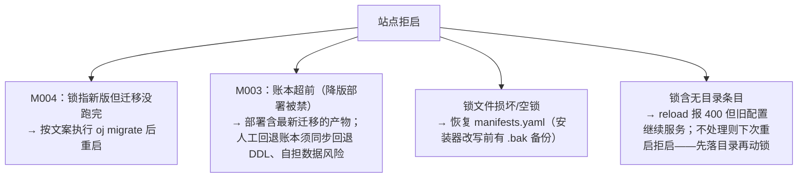

# 解决方案市场 / Solution Marketplace · 运维手册（OPERATIONS）

> 读者：**运维工程师**。本文讲清「这套系统怎么部署、排障、迁移、回滚、保安全」。
> 定位：runbook 导向，自包含——照本文可完成部署、日常运维、故障恢复、DB 迁移、安全加固与卸载影响面评估。
> 权威真源：本手册以以下真源为准（冲突时优先级从前到后）：
> 1. `202610161255-oj-wiki-rbac-migration-guide.md`（RBAC/账号/通讯录迁移 runbook，主真源）
> 2. `202610171354-lifecycle-guide.md` §2（运维视角、引导链、失败语义三分、故障恢复、Windows 限制 R30、安全基线）
> 3. `202610171254-lifecycle-manifest-contract.md` 附录 A（十阶段失败码全表、双端执行矩阵）
> 4. `202610171245-lifecycle-p0-spike-findings.md`（架构前提实测证据）
> 5. `202610180030-lifecycle-p1-handover.md`（环境速查、工程纪律、高频坑）
> 6. `202610171138-solution-lifecycle-implementation-design.md`（设计 v3，引用溯源）
> 事实随各期验收推进，落地状态见 §12「已知限制与待确认」。

---

## 0. 术语表（全文统一）

| 术语 | 含义 |
|---|---|
| 解决方案 / solution | 第三方作者按 C2 契约打的 tgz 包，在宿主站点内安装运行的「方案」 |
| 清单 / manifest.yaml | 构建器与安装器的共同上游契约文件（bundle 级 + oj 模块级，二者分离） |
| 装载 / 挂载 / mount | oj 将 api/web 目录以某 URL 前缀对外暴露（共享根 `api/modules/`） |
| 深检 / deep-check | `POST /api/_platform/solutions/verify?name=` 对已装方案的深度校验，出报告 |
| 市场 / marketplace | 分发与安装 UI；第一方样例方案 `oj-market`（独立仓） |
| 第一方 / first-party | 框架特权面（`_platform` 编排端点、market 自身） |
| isolate | oj 的 JS 沙箱运行时，解决方案与 `_platform` 均跑在其中 |
| bundles | CDN 发布清单（`bundles.yaml` / `manifests.yaml` 聚合 + tgz） |
| 迁移账本 / migration ledger | 每模块 `_oj_migrations` 表，记录已应用迁移的 seq（按文件名记账） |
| TOFU | 首次信任（Trust On First Use）——首次见到发布方公钥须人工确认指纹 |
| R30 | Windows 外部命令报错契约限制（tgz 解压依赖宿主 PATH 的 tar） |
| OJ-8 | Windows 缺 tar/外部命令报错契约（Git Bash 自动探测）需求——**终裁不采纳** |

---

## 1. 系统总览与组件关系（运维视角）

```mermaid
flowchart TD
    OP[运维/管理员] -->|CLI 瘦客户端 / 市场 UI| MK[market 方案 UI<br/>卡片·进度抽屉·回滚·深检]
    MK -->|assertSuperAdmin 门控| API["_platform 编排端点<br/>/api/_platform/market/*"]
    API -->|进程内直调| SM["十阶段安装状态机<br/>_platform 特权模块(isolate 内)"]
    SM -->|exec.run 外部 shell| EXEC["tar 解压 · oj migrate ·<br/>config 文本改写"]
    SM -->|reloadConfig| OJ[oj 宿主 serve]
    OJ -->|共享根 mount| ROOT["api/modules/<name>-<version>/<br/>manifests.yaml 扁平锁 · .solutions/state.yaml"]
    OJ --> DB[(DB: sqlite/mysql/pg<br/>迁移账本 _oj_migrations)]
    SM -->|下载 tgz| CDN["CDN / oj 静态 web: mount<br/>bundles.yaml·manifests.yaml·*.tgz"]
    MK -.->|深检(admin 域)| VER["POST /api/_platform/solutions/verify<br/>不进 superadmin 编排面"]
```

**组件职责速查**

| 组件 | 运维关心的点 |
|---|---|
| oj 宿主 | `oj serve` 起服务；按 `manifests.yaml` 扁平锁逐条装配模块；空锁/坏锁直接拒启（exit 1）；`oj migrate` 跑迁移账本 |
| api 运行时 / isolate | 解决方案与 `_platform` 都跑在沙箱里；`exec.run`/`fs`/`reloadConfig`/`verifyEd25519` 等特权面仅 `_platform`（请求作用域有模块归属）可用 |
| `_platform` 特权模块 | 安装状态机的**唯一执行器**（v3 换轨，无 Node 安装进程）；常驻分发，装完框架即具备安装能力 |
| market 方案 | 市场 UI（卡片/安装进度/版本历史/回滚/深检报告）；第一方样例，经 CLI 引导安装 |
| DB | 业务数据 + 迁移账本（每模块独立 seq）+ RBAC 表（`sys_role`/`sys_permission`/`sys_user_role`/`sys_setting`/`sys_oplog`） |
| CDN / 静态分发 | P1–P3 用 oj 静态 `web:` mount 承担；`web:` 指向**独立分发目录**，**严禁指向 `api/modules/` 或其父级**（R13，会泄漏后端产物） |

**关键不变式**：共享根布局**只能扁平** `<mount>/manifests.yaml` + `<mount>/<module>-<version>/`，目录名必须恰为 `<module>-<version>` 且 manifest 的 name/version 逐一相符，否则 `oj serve` 启动强校验拒启（spike S1-1.3）。

---

## 2. 引导链（bootstrap）

> 顺序：宿主准备 → 脚手架/换二进制 → 端口 → 授权段 → 起服务 → 首登改密。
> 真机宿主四件套缺一不可（配方细节见开发者教学文档 §3.4，此处只列运维动作）：
> ① `fs: {root: ., readonly: false}` ② `platform: {modules: [_platform], root: dist}` ③ exec 白名单三条逐字 ④ `dist/versions.json`（peerRuntime 真源）。

### 2.1 宿主准备（二进制与依赖）

```bash
# 二进制基线：oj ≥ 0.1.78（冒烟基准 0.1.74；P1-13b 真机验证于 0.1.78）
~/.local/share/oj/oj --version          # 确认版本

# 在工程内拉取/对齐依赖与 vender
pnpm install
ojm vendor                              # 拉 oj ≥ 0.1.73
ojm info                                # 核对 @oj-module/cli / runtime 与 oj 版本组合
```

### 2.2 改写 config.yaml（一次性注入，文本锚点 surgical edit）

安装器**只在首次接入时改写一次** config.yaml（禁 `yaml.stringify` 回写——OJ-3 红线），一次性注入集：

- `mounts[]` 增加指向共享根 `api/modules/` 的 api 挂载（D3：单 mount 指向共享根，禁同类 api 前缀重复挂载）
- `server.reload_api: true`（热更开关）
- `platform.exec._platform.allow` 三条 exec 白名单（**逐字，argv 不得增删**）：

```yaml
platform:
  modules: ["_platform"]
  root: ./dist
  trusted_paths: ["./data", "./dist"]
  exec:
    _platform:
      # 三条白名单，逐字，argv 不得增删；0.1.78 起 timeoutMs 缺省 30s
      allow:
        - "tar -tvzf ${path:archive}"          # list（辨识 symlink/hardlink）
        - "tar -xzf ${path:archive} -C ${path:dest}"  # extract
        - "oj migrate --format json"            # 迁移（生产包装须转发 opts，长命令显式传 timeoutMs）
```

> ⚠️ 加密态 config.yaml 会被拒装并给可读报错；改写后须 `reloadConfig` 终态断言（见 §5.1），`unchanged` 视为失败。

### 2.3 端口

| 端口 | 用途 | 注意 |
|---|---|---|
| `9778` | 主线冒烟保留口 | 被占则 `uni-dev-smoke` 整组 skip（设计生效，非 bug） |
| `9781+` | 其他站点 | **用完即关**；残留 `oj serve` 占口会导致测试整组 skip 或冒烟打到别人站点——显式传空闲端口 |

### 2.4 授权段（auth / anonymous / ldap）

```yaml
auth:
  jwt_secret: "<强随机>"
  anonymous_paths:
    - "/_system/health"            # 匿名健康探针（推荐冒烟探针，零配置）
    - "/auth/login"                # 登录端点（框架自带）
    - "/auth/ldap-login"           # LDAP（若启用）
    - "/system/login-methods"
    # 注意：anonymous_paths 热改属 restart_pending，不可热生效（S1-5.3）
ldap:                               # 仅当启用 LDAP（R4 迁移后键名）
  enabled: false
  base_dn: ""
  uid_attr: ""
  email_attr: ""
```

### 2.5 起服务

```bash
oj serve -c config.yaml --console-log
# 启动成功标志：逐个打印 module <name> v<ver> — <desc>
# 拒启常见文案见 §5.3（M003/M004/锁损坏/锁含无目录条目）
```

### 2.6 首登改密（bootstrap 收尾）

```bash
# 1) admin/123456 首登 → 框架返回 403 {code: must_change}（首登强制改密）
curl -X POST /api/auth/login -d '{"username":"admin","password":"123456"}'
# 2) 改密（旧口令经 MD5 兜底验过 → bcrypt 重写，无需重算迁移，首登即转正）
curl -X PUT /api/auth/password -H "Authorization: Bearer <token>" \
     -d '{"old_password":"123456","new_password":"<新强口令>"}'
```

### 2.7 一键引导装市场本身

```bash
# P1 期间：一切方案安装走 CLI；P2 起先 CLI 装 market，此后日常走市场 UI
ojm install market
# → 触发 _platform 编排端点，流式进度；完成后框架管理区出现市场入口
# market 未装时，管理区显示占位引导卡（「请运维执行 ojm install market」）
```

---

## 3. 日常运维操作

### 3.1 操作矩阵

| 动作 | 入口 | 前置条件 | 失败时表现 | 恢复路径 |
|---|---|---|---|---|
| 安装 / 升级 | CLI（P1）→ 市场页（P2 起） | 分发源可达；name/前缀未占用；peerRuntime 满足 | 进度停在失败阶段，给「原因 + 建议 + 是否可重试」 | 按失败三分处置（§4） |
| 降级 / 回滚 | 市场页（P2 起） | 目标版本目录在站内；迁移差异校验通过；切换前复验通过 | 复验失败拒切，现状不动 | 转人工（迁移有差异时禁止回滚） |
| 禁用 / 启用 | 市场页 / CLI | — | 非破坏操作 | 随时可逆：锁摘条目 + 三处状态位同写，目录与数据全保留 |
| 卸载 | 市场页（P3 起） | superadmin；影响面预检 + 二次确认 | 预检展示受影响角色/用户数 | 业务表不删；重装不复活旧授权（双维度级联） |

```bash
# CLI 瘦客户端（登录 → 触发编排端点 → 流式进度，零安装逻辑）
ojm install <file.tgz>                # 本地 tgz 走真实链路
ojm install <name>@<version>          # 从分发源拉取
ojm enable  <name>                    # 启用（锁恢复条目 + 三处 enabled 同写）
ojm disable <name>                    # 禁用（锁摘除条目 + 三处 enabled 同写；目录/数据保留）
ojm uninstall <name>                  # P3 起：影响面预检 + 二次确认 + RBAC 双维度级联
```

### 3.2 升级稳定性铁律（减法唯一出口 = 卸载）

- **注册只加法 + 元数据覆盖**：删声明不删数据，声明消失标 `deprecated`——「禁用 ≠ 卸载 ≠ 清除」三态分清。
- 同名同版本重装 = no-op；升级 = 同命令更高 version；**降级受迁移差异校验约束**（无差异才放行，R12）。
- 升级窗口期会对数据库做**前置备份**（sqlite 落 `db.sqlite.bak-<时间戳>`；mysql/pg 走市场页勾选确认门禁 + 审计）。**迁移前置备份是状态机的硬步骤，不是可选项。**

### 3.3 冒烟探针

安装期冒烟的后端可达性探测：若 manifest 声明了 `health`（可选，C2-33），优先打该端点；缺省用首个非匿名路由兜底（D14/Q-A：health 不强制）。匿名 health 推荐直接用内建 `{base}/_system/health`（S1-5.3 实测匿名 200、含 generation）。

---

## 4. 失败语义三分（D11）与十阶段失败码表

### 4.1 三分法（人话版）

1. **锁写入前失败**（preflight→extracting）：站点什么都没被改，直接重试（清场重跑删 staging、恢复目录，DB 零副作用）。
2. **锁写入后失败**（registering→smoke）：方案已生效或部分生效。**不要盲目重装**——先按指引禁用或回滚恢复原状，修复后再装；重试须显式重跑注册。
3. **切换前复验**（升级/回滚/启用，锁指向切换之前）：对目标版本目录再验（sha256；P2 起含验签）。验不过就拒绝切换，现状不受影响。

> 迁移失败特则：锁**保持指向旧版**（站点可用），新版目录与暂存保留，重试因账本去重而幂等。状态机入口另有「锁 ↔ 迁移账本对账自愈」（不一致自动回指旧版并隔离新目录）。

### 4.2 十阶段失败码表（取自契约附录 A，`lifecycle.stage.*`）

key 骨架：`lifecycle.stage.<stage>.reason` / `.hint` / `.retryable`。`retryable` 全局两值（zh「本次失败可重试」/「本次失败不可自动重试」）。

| stage | 含义 | zh-CN reason | retryable 默认 | 处置 |
|---|---|---|---|---|
| preflight | 预检 | 预检未通过：{detail}（保留名/占用/白名单/键所有权/兼容不符） | ✗ | 修正清单/释放占用后重装 |
| downloading | 下载 | 下载失败：无法从分发源获取 {file} | ✓ | 检查网络与市场地址，稍后重试 |
| verifying | 校验 | 校验失败：{file} 摘要与索引不符（P2 起含签名六码，见 4.3） | ✓ | 重试下载；持续失败联系发布方 |
| extracting | 解压 | 解压失败：包内容未通过安全校验（{detail}） | ✓ | 零落盘；反复出现勿用该包并联系发布方 |
| migrating | 迁移 | 数据库迁移失败：{detail} | ✓ | 数据保留原状，修复后重试，必要时回退上一版本 |
| lock_commit | 生效切换 | 生效切换失败：写入模块锁未通过读回校验 | ✓ | 存在并发构建/安装，稍后重试 |
| registering | 注册 | 注册失败：{detail}（路由/设置/RBAC） | ✓ | 重试；多次失败检查站点 DB 状态 |
| deploying_web | 前端落位 | 前端落位失败：{detail}（modules.json / 产物写入） | ✓ | 重试；已部分生效，持续失败请禁用该方案 |
| reloading | 热更 | 热更失败：配置未生效（{detail}） | ✓ | 站点仍用旧配置服务，稍后重试或联系运维 |
| smoke | 冒烟 | 冒烟检查未通过：{detail} | ✗ | 已部分生效，按详情排查；可先禁用恢复原状 |
| done | 完成 | 安装完成：{name} {version} | — | 刷新页面即可使用 |

> 特殊提示：`lock_commit` 失败多因并发 `oj build`/`ojm install` 吞写（见 §5.2）；`smoke` 失败不可自动重试，因为方案可能已生效。

### 4.3 签名失败六码（P2 起，verifying 段，一律零解压零落盘，retryable 恒 false）

| code | 触发条件 | 附加语义 |
|---|---|---|
| `sig_missing` | 无 detached `.sig` 且 Form B 无 `signature` | G4 硬 fail-closed，无逃生门 |
| `sig_alg` | `alg` 非 `"Ed25519"`（大小写敏感） | — |
| `sig_key` | `key_id` 命名空间违规；或已信任但公钥与信任库绑定不一致 | 后者同 `trust_bound_mismatch` |
| `tampered` | `verifyEd25519` 返回 false | 包体/key/value 任一不符 |
| `unknown_key` | `key_id` 不在信任库 | → 任务终态 `needs_trust` + 指纹展示；staging 不清场 |
| `sig_format` | 编码违规（public_key 非 64hex、`value` 非标准 base64、canon 非 v1）；或 `verifyEd25519` 抛错 | 抛错与返回 false 同拒装但分码 |

**TOFU 三态处置**（C2-38）：`trusted`（验签通过即装）/ `unknown`（任务停 `needs_trust`，展示指纹 `sha256Hex(publicKey)`，确认入库）/ `rejected`（不装，`trust_bound_mismatch`）。

```bash
# 首次信任确认（unknown_key 终态后）
ojm trust confirm --task <task_id>
# 或：POST /api/_platform/market/trust {task_id}
```

---

## 5. 故障恢复

### 5.1 reload 热更（配置生效）

```bash
# HTTP 触发（端点前缀 = mount 前缀 + /_system/config；裸 /_system/config 落入业务路由 404）
curl -X POST /api/_system/config -H "Authorization: Bearer <config-token>"
# 返回 {"code":0,"msg":"unchanged"|"applied":[...]}；空 body 强制；坏 token 401
# JS 等效（_platform 内）：await server.reloadConfig() → {generation,unchanged,applied,restart_pending,kept_listener}
```

> 终态断言：`applied` 非空 / `generation` 前进才视为成功；`unchanged` 视为失败（配置实际未生效）。并发 409 busy 按「捕获 busy 重试」处理。

### 5.2 锁并发（S1-3 实测）

- `oj build` 的读-改-写**没有互斥**，会吞掉并发写锁（实测发生过条目擦除）。安装器侧已加「写后读回校验 + 有界重试」。
- **运维序约束：安装/升级窗口避免并发跑 `oj build`**。最坏损失是一次安装未生效需重试，无损坏中间态。

### 5.3 站点拒启（oj exit 1）按文案分流



**拒启文案与动作**：

| 文案（前缀） | 含义 | 动作 |
|---|---|---|
| `M004: 模块 X 有 N 个待应用迁移` | 锁指新版 + 账本落后 | 执行 `oj migrate -c <config> -d <dir>` 后重启 |
| `M003: 模块 X 账本 seq（n）超过产物 migrations 最大 seq` | 账本超前（降版部署被禁止） | 部署含最新迁移的产物；人工回退账本须同步回退 DDL、自担数据风险 |
| `missing or empty — run oj build first` | 空锁/缺锁 | 恢复 `manifests.yaml`（有 `.bak`）；否则先 `oj build` |
| `manifest name "X" != directory name "X-0.1.0"` | 缺锁翻 dev 模式扫描版本目录 | 提供正确锁或回 release 形态 |

> `oj migrate --format json` 契约：stdout 单行 JSON `{results:[{module,ok,applied,error?}]}`，逐模块 continue-and-collect，**任一模块失败 exit 非 0**；`applied:[{version,name}]` 即安装器迁移阶段的账据。注意「账本超前」在 `oj migrate`（非 serve）侧报 `refinery missing-from-filesystem` 而非 M003——安装器须同时识别两种文案。

### 5.4 迁移账本拒启与对账（D11）

- 状态机入口先对账「**锁 ↔ 迁移账本**」，不一致自动回指旧版并隔离新目录。
- kill / 断电后重启可自愈或可恢复（P1 验收口径）：入口对账 + 账本去重重试幂等。

### 5.5 长任务恢复（FS marker 取消）

- 十阶段状态机跑在 `_platform` HTTP 路由内（请求作用域有模块归属 → exec/fs/reloadConfig 全可用）；进度落**状态文件**（`.install-tasks/`，单写者=oj 进程），前端 800ms 轮询。
- 取消 = 置位状态文件阶段游标；崩溃续跑从游标推进一段，天然幂等分段。
- 单段长耗时上限：`server.route_timeouts` 配 `timeout: 5m`；`exec.run timeoutMs` 硬上限 600s（生产包装须转发 opts）。

---

## 6. DB 迁移运维

> 适用：oj-module 0.1.21 → 0.2.0 的 RBAC/账号/通讯录迁移（主真源 `202610161255-oj-wiki-rbac-migration-guide.md`）。以下以 wiki 迁移为例，但规则通用。

### 6.1 migrate 执行

```bash
ojm migrate                                 # release verify 闸，通过才放行
oj migrate -c <config> -d <dir> --format json   # 手工/安装器调用，单行 JSON 结果
```

### 6.2 迁移账本并轨（顺序敏感）

oji 账本按**文件名**记账，重号不冲突但同义迁移会被重复执行（加列二次 ALTER 直接报错）。并轨原则：

- wiki 已有 0001–0006 与模板 0001–0009 **重号不同名** → 把模板新增文件复制为更大序号（账本只看文件名，顺序按号）。
- **顺序红线**：`users_source_display_name`（加 `source`/`display_name` 并 **DROP users.roles`）必须排最后（如 0010），且 **roles 数据先搬到 sys_user_role 之后**再应用。

落地序列示例（wiki `_platform/migrations` 终态）：0001 create_users → … → 0007 sys_rbac（六表+sys_setting/sys_oplog）→ 0008 sys_refresh_token → 0009 sys_throttle → **0010 users_source_display_name（DROP users.roles，最后）**。

> dev（`migrate_on_start: auto`）下把 0010 放到最后一次重启再落。release（verify）下账本有残留记录会拒启——迁移期保持 dev 模式，终态再切 verify。

### 6.3 users.roles → sys_user_role 数据迁移（一次性，在 0010 之前）

```sql
-- 1) JSON 角色落表（sqlite；mysql 用 JSON_TABLE / pg 用 jsonb 数组展开）
INSERT OR IGNORE INTO sys_user_role (user_id, role_name)
SELECT u.id, json_each.value FROM users u, json_each(u.roles);

-- 2) "admin" 原样进 sys_user_role（sys_role 种子已有 admin 行）
-- 3) 外来号规整
UPDATE users SET source = 'ldap' WHERE username LIKE 'ldap:%';
UPDATE users SET source = 'sso'  WHERE username LIKE 'sso:%';
```

验证：`SELECT COUNT(*) FROM sys_user_role` 与各用户 JSON 角色数一致；随后启动应用 0010（DROP roles），抽查 user-info 返回 roles 与迁移前一致。

### 6.4 登录链并轨（含 MD5 兼容）

- 删 wiki `auth/logout`、`auth/refresh`、`auth/_shared/session.ts`；`auth/login` 用模板版替换。
- **MD5 存量兼容**（mm-wiki 迁移账户）：模板 `createSession(deps)` 全 deps 注入，wiki 在工程私有 `auth/api.ts` 定制一处 `bcryptVerify` 兜底 `/^[0-9a-f]{32}$/` 形态哈希。老账户 `must_change=1` 首登走框架改密：旧口令经 MD5 兜底验过 → `bcryptHash` 重写——**无需重算迁移，首登即转正**。
- `config.yaml`：`anonymous_paths` 补 `/auth/ldap-login`、`/system/login-methods`；保留 `/wiki/sso/login`。

### 6.5 LDAP 入口与配置迁移

```sql
UPDATE sys_setting SET value = (SELECT value FROM mw_config WHERE key='ldap_open')     WHERE key='ldap.enabled';
UPDATE sys_setting SET value = (SELECT value FROM mw_config WHERE key='ldap_base_dn')  WHERE key='ldap_base_dn';
UPDATE sys_setting SET value = (SELECT value FROM mw_config WHERE key='ldap_uid_attr') WHERE key='ldap_uid_attr';
UPDATE sys_setting SET value = (SELECT value FROM mw_config WHERE key='ldap_email_attr')WHERE key='ldap_email_attr';
```

`config.yaml` 顶层补 `ldap:` 连接段（填 wiki 现值）；wiki 的 `getBool("ldap_open")` 消费点改读 `sys_setting.ldap.enabled`。

### 6.6 down 迁移限制（前向 only）

**OJ-9 终裁未采纳——前向-only 定版**：幂等前向 + 已应用去重是设计意图；回退 = 作者手写补偿迁移 + `oj migrate --format json` 读账本人工决策。R12 红线（降级仅「迁移无差异」）+ D11③ 切换前复验即**终态**，非兜底。

---

## 7. RBAC / 账号运维

### 7.1 角色层级

- `sys_role` 权威源（D10）：框架保留名 `admin` / `superadmin`；业务角色 `<name>.<role>`（如 `wiki.admin`）。
- **判权面**：`assertSystemAdmin` / `assertSuperAdmin` 换掉旧 `isGlobalAdmin`（读 users.roles 含 "admin"）。`assertSuperAdmin` 独占编排端点（R9：admin 超集链恒通过一切权限码，权限码门控不成立）。
- 空间特权（`space_user`）、外部联系人簿（`mw_contact`）属 wiki 业务面，**保留不动**（与框架权限点正交）。

### 7.2 新增角色 / 多方案冲突（纪律）

- **一切经唯一出口**：`upsertSolutionPerms`（注册 upsert）/ `uninstallSolution`（卸载）。**不得直写 `sys_role`/`sys_permission`**。
- 权限码强制 `<name>.` 前缀；角色引用的权限不得悬空（C2-15/16）。多方案同名角色由 `module` 维度隔离，互不冲突。

```ts
import { upsertSolutionPerms } from "../../_platform/_shared/service/solution-perms";
await upsertSolutionPerms({
  module: "wiki",
  roles: [
    { name: "wiki.admin", title: "wiki 管理员", permissions: ["wiki.doc.create","wiki.space.create"] },
    { name: "wiki.editor", title: "wiki 编辑", permissions: ["wiki.doc.create"] },
  ],
});
```

### 7.3 通讯录

- 框架通讯录 = `users` 表（用户目录）；wiki 的 `mw_contact` 外部联系人簿（name/mobile/email/position）**保留**（语义不同：外部联系人对用户目录）。两者不合并。

### 7.4 wiki 角色/权限点上架（M5 前手工）

安装器（M5）落地前，用框架唯一出口手工声明一次（升级稳定性规则随出口钉死）。此后 wiki 业务端点按需挂 `assertPermission("wiki.doc.create")`。

### 7.5 审计日志

- wiki 的 `auditOp`（oplog.ts）改委托框架 `auditOp`（sys_oplog，含 403 分钟窗口聚合）。
- `mw_log` 业务日志（文档操作流水）**保留**——sys_oplog 是安全审计面，两者不合并。
- 安装/升级/回滚/卸载**终态全量落审计**（含 task_id、from→to 版本、失败原因）——**失败也审计**（R16）。

---

## 8. 安全基线

| 基线 | 规则 | 依据 |
|---|---|---|
| 私钥不出仓 | 签名私钥不进仓库；`sig/` 夹具 seed 派生测试 key，私钥不入仓 | 契约附录 B-14 / 设计纪律 |
| exec 白名单 | 仅 `_platform` 三条（`tar -tvzf` / `tar -xzf ... -C` / `oj migrate --format json`）逐字；argv 不得增删 | D3 / handover 纪律 7 |
| isolate 禁 console.* | release isolate 抛 BadResource 毒死调用链；异常信息带上下文进任务记录 | handover 纪律 5 |
| SSRF 三钉 | exec `${path:}` 校验集 = `fs.root ∪ trusted_paths`；fetch/fs 越界 NotCapable；分发目录隔离（web: 禁指 api/modules） | S1-2 / R13 / D7 |
| TOFU 验签 fail-closed | P2 起 Ed25519 验签 fail-closed（未签名装不上、签名不符不落盘）+ TOFU 首次指纹确认 + 公钥轮换/吊销 | 契约 §2.11 / C2-38/39 |
| 深检 | `POST /api/_platform/solutions/verify` 全程不触 exec（迁移账本走 db.query），不读/不上报任何设置值（只报 key/存在性） | C2-42 |

> P1 现实约束：无签名阶段，分发源与站点同信任域——sha256 只防传输损坏、**不防投毒**。不要接不受控的分发源。
> 编排面：`/api/_platform/market/*` superadmin 独占 + market 模块已装启用双重校验。

**deep-check 用法**：

```bash
curl -X POST /api/_platform/solutions/verify?name=<name> -H "Authorization: Bearer <admin-token>"
# 返回 VerifyReport = {ok, checks[{id,severity,subject,advise_key}], advise[]}
# 站点保留最近 10 份报告：GET …/verify/last?name=
```

---

## 9. Windows 限制（R30 / OJ-8 已知限制）

- **OJ-8 终裁不采纳（2026-10-17）**：不引入 Git Bash 自动探测（保白名单安全边界）。Windows 支持走显式模板 `cmd /c tar ...`，由上游口径提供。报错不友好是长期已知限制而非待修缺陷。
- tar 依赖宿主 PATH：用 Git Bash 或把 `C:\Program Files\Git\usr\bin` 加入 PATH；上游口径为 Windows exec 模板显式写 `cmd /c tar ...`。
- 前端 entry 路径已强制 POSIX 分隔符序列化（R30）；目录删除遇 EPERM 给可读报错。
- 优先 macOS / Linux 验收，Windows 是已知限制清单而非阻塞项。

---

## 10. 监控与审计要点

| 项 | 怎么做 / 看什么 |
|---|---|
| 装配代际 | `{base}/_system/health` 返回 `generation`；reload 成功 + generation 前进 = 安装完成信号（双确认） |
| 安装终态 | 看 `market_history` 行（安装/卸载/回滚事件留痕，运维追溯）；含 task_id、from→to 版本、成败 reason；**失败也审计** |
| 深检报告 | 周期性对关键方案跑 verify，关注 `severity=error` 项（路由/RBAC/设置/账本/i18n/trust） |
| isolate 异常 | 阶段异常带首行栈进任务记录；release 下 `console.*` 会抛 BadResource，异常信息应带上下文 |
| 锁↔账本 | 状态机入口自动对账；异常时查 `manifests.yaml` 与 `_oj_migrations` 是否一致 |
| 审计面 | sys_oplog（安全审计，含 403 分钟聚合）+ mw_log（业务日志，保留）——两套不合并 |

---

## 11. 卸载级联与影响面评估

> P3 起落地；此处给运维评估框架。

- **触发面**：superadmin（市场 UI 或 `ojm uninstall`）；影响面预检先展示**受影响角色/用户数** → 二次确认。
- **级联清理（R12）**：RBAC 双维度级联（单事务 + `invalidateAllUsers` 统一失效出口）+ 业务表保留（Q4）。
- **关键不变式**：卸载后**重装不复活旧授权**（双维度级联）；业务数据表不删。
- **影响面评估清单**：
  1. 该方案声明了哪些 `roles` / `permissions`？哪些用户/角色被绑定？
  2. 哪些路由 / 设置分组 / i18n 命名空间随方案消失？
  3. 是否有其他方案依赖本方案的 `api.deps`？
  4. 业务表（非框架表）是否需手动归档？（安装器不删业务数据）

---

## 12. 已知限制与待确认（需人工拍板）

> 列出真源冲突与滞后项，不静默篡改原文。

1. **OJ-8 状态矛盾**：用户提示 OJ-8 存在「已决议提交」vs「终裁未采纳」自相矛盾。本文所读真源（设计 §6.2、guide §2.5）**一致为「终裁未采纳（2026-10-17）」**。若其他材料出现「已决议提交」，以本文三处真源（runbook/guide/契约）的「不采纳」为准，**建议人工拍板确认**后再调整 Windows 处理口径。
2. **交付期标注滞后**：guide §4（2026-10-17 写作时）称「P1 尚未开工」；handover（2026-10-18）称 P1 主线 1–14 已完成、P1-16 在飞。本文以 handover 的 P1 收尾态为基准描述命令，但**各期能力（签名/市场/深检/卸载/GC）仍以各期验收为准**，勿提前宣称可用。
3. **锁顺序修订**：基线 lifecycle §3 曾为「先落锁后迁移」，已修订为「**迁移成功后才落锁**」（D11/R2，C6 回写）。本文一律采用修订后口径。
4. **exec 下载形态**：GB 级走 blob（手册 §6 fs），生命周期场景不涉及；tens-of-MB 单体进内存可接受（默认单 isolate 堆 256MiB）。
5. **SSRF 三钉边界**：`${path:}` 校验集 = `fs.root ∪ trusted_paths`；越界 NotCapable 实测生效，但依赖 `trusted_paths` 配置正确——**运维须核对 config.yaml 的 trusted_paths 不含敏感目录**。
6. **分发目录隔离红线**：若 `web:` mount 误指 `api/modules/` 或其父级，会公开泄漏后端产物（R13）。**部署前必查 mounts 配置**。
7. **Windows 是已知限制非阻塞**：OJ-8 不采纳前提下，Windows 仅作限制清单，生产优先 macOS/Linux。
8. **GC（P3 起）**：旧版本目录自动清理保留最近 N=3（安装时间序，非版本号序）；当前生效版本永不清。**别手工删版本目录**——回滚依赖旧目录还在站内。
9. **模板同步黑洞（handover 纪律 6）**：改了 `packages/cli/templates/` 必须手动 rsync 到站点 api/src → 重建 → 重启 oj serve（缓存已编译模块源）。排障先确认站点跑的是不是新模板。
10. **oj-market 仓只读**：市场应用由接手代理交付终态，主线不回写；发现其缺口记录待办不修。

---

> 文档收尾：本文为运维自包含手册，作者侧「如何写 manifest / 打包」与架构「设计原理」由 devkit 手册与实施设计文档分别负责，本文不重复。运行任何写操作前，先确认已按 §2/§5/§6 完成备份与对账。
